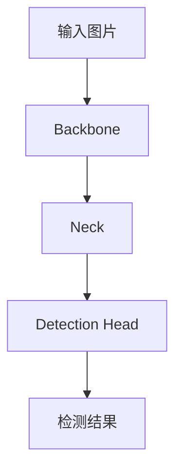

# 技术知识库文章 Skill

## 一、目标与基本原则

负责知识库文章从创建、编写到更新和检查的完整流程。

文章面向两个场景：

1. 用户通过网站阅读，要求结构清晰、内容完整、排版易读。
2. AI 工具通过 GitHub 读取文章，要求 Markdown 结构规范、信息明确、便于检索和理解。

遵循以下原则：

- Markdown 是文章的唯一内容源。
- 使用中文描述，专业术语、模型名称、模块名称和 API 保留英文。
- 以准确性和完整性为优先，不为了简洁而省略重要技术内容。
- 先整体、后局部，先介绍基本概念，再逐步深入原理和实现。
- 统一术语、变量、参数和章节编号。
- 不确定的内容明确标注，不编造事实、实验结果或来源。

## 二、任务执行流程

首先判断任务属于新建文章还是修改文章。

### 2.1 新建文章

1. 阅读 `website/articles/index.md`，了解现有文章，避免重复创建。
2. 如涉及已有主题，检索相关文章，确定新文章与已有内容的区别。
3. 根据主题确定文章结构，不机械套用固定章节。
4. 收集必要的论文、官方文档、代码仓库和技术资料。
5. 按照本 Skill 的规范编写 Markdown。
6. 将文章及其图片资源放入独立目录。
7. 更新文章总览和 VitePress 侧边栏。
8. 检查内容、公式、代码、图表和链接。
9. 执行网站构建，确认文章可以正常发布。


### 2.1.1 新文章的资料研究与源码核对

新建技术文章时，不能只依据单篇论文或 README 进行转述。按主题选择并交叉核对以下资料：

1. **论文**：确认作者、发布时间、研究动机、方法贡献、实验设置和论文原始结果。论文是理解研究主张的主要来源。
2. **官方 GitHub 仓库**：检查 README、目录结构、模型配置、关键模块源码、训练脚本、数据增强、损失函数和部署脚本。不要只看 README；至少追踪一条完整的前向数据流。
3. **Hugging Face**：检查作者官方组织中的模型卡、权重文件、配置文件、模型规格和加载方式；区分作者官方权重与社区转换、复现或二次发布的模型。
4. **官方文档和项目页面**：确认当前支持的 API、依赖版本、导出方式和部署限制。
5. **其他网络资料**：用于补充背景、社区使用经验和已知问题。优先选择可验证的一手资料；社区观点应标明来源属性。

研究过程中至少记录论文、官方仓库、相关配置/源码文件和 Hugging Face 模型页面，便于正文引用和后续维护。

### 2.1.2 论文、源码与模型权重之间的差异处理

论文、GitHub 主分支和 Hugging Face 模型配置可能不是同一时间的版本。发现差异时：

- 不要静默选择其中一个，也不要把不同版本的配置拼在一起。
- 论文中的方法和实验结果按论文原文描述，并标明论文口径。
- 当前训练参数、命令和实现细节以官方仓库当前配置及源码为准。
- 权重加载方式、文件格式和模型参数以对应 Hugging Face 模型页面及其配置为准。
- 如果官方仓库发布更新修正了论文早期统计值或配置，说明修正日期、原因和采用的数据口径。
- 如果源码行为与论文文字描述存在差异，分别说明论文表述和实际代码行为；不能仅凭模块名称推断实现。
- 如果论文没有公开某项细节，例如蒸馏数据、损失或训练流程，不要自行补齐，应明确说明资料未提供。
- 不同模型规格、Backbone 路线和 checkpoint 必须分别核对，不能假设它们共享同一配置。

### 2.1.3 源码阅读与技术文章组织

围绕关键技术问题选择源码，不必逐文件介绍整个仓库：

1. 从模型注册或配置入口确认模型由哪些模块组成。
2. 找到 Backbone、Adapter、Encoder、Decoder、Criterion、PostProcessor 的实现。
3. 沿 forward 路径追踪输入、输出、张量维度和数据流。
4. 对照模型 YAML 配置确认模块参数、尺度、层数、通道数和训练策略。
5. 对训练任务，检查 Matcher、Loss、数据增强和训练脚本。
6. 对部署任务，检查导出脚本的输入、输出、动态维度、后处理和版本限制。

文章应先给出整体结构图，再拆解重要模块；复杂模块分别绘制子图，并结合公式和张量维度解释。

### 2.1.4 实验数据与指标审查

整理模型对比表时：

- 记录数据集、输入分辨率、AP 指标、参数量、FLOPs 和延迟的来源。
- 区分论文表格与官方仓库后续更新的数据。
- 如果官方仓库修改了 FLOPs 统计逻辑，确认是否遗漏 Attention 等计算，并采用当前修正口径；同时保留必要的历史差异说明。
- 延迟必须注明硬件、精度、推理框架和测试条件；缺少这些信息时不要将延迟当作严格公平的横向比较。
- 不把不同输入分辨率、不同数据集或不同训练 Epoch 的指标直接解释为模型结构带来的单一收益。
- 参数量、GFLOPs 和实际推理速度是不同指标，不能互相替代。

### 2.1.5 发布前的新增文章审查

新增文章准备发布前，除常规格式检查外，还应检查：

- 文章中的每项关键技术结论是否能追溯到论文、源码、配置或模型卡。
- Mermaid 图是否忠实表达真实模块连接和数据流，不能把概念图误写成源码中的精确结构。
- 公式是否与源码计算和论文定义一致；推导或简化表达需要说明前提。
- 训练命令、配置路径、权重名称和模型规格是否来自当前官方仓库。
- Hugging Face 的官方权重与社区模型是否区分清楚。
- 模型表格的 AP、参数量、FLOPs、输入尺寸和延迟是否使用一致口径。
- 文章是否明确写出已知限制、版本差异和论文未公开的信息。

### 2.2 修改文章

1. 阅读目标文章，理解现有章节结构和上下文。
2. 明确用户要求修改的范围。
3. 保留原有技术含义、推导过程、公式、代码、表格、图示和参考资料。
4. 只修改必要部分，不擅自重写或删减其他内容。
5. 新增内容时保持术语、变量和章节编号一致。
6. 检查修改前后内容是否存在冲突、重复或逻辑断层。
7. 检查 Markdown 格式并执行网站构建。

如果用户要求重新整理或重写全文，可以调整文章结构，但仍须保留原文的全部核心技术内容。

## 三、文章结构与内容组织

文章结构根据主题灵活调整，通常遵循以下顺序：

1. 背景与核心思想
2. 基本概念与整体架构
3. 关键模块及其工作原理
4. 数据流与计算过程
5. 关键公式与参数推导
6. 训练、推理或实际运行流程
7. 实验结果与技术分析
8. 优缺点、局限性与适用场景
9. 总结
10. 参考资料

不要求每篇文章都包含以上所有章节。

### 3.1 技术解释要求

- 首先介绍整体架构，再逐步解释内部模块。
- 说明各模块的输入、输出、作用及相互关系。
- 涉及 Tensor 时，明确标注维度变化。
- 涉及参数计算时，给出计算公式和中间步骤。
- 涉及算法时，解释核心思想、执行过程和适用条件。
- 涉及模型训练时，区分数据准备、前向传播、损失计算、反向传播和参数更新。
- 涉及部署时，说明模型导出、推理接口和数据格式。
- 适当使用具体数字和小规模示例帮助理解。
- 代码示例应配合文字解释，不能只罗列代码。

### 3.2 内容来源与准确性

区分以下三类信息：

| 类型 | 说明 |
|---|---|
| 论文内容 | 作者明确提出的架构、方法、实验和结论 |
| 源码实现 | 官方代码或实际实现中的模块、参数和执行逻辑 |
| 分析推断 | 根据原理或实现得出的解释和推论 |

注意：

- 论文描述与源码实现可能存在差异，不要混为一谈。
- 引用实验结果时注明数据集、指标和实验条件。
- 不要将推测写成论文明确结论。
- 优先使用官方论文、官方文档和官方代码仓库。
- 保留重要参考链接，尽可能指向具体论文、文件或代码位置。
- 无法验证的内容明确说明，不要自行补全缺失信息。

## 四、Markdown 格式规范

### 4.1 文件格式

每篇文章采用独立目录：

```text
website/
└── articles/
    ├── article-name/
    │   ├── index.md
    │   └── assets/
    │       ├── image-01.png
    │       └── image-02.svg
    └── another-article/
        └── index.md
```

要求：

- 所有文章直接放在 `website/articles/` 下。
- 正文统一命名为 `index.md`。
- 图片和附件放在对应文章的 `assets/` 目录。
- 没有图片资源时不必创建空目录。
- 图片优先使用相对路径。
- 不要将无关资源放在文章目录中。

### 4.2 文章元数据

文章开头使用 YAML Frontmatter：

```yaml
---
title: 文章标题
description: 对文章内容的简要介绍
---
```

标题和简介应准确反映文章内容。

### 4.3 标题与排版

- 使用标准 Markdown 标题语法。
- 标题层级保持连续，不随意跳级。
- 合理使用列表、引用、表格和分隔线。
- 章节编号保持连续。
- 复杂内容适当拆分小节。
- 避免过长段落。
- 不要为了排版而过度使用粗体。
- 表格只用于适合横向比较或结构化展示的内容。

## 五、数学公式规范

所有数学公式必须兼容常见 Markdown 数学公式渲染器。

统一使用：

- 行内公式：`$公式$`
- 独立公式：`$$公式$$`

### 5.1 行内公式

示例：

```markdown
输入张量为 $X\in\mathbb{R}^{B\times T\times H}$。
```

要求：

- 公式与 `$` 分隔符之间不留空格。
- 不要混用其他公式分隔符。
- 变量和符号保持一致。
- 普通文字使用 `\text{}`。

### 5.2 独立公式

示例：

```latex
$$
P=3\times H\times D
$$
```

要求：

- 独立公式单独成行。
- 多行公式使用标准 LaTeX 环境。
- 矩阵、分数、求和、上下标使用标准 LaTeX 语法。
- 公式中的反斜杠、花括号和上下标必须正确。
- 不要将数学公式放进普通代码块。
- 不要将公式转换成图片。
- 不要使用 Word 公式或 Unicode 数学符号替代 LaTeX。

### 5.3 多行公式

示例：

```latex
$$
\begin{aligned}
Q &= XW_Q \\
K &= XW_K \\
V &= XW_V
\end{aligned}
$$
```

复杂公式可以使用：

- `aligned`
- `cases`
- `bmatrix`
- `frac`
- `sum`
- `prod`

### 5.4 公式解释

重要公式必须解释：

1. 公式表达的含义。
2. 每个变量代表什么。
3. 输入和输出的维度。
4. 公式成立的条件。
5. 必要时给出具体数值计算示例。

不要只给公式而没有上下文。

## 六、图片与流程图规范

优先使用 Mermaid 保留图表源码，避免将可编辑的结构图转换成图片。

使用优先级：

1. Mermaid
2. ASCII 流程图
3. Markdown 图片

### 6.1 Mermaid

根据场景选择：

| 图类型 | 推荐 Mermaid 类型 |
|---|---|
| 网络结构图 | `flowchart TD` |
| 模块关系图 | `flowchart LR` |
| 数据流图 | `flowchart TD` |
| 训练流程 | `flowchart TD` |
| 推理流程 | `flowchart TD` |
| 时序交互 | `sequenceDiagram` |
| 状态变化 | `stateDiagram-v2` |

示例：



### 6.2 网络结构图

网络结构图应尽可能包含：

- 输入和输出。
- 主要模块。
- 模块之间的数据流向。
- 关键操作。
- 重要 Tensor Shape。
- 必要的参数信息。

例如 Transformer、MLA、MoE 等复杂架构：

1. 先绘制整体结构图。
2. 再分别绘制关键子模块。
3. 使用公式解释具体计算。
4. 对重要的维度变化进行标注。

不要将所有细节堆在一张图中。

### 6.3 Mermaid 语法

- 使用标准 Mermaid 语法。
- 保留为 `mermaid` 代码块，不转换成 SVG 或 PNG。
- 节点名称和连线表达清晰。
- 复杂节点文字使用引号包裹。
- 特殊字符注意语法兼容性。
- 不使用非标准扩展语法。
- 发布前检查图表是否可以正常渲染。

### 6.4 Markdown 图片

仅在确实需要外部图片或真实视觉素材时使用。

要求：

- 优先将图片保存到文章的 `assets/` 目录。
- 使用相对路径引用。
- 为图片添加有意义的替代文本。
- 不使用装饰性图片填充文章。
- 外部图片应尽可能确认来源和可访问性。
- 不依赖临时链接或容易失效的图片地址。

## 七、代码规范

Python、C++、Shell、YAML 等代码必须使用对应语言的 Markdown 代码块。

示例：

```python
import torch

x = torch.randn(2, 4, 4096)
print(x.shape)
```

要求：

- 保留代码缩进、注释和换行。
- 代码应尽可能可以直接复制运行。
- 不随意省略关键实现。
- 说明必要的依赖和运行条件。
- 如果只是教学示例，明确标注与实际工程实现的区别。
- 如果代码来自第三方项目，保留来源链接。
- 不要把普通文本误标为代码。

## 八、参考资料

文章末尾统一设置参考资料章节。

示例：

```markdown
## 参考资料

1. [论文名称](https://example.com/paper)
2. [官方代码仓库](https://github.com/example/project)
3. [官方技术文档](https://example.com/docs)
```

要求：

- 优先保留一手资料。
- 论文和代码仓库尽量分别列出。
- 重要结论应能追溯到对应来源。
- 不要生成不存在的链接。
- 不要将搜索摘要当成原始资料。
- 对社区观点和未经验证的信息明确标注。

## 九、发布前检查

完成文章后，必须进行以下检查。

### 9.1 内容检查

- [ ] 内容是否完整，是否遗漏重要推导和结论。
- [ ] 技术描述是否准确。
- [ ] 论文、源码和推断是否明确区分。
- [ ] 术语、变量和参数是否统一。
- [ ] 是否存在重复章节或逻辑冲突。
- [ ] 参考资料是否真实有效。

### 9.2 Markdown 检查

- [ ] Frontmatter 格式正确。
- [ ] 标题层级连续。
- [ ] 代码围栏成对。
- [ ] 表格格式正确。
- [ ] 站内链接有效。
- [ ] 图片路径正确。

### 9.3 公式检查

- [ ] 行内公式使用 `$...$`。
- [ ] 独立公式使用 `$$...$$`。
- [ ] 公式分隔符与内容之间没有多余空格。
- [ ] 多行公式环境完整。
- [ ] 公式变量和上下标正确。
- [ ] 至少检查行内公式、多行公式和长公式的网页显示效果。

### 9.4 图表检查

- [ ] Mermaid 代码块格式正确。
- [ ] 节点和连线没有语法错误。
- [ ] 图表表达与正文一致。
- [ ] 关键维度和数据流标注正确。
- [ ] 图表在网站中可以正常渲染。

### 9.5 网站构建

在项目根目录执行：

```bash
npm run build
```

构建成功后，进一步检查：

- 文章页面能否正常打开。
- 公式是否正常渲染。
- Mermaid 是否正常显示。
- 代码高亮是否正常。
- 目录导航是否正确。
- 窄屏下表格、公式和代码块是否可读。

如果无法执行构建或无法实际检查网页，必须明确说明，不得声称检查通过。

## 十、文章发布与维护

新建或删除文章时：

1. 更新 `website/articles/index.md`。
2. 更新 `website/.vitepress/config.mts` 中的侧边栏。
3. 检查文章之间的站内链接。
4. 确认文章目录和资源路径正确。
5. 执行网站构建。

修改已有文章时：

- 尽量保持文章 URL 不变。
- 不随意修改文章目录名称。
- 不删除其他文章的资源。
- 不将构建产物提交为文章源文件。
- 保持 Markdown 为唯一知识内容来源。

## 十一、最终交付

完成任务后，简要说明：

1. 新增或修改了哪些文章。
2. 修改了哪些章节和内容。
3. 是否新增图片、Mermaid 图或代码。
4. 是否更新文章总览和导航。
5. 构建及检查结果。
6. 尚未解决的问题。

所有结果必须以实际执行情况为准，不得虚报。
