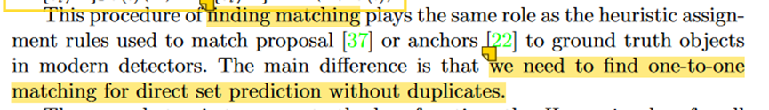
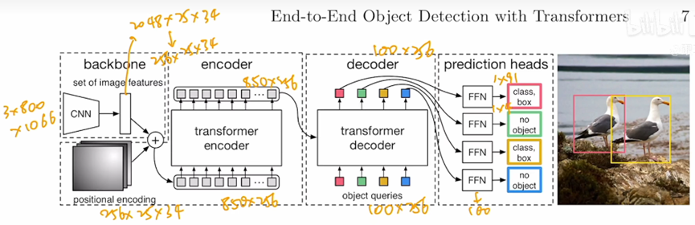
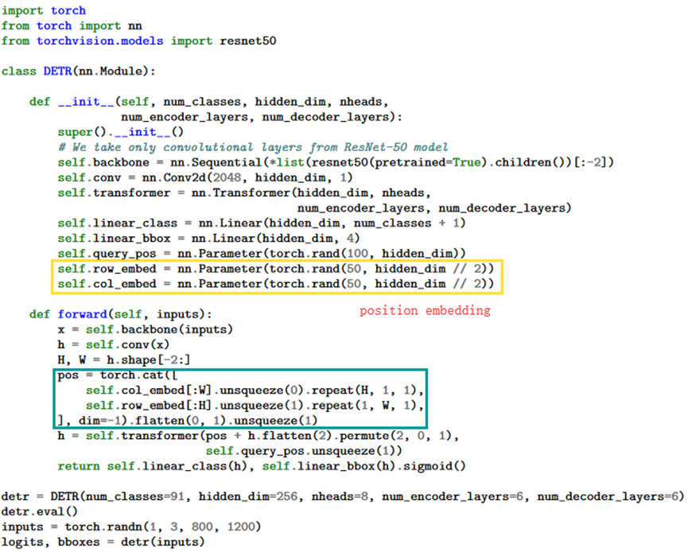
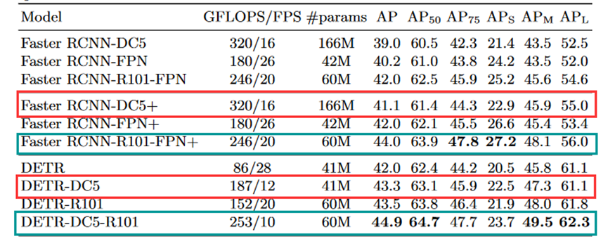
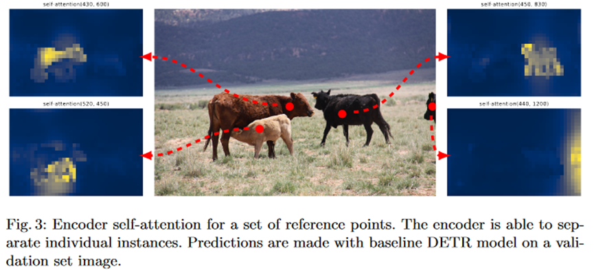
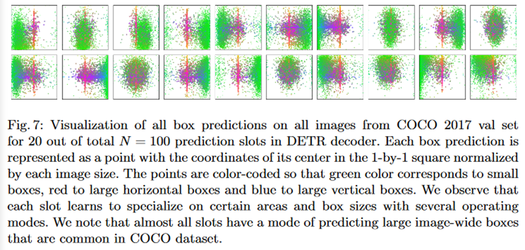

# DETR：End to End Object Detection with Transformers

**原文链接：** https://www.bilibili.com/opus/707521232851959812

**DETR 论文：** https://arxiv.org/pdf/2005.12872.pdf

pytorchang

2022年09月19日 15:03

2020年，Facebook使用Transformer进行目标检测。全新的架构，目标检测里程碑式工作。

之前目标检测中不论proposal based的方法还是anchor based 的方法，都需要nms（非极大值抑制）等候处理的方法筛选bbox（bounding box）。由于nms的操作，调参比较复杂，而且模型部署起来也比较困难。因此，一个端到端的目标检测模型是一直以来所追求的。DERT很好的解决了上述问题，不需要proposal和anchors，利用Transformer全局建模的能力，把目标检测看成集合预测的问题。而且由于全局建模的能力，DETR不会输出太多冗余的边界框，输出直接对应最后bbox，不需要nms进行后处理，大大简化了模型。

摘要：将目标检测看作集合预测任务，不需要nms处理和生成anchor。DETR提出两个东西，一是目标函数，通过二分图匹配的方式，使得模型输出独一无二的预测，就是说没有那么多冗余的框了。二是，使用Transformer的编码器解码器架构。具体还有两个小细节，一个是解码器这边还有另外一个输入，learned object query，类似于anchors，DETR可以将learned object query和全局图像信息结合起来，通过不停的做注意力操作，从而使得模型直接输出最后的预测框。二是并行的方式，与2017Transformer用在NLP领域使用掩码解码器（自回归方式：一个单词一个单词翻译）不同，这里视觉任务中，图像中目标没有依赖关系。另一方面也是希望越快越好。DETR最主要的优点就是非常简单，性能也不错，在COCO数据集可以和Faster RCNN基线网络打平。另外，DETR可以非常简单的拓展到其他任务上。

## 1.引言

集合预测问题，现在都是用间接的方式。如proposal的方式，Faster R-CNN、Mask R-CNN、Cascade R-CNN。anchors方式，YOLO、Focal loss。还有no anchor based 的方法，用物体中心点（window centers）Center Net、FCOS。会生成冗余 框，就会使用nms。

DETR训练过程：

第一步用CNN抽特征。

第二步用Transformer编码器去学全局特征，帮助后边做检测。

第三步，结合learned object query用Transformer解码器生成很多预测框。

第四步，匹配预测框与GT框，在匹配上的框里做目标检测的loss。

DETR推理过程：

第一步用CNN抽特征。

第二步用Transformer编码器去学全局特征，帮助后边做检测。

第三步，结合learned object query用Transformer解码器生成很多预测框。

第四步，置信度大于0.7的作为前景物体保留，其余作为背景。

性能方面，在COCO数据集上，能和Faster RCNN打成平手，不论是AP还是模型规模和速度上。DETR对大物体检测效果比较好，不受限于生成anchor 的大小。但DETR在小物体上效果就差一点，但是作者很乐观，接下来会有跟进工作解决小物体检测问题。另一方面是DETR训练比较慢，作者训练了500个epoch，一般只需十几个epoch。

## 2.相关工作

### 2.1集合预测

### 2.2Transformer Decoder 并行

### 2.3目标检测研究现状

现在研究都是基于初始预测进行检测，two stage 的方法基于proposal，signal stage的方法基于anchors（物体中心点）。

proposal和 anchors的联系：当anchor生成以后就要生成最终的Proposal了。首先对anchor有两部分的操作：分类和边框回归。分类通过softmax进行二分类，将anchor分为前景和背景，分别对应positive和negative。边框回归获取anchor针对ground true的偏移。得到这两个信息后开始选取符合条件的anchor作为Proposal。

第一步：先将前景的anchor按照softmax得到的score进行排序，然后按设定值取前N个positive anchor；第二步：利用im_info中保存的信息，将选出的anchor由M×N的尺度还原回P×Q的尺度，刨除超出边界的anchor；第三步：执行NMS(nonmaximum suppression,非极大值抑制)；第四步：将NMS的结果再次按照softmax的score进行排序，取N个anchor作为最终的Proposal；

## 3.DETR方法部分

### 3.1目标检测集合预测的目标函数

匈牙利算法解决二分图匹配问题。Scipy中有linear-sum-assignment函数，输出为cost matrix，输出为最优的方案。           

目标检测的损失由两部分组成，一是分类类别对不对，二是目标检测框回归参数。

这里找最优匹配的方式和原来利用先验知识去把预测和proposal和anchors匹配的方式一样，只不过这里的约束更强，一定要得到一个一对一的匹配关系，后续就不需要nms处理。

一旦得到了最佳匹配，即知道生成的100个框中哪个与gt是最优匹配的框，就可以进一步与GT框计算损失函数，然后做梯度回传。

作者在这里发现第一部分分类loss去掉log对数，可以使得前后两个损失在大致的取值空间。第二部分边界框回归损失，不仅使用了L1-loss（与边界框有关，大框大loss），还使用了generalize iou loss。

 

### 3.2DETR模型架构

第一步，输入3×800×1066，经过CNN得到2048×25×34，然后经过1×1的卷积降维得到256×25×34的特征图，加入位置编码后拉长得到850×256（序列长度850，嵌入维度256）。第二步进入Transformer编码器得到850×256的输出（可以理解为做了全局信息的编码）。第三步Transformer的输入为可学习的object queries100×256（100个框256维度）。输出维度不变100×256。第四步通过FFN也就是全连接层，每个框得到6个输出分别对应前景背景概率，框的边界信息（对角线两个坐标。）然后使用匈牙利算法计算最匹配的框，然后根据GT计算梯度，反向回传更新模型。

## 4.实验部分

### 4.1性能对比

gflops代表模型大小，FPS代表推理速度。虽然DETR的GFLOPS和参数量相对于Faster RCNN较少，但是推理速度还是稍微慢一点。对于小物体，Faster -RCNN比DETR要高4个点左右，但是对于大物体，DRTE要比Faster-RCNN高出6个点左右。作者认为DETR没有anchors尺寸的限制，并且使用的Transformer具有全局建模能力，对大物体比较友好。

### 4.2 可视化：Encoder Self-Attention（论文 Fig.3）

这张图展示的是 DETR Transformer Encoder 最后一层的 Self-Attention。论文作者在图像中的若干物体上选取空间参考点（图中红点），分别观察这些点对应的注意力分布。图中标注的 \`self-attention(x, y)\` 表示被选取的参考位置。

这里的可视化不是计算参考点与其他位置的特征余弦相似度，而是提取该位置作为 Query 时，对图像所有空间 Token 的注意力权重。

**具体计算过程：**

1. CNN Backbone 输出特征图，经过 1×1 卷积调整通道数，并将空间维度展平为 Token 序列。假设特征图为 \(H_f\times W_f\)，那么共有 \(L=H_fW_f\) 个图像 Token。
2. 选取一个空间位置 \(i\)，取它在当前 Encoder 层中的特征作为 Query；图像中的全部 Token 分别生成 Key 和 Value。
3. 对每个 Attention Head，计算该 Query 与所有 Key 的点积，再经过 Softmax，得到它对所有空间位置的注意力权重。

对于第 \(h\) 个注意力头：

\[
A_{i,j}^{(h)}
=
\operatorname{Softmax}_{j}
\left(
\frac{(q_i^{(h)})^\top k_j^{(h)}}{\sqrt{d_h}}
\right)
\]

其中：

- \(i\)：被选中的参考位置，也就是当前 Query 所在的 Token。
- \(j\)：图像中的任意一个空间 Token。
- \(q_i^{(h)}\)：参考位置在第 \(h\) 个 Head 中的 Query。
- \(k_j^{(h)}\)：位置 \(j\) 在第 \(h\) 个 Head 中的 Key。
- \(A_{i,j}^{(h)}\)：位置 \(i\) 对位置 \(j\) 的注意力权重。

固定 \(i\)，取它对所有 \(j\) 的权重，就得到一个长度为 \(H_fW_f\) 的向量。再将这个向量还原成 \(H_f\times W_f\) 的二维图，并放大到原图尺寸，就可以叠加到原图上形成注意力热力图。多头注意力中每个 Head 都有自己的权重分布；可视化时可以选择某个 Head 或对多个 Head 的权重进行聚合，论文 Fig.3 的图注没有进一步说明具体采用了哪种聚合方式。

**如何理解图中的热力图？**

例如，参考点位于一头牛身上，图中较亮的区域表示这个位置在当前层更新特征时，对应位置获得了较大的注意力权重。可以看到，注意力主要集中在与该实例相关的区域，而不是平均分布在整张图像上。换一个实例上的参考点，得到的注意力分布也会随之变化。

作者据此认为，Encoder 的全局信息交互已经能够在一定程度上区分不同实例，从而帮助 Decoder 后续提取和定位目标。

需要注意：**注意力热力图不是物体分割 Mask，也不是模型最终认定的物体轮廓。** 它表示的是特定 Query 在这一层从哪些空间位置聚合信息的权重分布。高权重意味着该位置对当前 Token 的特征更新有较大的注意力权重，但不能简单理解为“该位置一定属于同一个物体”。

#### 与 DINOv3 的 Patch 相似度热力图有什么区别？

DINOv3 中常见的一种可视化方法，是选取一个 Patch 的输出特征，与其他 Patch 的输出特征计算余弦相似度：

\[
S_{i,j}
=
\frac{f_i^\top f_j}
{\|f_i\|\|f_j\|}
\]

这里的 \(f_i\)、\(f_j\) 是网络输出的 Patch 特征。相似度越高，表示两个 Patch 的特征方向越接近。

两者虽然都能得到一张空间热力图，但含义不同：

| 比较 | DETR Attention | DINOv3 Patch Similarity |
|---|---|---|
| 计算对象 | 学习投影后的 Query 与 Key | 两个 Patch 的输出特征 |
| 计算方式 | 点积、缩放、Softmax | 通常使用余弦相似度 |
| 数值含义 | 当前 Query 从各位置聚合信息的权重 | 两个位置的特征相似程度 |
| 是否归一化为权重分布 | 对每个 Query 的空间位置做 Softmax | 通常不做 Softmax |
| 主要用途 | 分析模型的信息交互 | 分析特征空间中的语义相似性 |

因此，**Attention 高不等于两个位置的特征本身相似；特征相似度高也不代表模型在 Attention 中一定会给它们较高权重。** Attention 使用经过学习的 Q/K 投影，表达的是任务驱动的信息聚合关系；余弦相似度则直接比较特征向量本身。

不同深度的 Transformer 层对模型性能的影响。模型越深效果越好，并且没有明显的饱和的倾向。

### 4.3 Transformer 解码器：Decoder Cross-Attention（论文 Fig.6）

Fig.6 展示的是 Decoder 对每个预测目标的注意力分布。与 Fig.3 的 Encoder Self-Attention 不同，这里主要观察的是 Decoder 中 Object Query 对图像特征的 Cross-Attention。

**它的计算过程可以这样理解：**

- Query：来自 Decoder 中对应 Object Query 的当前特征表示。
- Key：来自 Encoder 输出的图像特征（Memory）。
- Value：同样来自 Encoder 输出的图像特征。

对于第 \(i\) 个 Object Query，它对图像位置 \(j\) 的注意力权重可以写成：

\[
A_{i,j}^{(h)}
=
\operatorname{Softmax}_{j}
\left(
\frac{(W_Qz_i)^\top(W_Km_j)}{\sqrt{d_h}}
\right)
\]

其中 \(z_i\) 是第 \(i\) 个 Query 的特征，\(m_j\) 是 Encoder 在空间位置 \(j\) 的输出特征。将一个 Query 对所有图像位置的权重还原成二维图，就得到该预测目标的空间注意力分布。

论文将不同预测目标的注意力区域用不同颜色叠加显示。可以看到：

- 大象的注意力主要集中在头部、腿部等位置。
- 小象也有自己相对独立的注意力区域。
- 斑马的注意力分布能够覆盖各自身体的部分区域，即使多个斑马相互靠近或遮挡，也能形成不同的关注模式。

作者观察到，Decoder 的注意力通常比较局部，尤其集中在物体的头部、腿部等边缘或具有辨识度的部位。作者提出一种解释：Encoder 已经通过全局信息交互在一定程度上区分了不同实例，因此 Decoder 不一定需要重新关注整个物体，只需要从一些关键局部区域获取信息，就可能完成类别判断和边界框定位。

这里要区分两件事：

1. Decoder 的 Self-Attention：不同 Object Query 之间进行信息交互，有助于建模预测目标之间的关系，并抑制重复预测。
2. Decoder 的 Cross-Attention：Object Query 从 Encoder 的图像特征中获取信息。Fig.6 展示的是这种 Query 到图像空间位置的注意力分布。

Fig.6 的热力图不是最终的 Bounding Box，也不是分割 Mask。它只是模型内部注意力权重的可视化。作者关于“关注物体极值部位有助于提取类别和边界”的解释属于对实验现象的分析，并不意味着模型只使用这些像素。

### 4.4 Object Query 可视化：Decoder Output Slot Analysis（论文 Fig.7）

这张图与 Fig.3、Fig.6 不同，它不是注意力热力图，而是对 DETR 的预测框进行统计可视化。

DETR Decoder 默认有 \(N=100\) 个 Object Query。作者从中选取 20 个 Query Slot，并将 COCO 2017 验证集中的所有图片都输入模型，统计每个 Slot 在所有图片上的预测框。

**图中每个元素的含义：**

- 每个小正方形：一个固定的 Query Slot。
- 每个散点：这个 Query Slot 在某一张验证集图片上的一个预测框。
- 散点的横纵坐标：预测框中心点在图像中的归一化坐标，范围为 0～1。
- 散点颜色：预测框的大小和形状类别。

颜色对应关系需要特别注意：

| 颜色 | 含义 |
|---|---|
| 绿色 | 小尺寸 Bounding Box |
| 红色 | 大尺寸、横向 Bounding Box |
| 蓝色 | 大尺寸、纵向 Bounding Box |

例如，固定观察第一个 Query Slot：作者并不是只观察某一张图片，而是把它在 COCO 验证集所有图片上的预测框中心点都画在同一个 1×1 正方形中。这样就能观察这个 Slot 在不同图片上的预测位置和框尺寸分布。

**论文观察到了什么？**

1. 不同 Query Slot 的预测分布并不完全相同，有些 Slot 更倾向于预测特定区域或尺寸的目标。
2. 一个 Slot 并不只有一种固定模式，而是可能存在多个工作模式（Operating Modes），关注不同的位置和目标尺寸。
3. 几乎所有 Slot 都存在一种预测覆盖较大图像范围的模式，在图中表现为中间区域较明显的红色散点。作者推测这与 COCO 数据集中常见的大范围目标分布有关。

这里不要将 Object Query 理解为传统检测器中的 Anchor，也不要认为每个 Query 被固定分配给图像中的某个区域。

**Query Slot 的空间偏好是训练后统计出来的倾向，不是人为规定的固定职责。** 同一个 Query 在不同图片中仍然可以预测不同位置、不同类别和不同尺寸的目标。100 个 Query 是并行工作的，最终由模型输出类别和边界框，并通过集合预测机制避免重复预测；并不是 100 个 Query 按顺序扫描图像的不同区域。

### 4.5 全景分割扩展：Panoptic Segmentation Head（论文 Fig.8）

Fig.8 展示了 DETR 如何在原有检测结构上增加 Mask Head，将目标检测扩展到全景分割（Panoptic Segmentation）。

先理解全景分割要解决什么问题。它需要对图像中的每一个像素赋予类别，同时区分可数实例和不可数背景区域：

- **Things（可数物体）**：例如人、汽车、大象。通常需要区分同一类别中的不同实例。
- **Stuff（背景/区域类）**：例如天空、道路、草地。通常关注区域的语义类别，而不是把每一块区域都当作独立物体实例。

普通 DETR 输出类别和 Bounding Box，而全景分割还需要为每个预测目标生成像素级 Mask。因此，作者在 Decoder 输出之后增加了一个 Mask Head。

#### 4.5.1 输入：Object Query 和 Encoder 图像特征

Fig.8 左侧有两个关键输入：

1. **Box embeddings（\(d\times N\)）**：Decoder 输出的 N 个对象特征向量，每个 Query 对应一个 d 维特征。这里的 Box embeddings 不是已经回归出的四个边界框坐标，而是用于生成检测结果的对象特征表示。
2. **Encoded image（\(d\times H/32\times W/32\)）**：低分辨率的图像空间特征，保留了图像的空间布局信息。

为什么同时需要这两种信息？

- Object Query 提供“当前要预测哪个实例/区域”的对象级信息。
- Encoder 图像特征提供“图像中各个位置有什么信息”的空间信息。

Mask Head 需要把二者结合起来，才能为每个 Query 生成不同的 Mask。

#### 4.5.2 Multi-Head Attention：先生成每个 Query 的注意力图

作者增加了一个专门用于 Mask Head 的 Multi-Head Attention 模块。

它与 Fig.6 的 Decoder Cross-Attention 在计算思想上相似，都是让对象特征与图像空间特征进行 Query-Key 匹配。但是，**Fig.8 中使用的是 Mask Head 自己的注意力模块，并不是直接把 Fig.6 已经可视化的注意力图拿过来使用。**

对于第 \(i\) 个 Object Query 和第 \(m\) 个 Attention Head：

\[
q_i^{(m)}=W_Q^{(m)}z_i
\]

\[
k_{u,v}^{(m)}=W_K^{(m)}M_{u,v}
\]

\[
A_{i,m}(u,v)
=
\operatorname{Softmax}_{u,v}
\left(
\frac{(q_i^{(m)})^\top k_{u,v}^{(m)}}{\sqrt{d_h}}
\right)
\]

其中：

- \(i\)：第 i 个 Object Query。
- \(m\)：第 m 个 Attention Head。
- \(u,v\)：图像特征图上的空间位置。
- \(A_{i,m}\)：当前 Query 在第 m 个 Head 上得到的一张空间注意力图。

假设有 N 个 Query、M 个 Attention Heads，那么输出形状为：

\[
A\in
\mathbb R^{N\times M\times H/32\times W/32}
\]

这意味着：**每个 Object Query 都会得到 M 张低分辨率注意力图。**

不同 Head 可以学习不同的空间关注模式。它们不是最终的 Mask，而是后续 Mask Head 的输入信息。

一个容易忽略的实现细节：DETR 官方代码中的 MHAttentionMap 只计算并返回 Softmax 后的注意力权重，没有像标准 Attention 那样再与 Value 相乘并进行加权求和。它的目的就是生成空间注意力图，而不是更新 Transformer 特征。

#### 4.5.3 FPN-style CNN：融合多尺度特征，生成高分辨率 Mask

注意力图的空间分辨率只有原图的 1/32，直接作为分割结果会非常粗糙，无法准确描述物体边缘。

因此作者使用一个 FPN-style CNN 结构逐步恢复空间分辨率。

主要过程：

1. 将每个 Query 对应的多头注意力图与低分辨率图像特征按通道拼接。
2. 通过卷积、Group Normalization 和 ReLU 进行特征处理。
3. 逐级上采样，并与 ResNet Backbone 的多尺度特征融合。
4. 融合的特征来自 Res5、Res4、Res3、Res2，空间分辨率逐渐提高。
5. 经过最后的卷积层，得到每个 Query 对应的 Mask Logits。

最终输出形状为：

\[
Masks\in
\mathbb R^{N\times H/4\times W/4}
\]

也就是说，每个 Query 都有一张分辨率为原图 1/4 的 Mask 预测图。后处理阶段再将其上采样到需要的图像尺寸。

这里的多尺度特征融合与普通 FPN 的思路类似：低分辨率特征包含较强的语义信息，高分辨率特征保留更丰富的边缘和空间细节。两者融合后，可以得到更精细的分割结果。

#### 4.5.4 Pixel-wise Argmax：将所有 Mask 合并

现在有 N 张 Mask，每张 Mask 对应一个 Query。

假设某个像素位置 \((x,y)\) 在不同 Mask 上的预测分数分别为：

\[
M_1(x,y),M_2(x,y),\ldots,M_N(x,y)
\]

最终将该像素分配给预测分数最高的 Mask：

\[
Label(x,y)
=
\arg\max_{i\in\{1,\ldots,N\}}M_i(x,y)
\]

这样，每个像素只会分配给一个预测区域，不同 Mask 之间不会产生重叠。

同时，模型还会使用对应 Query 的类别预测，为最终区域赋予类别标签。对于相同类别的 Stuff 区域，实际后处理中还可以将它们合并。

因此，Fig.8 的整体流程可以概括为：

\[
\boxed{
\text{Object Query}
+
\text{Encoder Feature}
\rightarrow
\text{Multi-Head Attention Maps}
\rightarrow
\text{FPN-style CNN}
\rightarrow
\text{Mask Logits}
\rightarrow
\text{Pixel-wise Argmax}
}
\]

#### 4.5.5 Mask Head 如何训练？

论文使用两种训练方式：

- **联合训练**：检测模型和 Mask Head 一起训练。
- **两阶段训练**：先训练 DETR 检测模型，然后冻结已有模型参数，只训练 Mask Head 25 个 Epoch。

两种方式实验效果相近。论文最终报告的是第二种方式，因为整体训练耗时更短。

每张预测 Mask 都会单独计算分割损失，使用：

- Dice / F1 Loss：衡量预测区域与真实区域的重叠程度。
- Focal Loss：缓解前景像素和背景像素之间的不平衡问题。

**这里最重要的理解是：Fig.8 不是简单地把 Decoder 的注意力图当作分割结果，而是将对象级 Query 与图像空间特征结合，先生成多头注意力图，再通过 CNN 多尺度特征融合，最终预测真正的像素级 Mask。**

#### 4.5.6 Fig.6 与 Fig.8 的区别

| 比较 | Fig.6 Decoder Attention | Fig.8 Mask Head Attention |
|---|---|---|
| 主要目的 | 分析检测模型如何关注图像 | 为分割 Mask 提供空间引导 |
| Query 来源 | Decoder Object Query | Decoder 输出的对象特征 |
| Key 来源 | Encoder Memory | Encoder Memory |
| 注意力模块 | Decoder 原有 Cross-Attention | Mask Head 新增的 MHAttentionMap |
| 输出用途 | 可视化模型内部注意力 | 作为 Mask Head 的输入 |
| 后续处理 | 叠加到原图观察 | 与图像特征、多尺度特征融合，生成 Mask |

两者都体现了 Query 与图像空间位置之间的关系，但 Fig.6 主要用于解释检测过程，Fig.8 则将注意力机制作为分割网络的一部分，真正参与 Mask 生成。

**参考资料：**

- [DETR 原论文，第 15 页 Fig.8](https://arxiv.org/pdf/2005.12872#page=15)
- [DETR 官方实现：models/segmentation.py](https://github.com/facebookresearch/detr/blob/main/models/segmentation.py)
- [DETR 官方实现：models/transformer.py](https://github.com/facebookresearch/detr/blob/main/models/transformer.py)

## 5.结论

DETR在COCO数据集上与Faster R-CNN基线模型打成平手，并且在分割任务上取得更好的结果。最主要的优势是简单，可以有很大的潜能应用在别的任务上。作者又强调了一下，DETR在大物体上效果非常好。文章存在的缺点作者也自己指出：推理时间有点长、由于使用了Transformer不好优化、小物体上性能也差一些。后来，Deformable DETR解决了推理时间和小物体检测差的不足。

后续工作：omni-DETR；up-DETR；PnP-DETR；SMAC-DETR；Deformer-DETR；DAB-DETR；SAM-DETR；DN-DETR；OW-DETR；OV-DETR

DETR使用object query代替了原来生成anchors的方式，运用二分图匹配代替了nms这一步，讲很多不可学习的东西变得可以学习了，相当于给了一个更强的约束。

论文地址：https://arxiv.org/pdf/2005.12872.pdf

参考：[DETR 论文精读【论文精读】_哔哩哔哩_bilibili​](https://www.bilibili.com/video/BV1GB4y1X72R?spm_id_from=333.1369.0.0)
