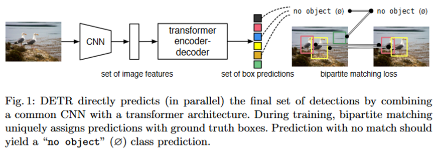
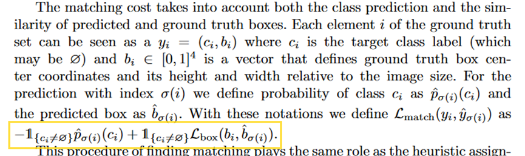
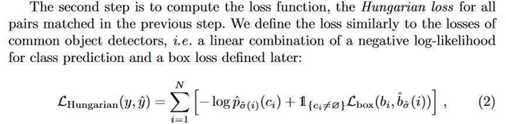
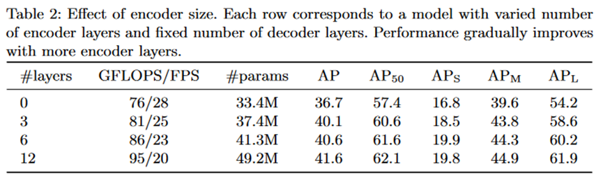
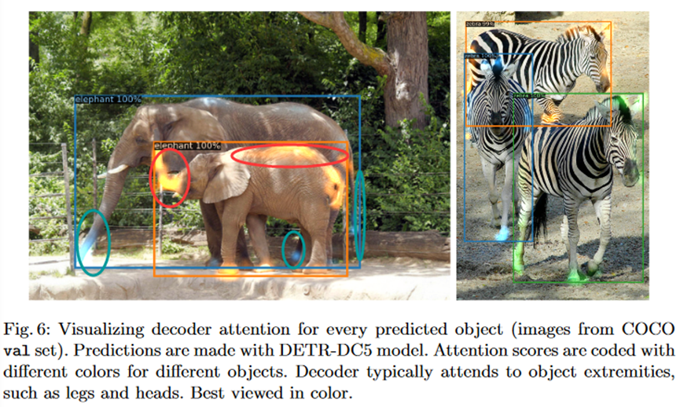
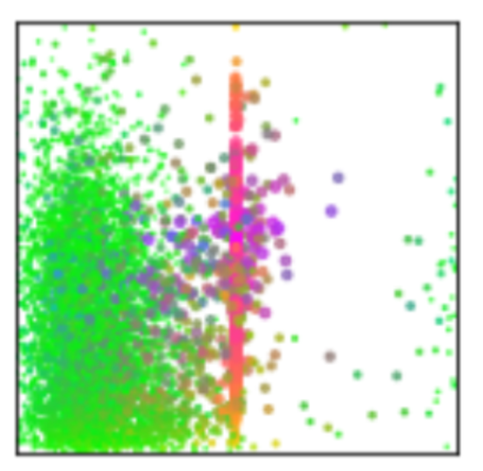

# DETR：End to End Object Detection with Transformers

**原文链接：** https://www.bilibili.com/opus/707521232851959812

**DETR 论文：** https://arxiv.org/pdf/2005.12872.pdf

pytorchang

2022年09月19日 15:03

2020年，Facebook使用Transformer进行目标检测。全新的架构，目标检测里程碑式工作。

之前目标检测中不论proposal based的方法还是anchor based 的方法，都需要nms（非极大值抑制）等候处理的方法筛选bbox（bounding box）。由于nms的操作，调参比较复杂，而且模型部署起来也比较困难。因此，一个端到端的目标检测模型是一直以来所追求的。DERT很好的解决了上述问题，不需要proposal和anchors，利用Transformer全局建模的能力，把目标检测看成集合预测的问题。而且由于全局建模的能力，DETR不会输出太多冗余的边界框，输出直接对应最后bbox，不需要nms进行后处理，大大简化了模型。

摘要：将目标检测看作集合预测任务，不需要nms处理和生成anchor。DETR提出两个东西，一是目标函数，通过二分图匹配的方式，使得模型输出独一无二的预测，就是说没有那么多冗余的框了。二是，使用Transformer的编码器解码器架构。具体还有两个小细节，一个是解码器这边还有另外一个输入，learned object query，类似于anchors，DETR可以将learned object query和全局图像信息结合起来，通过不停的做注意力操作，从而使得模型直接输出最后的预测框。二是并行的方式，与2017Transformer用在NLP领域使用掩码解码器（自回归方式：一个单词一个单词翻译）不同，这里视觉任务中，图像中目标没有依赖关系。另一方面也是希望越快越好。DETR最主要的优点就是非常简单，性能也不错，在COCO数据集可以和Faster RCNN基线网络打平。另外，DETR可以非常简单的拓展到其他任务上。

## 1.引言

集合预测问题，现在都是用间接的方式。如proposal的方式，Faster R-CNN、Mask R-CNN、Cascade R-CNN。anchors方式，YOLO、Focal loss。还有no anchor based 的方法，用物体中心点（window centers）Center Net、FCOS。会生成冗余 框，就会使用nms。

DETR训练过程：

第一步用CNN抽特征。

第二步用Transformer编码器去学全局特征，帮助后边做检测。

第三步，结合learned object query用Transformer解码器生成很多预测框。

第四步，匹配预测框与GT框，在匹配上的框里做目标检测的loss。

DETR推理过程：

第一步用CNN抽特征。

第二步用Transformer编码器去学全局特征，帮助后边做检测。

第三步，结合learned object query用Transformer解码器生成很多预测框。

第四步，置信度大于0.7的作为前景物体保留，其余作为背景。

性能方面，在COCO数据集上，能和Faster RCNN打成平手，不论是AP还是模型规模和速度上。DETR对大物体检测效果比较好，不受限于生成anchor 的大小。但DETR在小物体上效果就差一点，但是作者很乐观，接下来会有跟进工作解决小物体检测问题。另一方面是DETR训练比较慢，作者训练了500个epoch，一般只需十几个epoch。

## 2.相关工作

### 2.1集合预测

### 2.2Transformer Decoder 并行

### 2.3目标检测研究现状

现在研究都是基于初始预测进行检测，two stage 的方法基于proposal，signal stage的方法基于anchors（物体中心点）。

proposal和 anchors的联系：当anchor生成以后就要生成最终的Proposal了。首先对anchor有两部分的操作：分类和边框回归。分类通过softmax进行二分类，将anchor分为前景和背景，分别对应positive和negative。边框回归获取anchor针对ground true的偏移。得到这两个信息后开始选取符合条件的anchor作为Proposal。

第一步：先将前景的anchor按照softmax得到的score进行排序，然后按设定值取前N个positive anchor；第二步：利用im_info中保存的信息，将选出的anchor由M×N的尺度还原回P×Q的尺度，刨除超出边界的anchor；第三步：执行NMS(nonmaximum suppression,非极大值抑制)；第四步：将NMS的结果再次按照softmax的score进行排序，取N个anchor作为最终的Proposal；

## 3.DETR方法部分

### 3.1目标检测集合预测的目标函数

匈牙利算法解决二分图匹配问题。Scipy中有linear-sum-assignment函数，输出为cost matrix，输出为最优的方案。           

目标检测的损失由两部分组成，一是分类类别对不对，二是目标检测框回归参数。

这里找最优匹配的方式和原来利用先验知识去把预测和proposal和anchors匹配的方式一样，只不过这里的约束更强，一定要得到一个一对一的匹配关系，后续就不需要nms处理。

一旦得到了最佳匹配，即知道生成的100个框中哪个与gt是最优匹配的框，就可以进一步与GT框计算损失函数，然后做梯度回传。

作者在这里发现第一部分分类loss去掉log对数，可以使得前后两个损失在大致的取值空间。第二部分边界框回归损失，不仅使用了L1-loss（与边界框有关，大框大loss），还使用了generalize iou loss。

 

### 3.2DETR模型架构

第一步，输入3×800×1066，经过CNN得到2048×25×34，然后经过1×1的卷积降维得到256×25×34的特征图，加入位置编码后拉长得到850×256（序列长度850，嵌入维度256）。第二步进入Transformer编码器得到850×256的输出（可以理解为做了全局信息的编码）。第三步Transformer的输入为可学习的object queries100×256（100个框256维度）。输出维度不变100×256。第四步通过FFN也就是全连接层，每个框得到6个输出分别对应前景背景概率，框的边界信息（对角线两个坐标。）然后使用匈牙利算法计算最匹配的框，然后根据GT计算梯度，反向回传更新模型。

## 4.实验部分

### 4.1性能对比

gflops代表模型大小，FPS代表推理速度。虽然DETR的GFLOPS和参数量相对于Faster RCNN较少，但是推理速度还是稍微慢一点。对于小物体，Faster -RCNN比DETR要高4个点左右，但是对于大物体，DRTE要比Faster-RCNN高出6个点左右。作者认为DETR没有anchors尺寸的限制，并且使用的Transformer具有全局建模能力，对大物体比较友好。

### 4.2可视化

作者将编码器的注意力可视化出来了，每个物体选一个点计算自注意力。我们可以发现，经过Transformer Encoder后每个物体都可以很好的区分开来了，这时候再去做目标检测或者分割任务就简单很多了。

不同深度的Transformer层对模型性能的影响。模型越深效果越好，并且没有明显的饱和的倾向。

### 4.3Transformer解码器

对于小象和大象存在较大的重叠部分，大象用蓝色表示，大象的蹄子部分以及尾巴部分都是蓝色的标记。小象背部黄色的标记。这都说明解码器能够将两个目标各自的部分区分开来。另外就是斑马的条纹，DETR依然能够区分出每个斑马的轮廓并学到各个目标的条纹。

DETR的encoder是学一个全局的特征，让物体之间尽可能分得开。但是对于轮廓点这些细节就需要decoder去做，decoder可以很好的处理遮挡问题。

### 4.4object query可视化

作者将COCO数据集上得到的所有输出框全都可视化出来。作者将100个object query中20个拿出来，每个正方形代表一个object query。每个object query相当于一个问问题的人，绿色代表小的检测框，红色代表竖向大的检测框，蓝色代表大的横向检测框。例如第一个图，就是不断查询左下角是否有小的目标，中间是否有大的竖向的目标。当经过100个不同object query查询完成后，目标也就检测完成了。

## 5.结论

DETR在COCO数据集上与Faster R-CNN基线模型打成平手，并且在分割任务上取得更好的结果。最主要的优势是简单，可以有很大的潜能应用在别的任务上。作者又强调了一下，DETR在大物体上效果非常好。文章存在的缺点作者也自己指出：推理时间有点长、由于使用了Transformer不好优化、小物体上性能也差一些。后来，Deformable DETR解决了推理时间和小物体检测差的不足。

后续工作：omni-DETR；up-DETR；PnP-DETR；SMAC-DETR；Deformer-DETR；DAB-DETR；SAM-DETR；DN-DETR；OW-DETR；OV-DETR

DETR使用object query代替了原来生成anchors的方式，运用二分图匹配代替了nms这一步，讲很多不可学习的东西变得可以学习了，相当于给了一个更强的约束。

论文地址：https://arxiv.org/pdf/2005.12872.pdf

参考：[DETR 论文精读【论文精读】_哔哩哔哩_bilibili​](https://www.bilibili.com/video/BV1GB4y1X72R?spm_id_from=333.1369.0.0)
