# DINOv3：网络架构、自监督训练、Gram Anchoring 与模型蒸馏

## 一、DINOv3 概述
### 1.1 什么是 DINOv3？
DINOv3 是 Meta AI Research（FAIR）发布的新一代自监督视觉基础模型（Self-Supervised Vision Foundation Model）。

论文：

**DINOv3: Self-supervised learning for vision at unprecedented scale**

+ 发布时间：2025 年 8 月 14 日
+ 研究机构：Meta AI Research
+ 论文地址：[https://arxiv.org/abs/2508.10104](https://arxiv.org/abs/2508.10104)
+ 官方仓库：[https://github.com/facebookresearch/dinov3](https://github.com/facebookresearch/dinov3)

DINOv3 的核心目标：

利用海量无标注图像训练一个通用视觉特征提取器，使其能够理解图像中的物体、结构、空间关系以及局部视觉特征。

传统视觉模型通常针对具体任务训练：

```latex
分类模型：
输入图片 → 分类网络 → 类别

目标检测模型：
输入图片 → 检测网络 → 类别 + 边界框

语义分割模型：
输入图片 → 分割网络 → 像素级类别
```

这些模型通常需要大量人工标注数据，并且针对特定任务优化。

DINOv3 则希望训练一个通用 Backbone：

```latex
                  输入图片
                     |
                     v
                DINOv3 Backbone
                     |
                     v
                视觉特征提取
                     |
          +----------+----------+
          |          |          |
          v          v          v
        分类       目标检测    语义分割
          |          |          |
          v          v          v
        分类头      检测头      分割头
          |          |          |
          v          v          v
        分类结果    检测结果    分割结果
```

核心区别：

DINOv3 主要负责学习通用视觉表示（Visual Representation），下游任务可以根据需要使用不同的分类器、检测器或解码器。

### 1.2 为什么需要视觉基础模型？
视觉模型需要理解两种不同层次的信息。

**第一种：全局语义特征（Global Features）**

例如：

+ 图片中是什么物体？
+ 图片属于什么场景？
+ 两张图片是否包含相似内容？
+ 图片中的主要语义是什么？

这些任务主要关注整张图片的整体信息。

**第二种：局部密集特征（Dense Features）**

例如：

+ 每个局部区域包含什么信息？
+ 两个不同位置的特征是否属于同一个物体？
+ 物体的边界在哪里？
+ 不同位置之间有什么空间关系？

这些任务需要保留图像中每个 Patch 的特征。

可以这样理解：

```latex
原始图片
    |
    v
视觉 Backbone
    |
    +----------------------+
    |                      |
    v                      v
全局特征                 局部特征
CLS Token                Patch Tokens
    |                      |
    v                      v
整体语义理解             空间与局部信息
    |                      |
    v                      v
图像分类                 检测、分割、匹配、深度估计
```

DINOv3 的重要目标就是同时获得高质量的全局特征和局部特征。

尤其是局部特征，这是 DINOv3 相比此前自监督视觉模型的重要突破方向。

### 1.3 DINOv3 的核心贡献
DINOv3 并不是简单地将 Transformer 做得更大，而是围绕大规模自监督训练中的几个关键问题进行了改进。

主要有四个方面：

| 核心贡献 | 解决的问题 |
| --- | --- |
| 大规模数据集构建 | 如何从海量无标注图片中筛选高质量、多样化的数据 |
| ViT-7B 模型扩展 | 如何将自监督视觉模型扩展到 67 亿参数 |
| Gram Anchoring | 如何解决长时间训练导致的局部特征退化 |
| Post-Training | 如何通过高分辨率适配、模型蒸馏和文本对齐提高模型实用性 |


其中，**Gram Anchoring 是 DINOv3 最重要的技术创新之一**。

它解决了一个很有意思的问题：

随着模型训练时间增加，图像分类能力可能持续提升，但局部 Patch 特征的质量却可能下降。

这意味着：

模型越来越擅长理解整张图片，却可能越来越不擅长区分图片中不同位置的局部特征。

DINOv3 专门提出 Gram Anchoring 来解决这个问题。

---

## 二、DINOv3 的整体网络架构
### 2.1 模型使用什么网络结构？
DINOv3 的核心 Backbone 使用 Vision Transformer（ViT）。

最大版本为：

**DINOv3 ViT-7B/16**

主要配置：

| 参数 | 数值 |
| --- | ---: |
| Backbone | Vision Transformer |
| 参数量 | 6.716B |
| Transformer Blocks | 40 |
| Hidden Dimension | 4096 |
| Attention Heads | 32 |
| Head Dimension | 128 |
| Patch Size | 16 |
| FFN 类型 | SwiGLU |
| FFN Hidden Dimension | 8192 |
| Position Encoding | Axial RoPE |
| Register Tokens | 4 |
| Norm | LayerNorm |


可以看到，它采用的是标准的 Dense Vision Transformer 结构。

并没有使用 MoE、GQA 或 MLA。

主要结构：

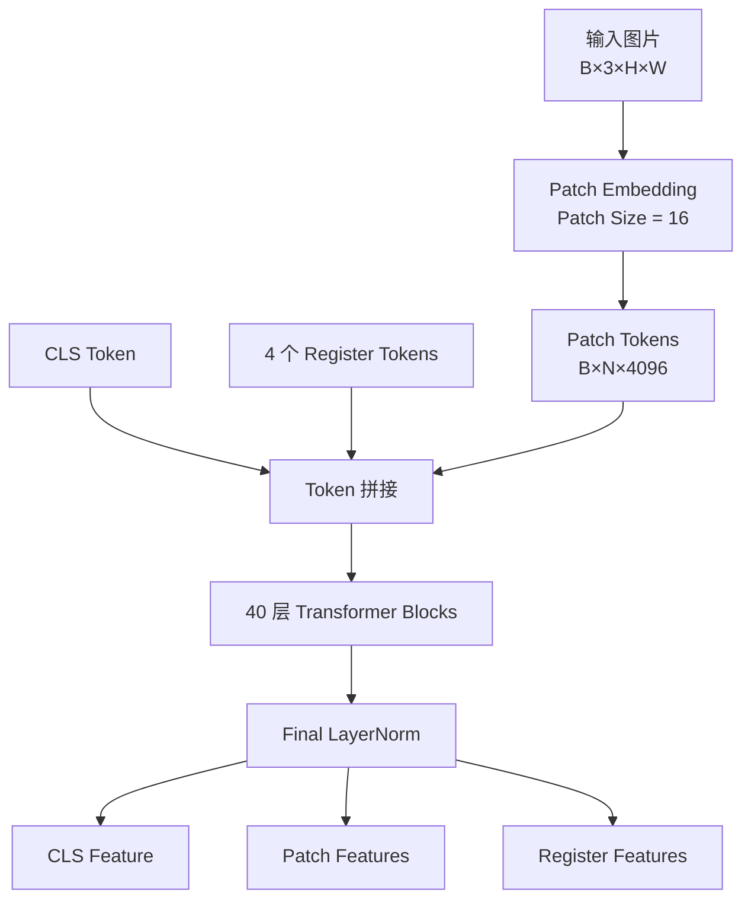

这里有三个重要组成部分：

1. CLS Token：负责聚合整张图片的全局语义信息。
2. Patch Tokens：保存每个图像区域的局部特征。
3. Register Tokens：辅助 Transformer 内部的信息交互，减少异常特征。

### 2.2 Patch Embedding：图片如何变成 Token？
假设输入图片：

```latex
Batch Size = B
Image Size = 256 × 256
Channels   = 3
Patch Size = 16
```

输入张量：

$ X\in\mathbb{R}^{B\times3\times256\times256} $

将图片划分为不重叠的 Patch。

每个 Patch 的尺寸：

$ 16\times16\times3=768 $

Patch 数量：

$ N=\frac{256}{16}\times\frac{256}{16} $

$ \boxed{N=256} $

每个 Patch 展平后是一个 768 维向量。

然后通过一个可学习的线性投影，将其映射到 Hidden Size：

$ W_{patch}\in\mathbb{R}^{768\times4096} $

因此：

$ X_{patch}=Flatten(Patch)\times W_{patch} $

输出：

$ \boxed{
X_{patch}\in\mathbb{R}^{B\times256\times4096}
} $

可以理解为：

原始图片中的每一个 16×16 区域，现在都由一个 4096 维的向量表示。

整个过程：

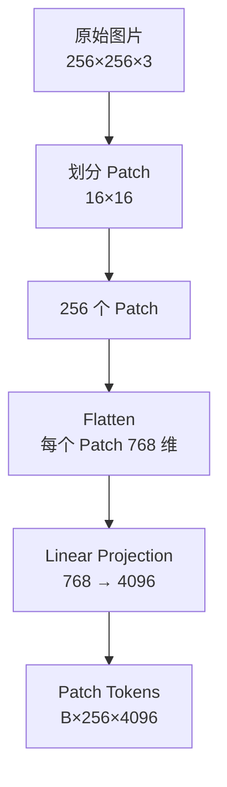

注意：

Patch Embedding 的本质是一个卷积操作：

```python
nn.Conv2d(
    in_channels=3,
    out_channels=4096,
    kernel_size=16,
    stride=16
)
```

它与将每个 Patch 展平后再经过 Linear，在数学上是等价的。

### 2.3 CLS Token 和 Register Tokens
除了 Patch Tokens，DINOv3 还包含：

+ 1 个 CLS Token。
+ 4 个 Register Tokens。

它们都是可学习的向量。

CLS Token：

$ X_{cls}\in\mathbb{R}^{1\times4096} $

Register Tokens：

$ X_{reg}\in\mathbb{R}^{4\times4096} $

将它们与 Patch Tokens 拼接：

$ X_0=Concat(X_{cls},X_{reg},X_{patch}) $

得到：

$ \boxed{
X_0\in\mathbb{R}^{B\times261\times4096}
} $

其中：

$ 261=1+4+256 $

对应：

| Token 类型 | 数量 | 作用 |
| --- | ---: | --- |
| CLS | 1 | 全局语义表示 |
| Register | 4 | 辅助内部信息交互 |
| Patch | 256 | 局部视觉特征 |


为什么需要 Register Tokens？

Vision Transformer 在处理图像时，有时会产生一些异常的高范数 Patch 特征。

这些异常特征可能出现在天空、背景等信息量较低的区域。

Register Tokens 的作用是为网络提供额外的信息存储位置，让模型可以通过这些特殊 Token 进行内部信息交互，而不必完全依赖图像 Patch Token。

可以将其理解为：

```latex
没有 Register Tokens：

Patch 1 ─┐
Patch 2 ─┼── 内部信息交互
Patch 3 ─┤
Patch 4 ─┘


加入 Register Tokens：

Patch 1 ─┐
Patch 2 ─┼── Register Tokens
Patch 3 ─┤        |
Patch 4 ─┘        |
                  v
              内部信息交互
```

Register Tokens 不对应真实图像区域，因此不会被当作普通 Patch 特征输出。

DINOv3 使用 4 个 Register Tokens。

### 2.4 Transformer Block 的整体结构
DINOv3 使用 40 层 Transformer Block。

每一层主要由两个部分组成：

1. Multi-Head Self-Attention。
2. SwiGLU FFN。

整体结构：

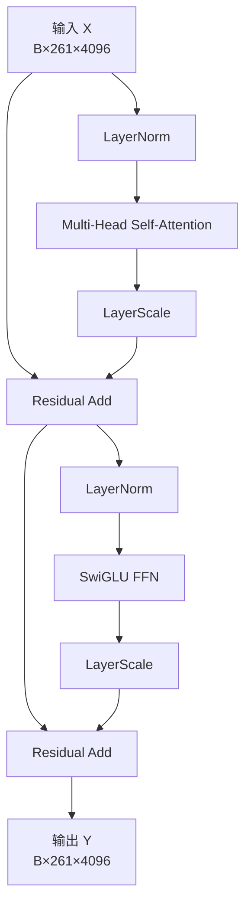

数学表达：

第一部分：

$ X_1=X+LayerScale(Attention(LN(X))) $

第二部分：

$ Y=X_1+LayerScale(FFN(LN(X_1))) $

每个 Transformer Block 的输入和输出维度保持不变：

$ [B,261,4096]\rightarrow[B,261,4096] $

经过 40 层之后，最终得到：

$ X_{40}\in\mathbb{R}^{B\times261\times4096} $

这里还有两个实现细节：

+ LayerScale 初始化值为 $ 10^{-5} $。
+ 训练时使用 Stochastic Depth，Drop Path Rate 为 0.4。

LayerScale 通过可学习的通道缩放系数控制残差分支的输出幅度，有助于稳定深层网络训练。

---

## 三、DINOv3 的 Attention 计算
### 3.1 Attention 配置
DINOv3 ViT-7B：

```latex
Hidden Size    = 4096
Attention Heads = 32
Head Dimension  = 128
```

因此：

$ D_{head}=\frac{4096}{32}=128 $

输入：

$ X\in\mathbb{R}^{B\times261\times4096} $

首先经过 LayerNorm。

然后通过三个线性层生成 Q、K、V。

$ Q=XW_Q $

$ K=XW_K $

$ V=XW_V $

权重矩阵：

$ W_Q,W_K,W_V\in\mathbb{R}^{4096\times4096} $

得到：

$ Q,K,V\in\mathbb{R}^{B\times261\times4096} $

然后 Reshape：

$ Q,K,V\rightarrow[B,32,261,128] $

这就是 32 个 Attention Head，每个 Head 128 维。

### 3.2 Axial RoPE：二维旋转位置编码
ViT 需要知道不同 Patch 在图像中的空间位置。

传统 ViT 通常使用可学习的绝对位置编码（Learnable Positional Embedding）。

DINOv3 则使用二维 RoPE。

RoPE 全称：

Rotary Position Embedding。

它通过旋转 Q、K 特征来编码位置信息。

对于图像：

每个 Patch 不只有一个序列位置，而是具有二维空间坐标：

$ (x,y) $

DINOv3 使用二维坐标来构建 RoPE。

具体做法：

1. 为每个 Patch 分配二维坐标。
2. 将坐标归一化到 $ [-1,1] $。
3. 根据二维坐标计算旋转位置编码。
4. 对 Q 和 K 应用旋转变换。

可以表示为：

$ Q'=RoPE(Q,x,y) $

$ K'=RoPE(K,x,y) $

然后计算 Attention：

$ Attention(Q,K,V)
=
Softmax\left(
\frac{Q'K'^T}{\sqrt{128}}
\right)V $

DINOv3 还采用了 RoPE-box jittering。

具体来说：

原始坐标范围：

$ [-1,1] $

训练时随机缩放坐标范围：

$ [-s,s] $

其中：

$ s\in[0.5,2] $

这样可以增强模型对不同图像分辨率、尺度以及宽高比的适应能力。

### 3.3 Attention 的完整计算流程
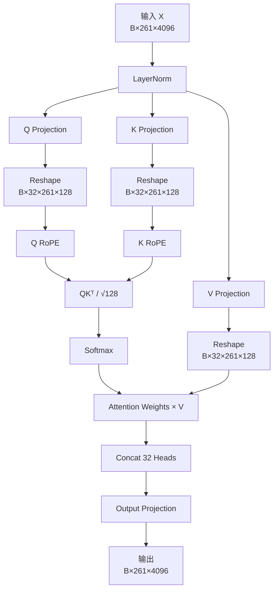

最终 Attention 输出：

$ O\in\mathbb{R}^{B\times261\times4096} $

这里使用的是标准 Multi-Head Self-Attention，而不是 GQA。

---

## 四、SwiGLU FFN 的计算
### 4.1 FFN 配置
DINOv3 ViT-7B 使用 SwiGLU。

配置：

```latex
Hidden Size = 4096
FFN Hidden  = 8192
```

输入：

$ X\in\mathbb{R}^{B\times261\times4096} $

SwiGLU 使用三个线性投影：

Gate Projection：

$ G=XW_1 $

Up Projection：

$ U=XW_2 $

其中：

$ W_1,W_2\in\mathbb{R}^{4096\times8192} $

经过 SiLU 激活和逐元素相乘：

$ H=SiLU(G)\odot U $

得到：

$ H\in\mathbb{R}^{B\times261\times8192} $

最后经过 Down Projection：

$ Y=HW_3 $

其中：

$ W_3\in\mathbb{R}^{8192\times4096} $

最终：

$ Y\in\mathbb{R}^{B\times261\times4096} $

### 4.2 为什么配置中的 FFN Ratio 是 3？
官方代码中：

```yaml
student:
  ffn_layer: swiglu64
  ffn_ratio: 3
```

这可能会产生疑问：

4096 × 3 = 12288，为什么最终 FFN Hidden Dimension 是 8192？

原因在于 SwiGLU 实现中的维度调整。

官方 `ffn_layers.py`：

```python
d = int(hidden_features * 2 / 3)
swiglu_hidden_features = d + (-d % align_to)
```

其中 `align_to=64`。

因此：

$ hidden\_features=4096\times3=12288 $

SwiGLU 内部调整：

$ d=12288\times\frac{2}{3}=8192 $

8192 本身能够被 64 整除，因此：

$ \boxed{D_{FFN}=8192} $

这就是配置文件中的 FFN Ratio 为 3，但实际 FFN Hidden Dimension 为 8192 的原因。

### 4.3 FFN 完整结构
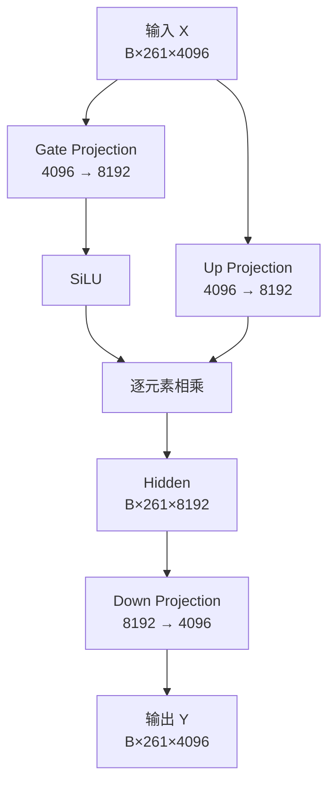

### 4.4 单层 Transformer Block 参数量
Attention：

Q、K、V：

$ P_{QKV}=3\times4096\times4096 $

$ P_{QKV}=50,331,648 $

Output Projection：

$ P_O=4096\times4096 $

$ P_O=16,777,216 $

因此：

$ P_{Attention}=67,108,864 $

FFN：

$ P_{FFN}=2\times4096\times8192
+8192\times4096 $

$ P_{FFN}=100,663,296 $

单层 Transformer Block：

$ P_{Block}=P_{Attention}+P_{FFN} $

$ \boxed{P_{Block}\approx167.77M} $

40 层：

$ P_{Transformer}=40\times167.77M $

$ \boxed{P_{Transformer}\approx6.711B} $

再加上：

+ Patch Embedding。
+ CLS Token。
+ Register Tokens。
+ LayerNorm。
+ LayerScale。
+ 其他偏置参数。

最终 Backbone 参数量约为：

$ \boxed{P_{ViT-7B}=6.716B} $

注意：

这里没有计算自监督训练时额外使用的 DINO Head 和 iBOT Head，因为它们属于训练阶段的投影头，不属于最终用于特征提取的 Backbone 参数量。

---

## 五、DINOv3 的自监督训练框架
DINOv3 的训练核心是 **Teacher-Student 自蒸馏 + 多视图一致性学习 + Masked Patch 特征预测**。

它不依赖人工标注的类别标签，而是通过同一张图片生成不同视图，让 Student 学习 Teacher 提供的特征分布。

整个训练主要包含三个基础 Loss：

1. **DINO Loss**：让不同图像视图的 CLS Token 学习一致的全局语义表示。
2. **iBOT Loss**：让 Student 根据可见 Patch 的上下文，预测被 Mask Patch 的特征分布。
3. **KoLeo Loss**：通过近邻距离约束，避免不同图片的特征过度集中。

此外，DINOv3 还有一个非常重要的改进：

4. **Gram Anchoring Loss**：在长时间训练阶段，约束不同 Patch 之间的相似性关系，避免局部特征逐渐退化。

需要区分：前三种 Loss 构成初始自监督预训练目标，Gram Loss 则主要用于后续的特征优化阶段，并不是从训练开始就一直参与计算。

### 5.1 为什么不需要人工标签？
传统监督学习：

```latex
图片 + 人工标签
       |
       v
     模型
       |
       v
   预测类别
       |
       v
  与真实标签计算 Loss
       |
       v
    更新参数
```

例如：

```latex
图片：一只猫

标签：Cat

模型预测：Dog

计算预测与真实标签之间的差异。
```

但 DINOv3 使用 Self-Supervised Learning。

它不需要人工提供每张图片的类别标签，而是利用同一张图片经过不同增强后得到的多个视图，构造训练目标。

例如：

```latex
                原始图片
                    |
          +---------+---------+
          |                   |
          v                   v
     Global Crop 1       Global Crop 2
          |                   |
          v                   v
     Student / Teacher  学习不同视图之间的特征关系
```

模型需要学习：

虽然两张图片的视角、尺度、颜色、裁剪范围不同，但它们来自同一张原始图片，应该具有一致的全局语义信息。

进一步地，模型还需要学习：

+ 图片整体表达了什么内容。
+ 每个局部 Patch 表示什么内容。
+ 不同 Patch 之间有什么关系。
+ 不同图像视图中的相同语义如何对应。

因此，DINOv3 并不是简单地让两个网络输出相同的特征向量，而是让 Student 学习匹配 Teacher 产生的概率分布和局部特征关系。

### 5.2 Teacher-Student 架构
DINOv3 使用 Teacher-Student 自蒸馏架构。

包含两个网络：

**Student Network**

+ 接受反向传播。
+ 通过 Loss 更新参数。
+ 同时处理 Global Crop 和 Local Crop。
+ 对 Global Crop 的部分 Patch 进行 Mask。
+ 学习匹配 Teacher 提供的目标分布。

**Teacher Network**

+ 不接受反向传播。
+ 通过 Student 参数的指数移动平均（EMA）更新。
+ 只处理未 Mask 的 Global Crop。
+ 为 Student 提供相对稳定的训练目标。

两个网络具有相同的网络结构，但参数不同。

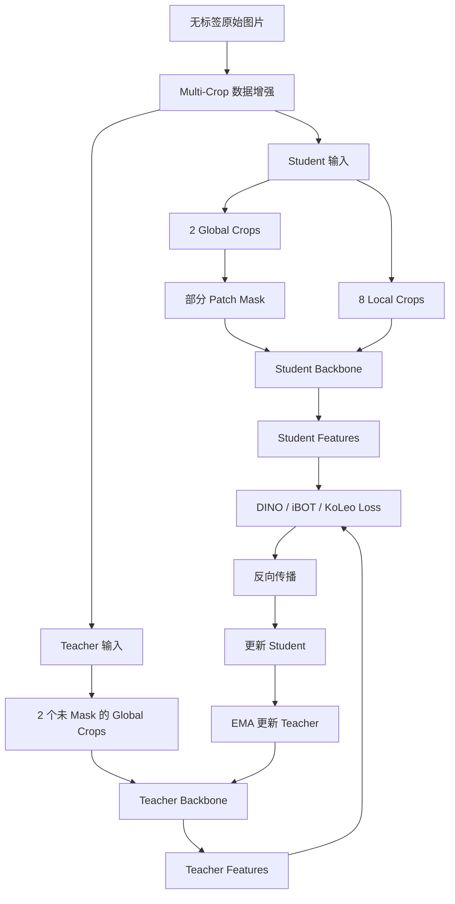

#### 5.2.1 Teacher 是如何更新的？
Teacher 并不是一个固定不变的模型，而是随着 Student 训练不断变化。

采用 EMA（Exponential Moving Average）更新：

$ \boxed{
\theta_t
\leftarrow
m\theta_t+(1-m)\theta_s
} $

其中：

+ $ \theta_t $：Teacher 当前参数。
+ $ \theta_s $：Student 当前参数。
+ $ m $：EMA Momentum。

DINOv3 论文中使用的 Teacher EMA 系数为：

$ m=0.999 $

例如：

```latex
Student 参数：
通过反向传播不断更新。

Teacher 参数：
不参与反向传播。

每次迭代：

Teacher = 0.999 × Teacher
        + 0.001 × Student
```

注意：

EMA 更新不仅涉及 Backbone，还涉及 Teacher 的 DINO Head 和 iBOT Head。

Teacher 不计算梯度，但会随着 Student 的参数变化而更新。

#### 5.2.2 一次训练迭代的顺序
一次完整的训练迭代可以拆分为：

1. 读取无标签图片。
2. 生成 Global Crop 和 Local Crop。
3. 对 Student 的 Global Crop 生成 Mask。
4. Teacher 对未 Mask 的 Global Crop 前向计算。
5. Student 对 Mask 后的 Global Crop 和 Local Crop 前向计算。
6. 计算 DINO Loss。
7. 计算 iBOT Loss。
8. 计算 KoLeo Loss。
9. 汇总 Loss。
10. 反向传播，更新 Student。
11. 使用 EMA 更新 Teacher。

Teacher 的前向过程在 `torch.no_grad()` 下执行，不参与反向传播。

---

### 5.3 Multi-Crop：多尺度图像增强
DINOv3 使用 Multi-Crop Strategy。

每张原始图片生成：

```latex
2 个 Global Crops

8 个 Local Crops
```

具体配置：

| 类型 | 数量 | 尺寸 | Patch 数量 |
| --- | ---: | ---: | ---: |
| Global Crop | 2 | 256×256 | 256 |
| Local Crop | 8 | 112×112 | 49 |


DINOv3 使用 Patch Size = 16。

因此：

Global Crop：

$ N_g=\frac{256}{16}=16 $

$ P_g=16\times16=256 $

Local Crop：

$ N_l=\frac{112}{16}=7 $

$ P_l=7\times7=49 $

Global Crop：

包含图片中较大范围的内容，主要用于学习全局语义。

Local Crop：

只包含图片中的局部区域，主要用于学习局部与全局之间的语义关系。

#### 5.3.1 Teacher 和 Student 接收的数据
| 网络 | Global Crop | Local Crop | Mask |
| --- | --- | --- | --- |
| Student | 2 个 | 8 个 | Global Crop 部分 Mask |
| Teacher | 2 个 | 0 个 | 不 Mask |


为什么 Teacher 只接收 Global Crop？

因为 Teacher 主要负责提供稳定的全局语义和局部 Patch 监督目标。

Student 则需要学习更多不同尺度的图像视图。

这样既可以增加训练监督信号，也能够减少 Teacher 的计算量。

#### 5.3.2 不同视图对应的特征
假设 Batch Size 为 $ B $，Backbone 输出维度为 4096。

Student 的 CLS Token：

Global：

$ H_{s,g}^{cls}
\in
\mathbb{R}^{2\times B\times4096} $

Local：

$ H_{s,l}^{cls}
\in
\mathbb{R}^{8\times B\times4096} $

Teacher 的 CLS Token：

$ H_t^{cls}
\in
\mathbb{R}^{2\times B\times4096} $

Student 的 Global Patch Tokens：

$ H_{s,g}^{patch}
\in
\mathbb{R}^{2\times B\times256\times4096} $

Teacher 的 Global Patch Tokens：

$ H_t^{patch}
\in
\mathbb{R}^{2\times B\times256\times4096} $

Student 的 Local Patch Tokens：

$ H_{s,l}^{patch}
\in
\mathbb{R}^{8\times B\times49\times4096} $

这里需要特别注意：

+ DINO Loss 使用 CLS Token。
+ iBOT Loss 使用 Global Crop 的 Patch Token。
+ KoLeo Loss 使用 Student 的 Global CLS Token。
+ Local Crop 不参与 iBOT 的 Masked Patch Loss。

---

### 5.4 DINO Head 和 iBOT Head
在详细介绍 Loss 之前，需要先理解两个独立的 Projection Head。

DINOv3 的 Backbone 输出维度为：

$ D=4096 $

但 4096 维的特征并不会直接用于计算最终的交叉熵。

而是分别经过两个独立的 Head：

1. DINO Head：负责 CLS Token 的全局语义学习。
2. iBOT Head：负责 Patch Token 的局部特征学习。

它们都使用 MLP 结构，但输出维度不同。

#### 5.4.1 DINO Head
论文中 DINO Head 的配置：

| 参数 | 数值 |
| --- | ---: |
| Input Dimension | 4096 |
| Hidden Dimension | 8192 |
| Bottleneck Dimension | 512 |
| Prototype 数量 | 262144 |
| MLP 层数 | 3 |


整体结构：

```mermaid
flowchart TD
    A["CLS Token<br/>4096"] --> B["Linear<br/>4096 → 8192"]    B --> C["GELU"]
    C --> D["Linear<br/>8192 → 8192"]
    D --> E["GELU"]
    E --> F["Linear<br/>8192 → 512"]
    F --> G["L2 Normalize"]
    G --> H["Linear<br/>512 → 262144"]
    H --> I["DINO Logits"]
```

最终输出：

$ Z_D\in\mathbb{R}^{B\times262144} $

262144 表示 Prototype 的数量。

Prototype 可以理解为模型自动学习的视觉特征原型。

它们不是人工定义的类别。

例如：

```latex
Prototype 1
Prototype 2
Prototype 3
...
Prototype 262144
```

模型会自动学习如何将不同视觉特征映射到这些 Prototype。

#### 5.4.2 iBOT Head
iBOT Head 也是独立的 MLP。

论文配置：

| 参数 | 数值 |
| --- | ---: |
| Input Dimension | 4096 |
| Hidden Dimension | 8192 |
| Bottleneck Dimension | 384 |
| Prototype 数量 | 98304 |
| MLP 层数 | 3 |


整体结构：

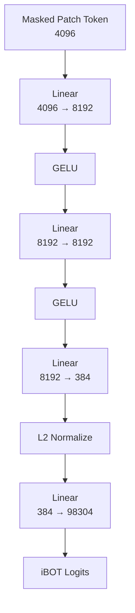

最终输出：

$ Z_I\in\mathbb{R}^{M\times98304} $

其中 M 是参与 iBOT 计算的 Masked Patch 总数量。

注意：

这里的 Hidden Dimension 是 8192，而不是 Backbone 的 4096。

4096 是 Head 的输入维度。

#### 5.4.3 为什么需要两个独立 Head？
因为 DINO 和 iBOT 学习的目标不同。

DINO：

希望不同视图中的 CLS Token 具有一致的全局语义分布。

iBOT：

希望 Student 能够根据上下文预测被 Mask Patch 的特征分布。

因此需要不同的 Prototype 空间。

| 项目 | DINO Head | iBOT Head |
| --- | ---: | ---: |
| 输入 | CLS Token | Patch Token |
| 输入维度 | 4096 | 4096 |
| Bottleneck | 512 | 384 |
| Prototype | 262144 | 98304 |
| 目标 | 全局语义 | 局部 Patch |
| 是否独立 | 是 | 是 |


Student 和 Teacher 各自拥有对应的 DINO Head 和 iBOT Head。

Teacher 的 Head 参数同样通过 EMA 更新。

另外，进入 Head 的 Backbone 特征使用归一化后的 Token 表示，而不是直接使用未经归一化的原始输出。

---

### 5.5 DINO Loss：全局语义学习
DINO Loss 是整个框架中负责学习全局语义一致性的核心部分。

它主要关注 CLS Token。

为什么使用 CLS Token？

在 Vision Transformer 中：

CLS Token 会通过多层 Self-Attention 与所有 Patch Token 进行信息交互。

因此 CLS Token 能够聚合整张图片的信息。

可以将它理解为：

**CLS Token 是 Transformer 对整张图片形成的全局特征表示。**

#### 5.5.1 DINO Loss 的整体流程
Student 和 Teacher 分别得到 CLS Token。

Student：

```latex
Global Crop CLS
       |
       v
DINO Head
       |
       v
Student Logits
       |
       v
Softmax
       |
       v
Student Probability
```

Teacher：

```latex
Global Crop CLS
       |
       v
DINO Head
       |
       v
Teacher Logits
       |
       v
Sinkhorn-Knopp
       |
       v
Teacher Target Probability
```

最终：

比较 Student 的概率分布与 Teacher 的目标概率分布。

注意：

Teacher 使用 Sinkhorn-Knopp，而不是直接使用普通 Softmax。

#### 5.5.2 Student 的概率计算
假设 Student 经过 DINO Head 后输出：

$ z_s\in\mathbb{R}^{262144} $

使用 Softmax：

$ \boxed{
p_s(k)=
\frac{
\exp(z_s(k)/\tau_s)
}{
\sum_{j=1}^{K}
\exp(z_s(j)/\tau_s)
}
} $

其中：

+ $ K=262144 $：Prototype 数量。
+ $ z_s(k) $：Student 对第 k 个 Prototype 的 Logit。
+ $ \tau_s $：Student Temperature。

官方实现中 Student Temperature 的默认值为：

$ \tau_s=0.1 $

为什么需要 Temperature？

Temperature 控制概率分布的尖锐程度。

当 Temperature 较小时：

模型会更加关注概率最高的 Prototype。

当 Temperature 较大时：

概率分布会更加平滑。

例如：

原始 Logits：

```latex
[2.0, 1.0, 0.5]
```

当 Temperature = 1：

```latex
Softmax([2.0, 1.0, 0.5])

约等于：

[0.629, 0.231, 0.140]
```

当 Temperature = 0.1：

```latex
Softmax([20, 10, 5])

约等于：

[0.99995, 0.000045, 0.0000003]
```

可以看到：

较小的 Temperature 会让模型更加倾向于某些 Prototype。

#### 5.5.3 Teacher 的目标概率分布
Teacher 经过 DINO Head 后，同样得到：

$ z_t\in\mathbb{R}^{262144} $

但 Teacher 不直接使用普通 Softmax。

而是使用 Sinkhorn-Knopp 算法：

$ \boxed{
p_t=Sinkhorn(z_t,\tau_t)
} $

其中：

+ $ z_t $：Teacher Logits。
+ $ \tau_t $：Teacher Temperature。
+ $ p_t $：Teacher 产生的目标概率分布。

Teacher Temperature 由训练过程中的 Temperature Schedule 控制。

Sinkhorn-Knopp 的详细计算过程在这里也需要理解，因为它直接决定了 Teacher 的监督目标。

假设：

Teacher 有 N 个样本，每个样本输出 K 个 Prototype Logits。

构造矩阵：

$ Z_t\in\mathbb{R}^{N\times K} $

首先进行温度缩放和指数运算：

$ Q=
\exp(Z_t/\tau_t)^T $

因此：

$ Q\in\mathbb{R}^{K\times N} $

接下来进行矩阵归一化。

**第一步：整体归一化**

让矩阵所有元素的和为 1：

$ Q\leftarrow
\frac{Q}{\sum_{i,j}Q_{ij}} $

**第二步：行归一化**

让每个 Prototype 对应的总分配质量趋向于相等：

$ Q_{ij}
\leftarrow
\frac{Q_{ij}}
{\sum_j Q_{ij}} $

再除以 K：

$ Q_{ij}\leftarrow\frac{Q_{ij}}{K} $

此时每一行的目标总质量为：

$ \sum_jQ_{ij}\approx\frac{1}{K} $

**第三步：列归一化**

让每个样本对应的概率分布之和为 1：

$ Q_{ij}
\leftarrow
\frac{Q_{ij}}
{\sum_iQ_{ij}} $

这样每个样本都具有一个归一化的 Prototype 分配分布。

**第四步：重复迭代**

重复执行行归一化和列归一化。

官方实现默认迭代 3 次。

最终：

$ \boxed{
p_t=Q^T
} $

得到：

$ p_t\in\mathbb{R}^{N\times K} $

每个样本对应的 Prototype 概率之和为 1，同时不同 Prototype 在整个批次中的分配质量趋向均衡。

需要注意：

Sinkhorn-Knopp 并不是强制每张图片均匀分配到所有 Prototype。

它主要约束整个 Batch 范围内的 Prototype 分配，避免所有样本都集中到少数几个 Prototype。

在分布式训练中，还需要通过 All-Reduce 汇总不同 GPU 上的统计量，确保归一化基于整体 Batch，而不是单张 GPU 的局部 Batch。

#### 5.5.4 计算交叉熵 Loss
现在已经得到：

Student：

$ p_s(k) $

Teacher：

$ p_t(k) $

计算交叉熵：

$ \boxed{
\mathcal{L}_{DINO}
=
-\sum_{k=1}^{K}
p_t(k)\log p_s(k)
} $

展开：

$ \mathcal{L}_{DINO}
=
-\sum_{k=1}^{262144}
p_t(k)\log p_s(k) $

举一个简单例子。

假设只有 4 个 Prototype：

Teacher：

$ p_t=[0.7,0.2,0.1,0] $

Student：

$ p_s=[0.5,0.3,0.1,0.1] $

那么：

$ \begin{aligned}
L
=&-[0.7\log0.5\\
&+0.2\log0.3\\
&+0.1\log0.1\\
&+0\log0.1]
\end{aligned} $

得到：

$ L\approx0.915 $

如果 Student 的预测越来越接近 Teacher：

$ p_s\rightarrow p_t $

那么交叉熵就会逐渐降低。

这里有一个重要细节：

Teacher 的概率分布是停止梯度的目标，反向传播只更新 Student。

#### 5.5.5 为什么需要比较不同 Crop？
这是 DINO Loss 非常重要的一部分。

DINOv3 不仅比较同一张图片的 Global Crop，还比较 Local Crop 与 Global Crop。

Student：

```latex
2 Global Crops

8 Local Crops
```

Teacher：

```latex
2 Global Crops
```

具体匹配方式：

**第一种：Global Student 与 Global Teacher**

两个 Global Crop 分别进行匹配。

但是需要排除同一个 Global Crop 对自身的匹配。

例如：

| Student | Teacher | 是否计算 |
| --- | --- | --- |
| Global 1 | Global 1 | 否 |
| Global 1 | Global 2 | 是 |
| Global 2 | Global 1 | 是 |
| Global 2 | Global 2 | 否 |


为什么排除？

如果直接让同一个视图与自身匹配，网络可能只需要复制相同输入的输出，而不必真正学习不同视图之间的语义一致性。

**第二种：Local Student 与 Global Teacher**

所有 Local Crop 都与两个 Global Crop 进行匹配。

例如：

| Student | Teacher | 是否计算 |
| --- | --- | --- |
| Local 1 | Global 1 | 是 |
| Local 1 | Global 2 | 是 |
| Local 2 | Global 1 | 是 |
| Local 2 | Global 2 | 是 |
| ... | ... | ... |
| Local 8 | Global 1 | 是 |
| Local 8 | Global 2 | 是 |


因此：

Global 匹配数量：

$ N_g=2\times(2-1)=2 $

Local 匹配数量：

$ N_l=8\times2=16 $

总匹配数量：

$ N=2+16=18 $

也就是说：

每张图片一共会产生 18 组 DINO 视图匹配。

#### 5.5.6 DINO Loss 的实际计算方式
为了让不同匹配数量的 Global 和 Local Loss 得到合理的权重，官方实现会根据匹配数量进行缩放。

Global Loss：

$ L_g=
\frac{1}{2B}
\sum_{b=1}^{B}
\sum_{i\neq j}
CE(p_t^{g_j,b},p_s^{g_i,b}) $

Local Loss：

$ L_l=
\frac{1}{16B}
\sum_{b=1}^{B}
\sum_{i=1}^{8}
\sum_{j=1}^{2}
CE(p_t^{g_j,b},p_s^{l_i,b}) $

其中：

+ $ B $：Batch Size。
+ $ g_i $：第 i 个 Global Crop。
+ $ l_i $：第 i 个 Local Crop。
+ $ p_t $：Teacher 目标分布。
+ $ p_s $：Student 预测分布。

最终：

$ \mathcal{L}_{DINO}
=
\frac{2}{18}L_g
+
\frac{16}{18}L_l $

即：

$ \boxed{
\mathcal{L}_{DINO}
=
\frac{1}{9}L_g
+
\frac{8}{9}L_l
} $

这样每一组有效视图匹配具有相同的平均权重。

完整流程：

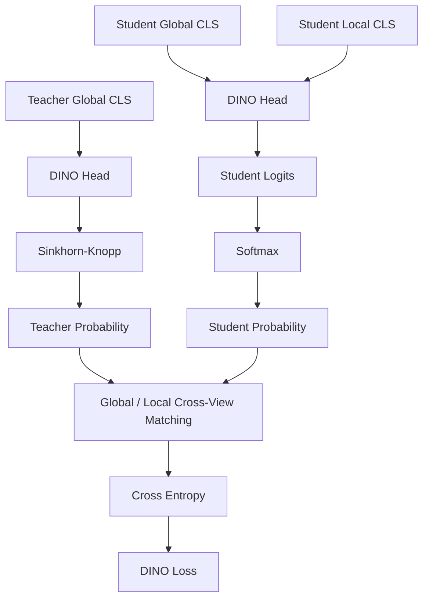

DINO Loss 的核心目的：

**让同一张图片的不同尺度、不同裁剪视图，在全局语义表示上保持一致。**

---

### 5.6 iBOT Loss：局部 Patch 特征学习
仅使用 DINO Loss 还不够。

因为 DINO Loss 主要关注 CLS Token。

它能够学习整张图片的语义，但不一定能保证每个 Patch 都具有良好的局部表示。

例如：

一张图片中有：

```latex
天空
树木
草地
建筑物
```

CLS Token 可能已经能够很好地表示整张图片包含这些内容。

但是对于密集视觉任务，我们还需要知道：

+ 哪些 Patch 对应树木？
+ 哪些 Patch 对应草地？
+ 相邻 Patch 之间有什么关系？
+ 某个局部区域具体包含什么视觉信息？

因此 DINOv3 还使用 iBOT。

iBOT 全称：

Image BERT Pre-training with Online Tokenizer。

其核心思想：

**对 Student 的部分 Patch Token 进行 Mask，让 Student 根据剩余信息预测被 Mask Patch 的特征分布。Teacher 则负责提供这些 Patch 的目标分布。**

注意：

iBOT 不是直接重建被 Mask 区域的 RGB 像素，而是预测 Teacher 提供的 Prototype 概率分布。

#### 5.6.1 Mask 机制
假设一个 Global Crop 为：

$ 256\times256 $

Patch Size：

$ 16\times16 $

那么：

$ N=16\times16=256 $

一共包含 256 个 Patch Token。

DINOv3 的配置：

```latex
Mask Probability = 0.5

Mask Ratio = 0.1 ~ 0.5
```

也就是：

+ 每个 Global Crop 有 50% 的概率执行 Mask。
+ 如果执行 Mask，则随机 Mask 10%～50% 的 Patch。

例如：

```latex
原始 Patch：

P1 P2 P3 P4 P5 P6 P7 P8

Student Mask：

P1 [M] P3 [M] P5 P6 [M] P8

Teacher：

P1 P2 P3 P4 P5 P6 P7 P8
```

Student 在被 Mask 的位置使用 Mask Token 替代原始 Patch 信息。

因此 Student 无法直接看到被 Mask Patch 的原始图像内容。

Teacher 则使用没有 Mask 的 Global Crop，生成对应位置的目标特征。

#### 5.6.2 Teacher 和 Student 如何得到 Patch 特征？
假设：

$ H_t\in
\mathbb{R}^{B\times N\times4096} $

Teacher 对完整图像进行特征提取。

Student：

$ H_s\in
\mathbb{R}^{B\times N\times4096} $

Student 对 Mask 后的图像进行特征提取。

然后从 Student 中取出被 Mask 的 Patch Token：

$ H_s^{masked}
=
H_s[\mathcal{M}] $

从 Teacher 中取出相同位置的 Patch Token：

$ H_t^{masked}
=
H_t[\mathcal{M}] $

其中：

$ \mathcal{M} $ 表示被 Mask 的 Patch 位置集合。

这里最重要的是：

**Teacher 和 Student 的 Patch 位置必须对应。**

例如：

Student 的第 5 个 Patch 被 Mask，那么 Teacher 就使用同一个 Global Crop 中第 5 个 Patch 的特征作为监督目标。

不是随机选择另一个 Patch，也不是选择其他图片的 Patch。

#### 5.6.3 经过独立的 iBOT Head
Student：

$ Z_s^{patch}
=
Head_s(H_s^{masked}) $

Teacher：

$ Z_t^{patch}
=
Head_t(H_t^{masked}) $

iBOT Head 输出维度：

$ K=98304 $

假设总共有 M 个 Masked Patches：

$ Z_s^{patch}
\in
\mathbb{R}^{M\times98304} $

$ Z_t^{patch}
\in
\mathbb{R}^{M\times98304} $

这里 Student 和 Teacher 的输出都是 Prototype Logits。

#### 5.6.4 Teacher 生成 Patch 目标分布
Teacher 的输出不能直接作为交叉熵目标。

需要经过 Sinkhorn-Knopp：

$ \boxed{
p_t^{patch}
=
Sinkhorn(Z_t^{patch},\tau_t)
} $

得到：

$ p_t^{patch}
\in
\mathbb{R}^{M\times98304} $

与 DINO Loss 一样：

Teacher 的每个 Patch 都会得到一个 Prototype 概率分布。

但是这里 Sinkhorn 的归一化对象不同：

DINO：

对 Teacher 的 CLS Token 输出进行归一化。

iBOT：

对所有参与训练的 Masked Patch 输出进行归一化。

在分布式训练中，iBOT 还会统计不同 GPU 上的 Masked Patch 总数量。

#### 5.6.5 Student 计算 Patch 概率分布
Student 使用 Softmax：

$ \boxed{
p_s^{patch}(k)
=
\frac{
\exp(z_s^{patch}(k)/\tau_s)
}{
\sum_{j=1}^{K}
\exp(z_s^{patch}(j)/\tau_s)
}
} $

其中：

$ K=98304 $

Student Temperature 默认：

$ \tau_s=0.1 $

这样每个 Masked Patch 都会得到一个 98304 维的概率分布。

#### 5.6.6 iBOT Loss 的计算
现在：

Teacher：

$ p_t^{patch} $

Student：

$ p_s^{patch} $

计算交叉熵：

$ \boxed{
\mathcal{L}_{iBOT}
=
-\frac{1}{|\mathcal{M}|}
\sum_{i\in\mathcal{M}}
\sum_{k=1}^{K}
p_t^i(k)
\log p_s^i(k)
} $

其中：

+ $ \mathcal{M} $：Masked Patch 集合。
+ $ p_t^i $：Teacher 第 i 个 Patch 的目标分布。
+ $ p_s^i $：Student 第 i 个 Patch 的预测分布。
+ K：Prototype 数量。

但这里还需要注意官方代码中的一个实现细节：

**iBOT 并不是简单地对整个 Batch 中所有 Masked Patch 做一次普通平均，而是先对每个图像视图内部的 Masked Patch 求平均，再对图像视图求平均。**

假设：

+ B：Batch Size。
+ 两个 Global Crops。
+ 第 c 个 Global Crop 中第 b 张图片被 Mask 的 Patch 集合为 $ \mathcal{M}_{c,b} $。

先计算每个 Masked Patch 的交叉熵：

$ \ell_{c,b,i}
=
-\sum_{k=1}^{K}
p_t^{c,b,i}(k)
\log p_s^{c,b,i}(k) $

然后对每个图像视图内部的 Masked Patch 求平均：

$ L_{c,b}
=
\frac{1}{|\mathcal{M}_{c,b}|}
\sum_{i\in\mathcal{M}_{c,b}}
\ell_{c,b,i} $

最后对两个 Global Crop 和整个 Batch 求平均：

$ \boxed{
\mathcal{L}_{iBOT}
=
\frac{1}{2B}
\sum_{c=1}^{2}
\sum_{b=1}^{B}
L_{c,b}
} $

如果某个图像视图没有 Masked Patch，则该视图对应的损失为 0。

这样做的意义：

不同图片可能被 Mask 的 Patch 数量不同。

如果直接对所有 Masked Patch 求平均，那么 Mask 数量较多的图片会贡献更多 Loss。

通过先对每张图片内部求平均，可以避免这种情况。

官方代码使用 `masks_weight` 实现了这一归一化。

#### 5.6.7 iBOT 的完整数据流
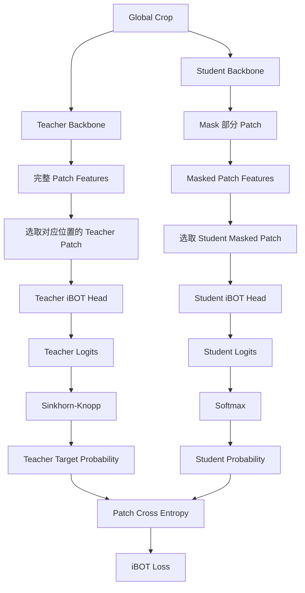

iBOT 的核心目的：

**让模型不仅理解整张图片，还要学习每个局部区域的视觉特征。**

---

### 5.7 KoLeo Loss：防止特征过度集中
除了 DINO 和 iBOT，DINOv3 还引入 KoLeo Regularization。

KoLeo 全称：

Kozachenko-Leonenko Entropy Estimation。

它是一种基于近邻距离的熵估计正则化方法。

前面两个 Loss 都在做什么？

DINO：

让不同视图的全局语义分布一致。

iBOT：

让 Student 学习预测 Teacher 的局部 Patch 特征分布。

但这两个目标仍然可能出现一个问题：

大量不同图片的特征集中在特征空间中的某个局部区域。

这样模型虽然可以完成 Teacher-Student 匹配，但特征的区分能力可能受到影响。

KoLeo 的作用就是：

**让 Batch 内的特征在特征空间中分布得更加均匀，减少特征过度集中。**

#### 5.7.1 KoLeo 使用什么特征？
DINOv3 在 Student 的 CLS Token 上计算 KoLeo Loss。

注意：

使用的是经过 Backbone 后、进入 DINO Head 之前的 CLS 特征。

不是 DINO Head 输出的 262144 维 Prototype Logits。

假设：

$ H_s^{cls}
\in
\mathbb{R}^{B\times4096} $

对特征进行 L2 Normalize：

$ \boxed{
x_i=
\frac{h_i}{\|h_i\|_2}
} $

得到单位长度的特征向量。

#### 5.7.2 计算最近邻
对于 Batch 中的每一个特征向量 $ x_i $：

找到与它最接近的其他特征向量。

$ \boxed{
j(i)=
\arg\min_{j\neq i}
\|x_i-x_j\|_2
} $

因为已经进行了 L2 Normalize，所以也可以通过最大化余弦相似度找到最近邻：

$ j(i)=
\arg\max_{j\neq i}
x_i^Tx_j $

注意：

必须排除自己与自己的匹配。

否则最近邻距离始终为 0。

#### 5.7.3 计算最近邻距离
找到最近邻后：

$ d_i=
\|x_i-x_{j(i)}\|_2 $

然后计算：

$ \boxed{
\mathcal{L}_{KoLeo}
=
-\frac{1}{B}
\sum_{i=1}^{B}
\log(d_i+\epsilon)
} $

其中：

+ $ d_i $：当前特征与最近邻特征的欧氏距离。
+ $ \epsilon $：防止数值计算出现 $ \log(0) $。

为什么使用负号？

因为训练时需要最小化 Loss。

当最近邻距离增加：

$ d_i\uparrow $

那么：

$ -\log(d_i+\epsilon)\downarrow $

因此模型会倾向于增大特征与最近邻之间的距离。

这样能够减少大量特征挤在同一小块区域的情况。
#### 5.7.4 举例理解
假设有 5 个特征向量：

```latex
特征分布不理想：

●●●●●
 ●●●●
  ●●

大量特征集中在局部区域。
```

加入 KoLeo 后：

```latex
●       ●

    ●

  ●       ●

```

模型会倾向于让这些特征分布得更加分散。

注意：

KoLeo 并不是要求所有特征之间的距离都完全相等，也不是直接强制特征在整个高维空间中均匀分布。

它主要通过最近邻距离，作为一种熵正则化近似，改善特征空间的分布。

#### 5.7.5 为什么使用较小的 Batch？
DINOv3 论文使用分布式 KoLeo 实现，将特征划分为较小的组进行计算。

论文中使用：

```latex
KoLeo Group Size = 16
```

即每组包含 16 个 CLS 特征。

对于每个特征：

需要在其他 15 个特征中找到最近邻。

这样既可以计算近邻距离，又不需要在整个训练 Batch 中计算完整的两两距离矩阵。

官方公开代码还提供了分布式 KoLeo 实现，可以跨 GPU 收集特征，并支持配置最近邻分组大小。

需要注意一个实现细节：

论文附录将 KoLeo 描述为作用于 Student 的第一个 Global Crop CLS Token；当前公开的 `ssl_meta_arch.py` 实现则会对 Student 的 Global Crop CLS 特征分别计算 KoLeo，再对这些结果进行平均。

因此，精确复现时应以对应训练配置和代码版本为准。

#### 5.7.6 KoLeo 的 Loss 权重
DINOv3 的初始训练中：

$ \boxed{
w_{KoLeo}=0.1
} $

所以：

$ L_{KoLeo}^{weighted}
=
0.1L_{KoLeo} $

KoLeo 不需要 Teacher 提供目标分布。

它直接对 Student 的特征进行正则化。

---

### 5.8 Gram Anchoring Loss：保持局部特征的一致性
前三种 Loss 已经能够让模型学习：

+ 全局语义。
+ 局部 Patch 表示。
+ 特征空间分布。

但 DINOv3 在大规模、长时间训练中发现了一个问题：

**全局语义能力持续提高，并不意味着局部 Patch 特征也会一直保持良好。**

随着训练进行，Patch 之间的相似性关系可能逐渐退化。

例如：

一张图片中有一棵树。

理想情况下：

+ 树叶区域的 Patch 具有较高的语义相似性。
+ 树干区域的 Patch 具有相对一致的特征。
+ 树木与天空之间的 Patch 具有不同的特征。

但是随着长时间训练，模型可能逐渐失去这种局部特征的一致性。

这对于以下任务尤其不利：

+ 语义分割。
+ 深度估计。
+ 特征匹配。
+ 目标定位。
+ 稠密视觉对应。

为了解决这个问题，DINOv3 引入了：

Gram Anchoring。

#### 5.8.1 什么是 Gram Matrix？
Gram Matrix 是一个描述不同特征向量两两相似关系的矩阵。

假设一张图片经过 Backbone 后得到 P 个 Patch 特征：

$ X\in\mathbb{R}^{P\times D} $

其中：

+ P：Patch 数量。
+ D：特征维度。

首先对每个 Patch 特征进行 L2 Normalize。

然后计算：

$ \boxed{
G=XX^T
} $

因此：

$ G\in\mathbb{R}^{P\times P} $

Gram Matrix 中的每一个元素：

$ G_{ij}=x_i^Tx_j $

表示第 i 个 Patch 与第 j 个 Patch 的余弦相似度。

例如：

$ G=
\begin{bmatrix}
1.0 & 0.8 & 0.2\\
0.8 & 1.0 & 0.3\\
0.2 & 0.3 & 1.0
\end{bmatrix} $

可以理解为：

+ Patch 1 与 Patch 2 相似度较高。
+ Patch 1 与 Patch 3 相似度较低。
+ Patch 2 与 Patch 3 相似度较低。

因此 Gram Matrix 描述的是：

**一张图片内部，不同 Patch 特征之间的整体相似性结构。**

#### 5.8.2 Student 和 Gram Teacher
Gram Anchoring 引入了一个额外的参考网络：

Gram Teacher。

它不是普通的当前 EMA Teacher。

而是从训练早期的 Teacher 中选取的参考模型，用来保存较好的局部特征结构。

主要有：

Student：

$ X_S\in\mathbb{R}^{P\times D} $

Gram Teacher：

$ X_G\in\mathbb{R}^{P\times D} $

两者都使用 Backbone 输出的 Patch Features，而不是 DINO Head 或 iBOT Head 的 Prototype Logits。

分别计算 Gram Matrix：

$ G_S=X_SX_S^T $

$ G_G=X_GX_G^T $

然后比较两个矩阵之间的差异。

#### 5.8.3 Gram Loss 的计算
定义：

$ \boxed{
\mathcal{L}_{Gram}
=
\left\|
X_SX_S^T-X_GX_G^T
\right\|_F^2
} $

其中：

+ $ X_S $：Student 的 L2 归一化 Patch Features。
+ $ X_G $：Gram Teacher 的 L2 归一化 Patch Features。
+ $ \|\cdot\|_F $：Frobenius 范数。

展开：

$ \mathcal{L}_{Gram}
=
\sum_{i=1}^{P}
\sum_{j=1}^{P}
\left(
G_S(i,j)-G_G(i,j)
\right)^2 $

也就是：

1. 计算 Student 中所有 Patch 两两之间的相似度。
2. 计算 Gram Teacher 中所有 Patch 两两之间的相似度。
3. 比较两个相似度矩阵。
4. 对所有元素的差异进行平方求和。

举例：

Student：

$ G_S=
\begin{bmatrix}
1.0 & 0.7\\
0.7 & 1.0
\end{bmatrix} $

Gram Teacher：

$ G_G=
\begin{bmatrix}
1.0 & 0.9\\
0.9 & 1.0
\end{bmatrix} $

那么：

$ G_S-G_G=
\begin{bmatrix}
0 & -0.2\\
-0.2 & 0
\end{bmatrix} $

因此：

$ L_{Gram}
=
0^2+(-0.2)^2+(-0.2)^2+0^2 $

$ \boxed{
L_{Gram}=0.08
} $

模型会通过反向传播调整 Student 的 Patch Features，使其相似性矩阵逐渐接近 Gram Teacher。

#### 5.8.4 为什么不直接比较两个特征向量？
如果直接比较：

$ \|X_S-X_G\|^2 $

那么模型就需要让每个 Patch 的特征向量本身尽可能接近。

Gram Anchoring 则不同。

它只要求：

不同 Patch 之间的相似性关系保持一致。

例如：

Student 可以改变某些特征向量在高维空间中的具体方向，只要不同 Patch 之间的相似性关系仍然与 Gram Teacher 接近即可。

因此它保留了更大的特征调整空间。

这也是 Gram Anchoring 与普通特征蒸馏之间的重要区别。

#### 5.8.5 Gram Anchoring 在训练的哪个阶段使用？
非常重要：

Gram Loss 并不是从训练一开始就加入的。

DINOv3 主要采用两个阶段。

**第一阶段：初始自监督预训练**

训练约 1M Iterations。

使用：

+ DINO Loss。
+ iBOT Loss。
+ KoLeo Loss。

此阶段不使用 Gram Loss。

**第二阶段：Gram Refinement**

在初始预训练完成后，引入 Gram Anchoring。

使用：

+ DINO Loss。
+ iBOT Loss。
+ KoLeo Loss。
+ Gram Loss。

论文中 Gram Teacher 取自较早阶段的 Teacher，并按照设定的间隔进行更新。

论文报告的主要配置：

```latex
Gram Loss Weight = 2

Gram Teacher Update Frequency = 10000 Iterations

Maximum Gram Teacher Updates = 3
```

第二阶段总 Loss：

$ \boxed{
\mathcal{L}_{Ref}
=
w_D\mathcal{L}_{DINO}
+
\mathcal{L}_{iBOT}
+
w_{DK}\mathcal{L}_{KoLeo}
+
w_{Gram}\mathcal{L}_{Gram}
} $

其中：

$ w_{Gram}=2 $

其他权重按照 Refinement 训练配置设置。

完整结构：

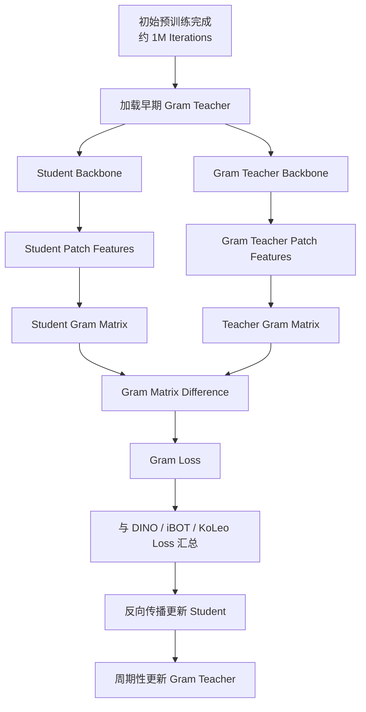

注意：

Gram Loss 主要在 Global Crop 上计算。

对于高分辨率适配阶段，DINOv3 还会使用更高分辨率的 Gram Teacher 特征，并通过下采样与 Student 的 Patch 网格对齐。

这使模型能够在提高输入分辨率的同时，继续保持局部特征的一致性。

Gram Anchoring 的意义：

**它不是为了让模型获得更强的全局语义，而是为了避免模型在长期训练中牺牲局部特征质量。**

---

### 5.9 DINOv3 的完整 Loss 计算
现在将所有 Loss 放在一起理解。

DINOv3 的训练分为两个主要阶段。

#### 5.9.1 第一阶段：初始自监督预训练
论文给出的初始训练目标：

$ \boxed{
\mathcal{L}_{Pre}
=
\mathcal{L}_{DINO}
+
\mathcal{L}_{iBOT}
+
0.1\mathcal{L}_{KoLeo}
} $

其中：

| Loss | 权重 | 输入特征 | 主要作用 |
| --- | ---: | --- | --- |
| DINO | 1.0 | CLS Token | 全局语义一致性 |
| iBOT | 1.0 | Masked Patch Token | 局部特征学习 |
| KoLeo | 0.1 | Student CLS Token | 特征空间分布正则化 |


三种 Loss 的作用并不相同。

DINO：

让模型知道整张图片表达了什么。

iBOT：

让模型知道每个局部区域具有什么特征。

KoLeo：

避免不同图片的特征过度集中。

#### 5.9.2 第二阶段：Gram Refinement
初始训练完成后，增加 Gram Loss：

$ \boxed{
\mathcal{L}_{Ref}
=
w_D\mathcal{L}_{DINO}
+
\mathcal{L}_{iBOT}
+
w_{DK}\mathcal{L}_{KoLeo}
+
w_{Gram}\mathcal{L}_{Gram}
} $

其中 Gram Loss 的作用是：

保持局部 Patch 之间的相似性结构。

需要注意：

论文中的初始训练 Loss 和 Refinement Loss 是两个不同阶段的优化目标，不能将初始阶段的三项 Loss 直接称为整个 DINOv3 训练过程的全部 Loss。

#### 5.9.3 一次训练迭代中的所有 Loss
完整流程：

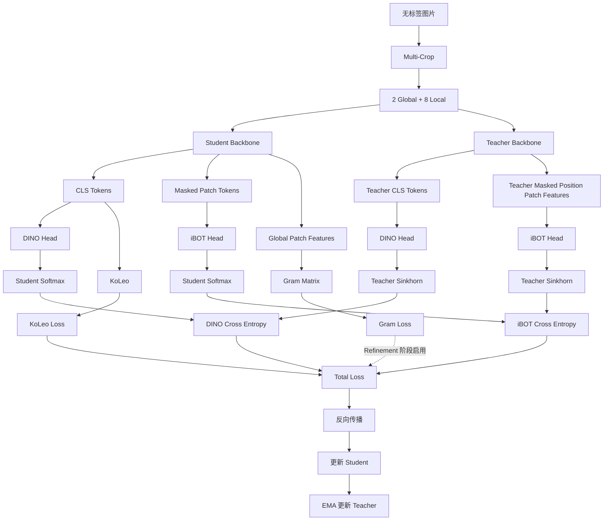

#### 5.9.4 不同 Loss 的梯度流向
这点非常重要。

| Loss | Student Backbone | Student DINO Head | Student iBOT Head | Teacher |
| --- | --- | --- | --- | --- |
| DINO | 更新 | 更新 | 不更新 | 不更新 |
| iBOT | 更新 | 不更新 | 更新 | 不更新 |
| KoLeo | 更新 | 不更新 | 不更新 | 不更新 |
| Gram | 更新 | 不更新 | 不更新 | 不更新 |


解释：

DINO Loss：

通过 CLS Token 向 Backbone 和 DINO Head 反向传播。

iBOT Loss：

通过 Masked Patch Token 向 Backbone 和 iBOT Head 反向传播。

KoLeo Loss：

直接通过 CLS Token 向 Backbone 反向传播。

Gram Loss：

直接通过 Patch Feature 向 Backbone 反向传播。

Teacher：

始终不参与梯度更新，而是通过 EMA 更新。

#### 5.9.5 PyTorch 风格的 Loss 计算示例
下面给出一个简化的教学实现，用来理解三种初始 Loss 的计算方式。

它展示的是数学逻辑，不是 DINOv3 官方完整训练代码。

```python
import torch
import torch.nn.functional as F


def cross_entropy_teacher_student(
    student_logits,
    teacher_probs,
    student_temp=0.1
):
    """
    student_logits:
        [N, K]

    teacher_probs:
        [N, K]

    student_temp:
        Student Temperature
    """

    student_log_probs = F.log_softmax(
        student_logits.float() / student_temp,
        dim=-1
    )

    loss = -(
        teacher_probs.detach().float() *
        student_log_probs
    ).sum(dim=-1)

    return loss.mean()


def dino_loss(
    student_logits,
    teacher_probs,
    student_temp=0.1
):
    """
    教学版本：
    仅计算已经完成视图匹配的样本对。
    """

    return cross_entropy_teacher_student(
        student_logits,
        teacher_probs,
        student_temp
    )


def ibot_loss(
    student_patch_logits,
    teacher_patch_probs,
    masks,
    student_temp=0.1
):
    """
    student_patch_logits:
        [B, N, K]

    teacher_patch_probs:
        [B, N, K]

    masks:
        [B, N]

    True 表示该位置被 Mask。
    """

    student_log_probs = F.log_softmax(
        student_patch_logits.float() / student_temp,
        dim=-1
    )

    # 每个 Patch 的交叉熵
    patch_loss = -(
        teacher_patch_probs.detach().float() *
        student_log_probs
    ).sum(dim=-1)

    # 仅计算 Masked Patch
    patch_loss = patch_loss * masks.float()

    # 每张图片内部单独求平均
    mask_count = masks.sum(dim=1).clamp(min=1)

    image_loss = patch_loss.sum(dim=1) / mask_count

    # 对 Batch 求平均
    return image_loss.mean()


def koleo_loss(features, eps=1e-8):
    """
    features:
        [B, D]

    教学版本：
    在一个 Batch 内寻找每个特征的最近邻。
    """

    # L2 Normalize
    features = F.normalize(features, p=2, dim=-1)

    # 计算余弦相似度矩阵
    similarity = features @ features.T

    # 排除自身
    similarity.fill_diagonal_(-1)

    # 找到最近邻
    nearest_indices = similarity.argmax(dim=1)

    nearest_features = features[nearest_indices]

    # 最近邻欧氏距离
    distances = torch.norm(
        features - nearest_features,
        p=2,
        dim=-1
    )

    # KoLeo Loss
    return -torch.log(distances + eps).mean()


# 假设已经得到各个分支的预测结果
# 这里使用随机张量演示 Loss 的调用方式。

B = 16
N = 256
K_DINO = 262144
K_IBOT = 98304
D = 4096

# DINO
student_dino = torch.randn(B, K_DINO)
teacher_dino = F.softmax(
    torch.randn(B, K_DINO),
    dim=-1
)

loss_dino = dino_loss(
    student_dino,
    teacher_dino
)

# iBOT
student_ibot = torch.randn(B, N, K_IBOT)
teacher_ibot = F.softmax(
    torch.randn(B, N, K_IBOT),
    dim=-1
)

masks = torch.rand(B, N) < 0.3

loss_ibot = ibot_loss(
    student_ibot,
    teacher_ibot,
    masks
)

# KoLeo
cls_features = torch.randn(B, D)

loss_koleo = koleo_loss(cls_features)

# 初始总 Loss
loss_total = (
    loss_dino
    + loss_ibot
    + 0.1 * loss_koleo
)

print("DINO Loss:", loss_dino.item())
print("iBOT Loss:", loss_ibot.item())
print("KoLeo Loss:", loss_koleo.item())
print("Total Loss:", loss_total.item())
```

注意：

上面的示例为了突出 Loss 计算过程，使用了普通 Softmax 模拟 Teacher 概率分布。

实际 DINOv3 训练中：

+ Teacher 使用 Sinkhorn-Knopp。
+ DINO Loss 需要按照 Global/Local Crop 进行交叉视图匹配。
+ iBOT 需要按照 Masked Patch 索引对齐 Teacher 和 Student。
+ KoLeo 使用官方的分布式近邻计算实现。
+ Gram Loss 在 Refinement 阶段单独加入。

因此，这段代码不能直接代替官方训练流程。

#### 5.9.6 一个非常重要的实现细节
上面的总 Loss 是论文层面的简化表达。

官方 `ssl_meta_arch.py` 在实际计算时，还会对不同 Loss 进行匹配数量和视图数量的缩放。

例如：

```python
dino_global_terms = (
    n_global_crops * (n_global_crops - 1)
)

dino_local_terms = (
    n_global_crops * n_local_crops
)

dino_global_scale = (
    dino_global_terms /
    (dino_global_terms + dino_local_terms)
)

dino_local_scale = (
    dino_local_terms /
    (dino_global_terms + dino_local_terms)
)
```

KoLeo 也会根据 Global Crop 数量进行相应缩放。

因此，实际训练代码中的单项 Loss 数值与论文公式中各项 Loss 的数值定义不一定完全相同。

复现时应以完整的损失计算代码和训练配置为准。

---

### 5.10 本章关键知识总结
DINOv3 的自监督训练不是简单地让两个网络输出相同的特征，而是通过不同的学习目标，从多个层次约束视觉表示。

| 模块 | 输入 | 输出 | 核心计算 | 作用 |
| --- | --- | --- | --- | --- |
| DINO | CLS Token | Prototype Probability | Sinkhorn + Softmax + Cross Entropy | 全局语义学习 |
| iBOT | Masked Patch Token | Prototype Probability | Sinkhorn + Softmax + Cross Entropy | 局部特征学习 |
| KoLeo | CLS Feature | Nearest Neighbor Distance | Negative Log Distance | 特征分布正则化 |
| Gram | Patch Feature | Gram Matrix | Frobenius Distance | 保持局部相似性结构 |


需要特别记住以下几个容易混淆的地方：

**1. Teacher 不是固定模型。**

Teacher 的 Backbone 和 Projection Heads 都通过 Student 的 EMA 更新。

**2. Teacher 只处理 Global Crop。**

Student 同时处理 Global Crop 和 Local Crop。

**3. DINO Loss 使用 CLS Token。**

它负责全局语义学习，Teacher 和 Student 之间需要进行跨视图匹配。

**4. iBOT Loss 使用 Patch Token。**

Student 对 Global Crop 的部分 Patch 进行 Mask，Teacher 对应位置的未 Mask 特征作为监督目标。

**5. DINO Head 和 iBOT Head 是两个独立的投影头。**

两者拥有不同的 Bottleneck 和 Prototype 数量。

**6. Sinkhorn-Knopp 同时用于 DINO 和 iBOT。**

Teacher 通过 Sinkhorn-Knopp 产生目标分布，Student 通过 Softmax 产生预测分布。

**7. KoLeo 不需要 Teacher。**

它直接约束 Student 的 CLS 特征，通过最近邻距离改善特征空间分布。

**8. Gram Anchoring 不是初始训练就启用的 Loss。**

它主要用于长时间训练之后的局部特征优化阶段。

从整体上看：

+ DINO 解决全局语义一致性。
+ iBOT 解决局部 Patch 特征学习。
+ KoLeo 改善特征空间分布。
+ Gram Anchoring 保持局部特征之间的关系。

四者结合，使 DINOv3 不仅能够学习具有较强语义表达能力的全局特征，还能保留适合检测、分割、深度估计和特征匹配等任务的高质量稠密特征。

### 5.11 参考资料与官方源码
**DINOv3 论文**

+ [DINOv3: Technical Report](https://arxiv.org/abs/2508.10104)

**官方训练架构**

+ [ssl_meta_arch.py](https://github.com/facebookresearch/dinov3/blob/main/dinov3/train/ssl_meta_arch.py)

**DINO Loss**

+ [dino_clstoken_loss.py](https://github.com/facebookresearch/dinov3/blob/main/dinov3/loss/dino_clstoken_loss.py)

**iBOT Loss**

+ [ibot_patch_loss.py](https://github.com/facebookresearch/dinov3/blob/main/dinov3/loss/ibot_patch_loss.py)

**KoLeo Loss**

+ [koleo_loss.py](https://github.com/facebookresearch/dinov3/blob/main/dinov3/loss/koleo_loss.py)

**Gram Loss**

+ [gram_loss.py](https://github.com/facebookresearch/dinov3/blob/main/dinov3/loss/gram_loss.py)

**Projection Head**

+ [dino_head.py](https://github.com/facebookresearch/dinov3/blob/main/dinov3/layers/dino_head.py)

**训练配置**

+ [ssl_default_config.yaml](https://github.com/facebookresearch/dinov3/blob/main/dinov3/configs/ssl_default_config.yaml)

## 六、Sinkhorn-Knopp：为什么要替代 Centering？
### 6.1 什么是 Prototype Collapse？
自监督学习有一个重要问题：

模型可能将大量不同图片都映射到非常相似的特征。

例如：

```latex
图片 A → Prototype 1

图片 B → Prototype 1

图片 C → Prototype 1

图片 D → Prototype 1
```

如果所有图片都产生相似的输出，模型就没有学到有区分度的视觉特征。

这种现象称为 Representation Collapse。

因此需要一种机制，让 Teacher 输出的 Prototype Assignment 更加合理。

### 6.2 Sinkhorn-Knopp 的核心思想
Sinkhorn-Knopp 是一种矩阵归一化算法。

其目标是：

在保证每个样本获得合理分配的同时，使不同 Prototype 的整体分配更加均衡。

假设：

Teacher 输出矩阵：

$ Z\in\mathbb{R}^{B\times K} $

其中：

+ B：Batch Size。
+ K：Prototype 数量。

先进行温度缩放：

$ Q=\exp(Z/\tau) $

然后转置：

$ Q\in\mathbb{R}^{K\times B} $

接下来反复进行行归一化和列归一化。

**行归一化：**

控制每个 Prototype 获得的整体分配质量。

**列归一化：**

保证每个样本的分配概率符合要求。

经过若干次迭代：

$ Q\rightarrow Q_{balanced} $

最终得到 Teacher 的目标分布。

可以简单理解为：

```latex
Teacher Logits
      |
      v
温度缩放 + Exp
      |
      v
矩阵 Q
      |
      v
行归一化
      |
      v
列归一化
      |
      v
重复迭代
      |
      v
Balanced Assignment
```

DINOv3 在 DINO 和 iBOT 两个目标中都采用 Sinkhorn-Knopp。

与传统 DINO 中的 Centering 相比，这种方式能够更直接地控制整个 Batch 的 Prototype Assignment 分布。

---

## 七、DINOv3 的训练数据如何构建？
### 7.1 为什么数据规模很重要？
DINOv3 使用大规模无标注图像进行训练。

但这里有一个问题：

数据越多，模型效果一定越好吗？

答案是否定的。

如果训练数据存在大量重复、分布不均衡或者视觉概念覆盖不足等问题，单纯增加数据量不一定能够提高模型效果。

因此，DINOv3 在数据构建上投入了大量工作。

### 7.2 原始数据池
论文介绍：

Meta 从 Instagram 公开帖子中的图片构建原始数据池。

经过平台内容审核后，获得约：

$ \boxed{17B\text{ Images}} $

注意：

17B 是原始数据池规模，不是最终直接用于训练的数据量。

最终通过数据筛选得到：

$ \boxed{1.689B\text{ Images}} $

这个数据集被命名为：

LVD-1689M。

### 7.3 LVD-1689M 如何构建？
DINOv3 使用三种数据筛选策略。

#### 第一种：Clustering-based Curation
基于聚类的数据筛选。

首先使用 DINOv2 提取图片特征。

然后对特征进行分层 Hierarchical K-Means 聚类。

论文中使用五层聚类结构：

```latex
DINOv2 Feature Extraction
          |
          v
Hierarchical K-Means          |
          +---- 200M Clusters
          |
          +---- 8M Clusters
          |
          +---- 800K Clusters
          |
          +---- 100K Clusters
          |
          +---- 25K Clusters
          |
          v
Balanced Sampling
          |
          v
Curated Images
```

通过分层聚类和均衡采样，减少数据中某些视觉概念占比过高的问题。

#### 第二种：Retrieval-based Curation
基于检索的数据筛选。

核心思路：

先准备一批具有代表性的 Seed Datasets。

然后从原始数据池中检索与这些数据集视觉特征相似的图片。

这样能够提高训练数据对特定下游任务的覆盖程度。

例如：

```latex
Seed Dataset
     |
     v
提取视觉特征
     |
     v
在原始数据池中进行检索
     |
     v
找到相似图片
     |
     v
加入训练数据
```

#### 第三种：Raw Public Datasets
除了自动筛选的数据，还加入一些公开视觉数据集：

+ ImageNet-1K
+ ImageNet-22K
+ Mapillary Street-level Sequences

这些数据可以补充特定视觉场景的信息。

### 7.4 三种数据策略为什么需要组合？
论文进行了数据消融实验：

| 数据类型 | IN1k k-NN | IN1k Linear | ObjectNet | iNaturalist | Paris Retrieval |
| --- | ---: | ---: | ---: | ---: | ---: |
| Raw | 80.1 | 84.8 | 70.3 | 70.1 | 63.3 |
| Clustering | 79.4 | 85.4 | 72.3 | 81.3 | 85.2 |
| Retrieval | 84.0 | 86.7 | 70.7 | 86.0 | 82.7 |
| LVD-1689M | 84.6 | 87.2 | 72.8 | 87.0 | 85.9 |


实验使用较短的 200K Iterations 训练。

可以看到：

+ Clustering 在部分任务上更好。
+ Retrieval 在部分任务上更好。
+ Raw Data 也有一定价值。
+ 三者组合后整体表现最好。

这说明：

**数据筛选方式与数据规模同样重要。**

### 7.5 数据采样策略
DINOv3 并不是简单地将所有数据混合后随机读取。

它使用两种 Batch 采样方式：

**Homogeneous Batch**

一个 Batch 中的数据来自同一个数据集。

**Heterogeneous Batch**

一个 Batch 中的数据来自多个不同的数据组成部分。

论文使用：

```latex
10%：

从 ImageNet-1K 中采样 Homogeneous Batch。

90%：

从其他数据组成部分中构建 Heterogeneous Batch。
```

这种设计可以兼顾高质量数据和大规模多样化数据。

### 7.6 SAT-493M：卫星图像数据集
除了 Web 图像预训练，DINOv3 还训练了专门的卫星图像模型。

数据集：

SAT-493M。

包含约：

$ 493M\text{ Images} $

主要用于遥感、卫星图像以及航空影像领域。

官方发布的卫星模型包括：

+ ViT-7B/16：从头训练。
+ ViT-L/16：从 ViT-7B 蒸馏。

这说明 DINOv3 的训练方法不局限于普通互联网图片。

同一套自监督学习方法可以应用到不同领域的数据上。

---

## 八、DINOv3 ViT-7B 的训练配置与资源
### 8.1 训练规模
论文中的主要预训练配置：

| 参数 | 配置 |
| --- | ---: |
| Backbone | ViT-7B |
| 参数量 | 6.716B |
| GPU | NVIDIA H100 |
| GPU 数量 | 256 |
| Global Batch Size | 4096 |
| Batch Size / GPU | 16 |
| Iterations | 1,000,000 |
| Global Crops | 2 |
| Local Crops | 8 |
| Global Resolution | 256 |
| Local Resolution | 112 |
| Optimizer | AdamW |
| 参数精度 | BF16 |
| 矩阵乘法 | FP8 |
| Teacher EMA | 0.999 |


论文还报告了：

$ Total\ GPU\ Hours=61,440 $

即约 6.14 万 GPU 小时。

### 8.2 为什么使用 FSDP？
7B 参数模型非常大。

如果使用普通 Data Parallel，每张 GPU 都需要保存完整模型参数、梯度和优化器状态，显存开销会非常高。

DINOv3 使用 Fully Sharded Data Parallel（FSDP）。

核心思想：

将模型参数、梯度和优化器状态分片到多张 GPU 上。

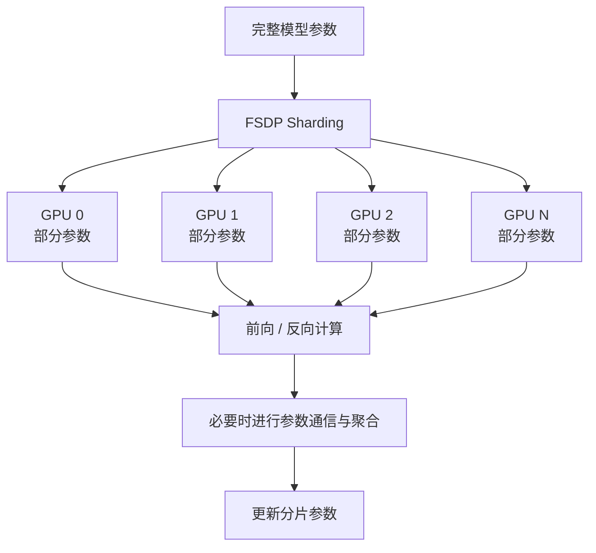

此外，DINOv3 使用：

+ BF16 作为主要参数计算精度。
+ FP32 进行梯度归约。
+ FP8 加速部分 Linear 层的矩阵乘法。
+ Gradient Checkpointing 降低激活值显存。
+ Layer-wise Learning Rate Decay。

### 8.3 训练超参数
论文 Appendix C 给出的主要设置：

| 参数 | 数值 |
| --- | ---: |
| Learning Rate | 0.0004 |
| LR Warmup | 100K Iterations |
| Weight Decay | 0.04 |
| Layer-wise Decay | 0.98 |
| Stochastic Depth | 0.4 |
| Teacher EMA | 0.999 |
| Training Iterations | 1M |


需要注意：

论文 Appendix C 报告的 Learning Rate 为 0.0004。

公开仓库中的 `dinov3_vit7b16_pretrain.yaml` 则设置：

```yaml
optim:
  optimizer: adamw
  scaling_rule: sqrt_wrt_1024
  layerwise_decay: 0.98

schedules:
  lr:
    start: 0
    peak: 5.0e-05
    end: 5.0e-05
    warmup_epochs: 100
```

这两处配置并不是可以直接逐字段等同的数值。

公开配置还包含学习率缩放规则，实际复现时应结合对应版本的调度器代码计算有效学习率，不应只复制某一个 YAML 字段。

### 8.4 为什么可以长时间训练？
DINOv3 在训练策略上还有一个重要改变：

减少对优化器参数的复杂动态调度。

论文提出使用：

+ Constant Learning Rate。
+ Constant Weight Decay。
+ Constant Teacher EMA Momentum。

并保留初始阶段的 Warmup。

这样可以避免必须提前精确指定训练结束时间的问题。

当下游任务性能仍然提升时，可以继续训练。

但随着训练时间增加，DINOv3 发现了一个新的问题：

**全局特征越来越好，局部特征却可能越来越差。**

这正是 Gram Anchoring 要解决的问题。

---

## 九、Gram Anchoring：DINOv3 最重要的创新
### 9.1 一个非常有意思的训练现象
假设模型正在进行长时间训练。

我们分别观察两个指标：

```latex
训练 Iteration 增加：

Image Classification Accuracy
       |
       |          /
       |        /
       |      /
       |    /
       +----------------->


Dense Feature Quality
       |
       |     /\
       |    /  \
       |   /    \____
       |
       +----------------->
```

分类性能可能持续提升。

但是 Dense Feature Quality 却可能在训练到一定阶段之后下降。

论文观察到：

ViT-g 和 ViT-7B 在大约 200K Iterations 之后，分割性能开始下降。

对于 ViT-7B，后期下降尤其明显。

为什么？

### 9.2 CLS Token 与 Patch Token 的相似度变化
Transformer 中：

CLS Token 会通过 Self-Attention 不断聚合 Patch Tokens 的信息。

随着训练进行，CLS Token 逐渐形成更加丰富的全局语义表示。

但问题在于：

Patch Tokens 也会受到全局语义信息的影响。

随着训练进行，CLS Token 与 Patch Tokens 之间的余弦相似度可能逐渐增加。

这会削弱 Patch 特征之间的局部区分能力。

可以这样理解：

原本：

```latex
Patch 1：树叶特征

Patch 2：树干特征

Patch 3：土壤特征

Patch 4：天空特征
```

不同 Patch 保留着各自的局部信息。

随着训练进行：

```latex
Patch 1：全局语义 + 局部信息

Patch 2：全局语义 + 局部信息

Patch 3：全局语义 + 局部信息

Patch 4：全局语义 + 局部信息
```

如果全局语义逐渐占据主导地位，Patch 之间的局部特征差异就可能减弱。

最终：

分类性能提高，但局部匹配、分割、几何任务的特征质量下降。

注意：

这里讨论的是 Patch 特征之间的相似度结构退化，不是 Register Tokens 解决的高范数异常问题。

两者是不同的问题。

### 9.3 什么是 Gram Matrix？
Gram Matrix 是一个描述向量之间两两相似度的矩阵。

假设一张图片经过 Backbone，得到 P 个 Patch 特征。

每个 Patch 的特征维度为 d。

那么：

$ X\in\mathbb{R}^{P\times d} $

先对每个 Patch 特征进行 L2 归一化：

$ \hat X=Normalize(X) $

然后计算：

$ G=\hat X\hat X^T $

得到：

$ \boxed{G\in\mathbb{R}^{P\times P}} $

其中：

$ G_{ij}=\hat x_i\cdot\hat x_j $

因为特征已经归一化，所以：

$ G_{ij}=CosineSimilarity(x_i,x_j) $

也就是说：

Gram Matrix 记录了图片中任意两个 Patch 之间的特征相似度。

例如：

```latex
假设图片只有 4 个 Patch：

       P1    P2    P3    P4

P1    1.0   0.8   0.2   0.1

P2    0.8   1.0   0.3   0.1

P3    0.2   0.3   1.0   0.7

P4    0.1   0.1   0.7   1.0
```

可以观察到：

+ P1 和 P2 比较相似。
+ P3 和 P4 比较相似。
+ P1 和 P4 差异较大。

这张矩阵描述了 Patch 之间的关系结构。

### 9.4 Gram Anchoring 的核心思想
DINOv3 的想法：

既然长时间训练可能破坏 Patch 之间的相似度结构，那么能不能使用一个早期模型作为参考，让当前模型保持这种局部特征关系？

于是引入：

Gram Teacher。

它是一个具有较好局部特征质量的早期模型。

现在有两个模型：

```latex
Student：

当前正在训练的模型。

Gram Teacher：

早期保存的模型，提供局部特征关系参考。
```

分别提取 Patch 特征：

$ X_S\in\mathbb{R}^{P\times d} $

$ X_G\in\mathbb{R}^{P\times d} $

分别计算 Gram Matrix：

$ G_S=X_SX_S^T $

$ G_G=X_GX_G^T $

然后让 Student 的 Gram Matrix 接近 Gram Teacher：

$ \boxed{
\mathcal{L}_{Gram}
=
\left\|
X_SX_S^T-X_GX_G^T
\right\|_F^2
} $

其中：

+ $ X_S $：Student 的归一化 Patch 特征。
+ $ X_G $：Gram Teacher 的归一化 Patch 特征。
+ $ \|\cdot\|_F $：Frobenius Norm。

### 9.5 为什么不直接让 Student 特征等于 Teacher 特征？
这是 Gram Anchoring 非常重要的设计。

假设直接使用特征蒸馏：

$ \mathcal{L}
=
\|X_S-X_G\|^2 $

那么 Student 必须尽可能复现 Teacher 的每个特征向量。

但 Gram Anchoring 不一样。

它只要求：

Student 和 Teacher 的 Patch 两两相似度关系接近。

不要求两个模型产生完全相同的特征向量。

例如：

```latex
Teacher：

Patch A 和 Patch B 相似度 = 0.8

Patch A 和 Patch C 相似度 = 0.2


Student：

Patch A 和 Patch B 相似度 = 0.79

Patch A 和 Patch C 相似度 = 0.21
```

虽然 Student 和 Teacher 的特征向量可能不同，但它们学习到了相似的局部关系。

因此：

**Gram Anchoring 保留的是特征空间中的相似度结构，而不是直接复制特征本身。**

这让 Student 仍然可以学习新的语义信息，同时维持良好的局部特征一致性。

### 9.6 Gram Teacher 如何选择？
论文使用早期训练阶段的模型作为 Gram Teacher。

原因是：

早期模型通常具有较好的 Patch-Level Consistency。

论文进行了消融实验：

| Gram Teacher Iteration | IN1k Linear | ADE20K mIoU | NYU RMSE |
| --- | ---: | ---: | ---: |
| Baseline | 88.2 | 50.3 | 0.307 |
| 200K | 88.0 | 53.6 | 0.285 |
| 200K + High Resolution | 88.0 | 55.7 | 0.281 |
| 100K + High Resolution | 87.9 | 55.7 | 0.284 |
| 1M + High Resolution | 88.1 | 54.9 | 0.290 |


可以看到：

200K 甚至 100K 迭代的 Teacher，在局部特征方面可能比 1M 迭代的 Teacher 更好。

这也是 Gram Anchoring 使用早期模型作为参考的原因。

### 9.7 Gram Anchoring 什么时候加入？
论文中：

Gram Anchoring 从约 1M Iterations 之后开始使用。

主要配置：

```latex
Gram Loss Weight = 2

Teacher Update Frequency = 10K Iterations

Maximum Teacher Updates = 3
```

这里的 Gram Teacher 不是每一步都进行普通的 Student EMA 更新。

论文描述的是周期性更新 Gram Teacher，使其逐渐与主 EMA Teacher 同步。

完整过程：

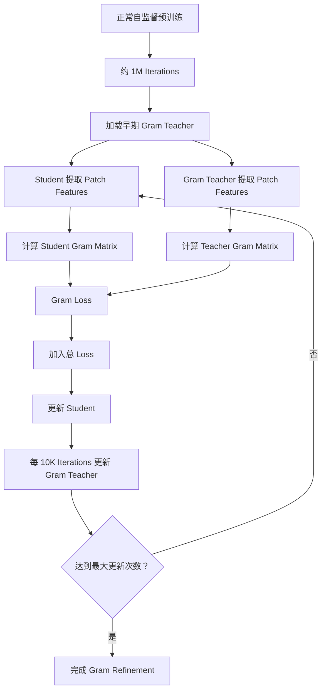

### 9.8 High-Resolution Gram Anchoring
DINOv3 还发现：

如果直接使用较低分辨率的图片计算 Gram Matrix，可能无法充分保留精细的局部特征关系。

因此又提出 High-Resolution Gram Anchoring。

核心过程：

1. 使用更高分辨率的图片输入 Gram Teacher。
2. 提取高分辨率 Patch Features。
3. 使用 Bicubic Interpolation 对特征图进行下采样。
4. 使 Teacher 特征图与 Student 的空间尺寸一致。
5. 计算 Gram Matrix 并进行约束。

例如：

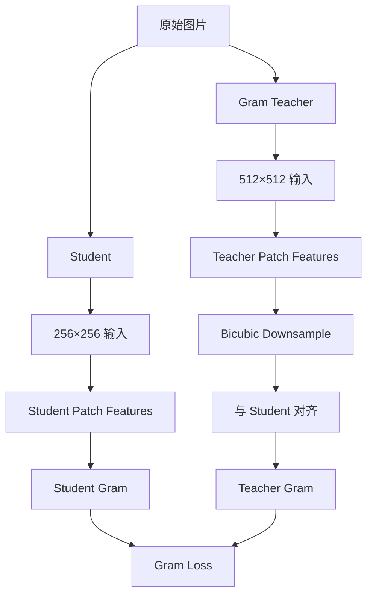

这样可以利用高分辨率图像产生更加平滑、稳定的局部特征关系，再将这种关系传递给 Student。

论文中，这种 High-Resolution Gram Refinement 在 ADE20K 上额外获得约 2 mIoU 的提升。

### 9.9 Refinement 阶段的总 Loss
加入 Gram Anchoring 后：

$ \boxed{
\mathcal{L}_{Ref}
=
w_D\mathcal{L}_{DINO}
+
\mathcal{L}_{iBOT}
+
w_{DK}\mathcal{L}_{DKoleo}
+
w_{Gram}\mathcal{L}_{Gram}
} $

其中：

$ w_{Gram}=2 $

核心变化：

原本只要求模型学习全局和局部特征。

现在额外要求模型保持局部 Patch 之间的相似度关系。

---

## 十、DINOv3 的 Post-Training
DINOv3 的训练并不止于 7B Backbone 预训练。

论文还设计了三个重要的后训练方向：

1. Resolution Scaling。
2. Model Distillation。
3. Text Alignment。

### 10.1 Resolution Scaling：高分辨率适配
DINOv3 的主要预训练分辨率：

```latex
Global Crop = 256×256

Local Crop = 112×112
```

但实际应用中，经常需要处理：

+ 512×512。
+ 1024×1024。
+ 2048×2048。
+ 更高分辨率的图片。

如果直接将 7B 模型用于高分辨率图片，模型虽然可以计算，但不一定能够充分适应新的输入分辨率。

因此 DINOv3 额外进行了高分辨率适配。

训练设置：

| 参数 | 配置 |
| --- | --- |
| Global Crop | 512 / 768 |
| Local Crop | 112 / 168 / 224 / 336 |
| Training Iterations | 10K |
| Gram Anchoring | 使用 |


论文采用不同分辨率的组合：

| Global | Local | Gram Teacher | 采样概率 |
| ---: | ---: | ---: | ---: |
| 512 | 112 | 768 | 0.30 |
| 768 | 112 | 1152 | 0.30 |
| 768 | 168 | 1152 | 0.30 |
| 768 | 224 | 1152 | 0.05 |
| 768 | 336 | 1152 | 0.05 |


通过短时间的高分辨率训练，让模型更好地适应不同分辨率。

论文还发现：

经过高分辨率适配的模型，可以在超过 4K 分辨率的输入下保持较好的特征质量。

这对于遥感、检测、分割等任务非常有价值。

### 10.2 Model Distillation：从 7B 蒸馏小模型
ViT-7B 虽然性能很强，但部署成本非常高。

因此 DINOv3 使用 7B 模型作为固定 Teacher，蒸馏出多个小模型。

与预训练阶段不同：

这里的 Teacher 是固定的 7B 模型，不再使用 Student EMA 更新 Teacher。

整体：

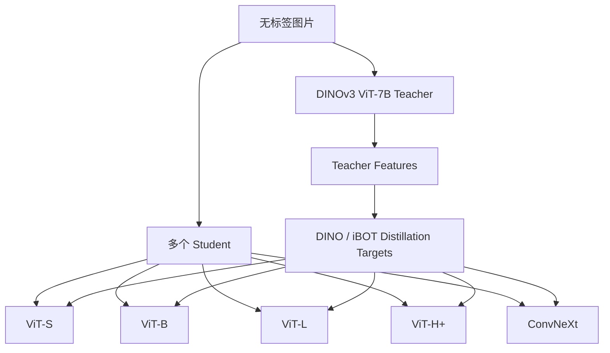

蒸馏过程仍然使用 DINO 和 iBOT 训练目标。

但由于 Teacher 固定，不再存在长时间 EMA 训练中相同的 Patch 特征退化问题，因此不需要使用 Gram Anchoring。

### 10.3 DINOv3 模型家族
官方提供的模型：

**ViT 系列**

| 模型 | 参数量 | 说明 |
| --- | ---: | --- |
| ViT-S/16 | 21M | 小型模型 |
| ViT-S+/16 | 29M | 定制小型模型 |
| ViT-B/16 | 86M | Base |
| ViT-L/16 | 300M | Large |
| ViT-H+/16 | 840M | 定制大型模型 |
| ViT-7B/16 | 6716M | 完整大模型 |


**ConvNeXt 系列**

| 模型 | 参数量 |
| --- | ---: |
| ConvNeXt Tiny | 29M |
| ConvNeXt Small | 50M |
| ConvNeXt Base | 89M |
| ConvNeXt Large | 198M |


ConvNeXt 也可以通过蒸馏获得 DINOv3 的特征能力。

这是一个比较有意思的地方：

Teacher 使用 Transformer，Student 却可以使用 CNN 架构。

说明 DINOv3 学习到的视觉知识，并不局限于某一种网络结构。

### 10.4 不同模型的计算量
论文给出了不同分辨率下的推理 FLOPs。

| 模型 | 参数量 | 256×256 GFLOPs | 512×512 GFLOPs |
| --- | ---: | ---: | ---: |
| ViT-S | 21M | 12 | 63 |
| ViT-S+ | 29M | 16 | 79 |
| ViT-B | 86M | 47 | 216 |
| ViT-L | 300M | 163 | 721 |
| ViT-H+ | 840M | 450 | 1903 |
| ViT-7B | 6716M | 3550 | 14515 |
| ConvNeXt-T | 29M | 5 | 20 |
| ConvNeXt-S | 50M | 11 | 46 |
| ConvNeXt-B | 89M | 20 | 81 |
| ConvNeXt-L | 198M | 38 | 152 |


可以发现：

+ ViT-7B 计算成本非常高。
+ ViT-L 在计算量和特征能力之间具有较好的平衡。
+ ConvNeXt 系列更适合计算资源受限的环境。

### 10.5 为什么小模型可以接近 7B Teacher？
论文发现：

经过充分蒸馏后，ViT-H+ 的表现已经接近 ViT-7B。

虽然参数量相差接近 8 倍，但在多个任务上，ViT-H+ 仍然可以达到接近 Teacher 的效果。

这说明：

大模型的知识并不一定只能通过同等规模的模型表达。

通过合理的蒸馏目标和训练方法，可以将大模型的视觉表示能力迁移到小模型。

---

## 十一、DINOv3 的文本对齐：dino.txt
### 11.1 为什么还需要文本对齐？
DINOv3 是纯视觉自监督模型。

它在预训练阶段没有使用图像与文本配对数据。

因此它擅长学习视觉特征，但并不天然具备 CLIP 那样的图文语义对齐能力。

例如：

输入一张猫的图片。

DINOv3 可以提取出很强的视觉特征，但它不会天然知道文本 `"cat"` 对应哪个特征。

因此论文进一步使用 dino.txt。

相关方法：

DINOv2 Meets Text。

### 11.2 文本对齐的核心思路
DINOv3 使用类似 LiT（Locked-image Text Tuning）的训练策略。

核心：

+ 冻结视觉 Backbone。
+ 新建 Text Encoder。
+ 通过图像和文本配对数据进行对比学习。

整体：

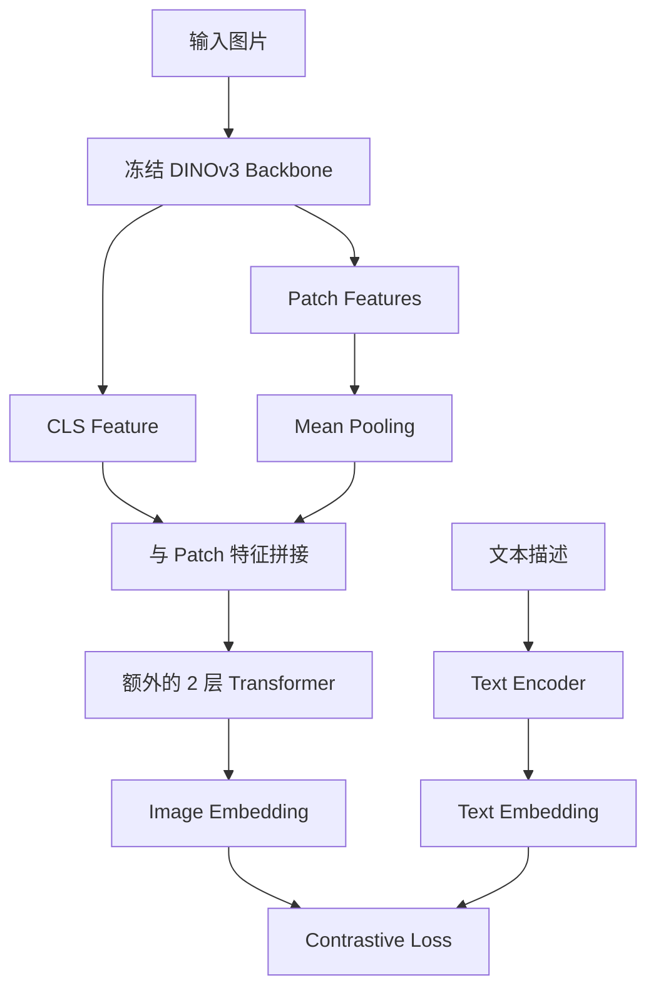

这里有两个重要设计：

1. 视觉 Backbone 保持冻结。
2. 将 CLS Token 与 Mean-Pooled Patch Embedding 拼接，再与文本特征进行对齐。

这样可以同时利用全局和局部视觉特征。

最终得到具有零样本图文匹配能力的模型。

---

## 十二、DINOv3 的输出究竟是什么？
### 12.1 Backbone 输出结构
DINOv3 并不是直接输出类别或者检测框。

它输出的是视觉特征。

官方代码：

`dinov3/models/vision_transformer.py`

提供：

```python
model.forward_features(image)
```

主要返回：

| 输出名称 | 形状 | 含义 |
| --- | --- | --- |
| x_norm_clstoken | B×4096 | CLS 特征 |
| x_norm_patchtokens | B×N×4096 | Patch 特征 |
| x_storage_tokens | B×4×4096 | Register 特征 |
| x_prenorm | B×(N+5)×4096 | Norm 前的特征 |
| masks | 与 Patch 对应 | Mask 信息 |


### 12.2 输入 256×256 图片时的输出
假设：

```latex
Batch Size = 1
Image Size = 256×256
Patch Size = 16
```

Patch 数量：

$ N=16\times16=256 $

因此：

CLS：

$ X_{CLS}\in\mathbb{R}^{1\times4096} $

Patch：

$ X_{Patch}\in\mathbb{R}^{1\times256\times4096} $

Register：

$ X_{Register}\in\mathbb{R}^{1\times4\times4096} $

### 12.3 Patch Features 如何变成特征图？
Patch Features 原本是：

$ X_{Patch}\in\mathbb{R}^{B\times N\times4096} $

但对于分割、检测等任务，通常需要二维特征图。

因此将其 Reshape：

$ X_{Map}\in
\mathbb{R}^{B\times4096\times16\times16} $

例如：

```latex
Patch Features：

[1,256,4096]

Transpose：

[1,4096,256]

Reshape：

[1,4096,16,16]
```

这就是 DINOv3 的 Dense Feature Map。

可以将它输入：

+ UPerNet。
+ DPT。
+ Mask2Former。
+ Faster R-CNN。
+ 其他检测、分割解码器。

需要注意：

ViT-7B 最终 Backbone 输出的是一张 Patch 特征图，并不天然提供传统 CNN 那种 P3、P4、P5 多尺度特征金字塔。

如果下游任务需要多尺度特征，需要额外设计特征融合模块或使用中间层特征。

---

## 十三、官方 GitHub 仓库结构与代码分析
官方仓库：

[https://github.com/facebookresearch/dinov3](https://github.com/facebookresearch/dinov3)

这是 Meta 发布的参考 PyTorch 实现，包含模型定义、训练、损失函数、数据处理和评估代码。

### 13.1 主要目录
```latex
dinov3/
│
├── configs/
│   └── train/
│       ├── dinov3_vit7b16_pretrain.yaml
│       ├── dinov3_vit7b16_gram_anchor.yaml
│       ├── dinov3_vit7b16_high_res_adapt.yaml
│       └── dinov3_vitl16_lvd1689m_distilled.yaml
│
├── models/
│   ├── vision_transformer.py
│   └── convnext.py
│
├── layers/
│   ├── attention.py
│   ├── block.py
│   ├── ffn_layers.py
│   ├── rope_position_encoding.py
│   ├── patch_embed.py
│   ├── layer_scale.py
│   └── rms_norm.py
│
├── loss/
│   ├── dino_clstoken_loss.py
│   ├── ibot_patch_loss.py
│   ├── gram_loss.py
│   └── koleo_loss.py
│
├── train/
│   ├── train.py
│   ├── ssl_meta_arch.py
│   └── multidist_meta_arch.py
│
└── eval/
    ├── classification
    ├── segmentation
    ├── depth
    └── ...
```

重点文件：
| 文件 | 作用 |
| --- | --- |
| vision_transformer.py | ViT Backbone 定义 |
| attention.py | QKV、Attention、RoPE 运算 |
| block.py | Transformer Block |
| ffn_layers.py | MLP、SwiGLU 实现 |
| rope_position_encoding.py | 二维 RoPE |
| ssl_meta_arch.py | Teacher-Student 训练架构 |
| dino_clstoken_loss.py | DINO 全局损失 |
| ibot_patch_loss.py | iBOT Patch 损失 |
| gram_loss.py | Gram Anchoring |
| koleo_loss.py | KoLeo 正则化 |
| dinov3_vit7b16_pretrain.yaml | 7B 预训练配置 |


### 13.2 环境安装
官方仓库要求：

+ Linux 环境。
+ PyTorch >= 2.7.1。
+ CUDA 环境建议安装。
+ 训练和评估需要额外依赖。

官方推荐使用：

```bash
git clone https://github.com/facebookresearch/dinov3.git

cd dinov3

micromamba env create -f conda.yaml

micromamba activate dinov3
```

如果使用 Conda，也可以根据 `conda.yaml` 创建环境。

### 13.3 加载预训练模型
官方支持 PyTorch Hub。

示例：

```python
import torch

REPO_DIR = "/path/to/dinov3"

WEIGHTS_PATH = "/path/to/dinov3_vitl16.pth"

model = torch.hub.load(
    REPO_DIR,
    "dinov3_vitl16",
    source="local",
    weights=WEIGHTS_PATH
)

model.eval()
```

官方还支持：

```python
dinov3_vits16

dinov3_vits16plus

dinov3_vitb16

dinov3_vitl16

dinov3_vith16plus

dinov3_vit7b16
```

ConvNeXt：

```python
dinov3_convnext_tiny

dinov3_convnext_small

dinov3_convnext_base

dinov3_convnext_large
```

另外还可以使用 Hugging Face Transformers。

官方模型集合：

[https://huggingface.co/collections/facebook/dinov3-68924841bd6b561778e31009](https://huggingface.co/collections/facebook/dinov3-68924841bd6b561778e31009)

### 13.4 特征提取代码
下面给出一个使用 ViT-L 提取 Dense Features 的完整示例：

```python
import torch
from torchvision.transforms import v2
from PIL import Image


REPO_DIR = "/path/to/dinov3"

WEIGHTS_PATH = "/path/to/dinov3_vitl16.pth"

# 1. 加载模型
model = torch.hub.load(
    REPO_DIR,
    "dinov3_vitl16",
    source="local",
    weights=WEIGHTS_PATH
)

model.eval().cuda()


# 2. 图像预处理
transform = v2.Compose([
    v2.ToImage(),
    v2.Resize((256, 256), antialias=True),
    v2.ToDtype(torch.float32, scale=True),
    v2.Normalize(
        mean=(0.485, 0.456, 0.406),
        std=(0.229, 0.224, 0.225)
    )
])


image = Image.open("test.jpg").convert("RGB")

image = transform(image).unsqueeze(0).cuda()


# 3. 特征提取
with torch.inference_mode():

    features = model.forward_features(image)

    cls_features = features["x_norm_clstoken"]

    patch_features = features["x_norm_patchtokens"]

    register_features = features["x_storage_tokens"]


# 4. 转换为特征图
B, N, C = patch_features.shape

feature_map = patch_features.transpose(1, 2).reshape(
    B, C, 16, 16
)

print("CLS:", cls_features.shape)

print("Patch:", patch_features.shape)

print("Register:", register_features.shape)

print("Feature Map:", feature_map.shape)
```

输出：

```latex
CLS:     [1,4096]

Patch:   [1,256,1024]  # ViT-L 的通道维度为 1024

Register:[1,4,1024]

Feature Map: [1,1024,16,16]
```

注意：

上面的示例使用的是 ViT-L，因此 Hidden Dimension 是 1024，而不是 ViT-7B 的 4096。

如果使用 ViT-7B，Patch 特征的形状就是：

```latex
[1,256,4096]
```

另外，官方模型卡说明输入尺寸应当是 Patch Size 的整数倍。如果不满足，模型会裁剪到最近的较小整数倍。

### 13.5 图像预处理注意事项
DINOv3 Web Image 模型使用的归一化参数：

```python
mean = (0.485, 0.456, 0.406)

std = (0.229, 0.224, 0.225)
```

SAT-493M 卫星模型使用：

```python
mean = (0.430, 0.411, 0.296)

std = (0.213, 0.156, 0.143)
```

两种模型的预处理参数不同，不能随意混用。

---

## 十四、DINOv3 如何应用到具体视觉任务？
DINOv3 的核心优势是提供通用视觉特征。

不同任务可以使用相同 Backbone，搭配不同 Head。

### 14.1 图像分类
使用 CLS Token：

$ X_{cls}\in\mathbb{R}^{B\times4096} $

然后连接一个分类器：

$ Y=X_{cls}W_{cls} $

即可完成分类。

可以使用：

+ k-NN。
+ Logistic Regression。
+ Linear Probe。
+ Fine-tuning。

### 14.2 语义分割
使用 Patch Features：

$ X_{patch}\in\mathbb{R}^{B\times N\times4096} $

转换成二维特征图：

$ X_{map}\in\mathbb{R}^{B\times4096\times H_p\times W_p} $

然后连接分割解码器：

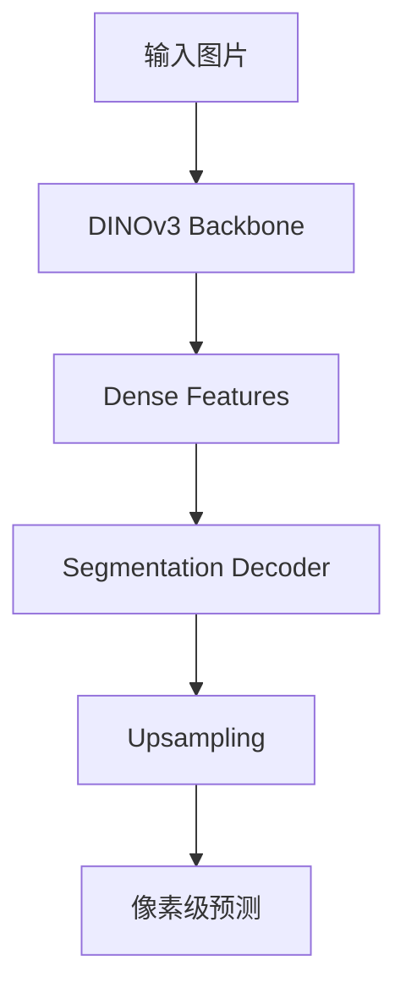

### 14.3 目标检测
DINOv3 本身不是一个开箱即用的目标检测器。

可以将它作为 Frozen Backbone，连接检测 Head。

例如：

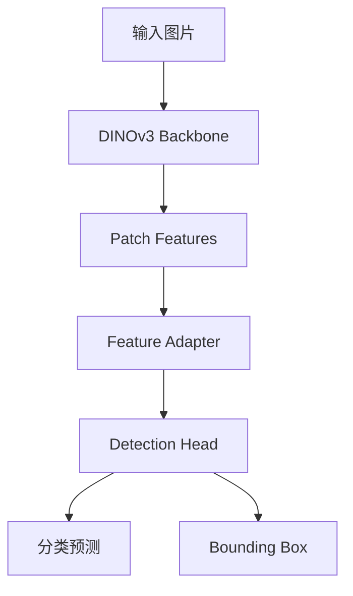

如果检测器需要多尺度特征，还需要额外设计 Neck 或多层特征融合模块。

### 14.4 深度估计
使用 Patch Features 连接 DPT 等解码器：

```latex
输入图片
   |
   v
DINOv3
   |
   v
Dense Features
   |
   v
DPT Decoder
   |
   v
Depth Map
```

### 14.5 特征匹配和跟踪
DINOv3 的 Patch Features 可以计算不同图片之间的余弦相似度。

假设：

$ F_A\in\mathbb{R}^{N\times D} $

$ F_B\in\mathbb{R}^{M\times D} $

相似度矩阵：

$ S=F_AF_B^T $

得到：

$ S\in\mathbb{R}^{N\times M} $

可以根据相似度进行 Patch Matching。

这对于：

+ 图像匹配。
+ 关键点对应。
+ 视频目标跟踪。
+ 物体发现。
+ 3D 几何对应。

都有应用价值。

---

## 十五、DINOv3 的核心创新总结
### 15.1 网络结构方面
DINOv3 的 7B Backbone 本质上仍然是 Dense Vision Transformer。

主要结构：

| 组件 | 设计 |
| --- | --- |
| Backbone | ViT |
| Attention | Standard Multi-Head Attention |
| FFN | SwiGLU |
| Position Encoding | Axial RoPE |
| Norm | LayerNorm |
| Register | 4 个 |
| Transformer Layers | 40 |
| Hidden Size | 4096 |


它并没有彻底发明一种全新的 Transformer Block。

其重要贡献更多体现在：

+ 更大规模的模型。
+ 更好的数据构建。
+ 更稳定的自监督训练。
+ Gram Anchoring。
+ 高分辨率适配和蒸馏。

### 15.2 训练方法方面
DINOv3 使用三个核心自监督目标：

$ \mathcal{L}_{Pre}
=
\mathcal{L}_{DINO}
+
\mathcal{L}_{iBOT}
+
0.1\mathcal{L}_{DKoleo} $

其中：

+ DINO：全局语义学习。
+ iBOT：局部 Patch 学习。
+ KoLeo：特征空间分布正则化。

然后引入 Gram Anchoring：

$ \mathcal{L}_{Gram}
=
\left\|
X_SX_S^T-X_GX_G^T
\right\|_F^2 $

解决长时间训练中的局部特征退化问题。

### 15.3 整体训练流程
DINOv3 的完整流程可以总结为：

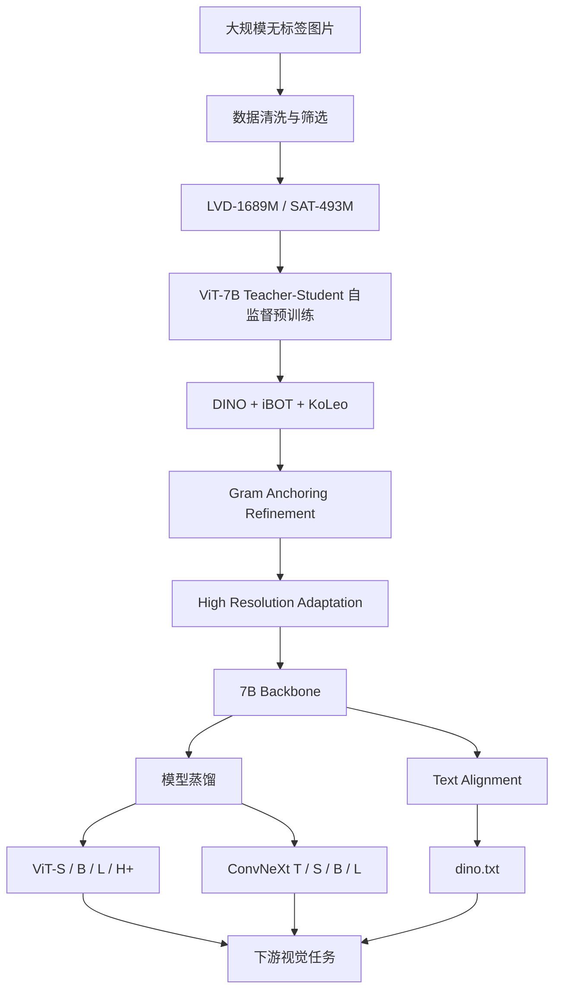

### 15.4 DINOv3 最值得关注的地方
从研究角度看，我认为有四个值得深入理解的点：

**第一：大规模数据构建。**

17B 原始图片并不是直接用于训练，而是通过聚类、检索和公开数据集组合得到 1.689B 的高质量训练集。

这说明数据筛选策略对模型能力有很大影响。

**第二：DINO + iBOT 的组合。**

全局 CLS 特征和局部 Patch 特征使用不同的训练目标，使模型同时学习语义和空间特征。

**第三：Gram Anchoring。**

这是最重要的技术增量。

它不是简单地增加网络层数或者参数量，而是直接针对大规模自监督训练中的特征退化问题设计新的正则化目标。

**第四：大模型蒸馏。**

通过一个 7B Teacher，将知识迁移到 ViT 和 ConvNeXt 等不同规模、不同结构的 Student 中，降低实际应用成本。

---

## 十六、参考资料与源码索引
### 16.1 官方论文
+ [DINOv3: Self-supervised learning for vision at unprecedented scale](https://arxiv.org/abs/2508.10104)

### 16.2 官方 GitHub
+ [facebookresearch/dinov3](https://github.com/facebookresearch/dinov3)
+ [README](https://github.com/facebookresearch/dinov3/blob/main/README.md)
+ [MODEL_CARD](https://github.com/facebookresearch/dinov3/blob/main/MODEL_CARD.md)
+ [DATASETS](https://github.com/facebookresearch/dinov3/blob/main/DATASETS.md)
+ [LICENSE](https://github.com/facebookresearch/dinov3/blob/main/LICENSE.md)

### 16.3 核心网络源码
+ [vision_transformer.py](https://github.com/facebookresearch/dinov3/blob/main/dinov3/models/vision_transformer.py)
+ [attention.py](https://github.com/facebookresearch/dinov3/blob/main/dinov3/layers/attention.py)
+ [block.py](https://github.com/facebookresearch/dinov3/blob/main/dinov3/layers/block.py)
+ [ffn_layers.py](https://github.com/facebookresearch/dinov3/blob/main/dinov3/layers/ffn_layers.py)
+ [rope_position_encoding.py](https://github.com/facebookresearch/dinov3/blob/main/dinov3/layers/rope_position_encoding.py)

### 16.4 核心训练源码
+ [ssl_meta_arch.py](https://github.com/facebookresearch/dinov3/blob/main/dinov3/train/ssl_meta_arch.py)
+ [dino_clstoken_loss.py](https://github.com/facebookresearch/dinov3/blob/main/dinov3/loss/dino_clstoken_loss.py)
+ [ibot_patch_loss.py](https://github.com/facebookresearch/dinov3/blob/main/dinov3/loss/ibot_patch_loss.py)
+ [gram_loss.py](https://github.com/facebookresearch/dinov3/blob/main/dinov3/loss/gram_loss.py)
+ [koleo_loss.py](https://github.com/facebookresearch/dinov3/blob/main/dinov3/loss/koleo_loss.py)

### 16.5 核心训练配置
+ [7B Pretraining](https://github.com/facebookresearch/dinov3/blob/main/dinov3/configs/train/dinov3_vit7b16_pretrain.yaml)
+ [Gram Anchoring](https://github.com/facebookresearch/dinov3/blob/main/dinov3/configs/train/dinov3_vit7b16_gram_anchor.yaml)
+ [High Resolution Adaptation](https://github.com/facebookresearch/dinov3/blob/main/dinov3/configs/train/dinov3_vit7b16_high_res_adapt.yaml)
+ [ViT-L Distillation](https://github.com/facebookresearch/dinov3/blob/main/dinov3/configs/train/dinov3_vitl16_lvd1689m_distilled.yaml)

### 16.6 Meta 官方介绍
+ [DINOv3: Self-supervised learning for vision at unprecedented scale](https://ai.meta.com/blog/dinov3-self-supervised-vision-model/)
+ [DINOv3 Research Page](https://ai.meta.com/research/publications/dinov3/)

### 16.7 许可证注意事项
DINOv3 使用 Meta 发布的专用 DINOv3 License，而不是直接采用 MIT 或 Apache-2.0。

官方提供了代码和模型权重，并允许在许可证约束下使用、修改和分发。

使用或商业部署前，应仔细阅读许可证中的用途限制、再分发要求及其他条款。

---

## 十七、总结
DINOv3 的核心不是单纯训练一个 67 亿参数的 Vision Transformer，而是构建一套能够持续扩展的自监督视觉表示学习体系。

它包含：

1. 大规模无标注数据的收集与筛选。
2. 基于 ViT-7B 的 Teacher-Student 自监督学习。
3. DINO 和 iBOT 联合学习全局与局部视觉特征。
4. KoLeo 正则化改善特征空间分布。
5. Gram Anchoring 解决长时间训练中的 Dense Feature Degradation。
6. 高分辨率适配和模型蒸馏。
7. 文本对齐，扩展零样本视觉语言能力。

从模型使用角度看：

DINOv3 不只是一个分类模型，而是一个通用视觉特征提取 Backbone。

它可以为分类、目标检测、分割、深度估计、图像匹配、视频跟踪等任务提供高质量的视觉表示。

**最重要的认识：模型参数规模决定了网络的表示容量，但数据质量、训练目标以及训练过程中如何保持特征质量，同样决定了最终模型能够学到什么。**

****

****

## **十八、DINOv3 蒸馏模型家族的架构与性能对比**
**DINOv3 不仅训练了一个 7B 参数的 ViT 模型，还通过知识蒸馏（Knowledge Distillation），将大型 Teacher 的视觉表示能力迁移到多种不同规模、不同架构的 Student 中。**

**这些 Student 不仅包括不同规模的 Vision Transformer（ViT），还包括完全不同架构的 ConvNeXt。**

**本章主要研究以下问题：**

1. **ViT-7B 是如何蒸馏出不同规模的 ViT 小模型的？**
2. **Student 和 Teacher 的网络结构是否必须相同？**
3. **ViT-S、ViT-B、ViT-L、ViT-H+ 分别使用什么网络结构？**
4. **ConvNeXt 如何接受来自 ViT-7B 的知识蒸馏？**
5. **不同模型的性能、参数量和计算量有什么差异？**
6. **模型规模增加之后，性能是否一定会持续提升？**
7. **在实际视觉任务中，应该如何选择不同的 Backbone？**

### **18.1 DINOv3 的蒸馏模型家族**
**DINOv3 官方提供了两大类视觉 Backbone：**

+ **Vision Transformer（ViT）**
+ **ConvNeXt（CNX）**

**它们都可以通过同一个 ViT-7B Teacher 获得知识，但 Student 的网络结构可以完全不同。**

#### **18.1.1 模型家族总览**
**以 Web 数据集 LVD-1689M 训练的模型为例，官方提供 10 个模型：**

| **模型类型** | **模型名称** | **参数量** | **来源** |
| --- | --- | ---: | --- |
| **Teacher** | **ViT-7B** | **6716M** | **从头训练** |
| **Student** | **ViT-S** | **21M** | **ViT-7B 蒸馏** |
| **Student** | **ViT-S+** | **29M** | **ViT-7B 蒸馏** |
| **Student** | **ViT-B** | **86M** | **ViT-7B 蒸馏** |
| **Student** | **ViT-L** | **300M** | **ViT-7B 蒸馏** |
| **Student** | **ViT-H+** | **840M** | **ViT-7B 蒸馏** |
| **Student** | **ConvNeXt-Tiny** | **29M** | **ViT-7B 蒸馏** |
| **Student** | **ConvNeXt-Small** | **50M** | **ViT-7B 蒸馏** |
| **Student** | **ConvNeXt-Base** | **89M** | **ViT-7B 蒸馏** |
| **Student** | **ConvNeXt-Large** | **198M** | **ViT-7B 蒸馏** |


**此外，官方还提供了面向卫星遥感数据 SAT-493M 的两个模型：**

+ **ViT-7B：从头训练。**
+ **ViT-L：由卫星领域 ViT-7B 蒸馏。**

**因此，官方 Model Card 一共列出了 12 个模型。**

**这里主要研究 Web 数据集上的 5 个 ViT Student 和 4 个 ConvNeXt Student。**

#### **18.1.2 两种完全不同的蒸馏关系**
**首先需要区分 ViT-7B 自身的训练和小模型蒸馏。**

**第一阶段：训练 ViT-7B**

**Teacher 和 Student 都是 ViT-7B，结构相同，通过 EMA 更新 Teacher。**

```mermaid
flowchart TD
    A["无标签图片"] --> B["Student ViT-7B"]
    A --> C["Teacher ViT-7B"]

    B --> D["DINO / iBOT / KoLeo Loss"]
    C --> D
    
    D --> E["反向传播"]
    E --> F["更新 Student"]
    
    F --> G["EMA 更新"]
    G --> C
```

**第二阶段：蒸馏小模型**

**使用已经训练完成的 ViT-7B 作为固定 Teacher，分别指导不同架构的 Student。**

```mermaid
flowchart TD
    A["无标签图片"] --> B["固定 Teacher：ViT-7B"]

    B --> C["Teacher DINO / iBOT Head"]
    C --> D["Teacher 目标概率分布"]
    
    A --> E["Student Backbone"]
    
    E --> F["ViT-S / S+ / B / L / H+"]
    E --> G["ConvNeXt T / S / B / L"]
    
    F --> H["Student Projection Heads"]
    G --> H
    
    H --> I["Student 预测概率分布"]
    
    D --> J["知识蒸馏 Loss"]
    I --> J
    
    J --> K["更新 Student 参数"]
```

**这次蒸馏有一个重要区别：**

**Student 不再需要与 Teacher 采用相同的网络结构。**

**甚至可以从 Transformer 蒸馏到 CNN。**

**这意味着 Teacher 学到的视觉知识，并不局限于某一种特定的网络架构。**

---

### **18.2 蒸馏训练的具体机制**
#### **18.2.1 Teacher 和 Student 的区别**
**蒸馏阶段：**

| **对比项** | **Teacher** | **Student** |
| --- | --- | --- |
| **Backbone** | **ViT-7B** | **ViT 或 ConvNeXt** |
| **参数量** | **6716M** | **21M～840M** |
| **是否训练** | **否** | **是** |
| **是否反向传播** | **否** | **是** |
| **是否使用 EMA 更新** | **否** | **不适用** |
| **DINO Head** | **使用预训练权重** | **重新初始化并训练** |
| **iBOT Head** | **使用预训练权重** | **重新初始化并训练** |
| **主要作用** | **提供监督目标** | **学习 Teacher 的知识** |


**Teacher 的 Backbone 和 Projection Heads 都是已经训练完成的，不再更新。**

**Student 则根据自己的 Backbone 结构，建立对应的 DINO Head 和 iBOT Head。**

#### **18.2.2 Teacher 和 Student 如何建立联系？**
**两者之间不需要额外增加一个连接网络，也不要求 Backbone 输出维度相同。**

**真正进行知识传递的是两个网络各自的 Projection Head。**

**以 DINO Head 为例：**

**Teacher：**

```latex
ViT-7B Backbone
       |
       v
CLS Token
       |
       v
4096 维
       |
       v
Teacher DINO Head
       |
       v
262144 维 Prototype Logits
       |
       v
Sinkhorn-Knopp
       |
       v
Teacher Target Probability
```

**Student：**

```latex
Student Backbone
       |
       v
CLS Token
       |
       v
Student Hidden Size
       |
       v
Student DINO Head
       |
       v
262144 维 Prototype Logits
       |
       v
Softmax
       |
       v
Student Probability
```

**虽然 Backbone 的输出维度不同，但两个 DINO Head 最终输出相同数量的 Prototype。**

**因此可以直接比较 Teacher 和 Student 的概率分布。**

**数学上：**

**Teacher：**

$ p_t\in\mathbb{R}^{262144} $

**Student：**

$ p_s\in\mathbb{R}^{262144} $

**计算交叉熵：**

$ \mathcal{L}_{DINO}
=
-\sum_{k=1}^{262144}
p_t(k)\log p_s(k) $

**iBOT Head 也是相同的思路：**

$ p_t^{patch},p_s^{patch}
\in\mathbb{R}^{98304} $

**比较对应 Masked Patch 的概率分布。**

**这样就不要求 Teacher 和 Student 的 Backbone 必须具有相同的 Hidden Size。**

#### **18.2.3 ConvNeXt 如何处理 CLS Token 和 Patch Token？**
**这是 ViT 蒸馏到 CNN 时一个非常有意思的地方。**

**ViT 原生包含：**

+ **CLS Token**
+ **Patch Tokens**
+ **Register Tokens**

**而传统 CNN 没有 CLS Token。**

**DINOv3 在 ConvNeXt 的实现中进行了适配。**

**假设 ConvNeXt 最后一个 Stage 输出：**

$ X\in\mathbb{R}^{B\times C\times H\times W} $

**首先对空间维度进行 Global Average Pooling：**

$ X_{cls}
=
\frac{1}{HW}
\sum_{i=1}^{H}
\sum_{j=1}^{W}
X_{i,j} $

**得到：**

$ X_{cls}\in\mathbb{R}^{B\times C} $

**这个全局池化特征可以作为 CLS Token 对应的全局表示。**

**同时，将原始特征图展开：**

$ X_{patch}
\in
\mathbb{R}^{B\times HW\times C} $

**于是 ConvNeXt 也能够提供：**

+ **全局特征：用于 DINO Loss 和 KoLeo Loss。**
+ **局部特征：用于 iBOT Patch Loss。**

**因此，虽然 ViT 和 ConvNeXt 的内部计算完全不同，但它们能够通过统一的全局和局部特征学习目标完成知识蒸馏。**

#### **18.2.4 蒸馏阶段使用哪些 Loss？**
**论文明确说明：**

**蒸馏使用与初始自监督预训练相同的训练目标。**

$ \boxed{
\mathcal{L}_{Distill}
=
\mathcal{L}_{DINO}
+
\mathcal{L}_{iBOT}
+
0.1\mathcal{L}_{DKoleo}
} $

**这里有一个重要区别：**

**蒸馏阶段不使用 Gram Anchoring。**

**原因是论文没有观察到 Student 蒸馏过程中出现需要额外使用 Gram Anchoring 解决的 Patch-Level Consistency 问题。**

#### **18.2.5 Single-Teacher Multiple-Students**
**DINOv3 还设计了一个高效的多 Student 蒸馏流程。**

**如果每训练一个 Student，就单独执行一次 ViT-7B Teacher 的前向计算，会产生大量重复计算。**

**因此论文提出：**

**Single-Teacher Multiple-Students Distillation。**

**即：**

**多个 Student 共享同一次 Teacher 推理结果。**

```mermaid
flowchart TD
    A["输入 Batch"] --> B["固定 ViT-7B Teacher"]

    B --> C["Teacher Forward"]
    C --> D["Teacher 输出与监督目标"]
    
    D --> E["All-Gather"]
    A --> E
    
    E --> F["Student GPU Group 1"]
    E --> G["Student GPU Group 2"]
    E --> H["Student GPU Group 3"]
    
    F --> I["训练 ViT-S"]
    G --> J["训练 ViT-B"]
    H --> K["训练 ViT-L"]
    
    I --> L["同步屏障"]
    J --> L
    K --> L
    
    L --> M["下一次迭代"]
```

**具体流程：**

1. **所有参与蒸馏的 GPU 共同执行 Teacher 前向计算。**
2. **收集 Teacher 的输出和输入数据。**
3. **将数据分配给不同的 Student GPU Group。**
4. **各个 GPU Group 独立训练对应的 Student。**
5. **完成同步后进入下一次迭代。**

**这样 Teacher 的推理成本可以由多个 Student 共同分摊。**

**论文给出的训练安排：**

+ **Student 蒸馏训练：1M Iterations。**
+ **Learning Rate Cooldown：250K Iterations。**
+ **后续进行高分辨率适配。**
+ **高分辨率适配阶段不使用 Gram Anchoring。**

**这也是 DINOv3 能够同时发布多种规模、不同架构模型的重要工程设计。**

---

### **18.3 ViT 系列 Student 的网络结构**
**ViT 系列一共提供五种 Student：**

+ **ViT-S**
+ **ViT-S+**
+ **ViT-B**
+ **ViT-L**
+ **ViT-H+**

**它们都使用 Patch Size = 16，保留 4 个 Register Tokens，并使用 RoPE 位置编码。**

#### **18.3.1 网络结构参数对比**
| **模型** | **参数量** | **Depth** | **Hidden Size** | **Heads** | **Head Dim** | **FFN 类型** | **FFN Ratio** |
| --- | ---: | ---: | ---: | ---: | ---: | --- | ---: |
| **ViT-S** | **21M** | **12** | **384** | **6** | **64** | **MLP** | **4** |
| **ViT-S+** | **29M** | **12** | **384** | **6** | **64** | **SwiGLU** | **6** |
| **ViT-B** | **86M** | **12** | **768** | **12** | **64** | **MLP** | **4** |
| **ViT-L** | **300M** | **24** | **1024** | **16** | **64** | **MLP** | **4** |
| **ViT-H+** | **840M** | **32** | **1280** | **20** | **64** | **SwiGLU** | **6** |
| **ViT-7B** | **6716M** | **40** | **4096** | **32** | **128** | **SwiGLU** | **3** |


**其中：**

$ HeadDim=\frac{HiddenSize}{Heads} $

**例如 ViT-B：**

$ HeadDim=\frac{768}{12}=64 $

**ViT-7B：**

$ HeadDim=\frac{4096}{32}=128 $

**可以看到：**

**除了 7B 之外，其他 ViT 模型的 Head Dim 都是 64。**

#### **18.3.2 ViT-S：最小的标准 Transformer**
**参数量：21M。**

```mermaid
flowchart TD
    A["输入图片"] --> B["Patch Embedding<br/>Patch Size 16"]
    B --> C["CLS + 4 Register + Patch Tokens"]
    C --> D["Transformer Block ×12"]

    D --> E["输出维度 384"]
    
    E --> F["CLS Token"]
    E --> G["Patch Tokens"]
```

**主要配置：**

```latex
Patch Size       = 16
Depth            = 12
Hidden Size      = 384
Attention Heads  = 6
Head Dim         = 64
FFN              = MLP
FFN Ratio        = 4
Register Tokens  = 4
```

**每个 Transformer Block 包含：**

+ **LayerNorm**
+ **Multi-Head Self-Attention**
+ **Residual Connection**
+ **LayerNorm**
+ **MLP FFN**
+ **Residual Connection**

**这是一个标准的 ViT 架构。**

#### **18.3.3 ViT-S+：通过 SwiGLU 扩展 FFN**
**参数量：29M。**

**ViT-S+ 与 ViT-S 的主要区别：**

| **参数** | **ViT-S** | **ViT-S+** |
| --- | ---: | ---: |
| **Depth** | **12** | **12** |
| **Hidden Size** | **384** | **384** |
| **Heads** | **6** | **6** |
| **FFN** | **MLP** | **SwiGLU** |
| **FFN Ratio** | **4** | **6** |
| **参数量** | **21M** | **29M** |


**它没有增加 Transformer 层数，也没有增加 Hidden Size。**

**而是通过改变 FFN 结构和扩大 FFN Ratio，增加模型的表达能力。**

**这也是为什么参数量从 21M 增加到了 29M。**

**需要注意：ViT-S 与 ViT-S+ 的性能差异不能全部归因于 SwiGLU，因为两者的 FFN 扩展比例和参数量也不同。**

#### **18.3.4 ViT-B：增加网络宽度**
**参数量：86M。**

```mermaid
flowchart TD
    A["输入图片"] --> B["Patch Embedding"]
    B --> C["Hidden Size = 768"]
    C --> D["Transformer Block ×12"]

    D --> E["Attention：12 Heads"]
    E --> F["Head Dim = 64"]
    F --> G["FFN：MLP，Ratio = 4"]
    G --> H["输出 Patch Features"]
```

**主要配置：**

```latex
Patch Size       = 16
Depth            = 12
Hidden Size      = 768
Attention Heads  = 12
Head Dim         = 64
FFN              = MLP
FFN Ratio        = 4
```

**与 ViT-S 相比：**

+ **层数相同。**
+ **Hidden Size 增加一倍。**
+ **Attention Heads 增加一倍。**
+ **参数量从 21M 增加到 86M。**

#### **18.3.5 ViT-L：同时增加深度和宽度**
**参数量：300M。**

```latex
Patch Size       = 16
Depth            = 24
Hidden Size      = 1024
Attention Heads  = 16
Head Dim         = 64
FFN              = MLP
FFN Ratio        = 4
```

**相比 ViT-B：**

+ **Transformer Block 从 12 层增加到 24 层。**
+ **Hidden Size 从 768 增加到 1024。**
+ **Attention Heads 从 12 增加到 16。**

**它通过同时增加深度和宽度来提升网络容量。**

#### **18.3.6 ViT-H+：接近 7B 的大型 Student**
**参数量：840M。**

```latex
Patch Size       = 16
Depth            = 32
Hidden Size      = 1280
Attention Heads  = 20
Head Dim         = 64
FFN              = SwiGLU
FFN Ratio        = 6
```

**ViT-H+ 是 DINOv3 中最大的蒸馏 Student。**

**与 ViT-L 相比：**

+ **Depth：24 → 32。**
+ **Hidden Size：1024 → 1280。**
+ **Heads：16 → 20。**
+ **FFN：MLP → SwiGLU。**
+ **FFN Ratio：4 → 6。**

**它的参数量达到 840M，已经能够非常接近 7B Teacher 的性能。**
---

### **18.4 ConvNeXt 系列 Student 的网络结构**
**除了 ViT，DINOv3 还将 ViT-7B 蒸馏到了 ConvNeXt。**

**这非常值得关注，因为 ConvNeXt 与 ViT 是两种不同的视觉网络架构。**

**ViT：**

+ **将图片转换成 Patch Tokens。**
+ **使用 Self-Attention 进行全局信息交互。**
+ **使用 Transformer Block 提取特征。**

**ConvNeXt：**

+ **使用卷积提取局部特征。**
+ **使用 Depthwise Convolution 降低计算量。**
+ **使用多个 Stage 构建层级化特征。**
+ **通过逐级下采样获得不同分辨率的特征图。**

#### **18.4.1 ConvNeXt 模型参数**
| **模型** | **参数量** | **Stage Depths** | **Stage Channels** |
| --- | ---: | --- | --- |
| **ConvNeXt-Tiny** | **29M** | **[3, 3, 9, 3]** | **[96, 192, 384, 768]** |
| **ConvNeXt-Small** | **50M** | **[3, 3, 27, 3]** | **[96, 192, 384, 768]** |
| **ConvNeXt-Base** | **89M** | **[3, 3, 27, 3]** | **[128, 256, 512, 1024]** |
| **ConvNeXt-Large** | **198M** | **[3, 3, 27, 3]** | **[192, 384, 768, 1536]** |


**这里的 Stage Depths 表示每个 Stage 中 ConvNeXt Block 的数量。**

**例如 ConvNeXt-Tiny：**

```latex
Stage 1：3 Blocks
Stage 2：3 Blocks
Stage 3：9 Blocks
Stage 4：3 Blocks

总计：18 Blocks
```

**ConvNeXt-Small：**

```latex
Stage 1：3 Blocks
Stage 2：3 Blocks
Stage 3：27 Blocks
Stage 4：3 Blocks

总计：36 Blocks
```

#### **18.4.2 ConvNeXt 整体网络结构**
**以 ConvNeXt-Tiny 为例：**

```mermaid
flowchart TD
    A["输入图片"] --> B["Stem<br/>4×4 Conv, Stride 4"]
    B --> C["Stage 1<br/>3 Blocks, 96 Channels"]
    C --> D["Downsample<br/>Stride 2"]

    D --> E["Stage 2<br/>3 Blocks, 192 Channels"]
    E --> F["Downsample<br/>Stride 2"]
    
    F --> G["Stage 3<br/>9 Blocks, 384 Channels"]
    G --> H["Downsample<br/>Stride 2"]
    
    H --> I["Stage 4<br/>3 Blocks, 768 Channels"]
    
    I --> J["输出特征图"]
```

**四个 Stage 的输出步长分别为：**

| **Stage** | **输出通道** | **Stride** | **主要作用** |
| --- | ---: | ---: | --- |
| **Stage 1** | **96** | **4** | **保留较多空间细节** |
| **Stage 2** | **192** | **8** | **中低层特征** |
| **Stage 3** | **384** | **16** | **中高层语义特征** |
| **Stage 4** | **768** | **32** | **高层语义特征** |


**这里的 Stride 是相对于原始输入图片的总下采样倍数。**

**例如输入图片为：**

$ X\in\mathbb{R}^{B\times3\times512\times512} $

**ConvNeXt-Tiny 的输出尺寸：**

**Stage 1：**

$ F_1\in\mathbb{R}^{B\times96\times128\times128} $

**Stage 2：**

$ F_2\in\mathbb{R}^{B\times192\times64\times64} $

**Stage 3：**

$ F_3\in\mathbb{R}^{B\times384\times32\times32} $

**Stage 4：**

$ F_4\in\mathbb{R}^{B\times768\times16\times16} $

**这就是 ConvNeXt 的层级化特征结构。**

**与原生 ViT/16 主要输出 Stride 16 的 Patch Features 不同，ConvNeXt 天然提供多个空间分辨率的特征图。**

#### **18.4.3 ConvNeXt Block 内部结构**
**一个 ConvNeXt Block 的基本结构：**

```mermaid
flowchart TD
    A["输入特征 X"] --> B["7×7 Depthwise Conv"]
    B --> C["LayerNorm"]
    C --> D["Pointwise Linear：C → 4C"]
    D --> E["GELU"]
    E --> F["Pointwise Linear：4C → C"]
    F --> G["LayerScale"]
    G --> H["Residual Add"]

    A --> H
    
    H --> I["输出特征"]
```

**具体解释：**

**第一步：Depthwise Convolution**

$ Y=DWConv_{7\times7}(X) $

**使用逐通道卷积提取空间特征。**

**第二步：LayerNorm**

**对通道特征进行归一化。**

**第三步：Pointwise Linear 扩展**

$ C\rightarrow4C $

**将通道维度扩大四倍。**

**第四步：GELU 激活**

$ Y=GELU(Y) $

**第五步：Pointwise Linear 压缩**

$ 4C\rightarrow C $

**恢复原来的通道维度。**

**第六步：Residual Connection**

$ Y=X+F(X) $

**最终输出与输入具有相同的空间尺寸和通道数量。**

#### **18.4.4 ViT 和 ConvNeXt 在结构上的根本区别**
| **对比项** | **ViT** | **ConvNeXt** |
| --- | --- | --- |
| **核心计算** | **Self-Attention** | **Convolution** |
| **输入处理** | **Patch Embedding** | **Stem Convolution** |
| **网络组织** | **Transformer Blocks** | **多阶段 CNN** |
| **全局信息** | **Attention 直接交互** | **逐层卷积与下采样** |
| **特征输出** | **Patch Tokens** | **多尺度 Feature Maps** |
| **原生特征步长** | **Patch Size = 16** | **4、8、16、32** |
| **主要优势** | **全局特征建模** | **多尺度局部特征与计算效率** |
| **量化部署** | **需要关注 Attention 算子支持** | **卷积量化生态较成熟** |


**需要注意：**

**ConvNeXt 不是简单地将 ViT 的 Attention 替换成 Conv。**

**它具有独立的层级化网络结构。**

**DINOv3 的蒸馏结果说明：**

**大型 Transformer 学到的视觉知识，可以迁移到结构完全不同的 CNN 中。**

---

### **18.5 ViT 系列性能测试对比**
**下面开始比较不同规模 ViT Student 的实际性能。**

**这里主要使用 DINOv3 论文 Table 14 的实验数据。**

#### **18.5.1 评测指标**
| **指标** | **任务** | **说明** |
| --- | --- | --- |
| **IN-ReaL** | **图像分类** | **ImageNet ReaL 分类准确率** |
| **IN-R** | **鲁棒分类** | **ImageNet-Rendition** |
| **ObjectNet** | **OOD 分类** | **不同物体视角和背景下的识别** |
| **Oxford-H** | **图像检索** | **Oxford-Hard 检索性能** |
| **ADE20k** | **语义分割** | **mIoU** |
| **NYU** | **深度估计** | **RMSE，越低越好** |
| **DAVIS** | **视频分割跟踪** | **J&F** |
| **NAVI** | **关键点匹配** | **Recall** |
| **SPair** | **关键点匹配** | **Recall** |


**这些任务可以分为两类：**

**Global Tasks：**

**主要考察模型对整张图片的语义理解能力。**

**Dense Tasks：**

**主要考察模型对局部区域、空间位置以及不同 Patch 之间关系的理解能力。**

#### **18.5.2 ViT 不同规模的性能对比**
| **模型** | **参数量** | **IN-ReaL ↑** | **IN-R ↑** | **ObjectNet ↑** | **Oxford-H ↑** |
| --- | ---: | ---: | ---: | ---: | ---: |
| **ViT-S** | **21M** | **87.0** | **60.4** | **50.9** | **49.5** |
| **ViT-S+** | **29M** | **88.0** | **68.8** | **54.6** | **50.0** |
| **ViT-B** | **86M** | **89.3** | **76.7** | **64.1** | **58.5** |
| **ViT-L** | **300M** | **90.2** | **88.1** | **74.8** | **63.1** |
| **ViT-H+** | **840M** | **90.3** | **90.0** | **78.6** | **64.5** |


**局部视觉任务：**

| **模型** | **ADE20k ↑** | **NYU ↓** | **DAVIS ↑** | **NAVI ↑** | **SPair ↑** |
| --- | ---: | ---: | ---: | ---: | ---: |
| **ViT-S** | **47.0** | **0.403** | **72.7** | **56.3** | **50.4** |
| **ViT-S+** | **48.8** | **0.399** | **75.5** | **57.1** | **55.2** |
| **ViT-B** | **51.8** | **0.373** | **77.2** | **58.8** | **57.2** |
| **ViT-L** | **54.9** | **0.352** | **79.9** | **62.3** | **61.2** |
| **ViT-H+** | **54.8** | **0.352** | **79.3** | **63.3** | **56.3** |


**注意：**

+ **ADE20k 使用 mIoU，越高越好。**
+ **NYU 使用 RMSE，越低越好。**
+ **其他指标越高越好。**

**论文为了公平比较不同 Patch Size 的模型，控制了输入 Token 数量。**

**对于 Patch Size = 16 的 DINOv3，使用 512×512 输入。**

**对于 Patch Size = 14 的对比模型，使用 448×448 输入。**

**这样两者都具有：**

$ N=32\times32=1024 $

**个 Patch Tokens。**

#### **18.5.3 从性能数据中能发现什么？**
**第一：随着模型规模增加，整体性能通常会提升。**

**从 ViT-S 到 ViT-L：**

+ **IN-ReaL：87.0 → 90.2。**
+ **IN-R：60.4 → 88.1。**
+ **ObjectNet：50.9 → 74.8。**
+ **ADE20k：47.0 → 54.9。**
+ **DAVIS：72.7 → 79.9。**

**可以看到，模型规模增加不仅提升了分类能力，也提升了局部特征质量。**

**第二：ViT-S+ 相比 ViT-S 有明显提升。**

**两者都是 12 层、384 Hidden Size。**

**但 ViT-S+ 将 FFN 从 MLP 改为 SwiGLU，并将 FFN Ratio 从 4 提高到 6。**

**例如：**

+ **IN-R：60.4 → 68.8。**
+ **ObjectNet：50.9 → 54.6。**
+ **SPair：50.4 → 55.2。**

**说明 FFN 的设计也是影响模型性能的重要因素。**

**但由于 FFN 类型、扩展比例和参数量同时发生变化，不能将所有提升都归因于 SwiGLU 本身。**

**第三：ViT-H+ 并不是所有指标都优于 ViT-L。**

**例如：**

| **指标** | **ViT-L** | **ViT-H+** |
| --- | ---: | ---: |
| **ADE20k** | **54.9** | **54.8** |
| **NYU** | **0.352** | **0.352** |
| **DAVIS** | **79.9** | **79.3** |
| **NAVI** | **62.3** | **63.3** |
| **SPair** | **61.2** | **56.3** |


**这说明增加参数量并不保证所有任务都能持续提升。**

**不同任务依赖的特征类型不同，模型容量、训练过程和特征质量都会影响最终结果。**

---

### **18.6 ConvNeXt 系列性能测试对比**
**ConvNeXt 系列也使用相同的 ViT-7B Teacher 进行蒸馏。**

**论文 Table 15 将蒸馏得到的 ConvNeXt 与传统监督训练的 ConvNeXt 进行了比较。**

#### **18.6.1 ConvNeXt 不同规模的性能对比**
| **模型** | **参数量** | **IN-ReaL @256** | **IN-ReaL @512** | **IN-R @256** | **IN-R @512** |
| --- | ---: | ---: | ---: | ---: | ---: |
| **ConvNeXt-Tiny** | **29M** | **86.6** | **87.7** | **73.7** | **74.1** |
| **ConvNeXt-Small** | **50M** | **87.9** | **88.7** | **73.7** | **74.1** |
| **ConvNeXt-Base** | **89M** | **88.5** | **89.2** | **77.2** | **78.2** |
| **ConvNeXt-Large** | **198M** | **88.9** | **89.4** | **81.3** | **82.4** |


**其他指标：**

| **模型** | **ObjectNet @256** | **ObjectNet @512** | **ADE20k** | **NYU ↓** |
| --- | ---: | ---: | ---: | ---: |
| **ConvNeXt-Tiny** | **52.6** | **58.7** | **42.7** | **0.448** |
| **ConvNeXt-Small** | **52.6** | **58.7** | **44.8** | **0.432** |
| **ConvNeXt-Base** | **56.2** | **61.3** | **46.3** | **0.420** |
| **ConvNeXt-Large** | **59.3** | **65.2** | **47.8** | **0.403** |


**其中：**

+ **IN-ReaL、IN-R、ObjectNet 分别在 256 和 512 分辨率下测试。**
+ **ADE20k 使用 512 分辨率。**
+ **NYU 使用 640 分辨率。**

#### **18.6.2 ConvNeXt 的一个明显特点：高分辨率适应能力**
**观察 IN-ReaL：**

**ConvNeXt-Tiny：**

$ 86.6\rightarrow87.7 $

**ConvNeXt-Large：**

$ 88.9\rightarrow89.4 $

**观察 ObjectNet：**

**ConvNeXt-Tiny：**

$ 52.6\rightarrow58.7 $

**ConvNeXt-Large：**

$ 59.3\rightarrow65.2 $

**输入分辨率从 256 提升到 512 后，性能整体得到改善。**

**尤其是 ObjectNet，提升比较明显。**

**这说明蒸馏得到的 ConvNeXt 不仅能够在常规分辨率工作，也能够利用更高分辨率带来的视觉信息。**

#### **18.6.3 与传统监督训练 ConvNeXt 对比**
**论文还比较了：**

+ **ImageNet-22k 监督训练的 ConvNeXt。**
+ **DINOv3 蒸馏得到的 ConvNeXt。**

**重点比较 ADE20k：**

| **模型** | **监督训练 ADE20k** | **DINOv3 蒸馏 ADE20k** | **提升** |
| --- | ---: | ---: | ---: |
| **ConvNeXt-Tiny** | **24.8** | **42.7** | **+17.9** |
| **ConvNeXt-Small** | **22.6** | **44.8** | **+22.2** |
| **ConvNeXt-Base** | **26.5** | **46.3** | **+19.8** |
| **ConvNeXt-Large** | **33.3** | **47.8** | **+14.5** |


**再看 NYU：**

| **模型** | **监督训练 NYU RMSE** | **DINOv3 蒸馏 NYU RMSE** |
| --- | ---: | ---: |
| **ConvNeXt-Tiny** | **0.666** | **0.448** |
| **ConvNeXt-Small** | **0.630** | **0.432** |
| **ConvNeXt-Base** | **0.596** | **0.420** |
| **ConvNeXt-Large** | **0.567** | **0.403** |


**可以发现：**

**DINOv3 蒸馏后的 ConvNeXt 在稠密视觉任务上具有明显优势。**

**尤其是 ADE20k：**

**ConvNeXt-Tiny 提升了 17.9 mIoU。**

**ConvNeXt-Large 提升了 14.5 mIoU。**

**这里的比较非常有意义：**

**DINOv3 的自监督知识不仅可以提升 Transformer，还可以显著改善 CNN 的视觉表示能力。**

**需要注意，传统 ConvNeXt 使用 ImageNet-22k 标签进行监督训练，而 DINOv3 ConvNeXt 使用 ViT-7B 蒸馏，两者的预训练方式不同。**

---

### **18.7 不同模型的参数量与计算量对比**
**模型性能只是一个方面。**

**如果要部署到实际设备，还需要考虑：**

+ **参数量。**
+ **FLOPs。**
+ **显存占用。**
+ **推理延迟。**
+ **不同硬件上的算子支持情况。**

**论文 Figure 16 给出了各模型的参数量以及不同分辨率下的推理 GFLOPs。**

#### **18.7.1 模型计算量对比**
| **模型** | **参数量** | **GFLOPs @256** | **GFLOPs @512** |
| --- | ---: | ---: | ---: |
| **ConvNeXt-Tiny** | **29M** | **5** | **20** |
| **ConvNeXt-Small** | **50M** | **11** | **46** |
| **ConvNeXt-Base** | **89M** | **20** | **81** |
| **ConvNeXt-Large** | **198M** | **38** | **152** |
| **ViT-S** | **21M** | **12** | **63** |
| **ViT-S+** | **29M** | **16** | **79** |
| **ViT-B** | **86M** | **47** | **216** |
| **ViT-L** | **300M** | **163** | **721** |
| **ViT-H+** | **840M** | **450** | **1903** |
| **ViT-7B** | **6716M** | **3550** | **14515** |


**GFLOPs 表示模型处理一张图片所需的理论浮点运算量估计。**

**注意：**

**GFLOPs 不等于实际推理时间。**

**实际速度还取决于：**

+ **GPU/NPU 架构。**
+ **Batch Size。**
+ **内存带宽。**
+ **算子实现。**
+ **TensorRT 或其他推理引擎优化。**
+ **FP16、BF16、INT8 等计算精度。**

#### **18.7.2 同等参数量下，ConvNeXt 的计算量更低**
**重点比较 ViT-B 和 ConvNeXt-Base：**

| **模型** | **参数量** | **GFLOPs @256** | **GFLOPs @512** |
| --- | ---: | ---: | ---: |
| **ViT-B** | **86M** | **47** | **216** |
| **ConvNeXt-Base** | **89M** | **20** | **81** |


**参数量基本相同。**

**但：**

**256 分辨率：**

$ \frac{20}{47}\approx42.6\% $

**512 分辨率：**

$ \frac{81}{216}=37.5\% $

**也就是说，ConvNeXt-Base 的理论计算量明显低于 ViT-B。**

**再看参数量几乎相同的 ViT-S+ 和 ConvNeXt-Tiny：**

| **模型** | **参数量** | **GFLOPs @256** | **GFLOPs @512** |
| --- | ---: | ---: | ---: |
| **ViT-S+** | **29M** | **16** | **79** |
| **ConvNeXt-Tiny** | **29M** | **5** | **20** |


**ConvNeXt-Tiny 的理论计算量明显更低。**

**这说明：**

**相同参数量并不代表相同计算量，不同网络结构会带来完全不同的计算成本。**

#### **18.7.3 ViT-H+ 与 ViT-7B 的计算量差距**
| **模型** | **参数量** | **GFLOPs @256** | **GFLOPs @512** |
| --- | ---: | ---: | ---: |
| **ViT-H+** | **840M** | **450** | **1903** |
| **ViT-7B** | **6716M** | **3550** | **14515** |


**参数量比例：**

$ \frac{6716}{840}\approx8.0 $

**计算量比例：**

$ \frac{3550}{450}\approx7.89 $

**因此 ViT-H+ 的参数量约为 ViT-7B 的 1/8，计算量也约为其 1/8。**

**对于实际部署，这个差距非常重要。**

---

### **18.8 ViT-H+ 与 ViT-7B 的性能对比**
**论文专门研究了一个问题：**

**最大的 Student 能够继承 Teacher 多少知识？**

**如果一个 840M 的 Student 已经能够接近 7B Teacher，那么部署 7B 模型就不一定有必要。**

**论文 Figure 16(b) 给出了直接对比。**

| **指标** | **ViT-H+** | **ViT-7B** |
| --- | ---: | ---: |
| **参数量** | **840M** | **6716M** |
| **IN1k** | **87.9** | **88.4** |
| **ObjectNet** | **78.6** | **78.9** |
| **IN-ReaL** | **90.3** | **90.3** |
| **ADE20k** | **54.8** | **55.9** |
| **Cityscapes** | **80.6** | **81.1** |


**可以看到：**

+ **IN1k：只相差 0.5。**
+ **ObjectNet：只相差 0.3。**
+ **IN-ReaL：完全相同。**
+ **ADE20k：只相差 1.1。**
+ **Cityscapes：只相差 0.5。**

**虽然 ViT-H+ 的参数量只有 ViT-7B 的约 1/8，但在这些评测任务上的表现已经非常接近 Teacher。**

**这也验证了蒸馏的有效性。**

**注意：**

**论文 Figure 16(b) 中的 7B ObjectNet 分数为 78.9。官方 Model Card 汇总表中对应单元格显示 91.1，与论文图中的对照值不一致。本节的 Teacher 对比采用论文 Figure 16(b) 的数值，避免混用不同表格口径。**

#### **18.8.1 不同分辨率下的特征稳定性**
**论文 Figure 17 还比较了不同 ViT 模型在高分辨率下的特征稳定性。**

**输入分辨率从：**

$ 896\times512 $

**逐步增加到：**

$ 7168\times4096 $

**不同模型表现：**

+ **ViT-S+：在 896×512 到 3584×2048 范围内保持稳定。**
+ **ViT-L：在最大分辨率下才开始出现明显特征漂移。**
+ **ViT-H+：在整个测试范围内保持稳定。**

**这说明：**

**Student 不仅能够继承 Teacher 的语义表示能力，也能够继承相当程度的高分辨率特征表达能力。**

**对于需要处理高分辨率图片的视觉任务，这一点尤其重要。**

---

### **18.9 不同架构的优劣势总结**
**现在将 ViT 和 ConvNeXt 放在一起比较。**

| **对比维度** | **ViT** | **ConvNeXt** |
| --- | --- | --- |
| **核心结构** | **Transformer** | **CNN** |
| **参数量范围** | **21M～840M** | **29M～198M** |
| **全局特征建模** | **Self-Attention** | **多层卷积与池化** |
| **局部特征** | **Patch Tokens** | **Feature Maps** |
| **原生多尺度特征** | **需要额外适配** | **天然支持** |
| **理论计算量** | **相对较高** | **相对较低** |
| **量化部署** | **需要考虑 Attention 算子** | **卷积量化方案成熟** |
| **高分辨率处理** | **需要考虑 Token 数量** | **需要考虑特征图尺寸** |
| **典型应用** | **通用视觉特征、全局语义** | **多尺度视觉、资源受限部署** |


**这里需要注意：**

**ConvNeXt 的计算量虽然较低，但不能简单认为它在所有设备上一定比 ViT 快。**

**例如：**

+ **GPU 对矩阵乘法有很强的优化。**
+ **某些 NPU 对卷积有专门的硬件加速。**
+ **TensorRT 对不同模型的算子融合和优化程度也不同。**

**所以实际部署时，仍然需要测量真实推理延迟。**

---

### **18.10 面向目标检测与密集视觉任务的模型选择**
**如果将 DINOv3 的蒸馏模型应用于目标检测、实例分割、语义分割等任务，需要重点考虑 Backbone 的特征输出形式。**

#### **18.10.1 ViT 的特征输出**
**以 ViT-B/16 为例：**

**输入：**

$ X\in\mathbb{R}^{B\times3\times512\times512} $

**Patch Size：**

$ P=16 $

**Patch 数量：**

$ N=\frac{512}{16}\times\frac{512}{16} $

$ N=32\times32=1024 $

**最终 Patch Features：**

$ F\in\mathbb{R}^{B\times1024\times768} $

**转换为二维特征图：**

$ F\in\mathbb{R}^{B\times768\times32\times32} $

**对应 Stride = 16。**

**如果需要构建类似 YOLO 的 P3、P4、P5 特征金字塔，通常需要额外设计特征适配层或 FPN。**

#### **18.10.2 ConvNeXt 的特征输出**
**以 ConvNeXt-Base 为例：**

**输入：**

$ X\in\mathbb{R}^{B\times3\times512\times512} $

**四个 Stage 输出：**

$ F_1\in\mathbb{R}^{B\times128\times128\times128} $

$ F_2\in\mathbb{R}^{B\times256\times64\times64} $

$ F_3\in\mathbb{R}^{B\times512\times32\times32} $

$ F_4\in\mathbb{R}^{B\times1024\times16\times16} $

**对应：**

| **特征层** | **Stride** | **用途** |
| --- | ---: | --- |
| **F1** | **4** | **高分辨率细节** |
| **F2** | **8** | **小目标特征** |
| **F3** | **16** | **中等目标特征** |
| **F4** | **32** | **高层语义特征** |


**这与传统目标检测网络的多尺度特征融合结构比较接近。**

**因此在构建检测网络时，ConvNeXt 能够直接提供多尺度特征图，而 ViT 通常需要额外设计特征金字塔。**

#### **18.10.3 建议的对照实验**
**如果需要研究不同 Backbone 对密集小目标检测的影响，可以设计以下实验：**

| **实验** | **Backbone** | **参数量** | **主要目的** |
| --- | --- | ---: | --- |
| **A** | **ViT-B** | **86M** | **Transformer 基准** |
| **B** | **ConvNeXt-Base** | **89M** | **CNN 与 Transformer 对比** |
| **C** | **ViT-L** | **300M** | **更大规模 Transformer** |
| **D** | **ConvNeXt-Large** | **198M** | **更大规模 CNN** |
| **E** | **ViT-S** | **21M** | **轻量模型** |
| **F** | **ConvNeXt-Tiny** | **29M** | **轻量 CNN** |


**实验中尽量保持：**

1. **相同的训练数据和数据划分。**
2. **相同的输入分辨率。**
3. **相同的检测头。**
4. **相同的训练 Epoch。**
5. **相同的优化器和主要超参数。**
6. **相同的预训练数据来源。**
7. **相同的特征融合策略，或者明确记录不同 Backbone 所需的适配层。**

**评价指标建议包括：**

+ **mAP50。**
+ **mAP50-95。**
+ **AP_small。**
+ **Recall。**
+ **漏检率。**
+ **推理延迟。**
+ **GPU 显存占用。**
+ **参数量与 GFLOPs。**

**特别注意：**

**DINOv3 官方论文中的分类、分割、深度估计等指标，并不等于在某个自定义目标检测数据集上微调后的 AP。**

**因此不能直接根据 ADE20k mIoU 判断哪个 Backbone 的植物检测 AP 一定更高。**

**真正有价值的是使用同一套下游检测任务，比较不同预训练 Backbone 的迁移能力。**

---

### **18.11 本章总结**
**DINOv3 的模型蒸馏不仅是将 7B 模型压缩成小模型，还构建了一个不同规模、不同架构的视觉模型家族。**

**本章需要记住以下几个重点：**

**1. Student 不必与 Teacher 采用相同的网络结构。**

**ViT-7B 可以蒸馏到 ViT，也可以蒸馏到 ConvNeXt。**

**2. ViT-S、S+、B、L、H+ 不是简单地裁剪 7B 的网络层数。**

**它们都是具有独立参数的完整 Transformer 网络。**

**3. ViT-S+ 和 ViT-H+ 使用 SwiGLU。**

**通过 FFN 结构和扩展比例的调整，提高模型的表达能力。**

**4. ConvNeXt 使用四阶段层级化 CNN 结构。**

**它天然提供 Stride 4、8、16、32 的多尺度特征。**

**5. 蒸馏通过 Projection Head 建立联系。**

**Teacher 和 Student 的 Backbone 可以具有不同的特征维度，但经过各自的 Head 后，可以在相同的 Prototype 空间中计算 Loss。**

**6. 蒸馏阶段使用固定的 7B Teacher。**

**Teacher 不再通过 EMA 更新，Student 通过 DINO、iBOT 和 KoLeo Loss 学习。**

**7. 蒸馏阶段不使用 Gram Anchoring。**

**论文没有观察到需要额外使用 Gram Anchoring 解决的 Patch-Level Consistency 问题。**

**8. 增加参数量不代表所有任务的性能都会提升。**

**ViT-H+ 在部分指标上并没有超过 ViT-L。**

**9. ConvNeXt 在相近参数量下具有更低的理论计算量。**

**但实际推理速度还需要结合具体硬件和推理引擎测试。**

**从整个模型家族来看：**

+ **ViT-S：轻量 Transformer。**
+ **ViT-S+：使用 SwiGLU 的轻量 Transformer。**
+ **ViT-B：中等规模 Transformer。**
+ **ViT-L：大型 Transformer。**
+ **ViT-H+：接近 7B 性能的大型 Student。**
+ **ConvNeXt-Tiny：轻量 CNN。**
+ **ConvNeXt-Small：中小型 CNN。**
+ **ConvNeXt-Base：中等规模 CNN。**
+ **ConvNeXt-Large：大型 CNN。**

**最重要的认识：大型 Teacher 提供的是视觉知识，而不是必须被复制的网络结构。通过知识蒸馏，可以将同一套视觉知识迁移到不同深度、宽度和计算形式的网络中，从而构建适合不同应用场景的模型家族。**

### **18.12 官方论文与源码**
#### **18.12.1 官方论文**
+ [**DINOv3: Self-supervised learning for vision at unprecedented scale**](https://arxiv.org/abs/2508.10104)
+ [**DINOv3 完整论文 PDF**](https://www.robots.ox.ac.uk/~vedaldi/assets/pubs/simeoni25dinov3.pdf)

**重点阅读：**

+ **Section 5.2：Model Distillation**
+ **Section 7.1：A Vision Transformer for Every Use Case**
+ **Section 7.2：Efficient ConvNeXts for Resource-Constrained Environments**
+ **Figure 12：Multi-Student Distillation**
+ **Figure 16：模型规模与性能对比**
+ **Figure 17：不同模型的高分辨率特征稳定性**
+ **Table 14：ViT 性能对比**
+ **Table 15：ConvNeXt 性能对比**

#### **18.12.2 官方 GitHub**
+ [**facebookresearch/dinov3**](https://github.com/facebookresearch/dinov3)
+ [**MODEL_CARD.md**](https://github.com/facebookresearch/dinov3/blob/main/MODEL_CARD.md)

#### **18.12.3 ViT 网络结构源码**
+ [**backbones.py**](https://github.com/facebookresearch/dinov3/blob/main/dinov3/hub/backbones.py)
+ [**vision_transformer.py**](https://github.com/facebookresearch/dinov3/blob/main/dinov3/models/vision_transformer.py)

**重点查看：**

+ `**dinov3_vits16**`
+ `**dinov3_vits16plus**`
+ `**dinov3_vitb16**`
+ `**dinov3_vitl16**`
+ `**dinov3_vith16plus**`
+ `**dinov3_vit7b16**`

**这些函数定义了不同 ViT 模型的 Depth、Hidden Size、Attention Heads、FFN Ratio 和 FFN 类型。**

#### **18.12.4 ConvNeXt 网络结构源码**
+ [**convnext.py**](https://github.com/facebookresearch/dinov3/blob/main/dinov3/models/convnext.py)

**重点查看：**

+ `**ConvNeXt**`
+ `**Block**`
+ `**convnext_sizes**`
+ `**get_convnext_arch**`

#### **18.12.5 蒸馏训练源码**
+ [**ssl_meta_arch.py**](https://github.com/facebookresearch/dinov3/blob/main/dinov3/train/ssl_meta_arch.py)

**重点查看：**

+ `**_setup_distillation**`
+ `**get_teacher_output**`
+ `**get_student_output**`
+ `**compute_losses**`

#### **18.12.6 官方蒸馏机制讨论**
+ [**GitHub Issue #37：Teacher 和 Student 如何建立连接？**](https://github.com/facebookresearch/dinov3/issues/37)

**该讨论中，官方作者解释了 Teacher Head 和 Student Head 如何通过相同的 Prototype 概率空间完成知识蒸馏。**
