# RF-DETR：实时目标检测 Transformer 原理、网络架构、NAS 搜索与源码解析

> 论文：RF-DETR: Neural Architecture Search for Real-Time Detection Transformers  
> 作者：Roboflow 团队  
> 论文地址：https://arxiv.org/abs/2511.09554  
> GitHub：https://github.com/roboflow/rf-detr  
> 官方文档：https://rfdetr.roboflow.com/  
> 主要任务：目标检测（Object Detection）、实例分割（Instance Segmentation）、关键点检测（Keypoint Detection）  
> 核心技术：Vision Transformer、Windowed Attention、Deformable Attention、Weight-sharing Neural Architecture Search

## 文档说明

本文结合 RF-DETR 原始论文、官方 GitHub 仓库和官方技术文档，分别从理论设计、网络结构、数学原理、Tensor Shape、训练损失、NAS 搜索、实验结果和工程部署等方面进行分析。

需要区分两个研究对象：

- **论文中的 RF-DETR**：重点介绍基于 ViT Backbone 的实时检测架构，以及 Weight-sharing NAS 如何在一次训练中搜索不同精度和速度的模型。
- **GitHub 中的 RF-DETR**：除了论文中的检测架构，还包含实例分割、关键点检测、训练接口、模型导出和部署等工程实现。仓库仍在持续迭代，部分默认参数和功能可能与论文实验配置存在差异。

因此，涉及论文实验时以论文数据为准，涉及实际代码和训练时以官方仓库当前实现为准。

---

# 一、RF-DETR 的研究背景与核心思想

## 1.1 为什么需要 RF-DETR？

传统实时目标检测主要采用 CNN 架构。

典型代表是 YOLO 系列：

- 使用 CNN Backbone 提取图像特征。
- 使用 Neck 融合不同尺度的特征。
- 使用 Detection Head 输出类别和边界框。
- 使用 NMS 删除重复预测。

传统检测流程：

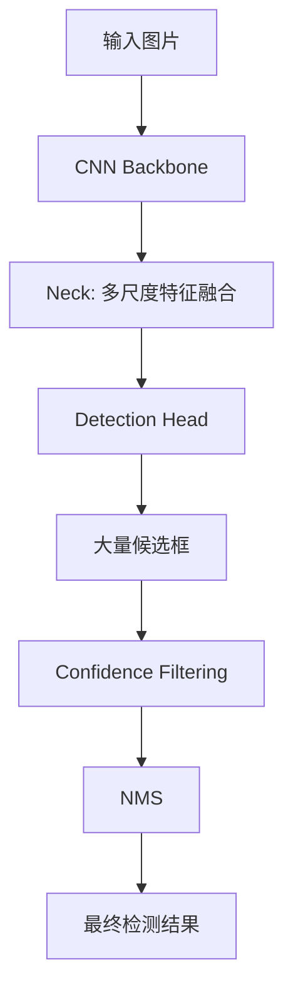

这种架构具有速度快、工程成熟、部署方便等优势。

但也存在一些问题：

1. 模型会在大量空间位置产生候选框。
2. 相邻位置可能对同一个目标产生重复预测。
3. 需要使用 NMS 进行后处理。
4. NMS 需要设置 IoU Threshold。
5. NMS 的计算量会受到候选框数量影响。
6. 密集目标和相邻目标场景下，NMS 可能错误删除真实目标。

Transformer 检测器采用了不同的思路。

它不再让大量候选框竞争，而是使用固定数量的 Object Queries，让每个 Query 负责预测一个目标。

这就是 DETR（DEtection TRansformer）提出的 Set Prediction 思想。

## 1.2 DETR 的基本思想

DETR 将目标检测转换为一个集合预测问题。

假设一张图片包含 3 个目标：

- 一辆汽车。
- 一个人。
- 一辆自行车。

模型预先设置 300 个 Object Queries。

每个 Query 可以理解为一个独立的检测任务：

```text
Query 1：有没有一个目标由我负责？如果有，它在哪里？
Query 2：有没有一个目标由我负责？如果有，它在哪里？
Query 3：有没有一个目标由我负责？如果有，它在哪里？
...
Query 300：有没有一个目标由我负责？如果有，它在哪里？
```

最终：

- 一部分 Query 负责真实目标。
- 其他 Query 输出 No Object。

训练时通过 Hungarian Matching（匈牙利匹配）建立预测结果和真实目标之间的一对一对应关系。

这样模型就能够学习避免重复预测，不再需要传统 NMS。

基本结构：

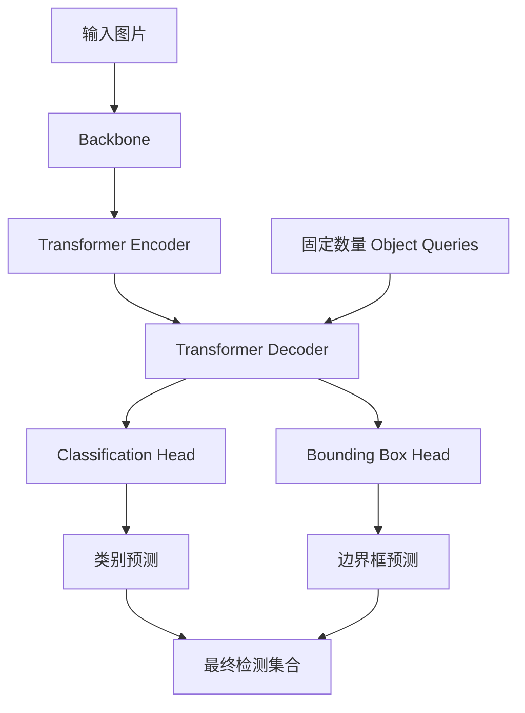

但是原始 DETR 存在一些问题：

1. Transformer Encoder 的全局 Attention 计算成本较高。
2. 训练收敛速度较慢。
3. 小目标检测能力不足。
4. 高精度和实时推理之间存在较大矛盾。

后续 Deformable DETR 等方法通过稀疏注意力、多尺度特征和改进训练方式进行了优化。

RF-DETR 则进一步关注一个问题：

**能否利用大型预训练视觉模型的特征表达能力，同时通过架构搜索自动找到适合不同硬件和数据集的实时检测网络？**

## 1.3 RF-DETR 的核心思想

RF-DETR 的核心并不是提出一个全新的 Attention 算子，而是将已有的高效 Transformer 检测架构与预训练视觉 Backbone、Windowed Attention 和 Weight-sharing NAS 结合起来。

主要包含五个方面。

### 1. 使用预训练 ViT Backbone

RF-DETR 使用 DINOv2 作为主要视觉 Backbone。

与传统 CNN Backbone 不同，ViT 将图片划分为 Patch，每个 Patch 转换为一个 Token。

然后通过 Transformer Block 提取特征。

使用预训练 Backbone 的优势：

- 能够利用大规模预训练获得的视觉特征。
- 对小规模目标检测数据集具有较好的迁移能力。
- 能够获得更强的语义特征。
- 减少从随机初始化开始训练的困难。

### 2. Windowed Attention + Global Attention

ViT 的全局 Self-Attention 需要计算所有 Token 之间的关系。

Token 数量为 $N$ 时，其 Attention 矩阵大小为：

$$
N\times N
$$

计算复杂度近似为：

$$
O(N^2)
$$

RF-DETR 在 Backbone 中交替使用：

- Windowed Attention：局部窗口注意力。
- Global Attention：全局注意力。

局部窗口降低计算量，全局注意力保留跨区域的信息交互能力。

### 3. MultiScale Projector

ViT 在多个 Transformer Block 中产生不同深度的特征。

RF-DETR 从多个 Block 提取特征，通过 MultiScale Projector 将这些特征融合成供 Decoder 使用的特征图。

Projector 使用卷积模块进行特征融合，并采用 LayerNorm。

### 4. Deformable Transformer Decoder

Decoder 使用 Object Queries 对 Encoder Memory 进行查询。

不同于普通 Cross-Attention：

- 不需要让每个 Query 与所有空间 Token 建立完整的 Attention 关系。
- 每个 Query 根据参考框预测少量采样位置。
- 在这些位置提取特征并进行加权融合。

这样可以降低 Decoder 的计算量。

### 5. Weight-sharing Neural Architecture Search

这是 RF-DETR 论文最重要的贡献之一。

传统方式：

```text
训练 Nano
    ↓
训练 Small
    ↓
训练 Medium
    ↓
训练 Large
```

每个模型都需要单独训练。

RF-DETR：

```text
                一次共享权重训练
                       |
       ┌───────────────┼───────────────┐
       ↓               ↓               ↓
    Nano 配置       Small 配置      Medium 配置
       ↓               ↓               ↓
    验证精度         验证精度         验证精度
       └───────────────┼───────────────┘
                       ↓
                Accuracy-Latency
                  Pareto Curve
```

通过改变：

- Patch Size。
- Image Resolution。
- Number of Windows。
- Decoder Layers。
- Number of Queries。

可以从同一组共享权重中得到不同计算量、不同精度的模型。

这意味着：

**RF-DETR 不仅是一个检测网络，也是一种用于自动寻找实时检测模型架构的训练方法。**

---

# 二、RF-DETR 整体网络架构

## 2.1 整体组成

RF-DETR 的主要网络结构可以划分为三个部分：

1. Backbone：Vision Transformer。
2. MultiScale Projector：多层特征融合。
3. Transformer Decoder：目标查询和预测。

此外还有：

- Encoder Proposal Head：产生初始目标候选。
- Classification Head：预测类别。
- Bounding Box Head：预测边界框。
- Segmentation Head：可选的实例分割分支。
- Keypoint Head：当前官方仓库提供的关键点检测预览分支。

整体架构：

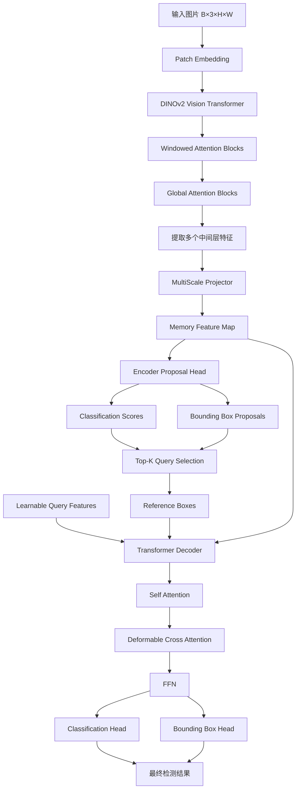

## 2.2 各模块作用

| 模块 | 主要结构 | 作用 |
|---|---|---|
| Patch Embedding | Conv2d | 将图片转换为 Patch Tokens |
| ViT Backbone | Transformer | 提取视觉特征 |
| Windowed Attention | 局部 Self-Attention | 降低全局 Attention 计算量 |
| Global Attention | 全局 Self-Attention | 建立跨窗口的全局关系 |
| MultiScale Projector | C2f + Conv + LayerNorm | 融合不同深度的 Backbone 特征 |
| Encoder Proposal Head | Linear + MLP | 产生初始分类分数和边界框 |
| Query Selection | Top-K | 选择高质量初始参考框 |
| Transformer Decoder | Self-Attention + Deformable Attention + FFN | 逐步提取目标信息 |
| Classification Head | Linear | 输出类别 |
| Bounding Box Head | MLP | 输出边界框 |

## 2.3 一个重要的结构区别：没有独立的传统 Transformer Encoder

理解 RF-DETR 时需要注意：

它并不是：

```text
Backbone
   ↓
Transformer Encoder
   ↓
Transformer Decoder
```

这种简单结构。

RF-DETR 将大量特征编码工作放在预训练 ViT Backbone 中完成。

随后使用 MultiScale Projector 融合多个深度的特征，再将其提供给 Decoder。

因此：

- ViT Backbone 本身承担主要的视觉特征编码工作。
- MultiScale Projector 负责特征融合。
- Transformer Decoder 负责目标查询和预测。

这种设计继承了 LW-DETR 的整体思路。

---

# 三、Backbone：DINOv2 Vision Transformer

## 3.1 为什么使用 ViT？

传统 CNN 通过卷积核逐层提取局部特征。

例如：

```text
Conv 3×3
    ↓
Conv 3×3
    ↓
Conv 3×3
    ↓
逐渐扩大感受野
```

ViT 则将图片划分成多个 Patch，然后通过 Self-Attention 建立不同 Patch 之间的关系。

例如一张 512×512 图片，使用 16×16 Patch：

$$
N=\frac{512}{16}\times\frac{512}{16}
$$

$$
N=32\times32=1024
$$

也就是说，一张图片被转换成 1024 个视觉 Token。

每个 Token 具有固定维度的特征向量。

## 3.2 Patch Embedding

假设输入图片：

$$
X\in\mathbb{R}^{B\times3\times H\times W}
$$

Patch Size 为 $P$。

通过一个卷积层完成 Patch Embedding：

$$
E=Conv2d(X,kernel=P,stride=P)
$$

假设 Backbone 的隐藏维度为 $D$：

$$
E\in
\mathbb{R}^{B\times D\times\frac{H}{P}\times\frac{W}{P}}
$$

然后展平：

$$
T=Flatten(E)
$$

$$
T\in
\mathbb{R}^{B\times N\times D}
$$

其中：

$$
N=\frac{H}{P}\times\frac{W}{P}
$$

例如 RF-DETR-S：

| 参数 | 数值 |
|---|---:|
| Input Resolution | 512×512 |
| Patch Size | 16×16 |
| Patch Grid | 32×32 |
| Token 数量 | 1024 |
| Backbone Hidden Dimension | 384 |

因此：

$$
X\in\mathbb{R}^{B\times3\times512\times512}
$$

经过 Patch Embedding：

$$
T\in\mathbb{R}^{B\times1024\times384}
$$

这里的 384 是 DINOv2-S 的隐藏维度。

## 3.3 DINOv2 Backbone 的结构

RF-DETR 的主要检测模型使用 DINOv2 预训练视觉特征。

以 DINOv2-S 为例：

| 参数 | 数值 |
|---|---:|
| Transformer Blocks | 12 |
| Hidden Dimension | 384 |
| Attention Heads | 6 |
| MLP Ratio | 4 |
| FFN Dimension | 1536 |
| Patch Size | 可配置 |

DINOv2-B 的主要区别是：

| 参数 | 数值 |
|---|---:|
| Transformer Blocks | 12 |
| Hidden Dimension | 768 |
| Attention Heads | 12 |
| MLP Ratio | 4 |
| FFN Dimension | 3072 |

一个标准 ViT Block：

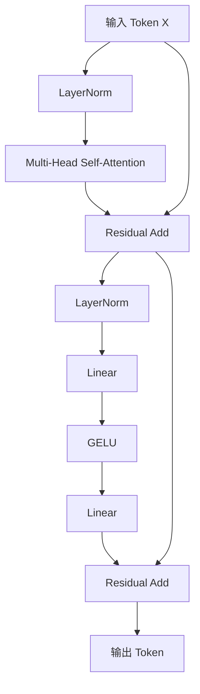

Self-Attention：

$$
Q=XW_Q
$$

$$
K=XW_K
$$

$$
V=XW_V
$$

$$
Attention(Q,K,V)
=
Softmax\left(
\frac{QK^T}{\sqrt{d_k}}
\right)V
$$

FFN：

$$
FFN(X)=W_2(GELU(W_1X))
$$

对于 DINOv2-S：

$$
384\rightarrow1536\rightarrow384
$$

## 3.4 为什么不直接使用全部 Global Attention？

假设输入为 512×512，Patch Size 为 16：

$$
N=1024
$$

Global Self-Attention 需要计算：

$$
A=QK^T
$$

Attention 矩阵：

$$
A\in\mathbb{R}^{1024\times1024}
$$

每个 Head 需要处理：

$$
1024^2=1,048,576
$$

个注意力位置。

当输入分辨率增加时，Token 数量会迅速增加。

例如：

| 输入尺寸 | Patch Size | Token 数量 | Attention 矩阵大小 |
|---|---:|---:|---:|
| 384×384 | 16 | 576 | 331,776 |
| 512×512 | 16 | 1024 | 1,048,576 |
| 640×640 | 16 | 1600 | 2,560,000 |
| 704×704 | 16 | 1936 | 3,748,096 |
| 880×880 | 20 | 1936 | 3,748,096 |

因此需要降低 ViT Backbone 的 Attention 计算量。

RF-DETR 使用 Windowed Attention 和 Global Attention 交替处理。

---

## 3.5 Windowed Attention：窗口注意力

Windowed Attention 的核心思想：

**不让每个 Token 都与整张图片的所有 Token 进行 Attention，而是将 Token 划分成多个窗口，每个窗口内部独立计算 Attention。**

假设 Token Grid：

$$
32\times32
$$

设置：

$$
num\_windows=2
$$

表示在高度和宽度两个方向各划分为 2 个窗口。

总共：

$$
2\times2=4
$$

个窗口。

每个窗口的大小：

$$
16\times16
$$

每个窗口包含：

$$
16\times16=256
$$

个 Patch Token。

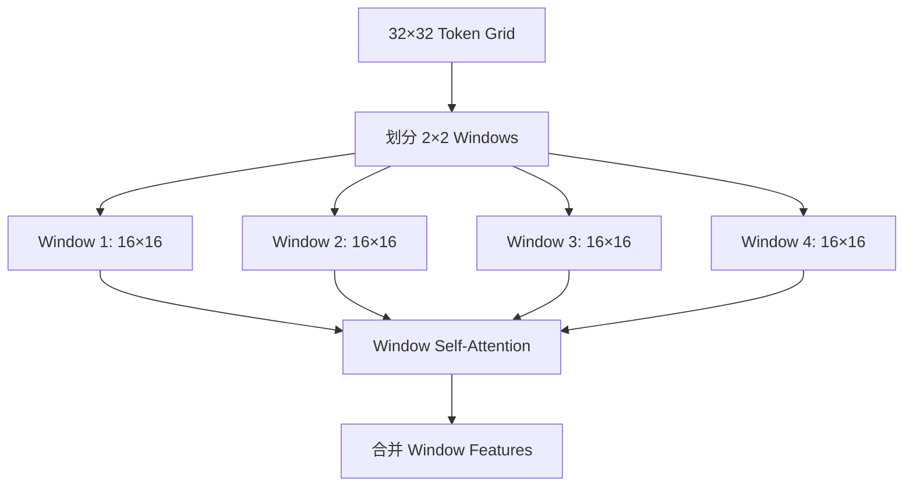

### 3.5.1 计算量分析

Global Attention：

$$
N=1024
$$

注意力矩阵元素数量：

$$
1024^2=1,048,576
$$

Windowed Attention：

每个窗口 256 个 Token。

4 个窗口：

$$
4\times256^2
$$

$$
=262,144
$$

因此：

$$
\frac{262144}{1048576}=\frac{1}{4}
$$

理论上，局部 Attention 的矩阵计算规模是全局 Attention 的 1/4。

这里比较的是 Attention 矩阵的主要计算规模，不代表整个 Transformer Block 的运行时间也一定降低到 1/4。

一般化：

假设 Token Grid 为 $S\times S$，每个方向划分为 $W$ 个窗口。

则总窗口数：

$$
W^2
$$

每个窗口 Token 数量：

$$
\frac{S^2}{W^2}
$$

所有窗口的 Attention 计算规模：

$$
W^2
\left(
\frac{S^2}{W^2}
\right)^2
$$

整理：

$$
\frac{S^4}{W^2}
$$

而 Global Attention：

$$
S^4
$$

所以理论比例：

$$
\frac{1}{W^2}
$$

当：

$$
W=2
$$

Attention 矩阵计算规模约为全局方式的 1/4。

## 3.6 为什么还需要 Global Attention？

如果所有 Block 都使用 Windowed Attention：

每个窗口内部的信息可以充分交互，但是不同窗口之间无法直接建立 Attention 关系。

例如：

图片左上角有一个人，右下角有一辆汽车。

两个目标之间可能存在语义关系。

如果始终使用局部窗口，跨窗口信息传递就需要经过多层间接传播。

因此 RF-DETR 将：

- Windowed Attention。
- Global Attention。

交替安排在 Backbone 中。

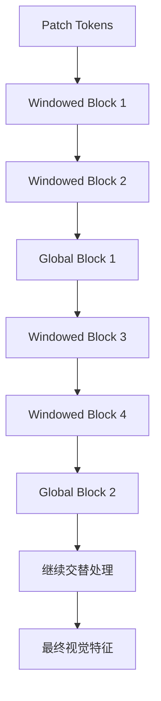

Windowed Attention 负责局部区域特征交互。

Global Attention 负责跨区域信息交互。

两者结合，既降低了计算成本，也保留了全局建模能力。

### 3.6.1 Class Token 如何处理？

原始 ViT 中存在一个 CLS Token。

它通常用于汇总整张图片的全局信息。

将图片划分为多个窗口后，RF-DETR 会为每个窗口复制对应的 CLS Token，使窗口注意力能够正常处理 CLS Token 和 Patch Tokens。

因此：

- 每个窗口有自己的局部 Token 序列。
- 每个窗口都包含一个对应的 CLS Token。
- 经过窗口注意力后，再恢复为完整的空间 Token 布局。

这一处理是窗口注意力能够兼容预训练 ViT 结构的重要细节。

## 3.7 不同深度的特征输出

RF-DETR 不仅使用 ViT 最后一层的特征，还会提取多个中间层特征。

以 RF-DETR-S 为例：

```text
Patch Embedding
      |
Transformer Block 1
      |
Transformer Block 2
      |
Transformer Block 3  ───── Feature 1
      |
Transformer Block 4
      |
Transformer Block 5
      |
Transformer Block 6  ───── Feature 2
      |
Transformer Block 7
      |
Transformer Block 8
      |
Transformer Block 9  ───── Feature 3
      |
Transformer Block 10
      |
Transformer Block 11
      |
Transformer Block 12 ───── Feature 4
```

对应：

$$
F_1,F_2,F_3,F_4
$$

这四个特征具有相同的空间尺寸，但语义深度不同。

假设：

$$
F_i\in
\mathbb{R}^{B\times384\times32\times32}
$$

它们分别具有：

- 较浅层：更多局部纹理和边缘信息。
- 中间层：更丰富的目标结构信息。
- 深层：更强的语义信息。

这些特征将交给 MultiScale Projector 进行融合。

---

# 四、MultiScale Projector：多层特征融合

## 4.1 为什么需要 Projector？

ViT 的不同 Transformer Block 输出特征具有相同的空间分辨率。

但是不同层的特征语义不同。

如果只使用最后一层：

可能丢失部分浅层特征信息。

因此 RF-DETR 提取多个深度的特征，并使用 Projector 进行融合。

需要注意：

这里的多尺度主要涉及不同网络深度的特征融合，不应直接理解为传统 CNN 中一定存在 P3、P4、P5 三种空间分辨率的特征金字塔。

标准检测模型的常用配置实际上只输出一个 P4 特征层。

## 4.2 Projector 输入

RF-DETR-S：

$$
F_1,F_2,F_3,F_4
$$

每个特征：

$$
F_i\in\mathbb{R}^{B\times384\times32\times32}
$$

首先沿 Channel 维度拼接：

$$
F_{cat}=Concat(F_1,F_2,F_3,F_4)
$$

得到：

$$
F_{cat}
\in
\mathbb{R}^{B\times1536\times32\times32}
$$

因为：

$$
384\times4=1536
$$

## 4.3 C2f 特征融合

拼接后经过 C2f 模块，将通道数映射到统一的 Hidden Dimension。

假设：

$$
C_{in}=1536
$$

$$
C_{out}=256
$$

则：

$$
F_{cat}
\rightarrow C2f
\rightarrow F_{out}
$$

最终：

$$
F_{out}
\in
\mathbb{R}^{B\times256\times32\times32}
$$

一个 C2f 模块：

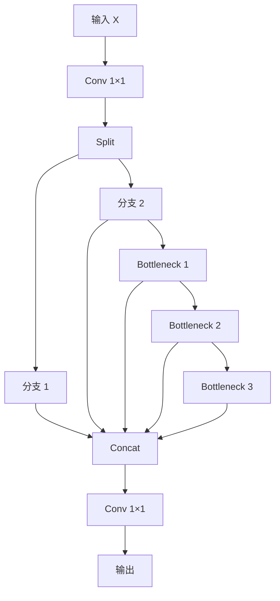

C2f 的作用：

- 提供不同的特征传播路径。
- 融合多个层级的特征。
- 控制计算量。
- 将 Backbone 输出统一到 Decoder 所需的通道数。

## 4.4 为什么使用 LayerNorm？

传统 CNN 特征融合模块经常使用 BatchNorm。

但是 RF-DETR 使用 LayerNorm。

原因之一是训练方式。

论文希望支持在消费级 GPU 上通过 Gradient Accumulation 进行训练。

BatchNorm 依赖当前 Mini-batch 的统计信息。

假设：

实际目标 Batch Size：

$$
B=32
$$

但是显存不足，只能每次处理：

$$
B_{micro}=4
$$

通过 8 次梯度累积：

$$
32=4\times8
$$

虽然最终梯度可以累积到相同数量的样本，但 BatchNorm 每次仍然只根据 4 张图片计算均值和方差。

因此统计结果与直接使用 Batch Size=32 不完全相同。

LayerNorm 则针对单个样本的特征维度进行归一化，不依赖 Mini-batch 统计量。

这使得 Gradient Accumulation 场景下的行为更加稳定。

## 4.5 Projector 输出

对于标准 RF-DETR-S：

$$
Memory
\in
\mathbb{R}^{B\times256\times32\times32}
$$

展平：

$$
Memory
\in
\mathbb{R}^{B\times1024\times256}
$$

这里的 Memory 就是后续 Transformer Decoder 读取的视觉特征。

### 4.5.1 一个容易混淆的地方

官方 `MultiScaleProjector` 实际支持不同尺度的输出：

| 配置 | 空间变化 |
|---|---|
| P3 | 上采样 2 倍 |
| P4 | 保持原始空间尺寸 |
| P5 | 下采样 2 倍 |

但论文对应的标准检测模型配置通常使用：

```python
projector_scale = ["P4"]
```

所以默认情况下：

- 不会同时产生传统意义上的 P3、P4、P5 三个空间特征层。
- Decoder 通常只有一个 Feature Level。
- 不同层级的信息主要来自 Backbone 不同深度的特征融合。

这也是理解 RF-DETR 网络结构时非常重要的区别。

---

# 五、Query Selection：目标查询初始化

## 5.1 什么是 Object Query？

Object Query 是 Transformer 检测器中的一个核心概念。

可以将它理解为一个负责寻找目标的特征向量。

假设：

- 一张图片有 5 个目标。
- 模型设置 300 个 Object Queries。

那么：

- 5 个 Query 最终负责描述真实目标。
- 其他 Query 预测 No Object。

RF-DETR 使用两阶段（Two-stage）Query 初始化方式。

它不是直接让所有 Query 从随机位置开始寻找目标，而是先从 Encoder Memory 中产生候选框，然后选择质量较高的候选框作为初始参考位置。

## 5.2 Encoder Proposal Head

假设 Projector 输出：

$$
Memory\in\mathbb{R}^{B\times1024\times256}
$$

其中：

- 1024：空间位置数量。
- 256：每个位置的特征维度。

对于每一个空间位置，模型都预测：

1. 分类分数。
2. 边界框。

### 5.2.1 分类预测

分类头：

$$
C_i=Linear(X_i)
$$

其中：

$$
X_i\in\mathbb{R}^{256}
$$

假设有 $C$ 个检测类别：

$$
C_i\in\mathbb{R}^{C}
$$

全部空间位置：

$$
C\in\mathbb{R}^{B\times1024\times C}
$$

### 5.2.2 边界框预测

边界框头使用 MLP：

$$
\Delta b_i=MLP(X_i)
$$

每个边界框包含：

$$
b_i=(c_x,c_y,w,h)
$$

在 RF-DETR 的两阶段结构中，初始边界框还会结合网格 Proposal。

对于第 $l$ 个特征层，位置 $(i,j)$ 的初始中心：

$$
x=\frac{j+0.5}{W}
$$

$$
y=\frac{i+0.5}{H}
$$

初始宽高：

$$
w=h=0.05\times2^l
$$

因此：

$$
a_{l,i,j}=(x,y,w,h)
$$

在标准单层 P4 配置中，只有一个特征层。

这些网格 Proposal 为模型提供了初始空间先验。

经过 Encoder 的分类头和边界框头，得到每个空间位置的分类分数和预测边界框。

## 5.3 Top-K Query Selection

现在有 1024 个空间位置，每个位置都有分类分数。

假设：

$$
C\in\mathbb{R}^{B\times1024\times80}
$$

对每个空间位置，取所有类别中的最大分类分数：

$$
s_i=\max_c C_{i,c}
$$

然后执行 Top-K：

$$
I_{topk}=TopK(s,K)
$$

RF-DETR-S 默认：

$$
K=300
$$

也就是说：

从 1024 个空间位置中选择 300 个高质量候选位置。

对应参考框：

$$
R_{topk}\in\mathbb{R}^{B\times300\times4}
$$

## 5.4 学习型 Query 与 Encoder Proposal 的关系

这里有一个容易理解错误的地方。

RF-DETR 的 Decoder 输入包含两种不同信息：

1. Query Content：可学习的 Query 特征。
2. Reference Box：Encoder 产生的初始空间参考框。

在官方实现中：

```python
tgt = query_feat.unsqueeze(0).expand(bs, -1, -1)
```

这里的 `query_feat` 是可学习的 Query Embedding。

Encoder Top-K 选择的主要作用是提供高质量的空间参考框。

也就是说：

**不能简单地认为 Decoder 的 Query Content 就是直接从 Encoder Memory 中取出的 Top-K 特征。**

更准确的关系是：

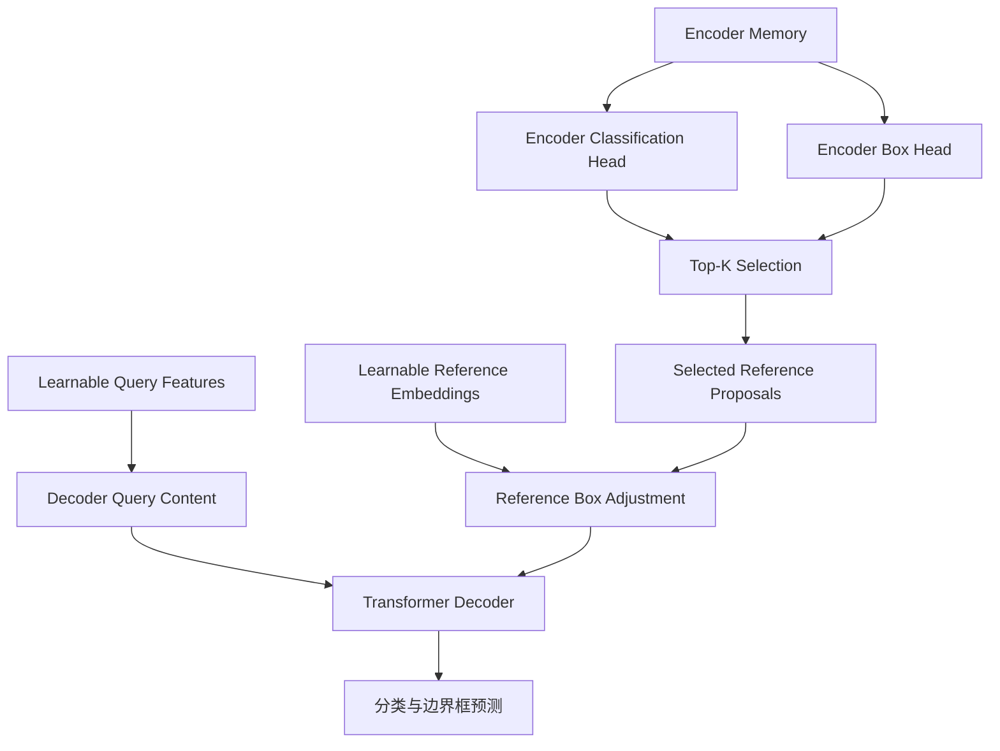

Encoder 负责提供初始空间位置。

Learnable Query Embedding 负责提供 Decoder 的内容特征。

二者共同参与后续检测。

## 5.5 为什么需要 Two-stage？

如果没有 Encoder Proposal：

Query 需要完全依赖自身的学习结果，在图像中寻找目标。

现在通过 Encoder 先生成候选框：

- Decoder 一开始就获得相对合理的目标位置。
- 减少无效搜索。
- 加快目标定位。
- 为后续 Deformable Attention 提供参考位置。

这种方式将目标检测分为：

1. Encoder：产生初始候选目标。
2. Decoder：对候选目标进行进一步识别和定位。

## 5.6 Query 数量的意义

默认：

$$
num\_queries=300
$$

它代表每张图片可供 Decoder 使用的 Query 数量。

在标准模型中，推理时最多使用 300 个 Query。

因此，默认模型最多只能产生 300 个独立 Query 对应的目标预测。

注意：

`num_queries` 和 `num_select` 不是完全相同的参数。

| 参数 | 作用 |
|---|---|
| num_queries | Decoder 使用多少个 Query |
| num_select | 后处理最多选择多少个检测结果 |

如果希望将模型的最大检测数量增加到 600：

```python
from rfdetr import RFDETRSmall

model = RFDETRSmall(
    num_queries=600,
    num_select=600
)
```

需要注意：

增加 Query 会增加 Decoder 的计算量和显存占用。

如果使用预训练权重，新增的 Query Embedding 也需要进行训练适配。

---

# 六、Transformer Decoder

## 6.1 Decoder 整体结构

经过 Query Selection 后，RF-DETR 得到：

$$
Q_{content}\in\mathbb{R}^{B\times300\times256}
$$

以及：

$$
Q_{reference}\in\mathbb{R}^{B\times300\times4}
$$

接下来进入 Transformer Decoder。

RF-DETR 的 Decoder 继承了 LW-DETR 的设计，主要包含：

1. Multi-Head Self-Attention。
2. Multi-Scale Deformable Cross-Attention。
3. Feed Forward Network。

整体结构：

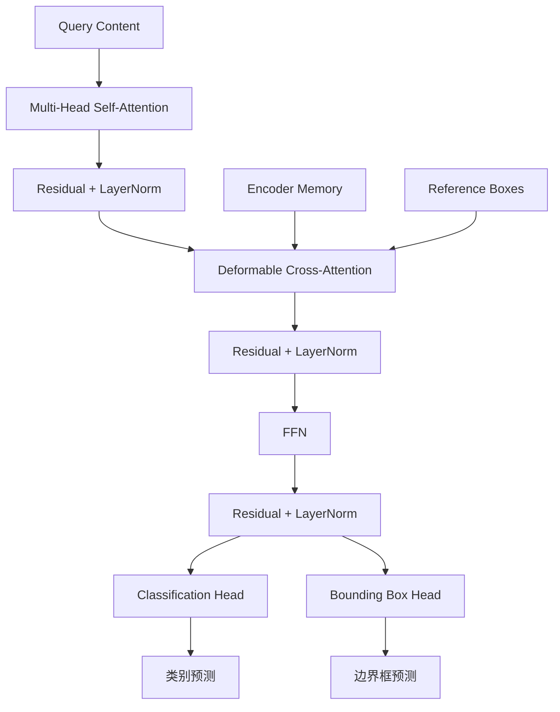

## 6.2 Decoder 参数

以 RF-DETR-S 为例：

| 参数 | 数值 |
|---|---:|
| Hidden Dimension | 256 |
| Number of Queries | 300 |
| Decoder Layers | 3 |
| Self-Attention Heads | 8 |
| Cross-Attention Heads | 16 |
| FFN Dimension | 2048 |
| Feature Levels | 1 |
| Deformable Attention Points | 2 |
| Activation | ReLU |

注意：

Self-Attention 和 Cross-Attention 的 Head 数量不同。

Self-Attention：

$$
HeadDim=\frac{256}{8}=32
$$

Cross-Attention：

$$
HeadDim=\frac{256}{16}=16
$$

## 6.3 Multi-Head Self-Attention

Self-Attention 负责建立不同 Object Queries 之间的关系。

输入：

$$
X\in\mathbb{R}^{B\times300\times256}
$$

计算：

$$
Q=XW_Q
$$

$$
K=XW_K
$$

$$
V=XW_V
$$

Attention：

$$
Attention(Q,K,V)
=
Softmax\left(
\frac{QK^T}{\sqrt{d_k}}
\right)V
$$

注意力矩阵：

$$
A\in\mathbb{R}^{B\times8\times300\times300}
$$

为什么需要 Query 之间交互？

例如图片中有两个人距离很近。

如果两个 Query 都预测同一个人：

通过 Self-Attention，两个 Query 可以交换信息。

在 Hungarian Matching 的训练监督下，模型会逐渐学会减少重复预测。

## 6.4 Deformable Cross-Attention

这是 Decoder 中非常重要的计算模块。

传统 Cross-Attention：

每个 Query 都需要与 Encoder Memory 中的所有 Token 建立注意力关系。

假设：

$$
Memory\in\mathbb{R}^{B\times1024\times256}
$$

那么 300 个 Query 都需要与 1024 个空间位置进行交互。

如果直接计算完整的 Cross-Attention：

$$
A\in\mathbb{R}^{B\times300\times1024}
$$

RF-DETR 使用 Deformable Attention。

核心思想：

**每个 Query 只需要从图像中采样少量关键位置，而不需要处理所有空间位置。**

### 6.4.1 输入

Query：

$$
Q\in\mathbb{R}^{B\times300\times256}
$$

Memory：

$$
V\in\mathbb{R}^{B\times1024\times256}
$$

Reference Box：

$$
R\in\mathbb{R}^{B\times300\times4}
$$

其中：

$$
R=(c_x,c_y,w,h)
$$

### 6.4.2 预测 Sampling Offsets

对于每一个 Query，模型通过 Linear 层预测采样偏移量。

$$
\Delta p
\in
\mathbb{R}^{B\times Q\times M\times L\times K\times2}
$$

其中：

- $Q=300$：Query 数量。
- $M=16$：Attention Heads。
- $L=1$：Feature Levels。
- $K=2$：每个 Head 的采样点数量。

因此，每个 Query 每层 Decoder 的采样位置总数：

$$
16\times1\times2=32
$$

也就是说：

每个 Query 不需要读取 1024 个位置，而是通过学习得到 32 个采样位置。

### 6.4.3 采样位置计算

对于参考框：

$$
R=(c_x,c_y,w,h)
$$

预测偏移量：

$$
\Delta p_{q,m,l,k}
$$

采样位置可以表示为：

$$
p_{q,m,l,k}
=
(c_x,c_y)
+
\Delta p_{q,m,l,k}
\odot
\frac{(w,h)}{2}
$$

其中：

- $\Delta p$：网络预测的采样偏移。
- $(w,h)$：参考框宽高。
- $\odot$：逐元素乘法。

因此，采样点的位置会受到参考框大小影响。

对于较大的目标，可以在更大区域内采样。

对于较小的目标，采样范围相应较小。

### 6.4.4 Attention Weights

除了预测采样位置，还需要预测每个采样点的权重。

$$
\alpha_{q,m,l,k}
$$

对所有采样位置执行 Softmax：

$$
\sum_{l=1}^{L}
\sum_{k=1}^{K}
\alpha_{q,m,l,k}=1
$$

最后对采样到的特征进行加权融合：

$$
Y_q=
W_o
\sum_{m=1}^{M}
\sum_{l=1}^{L}
\sum_{k=1}^{K}
\alpha_{q,m,l,k}
W_vV_l(p_{q,m,l,k})
$$

其中：

- $V_l(p)$：在第 $l$ 个特征层采样得到的特征。
- $W_v$：Value Projection。
- $W_o$：输出投影。
- $\alpha$：Attention Weights。

实际采样使用双线性插值，可以处理非整数坐标。

### 6.4.5 为什么叫 Deformable？

因为采样位置并不是固定的。

网络通过学习动态调整采样偏移。

例如：

一个 Query 负责寻找汽车。

它可以学习关注：

- 车轮。
- 车窗。
- 车身。
- 车辆边缘。

训练过程中，采样位置会逐渐调整到有助于目标识别和定位的区域。

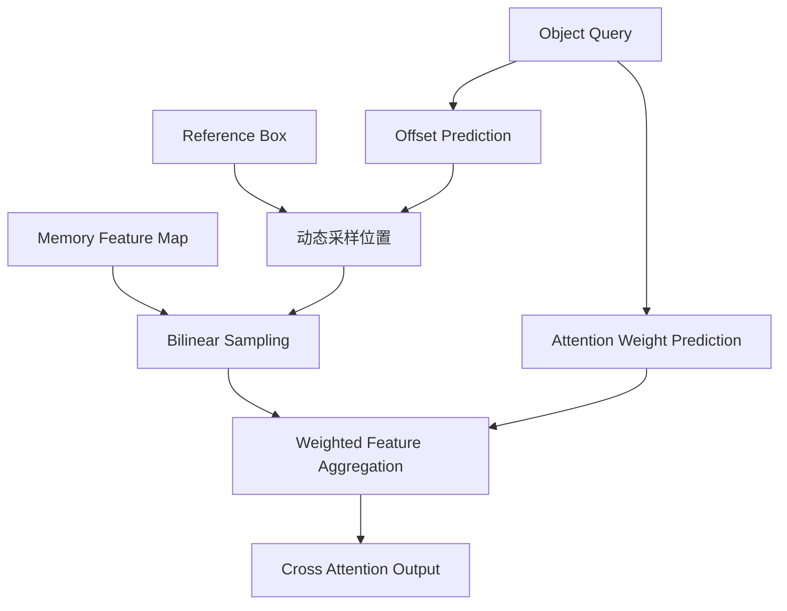

## 6.5 FFN

经过 Self-Attention 和 Deformable Cross-Attention 后，Query 还需要通过 FFN 进行特征变换。

RF-DETR-S 默认：

$$
256\rightarrow2048\rightarrow256
$$

计算：

$$
FFN(X)=W_2(ReLU(W_1X))
$$

然后通过残差连接和 LayerNorm。

完整 Decoder Layer：

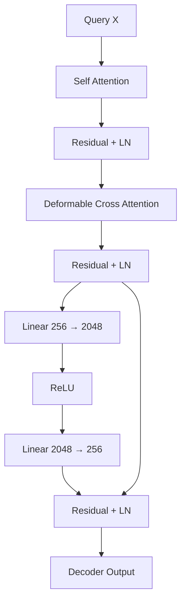

## 6.6 Bounding Box Prediction

每层 Decoder 都会输出分类和边界框。

假设第 $l$ 层输出：

$$
H^{(l)}
\in
\mathbb{R}^{B\times300\times256}
$$

分类头：

$$
C^{(l)}=Linear(H^{(l)})
$$

边界框头：

$$
\Delta B^{(l)}=MLP(H^{(l)})
$$

最终输出：

$$
Pred_{cls}^{(l)}
\in
\mathbb{R}^{B\times300\times C}
$$

$$
Pred_{box}^{(l)}
\in
\mathbb{R}^{B\times300\times4}
$$

## 6.7 Reference Box Refinement

RF-DETR 使用参考框对边界框预测进行参数化。

官方当前标准模型配置中：

```python
bbox_reparam = True
lite_refpoint_refine = True
```

其核心计算可以表示为：

$$
\hat{c}_{xy}^{(l)}
=
\Delta_{xy}^{(l)}
\odot r_{wh}^{(0)}
+
r_{xy}^{(0)}
$$

$$
\hat{w}_{h}^{(l)}
=
\exp(\Delta_{wh}^{(l)})
\odot r_{wh}^{(0)}
$$

其中：

- $r^{(0)}$：初始参考框。
- $\Delta^{(l)}$：当前 Decoder 层预测的边界框偏移。
- $\hat b^{(l)}$：当前层最终预测框。

### 6.7.1 一个重要区别

需要注意，RF-DETR 当前发布的标准模型并不是每层都更新 Deformable Attention 使用的 Reference Box。

在 `lite_refpoint_refine=True` 的配置下：

- 每层 Decoder 都会更新 Query 特征。
- 每层都会产生新的边界框预测。
- 但 Deformable Attention 使用的初始参考框保持不变。

因此：

**每层预测框不断改善，不等于每层 Attention 的参考框也在不断更新。**

这与采用逐层更新 Reference Points 的检测器存在区别。

## 6.8 为什么可以减少 Decoder Layers？

RF-DETR 在训练阶段对所有 Decoder Layer 的输出都计算损失。

例如：

```text
Decoder Layer 1 → Loss 1
Decoder Layer 2 → Loss 2
Decoder Layer 3 → Loss 3
Decoder Layer 4 → Loss 4
```

每层都必须具备独立产生有效预测的能力。

因此推理时可以直接移除后面的 Decoder Layer。

例如：

```text
训练：4 Layers

推理 A：4 Layers
推理 B：3 Layers
推理 C：2 Layers
推理 D：1 Layer
推理 E：0 Decoder Layers
```

移除 Decoder 后，模型可以直接使用 Encoder Proposal 进行检测。

此时模型相当于一个单阶段检测器。

需要注意：

这里的关键是训练阶段已经对各层输出进行监督，而不是简单地认为任意 Transformer 都能随意删除中间层。

---

# 七、NMS-Free：为什么 RF-DETR 不需要 NMS？

## 7.1 核心原因

RF-DETR 使用 Set Prediction。

训练阶段：

通过 Hungarian Matching 建立预测与 GT 的一对一关系。

假设：

真实目标：

$$
GT=\{A,B,C\}
$$

模型输出：

$$
Q=\{Q_1,Q_2,\ldots,Q_{300}\}
$$

Hungarian Matching 会选择最合适的三个 Query：

$$
Q_1\leftrightarrow A
$$

$$
Q_2\leftrightarrow B
$$

$$
Q_3\leftrightarrow C
$$

其他 Query 被监督为 No Object。

这样网络在训练阶段就学习了：

一个目标应该由一个 Query 负责。

## 7.2 Hungarian Matching

对于预测框 $i$ 和 GT $j$，构建匹配代价：

$$
C_{ij}
=
\lambda_{cls}C_{cls}
+
\lambda_{bbox}C_{bbox}
+
\lambda_{giou}C_{giou}
$$

其中：

分类代价：

$$
C_{cls}
$$

L1 边界框代价：

$$
C_{bbox}
=
\|\hat b_i-b_j\|_1
$$

GIoU 代价：

$$
C_{giou}
=
1-GIoU(\hat b_i,b_j)
$$

Hungarian Algorithm 寻找总代价最小的一对一分配。

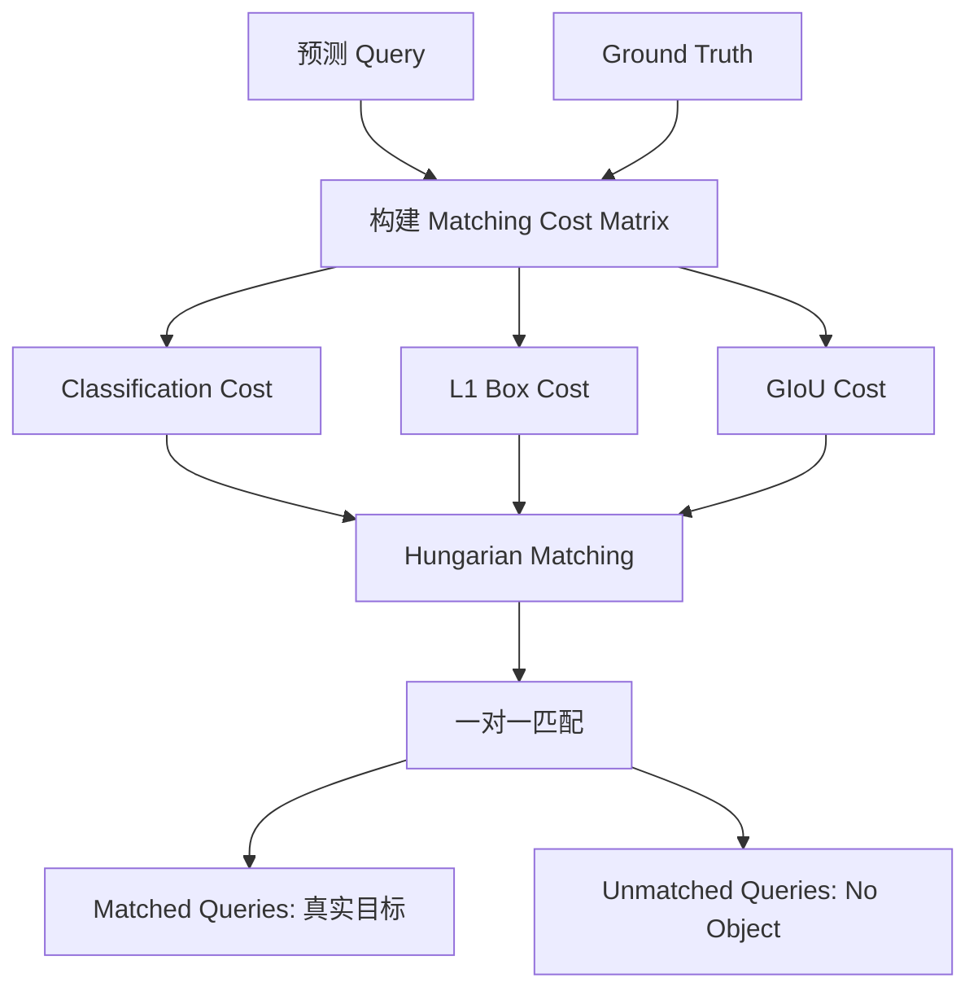

## 7.3 分类质量感知

RF-DETR 不仅关注类别是否预测正确，也希望分类分数能够反映定位质量。

官方当前代码默认使用 IoU-aware BCE（IA-BCE）分类损失。

对于一个匹配的正样本：

假设：

预测类别概率：

$$
p=0.9
$$

预测框与 GT 的 IoU：

$$
q=0.8
$$

构造质量感知目标：

$$
t=p^\alpha q^{1-\alpha}
$$

再进行下限截断：

$$
t=\max(t,0.01)
$$

其中 $\alpha$ 为控制分类分数和 IoU 权重的参数。

这样：

- 分类准确且定位准确，目标分数较高。
- 分类准确但定位较差，目标分数降低。
- 未匹配的背景 Query 使用负样本权重进行监督。

官方实现中还对负样本使用预测概率的 Focal 式权重，以降低大量简单负样本的影响。

注意：

论文中的核心创新是 Weight-sharing NAS 和架构设计，IA-BCE 是当前官方代码实现中的分类监督方式，不应将其与论文的 NAS 算法混为一谈。

## 7.4 推理阶段输出

假设：

$$
Pred_{cls}
\in
\mathbb{R}^{B\times300\times C}
$$

$$
Pred_{box}
\in
\mathbb{R}^{B\times300\times4}
$$

分类结果经过 Sigmoid：

$$
Score=\sigma(Pred_{cls})
$$

然后对 Query 和类别维度进行 Top-K 选择。

最终：

1. 过滤低置信度预测。
2. 选择高分检测结果。
3. 转换边界框格式。
4. 将归一化坐标恢复到图片尺寸。

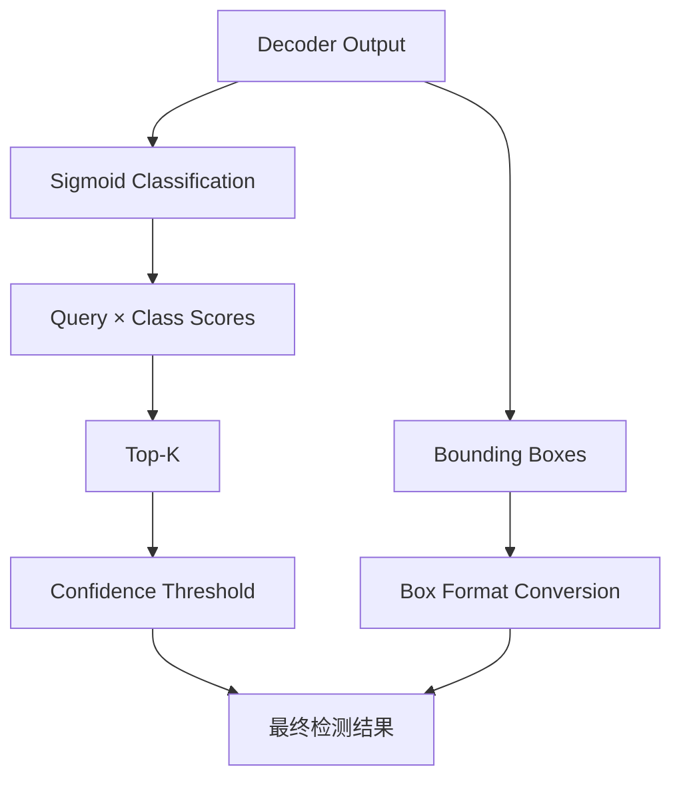

注意：

NMS-Free 不代表完全没有后处理。

RF-DETR 仍然需要：

- Sigmoid。
- Top-K。
- Confidence Threshold。
- 坐标转换。
- 原始图像尺寸恢复。

只是没有传统 NMS。

另外，NMS-Free 不意味着模型绝对不会产生重复预测，它只是通过一对一训练机制学习减少重复预测。

---

# 八、Weight-sharing NAS：RF-DETR 最核心的创新

## 8.1 什么是 NAS？

NAS（Neural Architecture Search）即神经网络架构搜索。

传统网络开发：

研究人员人工设计：

- Backbone 深度。
- 通道数量。
- Attention Heads。
- Decoder Layers。
- 输入分辨率。

然后训练模型，比较精度和速度。

如果模型速度不符合要求，通常需要重新修改结构并训练。

NAS 的目标是：

**自动寻找满足精度和计算效率要求的网络架构。**

传统 NAS 的问题：

如果每种架构都单独训练，成本会非常高。

例如：

| 模型 | 单次训练时间 |
|---|---:|
| Nano | 10 小时 |
| Small | 15 小时 |
| Medium | 20 小时 |
| Large | 30 小时 |

如果需要测试几十种配置，训练成本会非常高。

RF-DETR 使用 Weight-sharing NAS 解决这个问题。

## 8.2 Weight-sharing NAS 的核心思想

核心思想：

训练一个包含多种架构配置的共享权重网络。

不同子网络不再拥有完全独立的参数，而是共享同一套参数。

例如：

```text
             Shared Weights
                   |
       ┌───────────┼───────────┐
       ↓           ↓           ↓
   Subnet A    Subnet B    Subnet C
       |           |           |
   Nano配置     Small配置    Medium配置
       |           |           |
       └───────────┼───────────┘
                   ↓
             共享参数更新
```

训练过程中：

随机采样一种网络配置。

然后使用该配置完成一次前向传播和反向传播。

下一次迭代再随机采样其他配置。

最终，不同配置都能够使用同一套共享参数。

## 8.3 数学表达

定义搜索空间：

$$
\mathcal{A}
=
\mathcal{P}
\times
\mathcal{D}
\times
\mathcal{Q}
\times
\mathcal{R}
\times
\mathcal{W}
$$

其中：

- $\mathcal{P}$：Patch Size 搜索空间。
- $\mathcal{D}$：Decoder Layers 搜索空间。
- $\mathcal{Q}$：Query 数量搜索空间。
- $\mathcal{R}$：输入分辨率搜索空间。
- $\mathcal{W}$：Window 数量搜索空间。

每次训练迭代：

随机采样一个架构：

$$
a_t\sim Uniform(\mathcal{A})
$$

使用共享参数 $\theta$ 进行训练：

$$
\mathcal{L}_t
=
\mathcal{L}(f(x;\theta,a_t),y)
$$

更新：

$$
\theta_{t+1}
=
\theta_t
-
\eta
\nabla_\theta\mathcal{L}_t
$$

其中：

- $x$：输入图片。
- $y$：真实标签。
- $a_t$：当前采样的网络架构。
- $\theta$：共享参数。
- $\eta$：学习率。

经过大量迭代后：

同一套参数已经适应多种架构配置。

## 8.4 为什么能够提高泛化能力？

可以将它理解为一种 Architecture Augmentation。

普通训练：

每次训练都使用固定网络结构。

Weight-sharing NAS：

每次训练可能使用不同结构。

例如：

```text
Iteration 1：Patch 16，Resolution 512，Decoder 3
Iteration 2：Patch 14，Resolution 576，Decoder 4
Iteration 3：Patch 16，Resolution 640，Decoder 2
Iteration 4：Patch 20，Resolution 640，Decoder 5
Iteration 5：Patch 16，Resolution 704，Decoder 4
```

不同结构会产生不同的特征计算路径。

共享权重需要适应这些变化。

这样相当于在训练期间不断改变模型结构，起到一定正则化作用。

论文将其称为：

**Architecture Augmentation。**

## 8.5 RF-DETR 的五个搜索参数

RF-DETR 主要搜索五个维度：

1. Patch Size。
2. Decoder Layers。
3. Query Tokens。
4. Image Resolution。
5. Number of Windows。

下面分别分析。

---

## 8.6 搜索参数一：Patch Size

Patch Size 决定输入图片被划分成多少个 Token。

假设：

$$
H=W=512
$$

Patch Size：

$$
P=16
$$

Token 数量：

$$
N=\frac{512}{16}\times\frac{512}{16}
$$

$$
N=1024
$$

如果 Patch Size 改为 12：

$$
N=\frac{512}{12}\times\frac{512}{12}
$$

但 512 不能被 12 整除，因此实际配置需要选择符合 Patch 和 Window 约束的输入尺寸。

在相同输入分辨率下：

Patch 越小，Token 数量越多。

优点：

- 保留更多空间细节。
- 有利于小目标检测。
- 有利于细粒度目标识别。

缺点：

- Backbone 计算量增加。
- Attention 计算量增加。
- 显存占用增加。

论文采用 FlexiViT 风格的 Patch Embedding 权重插值方法，使训练过程能够在不同 Patch Size 之间切换。

核心思想是：

通过对 Patch Embedding 卷积核的空间维度进行插值，使预训练的 Patch Embedding 能够适应不同大小的 Patch。

这样无需为每一种 Patch Size 单独训练一套 Backbone。

## 8.7 搜索参数二：Decoder Layers

Decoder 层数直接影响推理延迟。

例如：

| Decoder Layers | 计算成本 | 检测精度 |
|---|---|---|
| 1 | 最低 | 相对较低 |
| 2 | 较低 | 提升 |
| 3 | 中等 | 继续提升 |
| 4 | 较高 | 继续提升 |
| 5 | 更高 | 可能继续提升 |

论文对每一层 Decoder 都计算预测损失。

所以可以在推理时直接删除后面的 Decoder Layers。

例如：

训练 5 层：

```text
Layer 1 → Loss 1
Layer 2 → Loss 2
Layer 3 → Loss 3
Layer 4 → Loss 4
Layer 5 → Loss 5
```

推理时：

```text
方案 A：使用 5 层
方案 B：使用 4 层
方案 C：使用 3 层
方案 D：使用 2 层
方案 E：使用 1 层
方案 F：完全移除 Decoder
```

无需为每种深度重新训练一套模型。

## 8.8 搜索参数三：Query Tokens

Query 数量直接影响：

- 最大检测目标数量。
- Decoder Self-Attention 计算量。
- Decoder Cross-Attention 计算量。
- 显存占用。

例如：

| Query 数量 | 最大独立目标预测数量 |
|---|---:|
| 100 | 100 |
| 200 | 200 |
| 300 | 300 |
| 500 | 500 |

注意：

这里讨论的是每张图片可用的独立 Query 数量，不是分类类别数量。

为什么减少 Query 能够降低计算量？

Self-Attention 的计算量近似：

$$
O(Q^2)
$$

Deformable Cross-Attention 的计算量近似：

$$
O(QMKL)
$$

其中：

- $Q$：Query 数量。
- $M$：Attention Heads。
- $K$：采样点数量。
- $L$：特征层数量。

所以降低 Query 数量可以减少 Decoder 计算量。

RF-DETR 在推理时根据 Encoder 输出的分类分数对 Query 进行排序，优先保留高分 Query。

这样可以减少无效 Query 的计算。

另外：

Query 数量还隐含着数据集的目标密度信息。

例如：

一个数据集平均每张图片只有 10 个目标。

可能不需要 300 个 Query。

而另一个数据集每张图片有 200 个目标，就需要更多 Query。

因此，最佳 Query 数量会受到数据集分布影响。

## 8.9 搜索参数四：Image Resolution

输入分辨率直接影响：

- Token 数量。
- 小目标特征保留程度。
- Backbone 计算量。
- Decoder 计算量。

假设：

Patch Size=16。

| Resolution | Token Grid | Token 数量 |
|---|---|---:|
| 384 | 24×24 | 576 |
| 512 | 32×32 | 1024 |
| 576 | 36×36 | 1296 |
| 640 | 40×40 | 1600 |
| 704 | 44×44 | 1936 |
| 880 | 55×55 | 3025 |

这里需要注意：

RF-DETR 的输入分辨率和 Patch Size 是两个不同的搜索参数。

Token 数量由两者共同决定：

$$
N=\frac{H}{P}\times\frac{W}{P}
$$

对于正方形输入：

$$
N=\left(\frac{R}{P}\right)^2
$$

提高分辨率：

- 能够保留更多小目标细节。
- Token 数量增加。
- 计算量和显存增加。

降低分辨率：

- 推理更快。
- 计算量更低。
- 可能损失小目标检测能力。

论文还发现：

对于目标检测任务，模型表现与空间 Token 数量有很强的关系。

因此：

固定 Patch Size，提高 Resolution。

或者：

固定 Resolution，减小 Patch Size。

在 Token 数量接近的情况下，可能获得相近的检测效果。

但是对于实例分割任务，这个规律不能完全照搬，因为分割头的输出分辨率还受到输入图像分辨率影响。

## 8.10 搜索参数五：Number of Windows

Window 数量决定局部 Attention 的划分方式。

例如：

$$
num\_windows=1
$$

表示不进行多窗口划分。

$$
num\_windows=2
$$

表示划分成 2×2 个窗口。

$$
num\_windows=4
$$

表示划分成 4×4 个窗口。

窗口数量越多：

- 单个窗口的 Token 数量越少。
- 局部 Attention 计算量降低。
- 跨窗口信息交互受到限制。

窗口数量越少：

- 单个窗口范围更大。
- 局部信息交互更充分。
- 计算成本可能增加。

因此需要结合 Global Attention Block 共同考虑。

## 8.11 NAS 搜索后的模型选择

训练结束后：

对不同配置进行验证。

得到：

- AP。
- Latency。
- GFLOPs。
- Parameters。

然后绘制 Accuracy-Latency Pareto Curve。

假设有三个模型：

| 模型 | AP | Latency |
|---|---:|---:|
| A | 48 | 2ms |
| B | 52 | 4ms |
| C | 55 | 8ms |

如果：

模型 A 比其他模型快，但精度低。

模型 C 精度高，但速度慢。

模型 B 可能处于一个较好的平衡位置。

Pareto Optimal 的含义：

如果不存在另一个模型能够同时做到：

- 精度不低于当前模型。
- 延迟不高于当前模型。

那么当前模型就处于 Pareto 前沿。

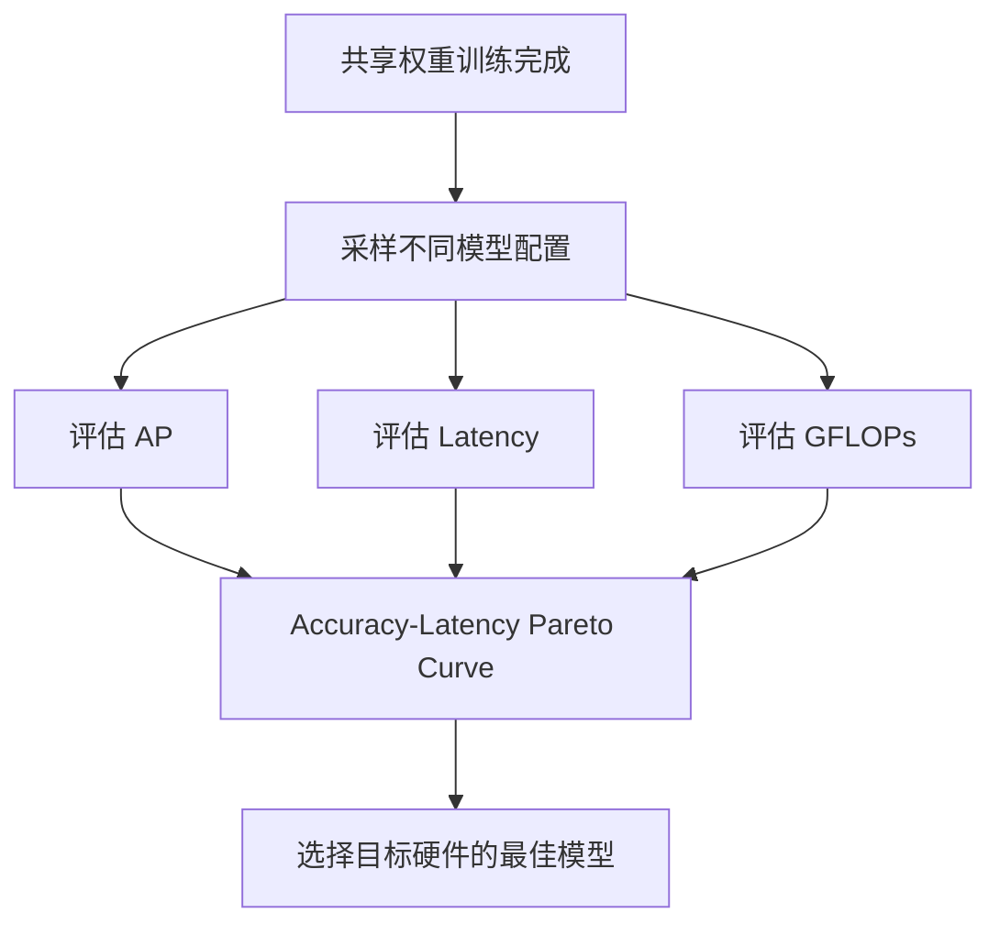

RF-DETR 的重要特点：

**Nano、Small、Medium、Large 等模型并不是通过四次完全独立的训练得到的，而是同一个共享权重训练过程中的不同架构配置。**

论文还发现，部分训练时没有明确采样过的架构配置，也能够保持较好的性能。

这说明 Weight-sharing NAS 不仅可以搜索训练时出现的架构，还具有一定的架构泛化能力。

---

# 九、RF-DETR-Seg：实例分割架构

RF-DETR 的实例分割版本称为：

RF-DETR-Seg。

它并没有重新设计整套网络，而是在目标检测架构上增加了一个轻量级 Segmentation Head。

## 9.1 整体结构

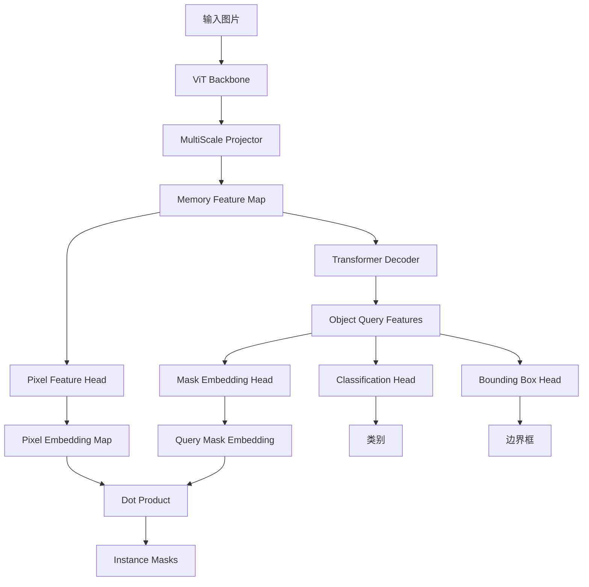

每个 Query 同时负责：

- 类别预测。
- 边界框预测。
- 实例分割 Mask 预测。

所以一个目标的 Box、Class 和 Mask 天然属于同一个 Query。

不需要额外匹配 Mask 和 Box。

## 9.2 Pixel Embedding Map

Memory Feature Map 的空间分辨率比较低。

例如：

输入：

$$
384\times384
$$

Patch Size：

$$
P=12
$$

Memory：

$$
[B,256,32,32]
$$

分割头首先将 Memory 上采样到输入图片的 1/4：

$$
384/4=96
$$

最终 Pixel Feature Map：

$$
P\in\mathbb{R}^{B\times C_p\times96\times96}
$$

随后经过轻量卷积模块进一步提取像素级特征。

## 9.3 Query Mask Embedding

每个 Decoder Query：

$$
Q_i\in\mathbb{R}^{256}
$$

经过一个 MLP：

$$
E_i=MLP(Q_i)
$$

得到 Mask Embedding：

$$
E_i\in\mathbb{R}^{C_p}
$$

## 9.4 Mask 生成

对于第 $i$ 个 Query：

Pixel Embedding：

$$
P(x,y)\in\mathbb{R}^{C_p}
$$

Query Embedding：

$$
E_i\in\mathbb{R}^{C_p}
$$

Mask Logit：

$$
M_i(x,y)=E_i^TP(x,y)+b
$$

其中：

- $E_i$：当前目标的 Mask Embedding。
- $P(x,y)$：图片位置 $(x,y)$ 的像素特征。
- $b$：偏置。

经过 Sigmoid：

$$
Mask_i(x,y)=\sigma(M_i(x,y))
$$

每个 Query 都可以生成一张独立的 Mask。

例如：

```text
Query 1 → Person Box + Person Class + Person Mask
Query 2 → Car Box + Car Class + Car Mask
Query 3 → Dog Box + Dog Class + Dog Mask
```

## 9.5 为什么使用 Dot Product？

如果每个目标都使用一个独立的 Mask Prediction Network：

计算成本会比较高。

RF-DETR 采用共享 Pixel Embedding：

- 每张图片只计算一次 Pixel Feature Map。
- 每个 Query 只需要生成自己的 Mask Embedding。
- 最终通过矩阵乘法得到所有 Mask。

假设：

$$
P\in\mathbb{R}^{B\times C_p\times H_m\times W_m}
$$

$$
E\in\mathbb{R}^{B\times Q\times C_p}
$$

那么：

$$
M=EP
$$

得到：

$$
M\in\mathbb{R}^{B\times Q\times H_m\times W_m}
$$

这是一种比较高效的实例分割方式。

## 9.6 Mask Loss

RF-DETR-Seg 主要使用：

1. Binary Cross Entropy。
2. Dice Loss。

BCE：

$$
\mathcal{L}_{BCE}
=
-\left[
y\log p+(1-y)\log(1-p)
\right]
$$

Dice：

$$
Dice=
\frac{2|P\cap G|+\epsilon}
{|P|+|G|+\epsilon}
$$

Dice Loss：

$$
\mathcal{L}_{Dice}=1-Dice
$$

由于对所有像素进行完整计算会产生较大成本，训练时还会使用 Point Sampling。

重点采样：

- 预测不确定的位置。
- 目标边缘位置。
- 随机空间位置。

这样可以降低分割训练的计算成本。

## 9.7 RF-DETR-Seg 的预训练

论文使用 Objects365 数据集进行预训练。

为了同时获得检测和实例分割标注，论文使用 SAM2 生成伪实例分割标注。

这样：

- 检测头可以使用目标框监督。
- 分割头可以使用实例 Mask 监督。

需要注意：

SAM2 产生的是伪标签，并不代表这些标签都具有人工标注的准确度。

---

# 十、RF-DETR Keypoint：关键点检测扩展

官方 GitHub 当前还提供 Keypoint Preview 模型。

需要注意：

关键点检测不是原始 RF-DETR 论文的主要研究内容，而是官方仓库在检测架构上扩展的功能。

其核心设计参考 Group Pose。

## 10.1 基本思想

普通 Object Query：

负责一个目标。

关键点检测需要在目标内部预测多个关键点。

例如人体：

- Nose。
- Left Eye。
- Right Eye。
- Left Shoulder。
- Right Shoulder。
- Left Elbow。
- Right Elbow。
- Wrist。
- Hip。
- Knee。
- Ankle。

因此，每个 Object Query 还需要一组 Keypoint Queries。

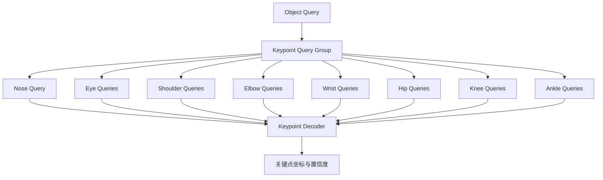

## 10.2 Keypoint Query 的计算

假设：

一个人体 Object Query 的特征为：

$$
Q_{obj}\in\mathbb{R}^{256}
$$

人体有 17 个关键点。

对应：

$$
Q_{kp}\in\mathbb{R}^{17\times256}
$$

每个关键点有独立的 Query Embedding。

它们与 Object Query 一起进入 Decoder。

## 10.3 为什么需要独立 Keypoint Query？

例如：

一个人的左手腕位置与左肘位置存在空间关系。

如果每个关键点完全独立预测：

模型可能无法充分利用人体结构信息。

使用 Keypoint Queries：

- 左手腕可以参考左肘。
- 左肘可以参考左肩。
- 左膝可以参考左髋。
- 不同关键点可以交换特征信息。

这样模型能够学习目标内部的结构关系。

## 10.4 每个关键点预测什么？

官方关键点扩展中，每个 Keypoint Query 预测 8 个数值：

| 内容 | 维度 | 作用 |
|---|---:|---|
| Location | 2 | 关键点坐标 |
| Findable | 1 | 是否能够确定关键点位置 |
| Visible | 1 | 是否能够直接观察到关键点 |
| Uncertainty | 3 | 位置不确定性 |
| Class Vote | 1 | 关键点对目标类别的辅助判断 |

其中 Location 使用相对于参考框的位置偏移进行表示。

例如：

$$
x=c_x+\Delta x\cdot w
$$

$$
y=c_y+\Delta y\cdot h
$$

其中：

- $(c_x,c_y)$：参考框中心。
- $(w,h)$：参考框宽高。
- $(\Delta x,\Delta y)$：预测的归一化偏移。

## 10.5 关键点损失

当前关键点实现包含：

- L1 Keypoint Loss。
- Findable BCE Loss。
- Visible BCE Loss。
- Gaussian Negative Log-Likelihood。

其中 Gaussian NLL 用于学习关键点位置的不确定性。

假设预测关键点的二维分布为：

$$
p(x| \mu,\Sigma)
$$

则真实位置 $x$ 的负对数似然：

$$
\mathcal{L}_{NLL}
=
-\log p(x|\mu,\Sigma)
$$

模型不仅需要预测关键点位置，还需要学习：

- 哪些关键点容易预测。
- 哪些关键点容易受到遮挡影响。
- 哪些位置的不确定性更大。

注意：

官方 Keypoint Preview 目前主要针对人体关键点场景进行预训练，但支持根据自定义 COCO Keypoint 或 YOLO Pose 数据集配置关键点 Schema。

---

# 十一、RF-DETR 的训练机制

## 11.1 训练核心流程

RF-DETR 的训练主要涉及：

1. Backbone 预训练权重初始化。
2. MultiScale Projector 特征融合。
3. Two-stage Query Selection。
4. Group DETR。
5. Hungarian Matching。
6. IoU-aware Classification Loss。
7. Bounding Box Loss。
8. Auxiliary Loss。

整体训练流程：

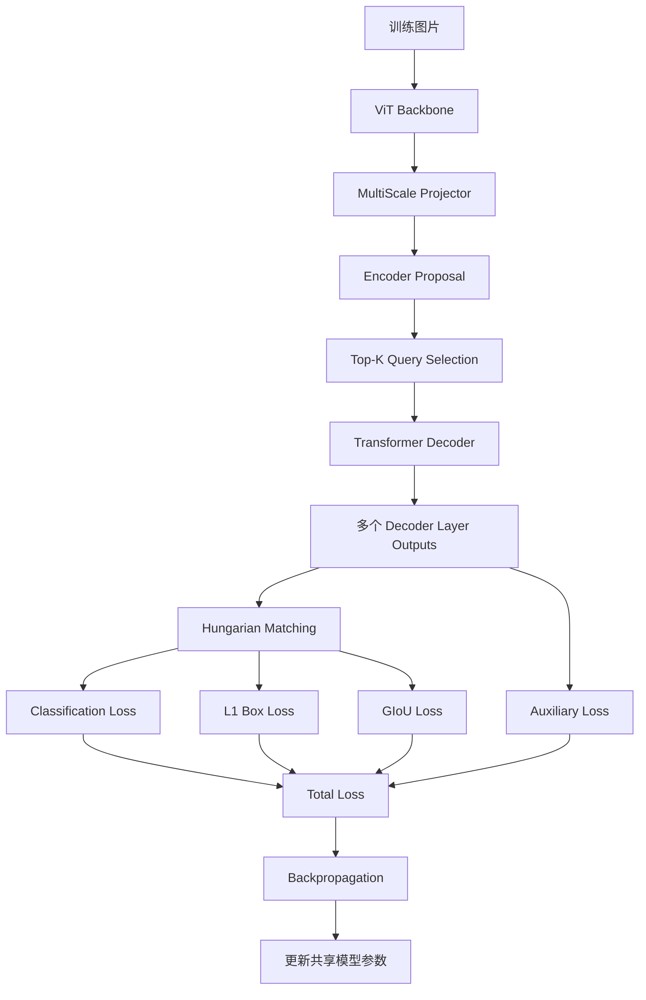

## 11.2 Group DETR

RF-DETR 当前实现使用 Group DETR 训练方式。

默认：

$$
group\_detr=13
$$

其思想：

将 Query 分成多个独立组。

每个组都独立进行 Hungarian Matching。

假设：

$$
num\_queries=300
$$

$$
group\_detr=13
$$

那么训练时：

$$
300\times13=3900
$$

个 Query 参与不同组的训练。

每个组都需要学习如何预测同一组 GT 目标。

例如：

```text
Group 1 → 300 Queries → Hungarian Matching
Group 2 → 300 Queries → Hungarian Matching
Group 3 → 300 Queries → Hungarian Matching
...
Group 13 → 300 Queries → Hungarian Matching
```

这样，每个 GT 可以在不同 Query Group 中获得多个正样本监督。

推理阶段只使用一个 Group：

$$
Q_{inference}=300
$$

因此 Group DETR 主要增加训练阶段的监督信号，不会让推理阶段变成 3900 个 Query。

## 11.3 Hungarian Matching

匹配代价：

$$
C_{ij}
=
\lambda_{cls}C_{cls}
+
\lambda_{bbox}C_{bbox}
+
\lambda_{giou}C_{giou}
$$

最终通过 Hungarian Algorithm 寻找总代价最小的分配方案。

它解决的核心问题：

一个真实目标只对应一个预测 Query。

## 11.4 Classification Loss

当前官方实现默认：

```python
ia_bce_loss = True
```

使用 IoU-aware BCE。

对于匹配的正样本：

$$
t=p^\alpha IoU^{1-\alpha}
$$

其中：

- $p$：预测分类概率。
- $IoU$：预测框与 GT 的重叠程度。
- $\alpha$：分类分数的权重参数。

然后构造正样本和负样本权重，使用 BCE 进行优化。

这样分类分数能够反映：

- 类别预测是否正确。
- 边界框定位质量是否足够好。

## 11.5 Bounding Box L1 Loss

预测框：

$$
\hat b=(\hat c_x,\hat c_y,\hat w,\hat h)
$$

真实框：

$$
b=(c_x,c_y,w,h)
$$

计算：

$$
\mathcal{L}_{L1}
=
\|\hat b-b\|_1
$$

展开：

$$
\mathcal{L}_{L1}
=
|\hat c_x-c_x|
+
|\hat c_y-c_y|
+
|\hat w-w|
+
|\hat h-h|
$$

## 11.6 GIoU Loss

IoU：

$$
IoU(A,B)=\frac{|A\cap B|}{|A\cup B|}
$$

GIoU：

$$
GIoU=
IoU-
\frac{|C-(A\cup B)|}{|C|}
$$

其中 $C$ 是能够同时包含 A 和 B 的最小外接矩形。

损失：

$$
\mathcal{L}_{GIoU}=1-GIoU
$$

## 11.7 Auxiliary Loss

RF-DETR 会对不同 Decoder Layer 的预测结果计算辅助损失。

例如：

$$
\mathcal{L}
=
\mathcal{L}^{(1)}
+
\mathcal{L}^{(2)}
+
\mathcal{L}^{(3)}
$$

每层都能获得直接监督。

这样：

- 浅层 Decoder 可以产生有效预测。
- 深层 Decoder 可以进一步提升预测。
- 推理时可以减少 Decoder 层数。

## 11.8 论文训练参数

论文 Appendix A 给出的主要训练参数：

| 参数 | 数值 |
|---|---:|
| Learning Rate | 1e-4 |
| Batch Size | 128 |
| Gradient Clipping | 0.1 |
| Layer-wise LR Decay | 0.8 |
| LR Warm-up | 不使用 |
| EMA | 使用 EMA Scheduler |
| Backbone | DINOv2 |
| Multi-scale Training | 0.5～1.5 倍 |

其中 Layer-wise LR Decay：

$$
lr_l=lr_{base}\times\gamma^{L-l}
$$

其中：

- $L$：Backbone 总层数。
- $l$：当前层编号。
- $\gamma=0.8$。

越靠近输入的层，学习率通常越小。

这样能够更好地保留预训练 Backbone 的特征表达。

论文还使用：

- Horizontal Flip。
- Random Crop。

并采用 Batch-level Resize，减少不同图片 Padding 带来的计算浪费。

需要注意：

以上是论文研究中的训练设置。当前 GitHub 高层训练 API 还提供了更多训练配置和优化选项，实际运行时不能直接认为所有默认值都与论文实验配置完全一致。

---

# 十二、RF-DETR 的模型配置与参数

## 12.1 论文中的模型规模

论文主要通过不同的架构配置形成多个模型规模。

| 模型 | Backbone | Resolution | Patch Size | Windows | Decoder Layers | Queries |
|---|---|---:|---:|---:|---:|---:|
| Nano | DINOv2-S | 384 | 16 | 2 | 2 | 300 |
| Small | DINOv2-S | 512 | 16 | 2 | 3 | 300 |
| Medium | DINOv2-S | 576 | 16 | 2 | 4 | 300 |
| Large | DINOv2-S | 704 | 16 | 2 | 4 | 300 |
| XL | DINOv2-B | 700 | 20 | 1 | 5 | 300 |
| 2XL | DINOv2-B | 880 | 20 | 2 | 5 | 300 |
| Max | DINOv2-B | 828 | 12 | 1 | 6 | 300 |

注意：

- Nano 到 Large 是论文中共享权重搜索形成的主要模型家族。
- XL、2XL 使用更大的 Backbone，不能直接认为它们与 Nano 到 Large 属于完全相同的共享权重模型。
- Max 是面向更高精度需求的配置。

## 12.2 当前 GitHub 中的主要检测模型

当前官方仓库提供：

| 模型 | Resolution | Patch Size | Windows | Decoder Layers | Queries |
|---|---:|---:|---:|---:|---:|
| RFDETRNano | 384 | 16 | 2 | 2 | 300 |
| RFDETRSmall | 512 | 16 | 2 | 3 | 300 |
| RFDETRMedium | 576 | 16 | 2 | 4 | 300 |
| RFDETRLarge | 704 | 16 | 2 | 4 | 300 |

标准配置主要采用：

$$
HiddenDim=256
$$

$$
SAHeads=8
$$

$$
CAHeads=16
$$

$$
FFNDim=2048
$$

$$
FeatureLevels=1
$$

$$
DeformablePoints=2
$$

其他关键配置：

```python
two_stage = True

bbox_reparam = True

lite_refpoint_refine = True

layer_norm = True

group_detr = 13

ia_bce_loss = True
```

## 12.3 论文模型与当前仓库的区别

需要注意模型版本和模型规模的变化。

当前官方仓库还提供：

- Atto。
- Femto。
- Pico。
- XLarge。
- 2XLarge。
- Segmentation 系列。
- Keypoint Preview。

其中：

- Atto、Femto、Pico 使用 PE-Core-T Backbone。
- Nano、Small、Medium、Large 使用 DINOv2 Backbone。
- XLarge、2XLarge 属于额外模型扩展。
- `RFDETRBase` 在当前实现中已标记为 Deprecated，建议使用明确的模型规模类。

不要仅凭模型名称判断 Backbone 或计算规模。

---

# 十三、RF-DETR 的性能测试

## 13.1 论文 COCO 检测结果

论文在 COCO val2017 上测试。

代表性结果：

| 模型 | Parameters | GFLOPs | Latency | AP | AP50 | AP75 | AP_small |
|---|---:|---:|---:|---:|---:|---:|---:|
| RF-DETR-N | 30.5M | 31.9 | 2.3ms | 48.0 | 67.0 | 51.4 | 25.2 |
| RF-DETR-S | 32.1M | 59.8 | 3.5ms | 52.9 | 71.9 | 57.0 | 32.0 |
| RF-DETR-M | 33.7M | 78.8 | 4.4ms | 54.7 | 73.5 | 59.2 | 36.1 |
| RF-DETR-2XL | 126.9M | 438.4 | 17.2ms | 60.1 | 78.5 | 65.5 | 43.2 |

Latency 测试条件：

- NVIDIA T4。
- TensorRT 10.4。
- CUDA 12.4。
- FP16。
- Batch Size = 1。

这些是论文报告的实验结果，不代表其他 GPU 上也会获得相同延迟。

## 13.2 与其他实时检测器对比

论文中的部分结果：

| 模型 | Parameters | GFLOPs | Latency | AP |
|---|---:|---:|---:|---:|
| YOLOv8-N | 3.2M | 8.7 | 2.1ms | 35.2 |
| YOLOv11-N | 2.6M | 6.5 | 2.2ms | 37.1 |
| D-FINE-N | 3.8M | 7.3 | 2.1ms | 42.7 |
| LW-DETR-T | 12.1M | 21.4 | 1.9ms | 42.9 |
| RF-DETR-N | 30.5M | 31.9 | 2.3ms | 48.0 |
| YOLOv8-S | 11.2M | 28.6 | 2.9ms | 42.4 |
| YOLOv11-S | 9.4M | 21.5 | 3.2ms | 44.1 |
| D-FINE-S | 10.2M | 25.2 | 3.5ms | 50.6 |
| RF-DETR-S | 32.1M | 59.8 | 3.5ms | 52.9 |
| RT-DETR-R18 | 36.0M | 100.0 | 4.4ms | 49.0 |
| D-FINE-M | 19.2M | 56.6 | 5.4ms | 55.0 |
| RF-DETR-M | 33.7M | 78.8 | 4.4ms | 54.7 |

从结果可以看到：

### RF-DETR-N

AP：

$$
48.0
$$

D-FINE-N：

$$
42.7
$$

差值：

$$
48.0-42.7=5.3
$$

延迟只相差：

$$
2.3-2.1=0.2ms
$$

说明 RF-DETR-N 在接近的推理时间下获得了更高精度。

### RF-DETR-S

AP：

$$
52.9
$$

D-FINE-S：

$$
50.6
$$

两者延迟均为：

$$
3.5ms
$$

RF-DETR-S 获得了更高的 AP。

### RF-DETR-M

AP：

$$
54.7
$$

D-FINE-M：

$$
55.0
$$

虽然 RF-DETR-M 延迟更低，但 AP 略低于 D-FINE-M。

因此不能认为 RF-DETR 在所有规模、所有精度指标上都具有绝对优势。

## 13.3 当前 GitHub Benchmark

当前官方 README 提供的模型数据：

| 模型 | COCO AP50 | COCO AP50:95 | Latency | Parameters | Resolution |
|---|---:|---:|---:|---:|---:|
| RF-DETR-Nano | 67.6 | 48.4 | 2.3ms | 30.5M | 384 |
| RF-DETR-Small | 72.1 | 53.0 | 3.5ms | 32.1M | 512 |
| RF-DETR-Medium | 73.6 | 54.7 | 4.4ms | 33.7M | 576 |
| RF-DETR-Large | 75.1 | 56.5 | 6.8ms | 33.9M | 704 |
| RF-DETR-XLarge | 77.4 | 58.6 | 11.5ms | 126.4M | 700 |
| RF-DETR-2XLarge | 78.5 | 60.1 | 17.2ms | 126.9M | 880 |

这些数据来自当前仓库的 Benchmark 页面。

与论文中的原始数据相比，部分 AP 数值略有变化。

主要原因是模型版本、评估实现和 Benchmark 流程会持续更新。

使用时应以对应模型版本和测试环境为准。

## 13.4 为什么论文特别强调 Latency Benchmark？

论文指出：

不同论文中的推理时间经常存在较大差异。

其中一个原因是 GPU Power Throttling。

例如：

- GPU 长时间高负载。
- 温度升高。
- 功耗限制。
- GPU 频率降低。

这些因素都会影响推理延迟。

论文提出在连续 Forward Pass 之间增加 200ms 缓冲时间，以减少功耗和温度变化造成的测量波动。

需要注意：

这个方法主要是为了获得更加稳定的单次推理延迟，并不是用于测量持续吞吐量的最佳方式。

另外，论文强调：

**模型精度和延迟应该尽可能使用同一个模型制品进行测试。**

例如：

不能使用 FP32 模型测量精度，再使用一个精度已经明显变化的 FP16 模型报告延迟，而不说明差异。

## 13.5 RF100-VL 测试

除了 COCO，论文还使用 RF100-VL 进行测试。

RF100-VL 包含 100 个不同领域的数据集。

与 COCO 相比，它具有更大的数据分布差异。

例如：

- 工业目标。
- 农业目标。
- 交通目标。
- 日常生活目标。
- 不同摄像机拍摄的目标。

论文认为：

在多个不同领域的数据集上保持较好的检测性能，可以反映模型的迁移能力。

RF-DETR 在该测试上也取得了较好的结果。

这对于需要在特定领域进行迁移学习的目标检测模型具有参考价值。

---

# 十四、RF-DETR 的优势与局限性

## 14.1 优势

### 1. 预训练 Backbone 具有较强特征表达能力

通过大规模预训练视觉特征，可以提高小数据集上的迁移效果。

### 2. Windowed Attention 降低计算量

通过局部窗口和全局注意力交替处理，降低 Backbone 的 Attention 计算成本。

### 3. Deformable Attention

每个 Query 只采样少量关键位置，不需要完整处理所有空间特征。

### 4. NMS-Free

通过 Hungarian Matching 和 Set Prediction 学习一对一检测关系。

### 5. Weight-sharing NAS

一次训练可以得到多种架构配置。

可以针对不同硬件和精度需求选择模型。

### 6. 支持实例分割

同一个 Query 同时输出类别、边界框和 Mask。

### 7. 支持关键点检测扩展

官方仓库提供 Keypoint Preview，可以将目标检测与关键点预测结合。

## 14.2 局限性

### 1. 参数量相对较大

例如：

RF-DETR-N：

$$
30.5M
$$

YOLO11-N：

$$
2.6M
$$

两者参数量差异较大。

因此，RF-DETR-N 并不是参数量意义上的轻量级 Nano 模型。

如果设备的内存、算力非常有限，需要考虑实际部署成本。

### 2. 高分辨率带来较高计算量

输入分辨率提高后：

$$
N=\left(\frac{R}{P}\right)^2
$$

Token 数量平方级增长。

尤其是 Global Attention Block，计算成本增长明显。

### 3. Query 数量限制

默认 300 个 Query。

对于一张图片有大量独立目标的场景，需要考虑增加 Query。

### 4. 小目标依然受到 Patch Size 影响

Patch Size 较大时，细小目标可能只占很少的 Token 空间。

因此：

高分辨率和较小 Patch Size 对小目标检测非常重要。

### 5. Windowed Attention 存在局部信息限制

如果窗口数量过多，局部特征交互范围会受到限制。

需要保留足够的 Global Attention。

### 6. 训练和部署复杂度

与传统 CNN 检测器相比，需要考虑：

- ViT Backbone。
- Attention 算子。
- Deformable Attention。
- 动态 Query。
- 模型导出。
- TensorRT 算子兼容性。

### 7. NMS-Free 不等于完全没有重复预测

模型通过一对一训练学习避免重复检测，但这不是数学上的绝对保证。

在数据分布变化、密集目标、遮挡严重等情况下，仍然可能出现漏检和重复预测。

### 8. 不属于天然开放词汇检测器

RF-DETR 使用预训练视觉 Backbone，但检测分类头仍然需要针对具体类别进行监督训练。

不能直接认为它可以像开放词汇检测器一样，仅输入文本类别就能识别任意新目标。

---

# 十五、RF-DETR 在密集小目标检测中的应用

对于密集目标检测，例如农业场景中的作物、杂草等，需要重点考虑以下问题。

## 15.1 Query 数量是否足够？

默认：

$$
num\_queries=300
$$

假设一张图片包含：

$$
N_{GT}=500
$$

个独立目标。

但是模型只有 300 个 Query。

那么：

$$
N_{GT}>num\_queries
$$

在一对一匹配的情况下，最多只有 300 个 Query 能够分别匹配不同目标。

因此不可能通过这 300 个 Query 完整表示 500 个独立目标。

可以考虑增加：

$$
num\_queries=500
$$

或者：

$$
num\_queries=600
$$

并同步调整：

$$
num\_select
$$

需要注意：

增加 Query 会增加计算量。

## 15.2 为什么增加 Query 不一定提升 AP？

假设：

默认 300 个 Query 已经可以覆盖绝大多数 GT。

增加到 600：

并不会自动增加有效检测能力。

还需要考虑：

1. Encoder 是否能够产生高质量的初始 Proposal。
2. Decoder 是否能够充分利用新增 Query。
3. 新增 Query Embedding 是否得到充分训练。
4. Hungarian Matching 是否稳定。
5. 数据标注是否完整。
6. 目标之间是否存在严重遮挡。

如果真正的瓶颈是 Backbone 特征分辨率，那么增加 Query 可能并不能解决漏检问题。

## 15.3 输入分辨率

例如：

原始配置：

$$
R=512,\quad P=16
$$

Token 数量：

$$
N=32^2=1024
$$

提高输入分辨率：

$$
R=960,\quad P=16
$$

Token 数量：

$$
N=60^2=3600
$$

Token 数量变为：

$$
\frac{3600}{1024}\approx3.52
$$

倍。

这会增加：

- Backbone 计算量。
- Memory 特征数量。
- Attention 计算量。
- 特征存储开销。

特别是 Global Attention，其主要计算规模与 Token 数量的平方相关。

因此，不能只根据分辨率提高比例估算整个模型的延迟。

## 15.4 Patch Size

假设输入分辨率固定。

减小 Patch Size：

- 提高空间特征密度。
- 有利于保留小目标细节。
- 增加 Token 数量。
- 增加 Backbone 计算量。

例如：

$$
R=576
$$

Patch Size=16：

$$
N=36^2=1296
$$

Patch Size=12：

$$
N=48^2=2304
$$

Token 数量增加：

$$
\frac{2304}{1296}\approx1.78
$$

倍。

因此 Patch Size 是非常重要的性能调节参数。

但是需要注意：

修改 Patch Size 会涉及 Patch Embedding 权重和预训练权重兼容性，不能只修改配置文件就认为能够获得与原模型相同的预训练效果。

## 15.5 是否增加 P2 检测层？

标准 RF-DETR 配置通常只使用 P4 特征。

Projector 虽然支持 P3、P4、P5 等尺度，但默认检测模型并不是传统的三层 CNN 特征金字塔。

如果需要增加更高分辨率特征：

需要考虑：

1. 修改 Projector 的输出尺度。
2. 修改 Decoder 的 Feature Levels。
3. 修改 Deformable Attention。
4. 修改模型配置。
5. 重新训练并验证。

不能直接将 YOLO 中增加 P2 检测头的方式照搬到 RF-DETR。

## 15.6 建议的实验方案

可以设计以下对照实验：

| 实验 | Resolution | Patch Size | Query 数量 | 目的 |
|---|---:|---:|---:|---|
| A | 512 | 16 | 300 | 标准基线 |
| B | 640 | 16 | 300 | 提高分辨率 |
| C | 960 | 16 | 300 | 高分辨率影响 |
| D | 960 | 16 | 500 | Query 数量影响 |
| E | 576 | 12 | 300 | Patch Size 影响 |
| F | 960 | 16 | 600 | 高密度目标实验 |

重点关注：

| 指标 | 关注内容 |
|---|---|
| AP50 | 基础检测能力 |
| AP50-95 | 定位精度 |
| AP_small | 小目标检测 |
| Recall | 漏检 |
| Precision | 误检 |
| 每图预测数量 | Query 是否不足 |
| 密集区域 Recall | 相邻目标检测能力 |
| Latency | 实际推理速度 |
| Peak GPU Memory | 显存占用 |

特别需要区分：

- Query 数量不足。
- 特征分辨率不足。
- 目标遮挡导致特征无法区分。
- 标注不完整。

这几种情况需要不同的解决方案。

---

# 十六、官方 GitHub 仓库与源码结构

## 16.1 官方仓库

https://github.com/roboflow/rf-detr

官方仓库包含：

- PyTorch 模型实现。
- Backbone。
- Transformer。
- Detection Head。
- Segmentation Head。
- Keypoint Head。
- 训练代码。
- 数据集加载。
- ONNX 导出。
- TensorRT 导出。
- 其他端侧部署支持。

当前主要使用：

`src/rfdetr/`

## 16.2 核心目录结构

```text
rf-detr/
│
├── src/
│   └── rfdetr/
│       │
│       ├── models/
│       │   ├── backbone/
│       │   │   ├── backbone.py
│       │   │   ├── dinov2.py
│       │   │   ├── dinov2_with_windowed_attn.py
│       │   │   └── projector.py
│       │   │
│       │   ├── heads/
│       │   │   ├── segmentation.py
│       │   │   └── keypoints.py
│       │   │
│       │   ├── lwdetr.py
│       │   ├── transformer.py
│       │   ├── criterion.py
│       │   ├── matcher.py
│       │   ├── postprocess.py
│       │   └── weights.py
│       │
│       ├── training/
│       │   ├── module_model.py
│       │   ├── module_data.py
│       │   ├── trainer.py
│       │   └── param_groups.py
│       │
│       ├── export/
│       │   ├── _onnx/
│       │   ├── _tensorrt/
│       │   ├── _coreml/
│       │   └── prepare.py
│       │
│       ├── config.py
│       ├── variants.py
│       ├── detr.py
│       └── inference.py
│
├── docs/
│
├── tests/
│
├── pyproject.toml
│
└── README.md
```

## 16.3 核心源码阅读顺序

建议按照网络的数据流阅读。

### 第一步：整体模型

[lwdetr.py](https://github.com/roboflow/rf-detr/blob/develop/src/rfdetr/models/lwdetr.py)

重点查看：

- LWDETR。
- Backbone。
- Transformer。
- Query Embedding。
- Reference Points。
- Classification Head。
- Bounding Box Head。

这个文件是整个模型组装和 Forward 的重要入口。

注意：

虽然文件名称是 `lwdetr.py`，但 RF-DETR 的模型实现核心仍然使用这个类。

### 第二步：Backbone

[backbone.py](https://github.com/roboflow/rf-detr/blob/develop/src/rfdetr/models/backbone/backbone.py)

重点查看：

- Backbone。
- Feature Extraction。
- Projector。
- Feature Maps。
- Position Embedding。

### 第三步：DINOv2

[dinov2.py](https://github.com/roboflow/rf-detr/blob/develop/src/rfdetr/models/backbone/dinov2.py)

重点查看：

- Backbone 初始化。
- 预训练权重加载。
- Patch Size。
- 输出特征层。
- Backbone 配置。

### 第四步：Windowed Attention

[dinov2_with_windowed_attn.py](https://github.com/roboflow/rf-detr/blob/develop/src/rfdetr/models/backbone/dinov2_with_windowed_attn.py)

重点查看：

- Windowed Attention。
- Patch Embedding。
- CLS Token。
- Window Partition。
- Window 恢复。
- Position Embedding 插值。

### 第五步：MultiScale Projector

[projector.py](https://github.com/roboflow/rf-detr/blob/develop/src/rfdetr/models/backbone/projector.py)

重点查看：

- MultiScaleProjector。
- C2f。
- Bottleneck。
- ConvX。
- LayerNorm。

### 第六步：Transformer Decoder

[transformer.py](https://github.com/roboflow/rf-detr/blob/develop/src/rfdetr/models/transformer.py)

重点查看：

- Transformer。
- TransformerDecoder。
- TransformerDecoderLayer。
- MSDeformAttn。
- Query Selection。
- Encoder Proposal。
- Reference Points。

### 第七步：Loss

[criterion.py](https://github.com/roboflow/rf-detr/blob/develop/src/rfdetr/models/criterion.py)

重点查看：

- SetCriterion。
- loss_labels。
- loss_boxes。
- loss_masks。
- loss_keypoints。
- Auxiliary Loss。

### 第八步：Hungarian Matching

[matcher.py](https://github.com/roboflow/rf-detr/blob/develop/src/rfdetr/models/matcher.py)

重点查看：

- HungarianMatcher。
- Classification Cost。
- L1 Cost。
- GIoU Cost。
- Matching Assignment。

### 第九步：PostProcessor

[postprocess.py](https://github.com/roboflow/rf-detr/blob/develop/src/rfdetr/models/postprocess.py)

重点查看：

- Sigmoid。
- Top-K。
- Confidence Filtering。
- Box Format Conversion。
- Mask 和 Keypoint 输出。

## 16.4 推荐源码阅读重点

| 顺序 | 文件 | 主要内容 |
|---|---|---|
| 1 | lwdetr.py | 整体网络数据流 |
| 2 | dinov2.py | Backbone |
| 3 | dinov2_with_windowed_attn.py | 窗口注意力 |
| 4 | projector.py | 特征融合 |
| 5 | transformer.py | Query、Attention、Decoder |
| 6 | matcher.py | Hungarian Matching |
| 7 | criterion.py | 损失函数 |
| 8 | segmentation.py | 实例分割 |
| 9 | postprocess.py | 推理后处理 |
| 10 | config.py | 模型配置 |

阅读时始终关注：

1. 每个模块的输入 Tensor Shape。
2. 输出 Tensor Shape。
3. 模块内部具体计算。
4. 是否改变空间分辨率。
5. 是否改变通道数。
6. 对计算量和显存有什么影响。

---

# 十七、RF-DETR 的训练、推理与模型导出

## 17.1 环境准备

官方 GitHub 当前提供 Python Package：

```bash
pip install rfdetr
```

训练需要额外安装：

```bash
pip install "rfdetr[train]"
```

建议：

```bash
conda create -n rfdetr python=3.10 -y

conda activate rfdetr

pip install rfdetr

pip install "rfdetr[train]"
```

注意：

实际 PyTorch 和 CUDA 版本需要结合设备环境选择。

## 17.2 数据集格式

RF-DETR 支持：

- COCO JSON。
- YOLO Dataset。

### COCO 格式

目录：

```text
dataset/
│
├── train/
│   ├── _annotations.coco.json
│   ├── image1.jpg
│   ├── image2.jpg
│   └── ...
│
├── valid/
│   ├── _annotations.coco.json
│   ├── image1.jpg
│   └── ...
│
└── test/
    ├── _annotations.coco.json
    └── ...
```

标注主要包含：

- images。
- categories。
- annotations。
- bbox。
- segmentation（实例分割任务）。

COCO Bounding Box 格式：

$$
(x,y,w,h)
$$

其中：

- $x,y$：左上角坐标。
- $w,h$：宽度和高度。

### YOLO 格式

目录：

```text
dataset/
│
├── data.yaml
│
├── train/
│   ├── images/
│   └── labels/
│
├── valid/
│   ├── images/
│   └── labels/
│
└── test/
    ├── images/
    └── labels/
```

`data.yaml`：

```yaml
names:
  0: person
  1: car
  2: bicycle

nc: 3

train: train/images
val: valid/images
test: test/images
```

标签格式：

```text
class_id center_x center_y width height
```

坐标归一化到 0～1。

## 17.3 单卡训练

```python
from rfdetr import RFDETRSmall

model = RFDETRSmall()

model.train(
    dataset_dir="./dataset",
    epochs=100,
    batch_size="auto",
    lr=1e-4,
    output_dir="./output/rfdetr"
)
```

这里使用的是官方高层 API。

`batch_size="auto"` 可以根据当前 CUDA 环境进行批量大小探测。

## 17.4 多卡训练

RF-DETR 的训练基于 PyTorch Lightning。

官方训练接口支持多 GPU 训练和 DDP。

可以通过对应训练配置选择 GPU 数量和分布式策略。

对于大规模训练，需要重点观察：

- Backbone 学习率。
- Layer-wise LR Decay。
- Gradient Accumulation。
- EMA。
- Mixed Precision。
- GPU Memory。
- 实际有效 Batch Size。

## 17.5 加载预训练模型

例如：

```python
from rfdetr import RFDETRSmall

model = RFDETRSmall()
```

模型会自动加载对应的预训练权重。

也可以加载本地权重：

```python
from rfdetr import RFDETRSmall

model = RFDETRSmall(
    pretrain_weights="./weights/checkpoint.pth"
)
```

## 17.6 模型推理

```python
from rfdetr import RFDETRSmall

model = RFDETRSmall()

detections = model.predict(
    "image.jpg",
    threshold=0.5
)

print(detections.xyxy)
print(detections.confidence)
print(detections.class_id)
```

## 17.7 ONNX 导出

官方支持：

```python
model.export(
    format="onnx"
)
```

输出 ONNX 模型。

后续可以使用：

- ONNX Runtime。
- TensorRT。
- OpenVINO。
- 其他兼容 ONNX 的推理框架。

## 17.8 TensorRT 导出

安装：

```bash
pip install "rfdetr[tensorrt]"
```

导出：

```python
model.export(
    format="tensorrt"
)
```

官方接口会在导出 ONNX 后，通过 TensorRT Python API 构建 Engine。

实际部署时需要重点验证：

1. Deformable Attention 算子支持。
2. FP16 精度。
3. 输入尺寸。
4. Query 数量。
5. 输出类别索引。
6. Box 坐标格式。
7. 后处理一致性。

## 17.9 INT8 量化

当前官方导出接口还支持 INT8 量化。

例如：

```python
model.export(
    format="onnx",
    quantization="int8",
    calibration_data="./calibration_images/"
)
```

量化时需要提供具有代表性的校准图片。

建议重点比较：

- FP32 AP。
- FP16 AP。
- INT8 AP。
- 推理延迟。
- 模型体积。
- 显存占用。

对于小目标检测，量化后需要特别关注分类置信度和边界框定位精度的变化。

## 17.10 当前支持的其他部署格式

官方文档还提供：

- TFLite。
- LiteRT。
- ExecuTorch。
- CoreML。
- OpenVINO。

具体支持范围和依赖安装方式以官方 Export 文档为准。

---

# 十八、RF-DETR 与 RT-DETR 的架构对比

两者都属于实时端到端 Transformer 检测器，也都采用 NMS-Free 的检测方式，但整体设计存在明显区别。

## 18.1 整体架构对比

| 对比项 | RT-DETR | RF-DETR |
|---|---|---|
| Backbone | ResNet 等 CNN | ViT |
| 特征提取 | CNN 多尺度特征 | Patch Tokens |
| Encoder | Hybrid Encoder | ViT Backbone + Projector |
| 特征融合 | AIFI + CCFF | MultiScale Projector |
| Attention | Self-Attention + Deformable Attention | Windowed/Global Attention + Deformable Attention |
| Query 初始化 | Encoder Top-K | Encoder Proposal Top-K + Learnable Queries |
| Decoder | Transformer Decoder | Transformer Decoder |
| Query 数量 | 默认 300 | 默认 300 |
| NMS | 不需要 | 不需要 |
| 速度调节 | Decoder 层数 | 多维度 NAS |
| 主要创新 | 高效 Hybrid Encoder、Query Selection | 预训练 ViT、Weight-sharing NAS |

## 18.2 Backbone 的区别

RT-DETR：

```text
Image
  ↓
ResNet
  ↓
S3 / S4 / S5
```

RF-DETR：

```text
Image
  ↓
Patch Embedding
  ↓
ViT
  ↓
多个中间层特征
```

RT-DETR 更偏向传统 CNN 多尺度特征提取。

RF-DETR 则依赖预训练 ViT 的特征表达能力。

## 18.3 Encoder 的区别

RT-DETR：

- AIFI 使用 Transformer。
- CCFF 使用 CNN。
- 负责同尺度和跨尺度特征融合。

RF-DETR：

- ViT Backbone 已经完成主要视觉编码。
- MultiScale Projector 融合多个深度的特征。
- 标准模型通常使用单层 P4 Memory。

因此两者的特征融合设计并不相同。

## 18.4 Attention 的区别

RT-DETR：

使用 Multi-Scale Deformable Attention，在多个尺度特征图上采样。

RF-DETR：

Backbone 中使用 Windowed Attention 和 Global Attention。

Decoder 使用 Deformable Attention。

对于标准 RF-DETR-S，Decoder 的 Deformable Attention 使用一个特征层，每个 Head 采样两个点。

## 18.5 Query Selection 的区别

两者都使用 Encoder Proposal 和 Top-K 思路。

但 Query Content、Reference Box 的组织方式存在实现差异。

RF-DETR 使用可学习的 Query Content，并通过 Encoder 选择高质量的参考位置。

## 18.6 最重要的区别

RT-DETR 的重点：

**通过重新设计 Encoder，降低 DETR 的特征交互计算成本。**

RF-DETR 的重点：

**利用预训练 ViT 和 Weight-sharing NAS，寻找适合不同硬件与数据集的检测架构。**

所以 RF-DETR 的 NAS 不只是一个额外的训练技巧，而是整个模型家族形成方式的重要组成部分。

---

# 十九、论文与源码中的关键问题总结

## 19.1 RF-DETR 是否只是一个 ViT + DETR？

不是。

虽然整体上使用 ViT Backbone 和 Transformer Decoder，但它还包含：

- Windowed Attention。
- MultiScale Projector。
- Two-stage Query Selection。
- Deformable Attention。
- Group DETR。
- IoU-aware Classification。
- Weight-sharing NAS。

其中 Weight-sharing NAS 是论文最重要的贡献之一。

## 19.2 RF-DETR 为什么能够一次训练得到多个模型？

因为不同架构共享同一套参数。

训练时随机采样架构。

经过多次训练迭代后，共享参数能够适应不同 Patch Size、输入分辨率、Decoder 深度、Query 数量和 Window 配置。

## 19.3 RF-DETR 为什么使用 Windowed Attention？

为了降低 ViT Backbone 的计算成本。

Global Attention 的主要计算复杂度为：

$$
O(N^2)
$$

Windowed Attention 将 Token 分成多个局部窗口，降低每个 Block 的 Attention 计算规模。

## 19.4 为什么需要 Global Attention？

Windowed Attention 只能进行局部信息交互。

Global Attention 用于建立不同窗口之间的全局信息联系。

## 19.5 MultiScale Projector 是不是传统 FPN？

不能完全等同。

它的核心是融合不同深度的 ViT 特征。

虽然代码支持 P3、P4、P5 等不同空间尺度的输出，但标准检测配置通常只使用 P4。

## 19.6 为什么 RF-DETR 不需要 NMS？

因为训练阶段通过 Hungarian Matching 建立一对一预测关系。

模型学习每个 Query 负责一个目标，其他 Query 预测 No Object。

## 19.7 RF-DETR 能否检测超过 300 个目标？

默认 300 个 Query。

如果需要更多目标，需要增加 `num_queries`，并同步调整 `num_select`。

同时需要重新训练或微调新增 Query。

## 19.8 RF-DETR 是否适合小目标？

可以通过以下方式改善：

- 提高输入分辨率。
- 减小 Patch Size。
- 调整 Window 数量。
- 增加 Query 数量。
- 使用更合适的预训练模型。

但这些设置都需要在精度、延迟和显存之间进行权衡。

## 19.9 RF-DETR 是否适合端侧部署？

可以部署，但需要结合实际硬件进行测试。

重点关注：

- ViT Backbone 的计算量。
- Deformable Attention 算子支持。
- FP16/INT8 精度。
- 输入分辨率。
- Query 数量。
- TensorRT 算子融合。
- 实际设备上的延迟和功耗。

不能仅凭论文中的 T4 延迟判断其在 Jetson、ARM CPU 或其他端侧平台上的速度。

---

# 二十、总结

RF-DETR 的核心价值在于：

**将预训练视觉 Transformer、局部与全局 Attention、Deformable Attention 和 Weight-sharing NAS 结合起来，形成能够适应不同精度和推理速度需求的实时端到端检测模型。**

需要掌握以下核心知识。

## 20.1 Backbone

使用 ViT 将图片划分为 Patch Tokens。

通过 Windowed Attention 和 Global Attention 交替提取特征。

## 20.2 MultiScale Projector

从不同深度的 Transformer Block 提取特征。

通过 C2f 和 LayerNorm 融合成统一的 Memory Feature Map。

## 20.3 Query Selection

Encoder 对每个空间位置预测分类和边界框。

通过 Top-K 选择高质量参考位置。

Learnable Query Features 与这些参考位置共同进入 Decoder。

## 20.4 Transformer Decoder

由三个核心模块组成：

- Self-Attention。
- Deformable Cross-Attention。
- FFN。

通过多层 Decoder 输出类别和边界框。

## 20.5 NMS-Free

通过 Hungarian Matching 和一对一集合预测学习减少重复检测。

## 20.6 Weight-sharing NAS

一次训练覆盖多种网络架构。

通过调整五个参数：

- Patch Size。
- Decoder Layers。
- Query Tokens。
- Image Resolution。
- Number of Windows。

找到适合目标数据集和硬件的模型。

## 20.7 Segmentation

通过 Pixel Embedding 和 Query Embedding 的 Dot Product 生成实例 Mask。

## 20.8 Keypoint

通过 Object Query 和 Keypoint Query 联合预测目标位置和关键点信息。

---

# 二十一、论文与源码索引

## 21.1 官方论文

- [RF-DETR: Neural Architecture Search for Real-Time Detection Transformers](https://arxiv.org/abs/2511.09554)
- [论文 PDF](https://arxiv.org/pdf/2511.09554)

推荐阅读顺序：

1. Section 1：Introduction。
2. Section 3：Weight-Sharing NAS With Foundation Models。
3. Section 4：Experiments。
4. Appendix A：Implementation Details。
5. Appendix：不同模型架构与 NAS 搜索结果。

重点关注：

- Figure 1：Accuracy-Latency Pareto Curve。
- Figure 2：RF-DETR Architecture。
- Figure 3：NAS Search Space。
- Table 2：COCO Detection Evaluation。
- Table 5：NAS Ablation。
- Table 6：Backbone Ablation。

## 21.2 官方 GitHub

- [roboflow/rf-detr](https://github.com/roboflow/rf-detr)
- [官方 README](https://github.com/roboflow/rf-detr/blob/develop/README.md)
- [官方技术文档](https://rfdetr.roboflow.com/)
- [How RF-DETR Works](https://rfdetr.roboflow.com/learn/how-it-works/)
- [训练文档](https://rfdetr.roboflow.com/learn/train/)
- [部署文档](https://rfdetr.roboflow.com/exports/)

## 21.3 核心网络源码

- [lwdetr.py](https://github.com/roboflow/rf-detr/blob/develop/src/rfdetr/models/lwdetr.py)
- [transformer.py](https://github.com/roboflow/rf-detr/blob/develop/src/rfdetr/models/transformer.py)
- [backbone.py](https://github.com/roboflow/rf-detr/blob/develop/src/rfdetr/models/backbone/backbone.py)
- [dinov2.py](https://github.com/roboflow/rf-detr/blob/develop/src/rfdetr/models/backbone/dinov2.py)
- [dinov2_with_windowed_attn.py](https://github.com/roboflow/rf-detr/blob/develop/src/rfdetr/models/backbone/dinov2_with_windowed_attn.py)
- [projector.py](https://github.com/roboflow/rf-detr/blob/develop/src/rfdetr/models/backbone/projector.py)

## 21.4 核心训练源码

- [matcher.py](https://github.com/roboflow/rf-detr/blob/develop/src/rfdetr/models/matcher.py)
- [criterion.py](https://github.com/roboflow/rf-detr/blob/develop/src/rfdetr/models/criterion.py)
- [segmentation.py](https://github.com/roboflow/rf-detr/blob/develop/src/rfdetr/models/heads/segmentation.py)
- [config.py](https://github.com/roboflow/rf-detr/blob/develop/src/rfdetr/config.py)
- [variants.py](https://github.com/roboflow/rf-detr/blob/develop/src/rfdetr/variants.py)

## 21.5 推荐阅读的官方资料

| 资料 | 主要内容 |
|---|---|
| [RF-DETR Paper](https://arxiv.org/abs/2511.09554) | 论文设计、NAS、实验 |
| [How It Works](https://rfdetr.roboflow.com/learn/how-it-works/) | 网络结构与数据流 |
| [Training](https://rfdetr.roboflow.com/learn/train/) | 自定义数据集训练 |
| [Dataset Formats](https://rfdetr.roboflow.com/learn/train/dataset-formats/) | COCO、YOLO 数据格式 |
| [Detection Inference](https://rfdetr.roboflow.com/learn/run/detection/) | 检测推理 |
| [Segmentation Inference](https://rfdetr.roboflow.com/learn/run/segmentation/) | 实例分割 |
| [ONNX Export](https://rfdetr.roboflow.com/exports/onnx/) | ONNX 导出与量化 |
| [NAS Documentation](https://docs.roboflow.com/train/neural-architecture-search) | 数据集专用架构搜索 |

---

**建议的学习重点：**

阅读源码时，优先弄清楚三个问题：

1. DINOv2 输出的多个中间层特征，如何经过 Projector 融合成 Memory？
2. Encoder 如何产生 Proposal，Top-K 选择的参考框如何与 Learnable Query 结合？
3. Weight-sharing NAS 如何在不为每个模型单独训练的情况下，得到不同精度和速度的模型？

这三个问题是理解 RF-DETR 整体设计的关键。