# RT-DETR：Real-Time Detection Transformer 原理、网络结构与源码解析

> 论文：DETRs Beat YOLOs on Real-time Object Detection  
> 会议：CVPR 2024  
> 作者：Yian Zhao、Wenyu Lv 等  
> 论文地址：https://arxiv.org/abs/2304.08069  
> 官方项目：https://zhao-yian.github.io/RTDETR/  
> 官方 GitHub：https://github.com/lyuwenyu/RT-DETR

---

# 一、RT-DETR 的研究背景与核心思想

## 1.1 为什么需要 RT-DETR？

在目标检测领域，YOLO 系列长期采用 CNN Backbone + Neck + Detection Head 的网络结构。

典型检测流程：

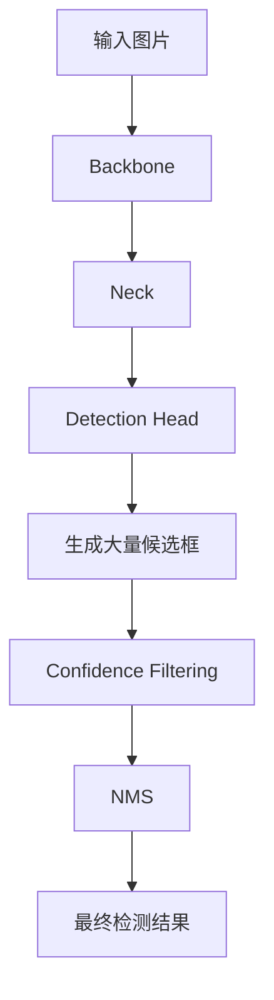

其中 NMS（Non-Maximum Suppression，非极大值抑制）是一个重要的后处理步骤。

假设模型预测了多个重叠框：

- Box A：Confidence = 0.95
- Box B：Confidence = 0.90
- Box C：Confidence = 0.85

如果 Box A 和 Box B 的 IoU 超过设定阈值，就会删除置信度较低的 Box B。

NMS 的主要问题：

1. 增加推理后处理时间。
2. 需要设置 Confidence Threshold。
3. 需要设置 IoU Threshold。
4. 在密集目标和重叠目标场景下，可能错误删除真实目标。
5. 后处理速度会受到候选框数量影响。

因此，NMS 不仅影响速度，也会影响最终检测结果。

## 1.2 DETR 为什么能够不使用 NMS？

DETR（Detection Transformer）提出了一种不同的目标检测思路。

传统检测器：

- 在特征图上生成大量候选框。
- 对每个候选框进行分类和回归。
- 使用 NMS 删除重复检测框。

DETR：

- 预先定义固定数量的 Object Queries。
- 每个 Query 负责预测一个目标或者 No Object。
- 通过 Hungarian Matching 建立预测结果和真实目标之间的一对一匹配。
- 最终直接输出预测结果，不需要 NMS。

基本流程：

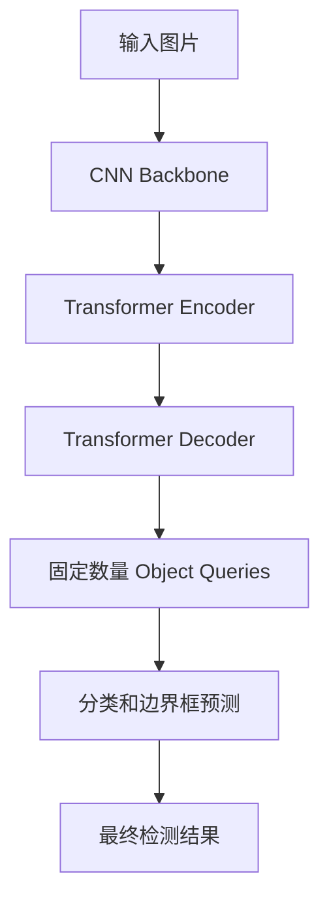

DETR 的优点：

- 端到端检测。
- 不需要 NMS。
- 通过一对一匹配减少重复预测。
- 网络结构具有较强的整体性。

但是，原始 DETR 存在两个主要问题：

1. Transformer Encoder 计算量较大。
2. 训练收敛速度较慢。

Deformable DETR 通过稀疏采样的多尺度注意力改善计算效率和小目标检测能力，但多尺度特征参与 Transformer Encoder 后，计算成本仍然较高。

RT-DETR 的目标就是解决这个问题：

**保留 DETR 的端到端检测方式，同时重新设计 Encoder，使其满足实时目标检测的速度要求。**

## 1.3 RT-DETR 的核心贡献

论文主要提出了三个方面的改进。

### 第一：Efficient Hybrid Encoder

高效混合编码器。

将多尺度特征的处理分为两部分：

- AIFI：Attention-based Intra-scale Feature Interaction。
- CCFF：CNN-based Cross-scale Feature Fusion。

其中：

- AIFI 使用 Transformer 处理高层语义特征。
- CCFF 使用 CNN 进行不同尺度特征融合。

核心思想：

不需要对所有尺度的特征都执行 Transformer Attention。

### 第二：Uncertainty-minimal Query Selection

最小不确定性查询选择。

传统 Query Selection 主要根据分类置信度选择 Top-K 特征。

但是，目标检测不仅需要分类准确，还需要定位准确。

RT-DETR 将分类质量与定位质量联系起来，使得 Decoder 获得更高质量的初始 Queries。

### 第三：Flexible Inference Speed

灵活调整推理速度。

RT-DETR 的 Decoder 包含多个预测层，每一层都可以输出分类和边界框。

因此，可以在不重新训练模型的情况下，调整推理时使用的 Decoder 层数。

例如：

- 使用 6 层 Decoder：精度较高。
- 使用 5 层 Decoder：速度更快。
- 使用 4 层 Decoder：进一步降低延迟。

---

# 二、RT-DETR 整体网络架构

## 2.1 网络整体组成

RT-DETR 由三个主要部分组成：

1. Backbone。
2. Efficient Hybrid Encoder。
3. Transformer Decoder。

整体结构：

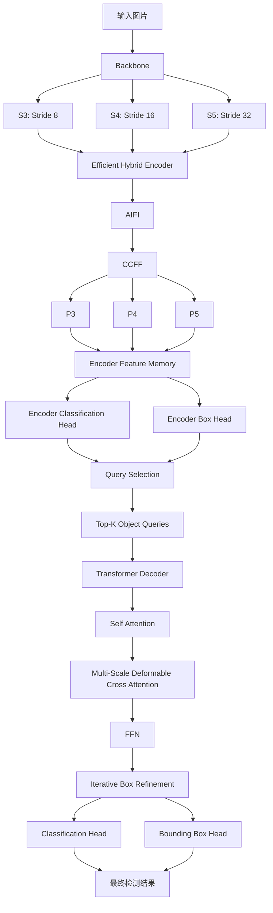

需要注意：

RT-DETR 并不是一个完全由 Transformer 构成的网络。

它实际上采用了混合架构：

- Backbone：CNN。
- Encoder：Transformer + CNN。
- Decoder：Transformer。

这也是它能够兼顾速度和检测精度的重要原因。

## 2.2 各模块的主要作用

| 模块 | 主要结构 | 作用 |
|---|---|---|
| Backbone | ResNet | 提取不同层级的视觉特征 |
| AIFI | Transformer Encoder | 建立高层特征的全局联系 |
| CCFF | FPN + PAN + RepBlock | 融合多尺度特征 |
| Query Selection | Classification + Box Head | 选择高质量初始查询 |
| Decoder | Transformer | 逐步优化目标特征 |
| Prediction Head | Linear + MLP | 输出类别和边界框 |

## 2.3 一张图片在网络中的完整数据流

假设输入图片为：

$$
X\in\mathbb{R}^{B\times3\times640\times640}
$$

使用 ResNet50 作为 Backbone。

经过 Backbone 后得到：

$$
S_3\in\mathbb{R}^{B\times512\times80\times80}
$$

$$
S_4\in\mathbb{R}^{B\times1024\times40\times40}
$$

$$
S_5\in\mathbb{R}^{B\times2048\times20\times20}
$$

经过 Hybrid Encoder 后：

$$
P_3\in\mathbb{R}^{B\times256\times80\times80}
$$

$$
P_4\in\mathbb{R}^{B\times256\times40\times40}
$$

$$
P_5\in\mathbb{R}^{B\times256\times20\times20}
$$

将三个尺度的特征展平并拼接：

$$
N=80^2+40^2+20^2
$$

$$
N=6400+1600+400=8400
$$

最终得到：

$$
Memory\in\mathbb{R}^{B\times8400\times256}
$$

从中选择 300 个高质量特征：

$$
Query\in\mathbb{R}^{B\times300\times256}
$$

进入 Decoder，经过 6 层 Transformer Decoder 后输出：

$$
Pred_{cls}\in\mathbb{R}^{B\times300\times80}
$$

$$
Pred_{box}\in\mathbb{R}^{B\times300\times4}
$$

其中 80 是 COCO 数据集的类别数量。

---

# 三、Backbone：ResNet 特征提取

## 3.1 RT-DETR 使用什么 Backbone？

官方原始实现支持多种 Backbone：

- ResNet18。
- ResNet34。
- ResNet50。
- ResNet101。

此外，官方代码还提供了其他 Backbone 的适配实现。

原始论文主要使用 ResNet50 和 ResNet101 进行性能测试。

这里以 ResNet50 为例。

ResNet50 的基本结构：

| 模块 | Block 数量 | 输出通道 |
|---|---:|---:|
| Stem | - | 64 |
| Stage 1 | 3 | 256 |
| Stage 2 | 4 | 512 |
| Stage 3 | 6 | 1024 |
| Stage 4 | 3 | 2048 |

ResNet50 使用 Bottleneck Block。

一个 Bottleneck Block：

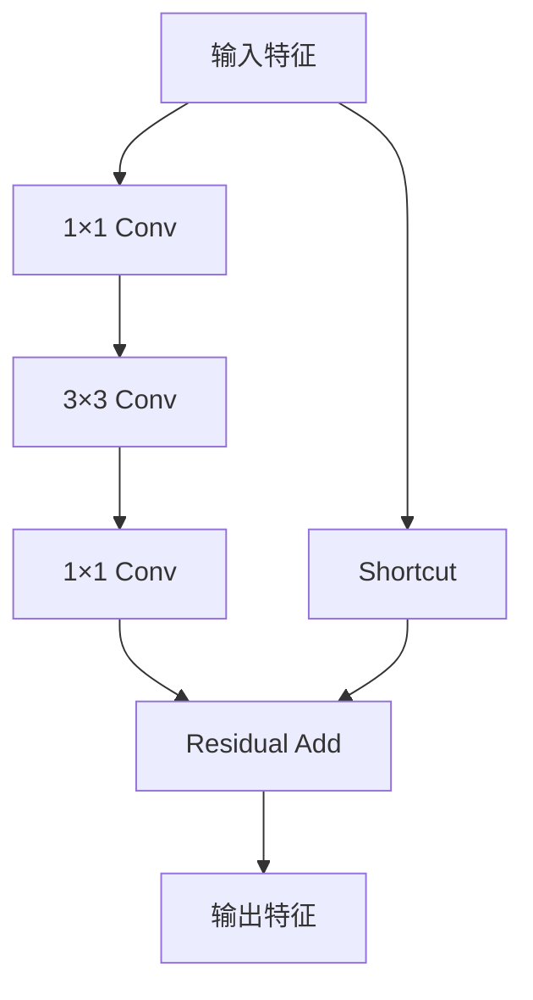

其中：

- 第一个 1×1 Conv 用于降低通道数。
- 3×3 Conv 提取空间特征。
- 最后一个 1×1 Conv 恢复通道数。
- Shortcut 用于残差连接。

## 3.2 RT-DETR 为什么使用三个特征层？

RT-DETR 从 Backbone 的最后三个 Stage 提取特征：

$$
\{S_3,S_4,S_5\}
$$

分别对应：

| 特征 | Stride | 通道数 | 640 输入下的尺寸 |
|---|---:|---:|---|
| S3 | 8 | 512 | 80×80 |
| S4 | 16 | 1024 | 40×40 |
| S5 | 32 | 2048 | 20×20 |

不同尺度特征具有不同作用：

- S3：保留更多空间细节。
- S4：兼顾空间信息和语义信息。
- S5：具有较强的高层语义信息。

多尺度特征对于小目标检测尤其重要。

例如：

同样一个 8×8 像素的小目标：

在 Stride 8 的特征图上可能对应约 1×1 的空间区域。

在 Stride 32 的特征图上，其空间信息可能已经非常有限。

因此需要融合不同尺度的特征。

## 3.3 官方 PResNet 实现

官方 PyTorch 实现使用：

`rtdetr_pytorch/src/nn/backbone/presnet.py`

配置文件：

```yaml
PResNet:
  depth: 50
  variant: d
  freeze_at: 0
  return_idx: [1, 2, 3]
  num_stages: 4
  freeze_norm: True
  pretrained: True
```

几个重要参数：

**depth**

指定 ResNet 深度。

**variant**

指定 ResNet 的 Stem 和下采样实现方式。

`variant: d` 使用三个 3×3 卷积构建 Stem，并在部分下采样 Shortcut 中使用 AvgPool。

**return_idx**

指定返回哪些 Stage 的特征。

`[1, 2, 3]` 对应 Stride 8、16、32 的特征。

**freeze_norm**

是否冻结归一化层。

**pretrained**

是否加载预训练权重。

---

# 四、Efficient Hybrid Encoder：高效混合编码器

这是 RT-DETR 最重要的创新之一。

## 4.1 为什么需要重新设计 Encoder？

传统多尺度 Transformer Encoder 的问题是：

需要对不同尺度的特征进行大量 Attention 运算。

以 640×640 输入为例：

三个特征层：

- S3：6400 个 Token。
- S4：1600 个 Token。
- S5：400 个 Token。

总计：

$$
N=8400
$$

如果直接将所有 Token 拼接起来进行全局 Self-Attention：

Attention 矩阵的空间复杂度与 Token 数量的平方成正比：

$$
O(N^2)
$$

对应的注意力矩阵大小：

$$
8400^2=70,560,000
$$

而 RT-DETR 只在 S5 上执行 Transformer Encoder。

此时：

$$
N_5=400
$$

Attention 矩阵大小：

$$
400^2=160,000
$$

两者的理论注意力矩阵元素数量比例：

$$
\frac{8400^2}{400^2}=441
$$

也就是说，在这个示例中，只对 S5 执行 Self-Attention，可以将对应的注意力矩阵规模降低到原来的约 1/441。

这并不意味着整个 Encoder 的总计算量也降低 441 倍，因为其他卷积、特征融合等运算仍然存在。

RT-DETR 将 Encoder 拆分为两个模块：

1. AIFI：处理同尺度内部特征交互。
2. CCFF：处理不同尺度之间的特征融合。

## 4.2 AIFI：Attention-based Intra-scale Feature Interaction

AIFI 的作用：

**只在高层语义特征 S5 上执行 Transformer Encoder，建立不同空间位置之间的全局关系。**

为什么只选择 S5？

因为 S5 已经具有较强的语义信息。

例如，一张图片中包含：

- 人。
- 汽车。
- 自行车。
- 道路。

S5 中的特征已经具有一定的目标语义表达能力。

通过 Self-Attention，可以建立不同目标和不同空间区域之间的关系。

而 S3 主要保留空间细节，直接在其上执行全局 Attention 计算成本更高。

论文的消融实验也验证了这一设计。

### 4.2.1 AIFI 的输入

首先将 Backbone 的三个特征层映射到统一维度：

$$
S_i\in\mathbb{R}^{B\times C_i\times H_i\times W_i}
$$

通过 1×1 Conv：

$$
F_i=Conv_{1\times1}(S_i)
$$

统一映射为：

$$
F_i\in\mathbb{R}^{B\times256\times H_i\times W_i}
$$

AIFI 选择 S5：

$$
F_5\in\mathbb{R}^{B\times256\times20\times20}
$$

将其展平：

$$
X_5\in\mathbb{R}^{B\times400\times256}
$$

### 4.2.2 位置编码

Transformer 本身不具备天然的空间位置感知能力，因此需要加入位置编码。

RT-DETR 使用二维 Sin-Cos Position Embedding。

对于空间位置 $(x,y)$，构造不同频率的正弦和余弦编码。

可以表示为：

$$
PE(x,y)=
[
\sin(y\omega),
\cos(y\omega),
\sin(x\omega),
\cos(x\omega)
]
$$

其中：

$$
\omega_i=\frac{1}{T^{i/d}}
$$

$T$ 是位置编码温度参数，默认：

$$
T=10000
$$

最终位置编码维度：

$$
PE\in\mathbb{R}^{1\times400\times256}
$$

将其加入输入：

$$
X=X_5+PE
$$

### 4.2.3 Self-Attention

标准 Multi-Head Self-Attention：

$$
Q=XW_Q
$$

$$
K=XW_K
$$

$$
V=XW_V
$$

计算 Attention：

$$
Attention(Q,K,V)
=
Softmax\left(
\frac{QK^T}{\sqrt{d_k}}
\right)V
$$

RT-DETR 的 AIFI 默认配置：

| 参数 | 数值 |
|---|---:|
| Hidden Dimension | 256 |
| Attention Heads | 8 |
| Head Dimension | 32 |
| FFN Dimension | 1024 |
| Transformer Layers | 1 |
| Activation | GELU |
| Dropout | 0 |

其中：

$$
HeadDim=\frac{256}{8}=32
$$

FFN：

$$
256\rightarrow1024\rightarrow256
$$

一个 AIFI Transformer Block：

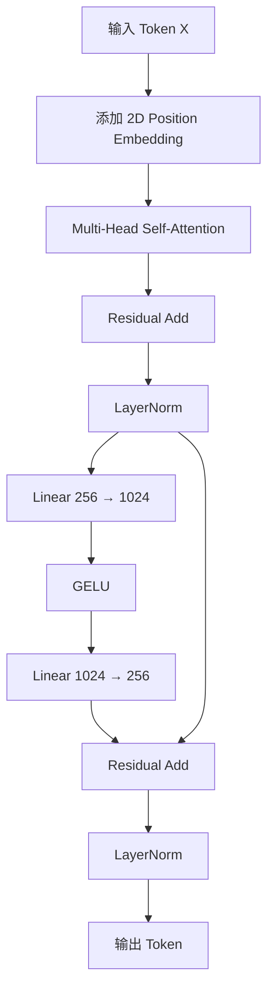

最终恢复二维特征图：

$$
F_5'
\in
\mathbb{R}^{B\times256\times20\times20}
$$

### 4.2.4 AIFI 的本质

AIFI 不是对所有尺度都执行 Transformer。

它只处理高层特征。

这样既能利用 Transformer 建立全局语义关系，又避免在高分辨率特征图上进行大量 Attention 运算。

---

## 4.3 CCFF：CNN-based Cross-scale Feature Fusion

AIFI 处理同尺度内部的特征关系。

但是，目标检测还需要融合不同尺度的信息。

因此 RT-DETR 使用 CCFF。

CCFF 主要由：

- FPN Top-down。
- PAN Bottom-up。
- CSPRepLayer。
- RepVggBlock。

组成。

整体结构：

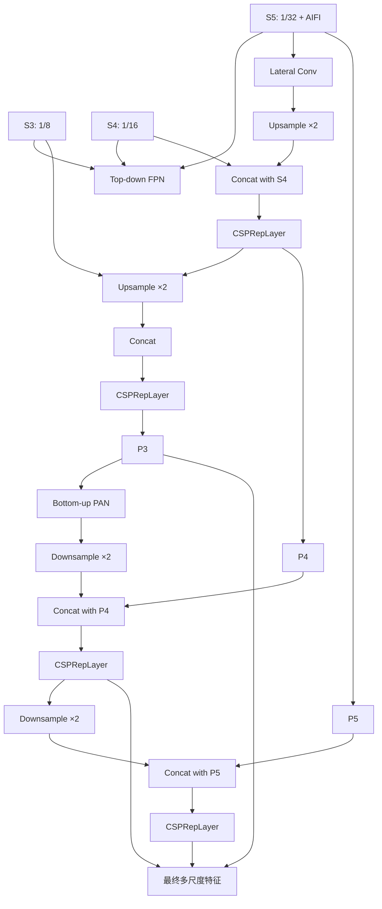

### 4.3.1 FPN：自顶向下融合

FPN 的核心思想：

将高层语义信息向低层传播。

例如：

S5：

$$
[B,256,20,20]
$$

上采样两倍：

$$
[B,256,40,40]
$$

与 S4 进行拼接：

$$
[B,512,40,40]
$$

然后通过 CSPRepLayer：

$$
[B,512,40,40]
\rightarrow
[B,256,40,40]
$$

继续向上：

$$
[B,256,40,40]
\rightarrow
[B,256,80,80]
$$

与 S3 拼接：

$$
[B,512,80,80]
$$

再通过 CSPRepLayer：

$$
[B,256,80,80]
$$

这样低层特征就能够融合高层语义信息。

### 4.3.2 PAN：自底向上融合

FPN 主要从高层向低层传递语义信息。

PAN 则通过下采样，将低层特征向高层传播。

例如：

P3：

$$
[B,256,80,80]
$$

通过 3×3 Conv，Stride=2：

$$
[B,256,40,40]
$$

与 FPN 输出的 P4 拼接：

$$
[B,512,40,40]
$$

再通过 CSPRepLayer：

$$
[B,256,40,40]
$$

继续下采样到 P5：

$$
[B,256,20,20]
$$

最终得到三个尺度的特征。

### 4.3.3 CSPRepLayer 是什么？

CSPRepLayer 是 CCFF 中的重要模块。

它具有两条分支：

- 第一条分支：Conv + RepVggBlock。
- 第二条分支：Conv。

两条分支进行逐元素相加。

结构：

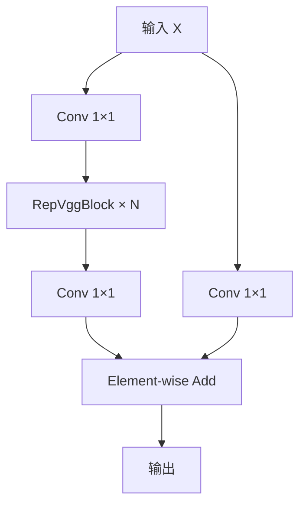

具体计算：

第一条分支：

$$
X_1=Conv_1(X)
$$

$$
X_1=RepBlocks(X_1)
$$

第二条分支：

$$
X_2=Conv_2(X)
$$

最终：

$$
Y=Conv_3(X_1+X_2)
$$

其中：

$$
N=3
$$

是默认的 RepVggBlock 数量。

### 4.3.4 RepVggBlock

RepVggBlock 由两个卷积分支组成：

- 3×3 Conv + BatchNorm。
- 1×1 Conv + BatchNorm。

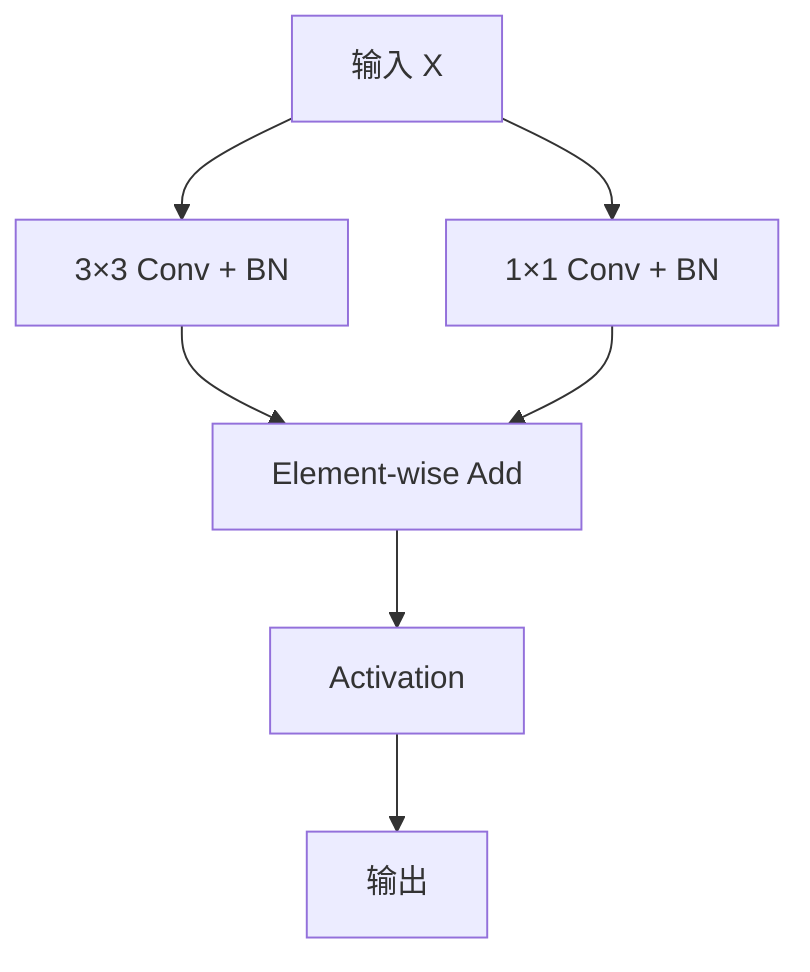

为什么使用两个分支？

训练阶段：

两个分支可以提供不同的特征提取路径。

推理阶段：

可以将两个分支进行重参数化融合，转换成一个 3×3 Conv。

假设：

$$
Y=Conv_{3\times3}(X)+Conv_{1\times1}(X)
$$

将 1×1 卷积核补零到 3×3：

$$
W_{1\times1}\rightarrow W_{1\times1}^{3\times3}
$$

则：

$$
Y=
Conv_{3\times3}
(
X,
W_{3\times3}+W_{1\times1}^{3\times3}
)
$$

在融合 BatchNorm 参数后，可以进一步得到一个等效卷积。

因此：

训练阶段结构复杂，推理阶段结构简单。

这就是 RepVGG 类重参数化设计的核心思想。

官方代码中的 `convert_to_deploy()` 就是完成这个转换。

### 4.3.5 CCFF 最终输出

以 640×640 输入为例：

| 输出 | Stride | Shape |
|---|---:|---|
| P3 | 8 | [B,256,80,80] |
| P4 | 16 | [B,256,40,40] |
| P5 | 32 | [B,256,20,20] |

最终，Hybrid Encoder 输出三种尺度的特征。

---

# 五、Query Selection：目标查询选择

这是 RT-DETR 的另一个核心设计。

## 5.1 什么是 Object Query？

在 Transformer 检测器中，Object Query 可以理解为：

**用于寻找和描述某一个潜在目标的特征向量。**

例如：

一张图片有 5 个目标。

Decoder 中可能有 300 个 Queries。

其中：

- 5 个 Query 负责描述真实目标。
- 其他 Query 最终预测 No Object 或低置信度结果。

RT-DETR 默认：

$$
K=300
$$

即使用 300 个 Object Queries。

## 5.2 为什么不能直接随机初始化 Query？

传统 DETR 使用可学习的 Query Embedding。

这些 Query 在训练开始时没有明确的目标信息。

需要经过多层 Decoder 才能逐渐学会如何寻找目标。

RT-DETR 采用基于 Encoder 特征的 Query Selection。

流程：

1. Encoder 输出大量空间特征。
2. 为每个特征预测分类分数。
3. 为每个特征预测初始边界框。
4. 根据分类质量选择 Top-K 特征。
5. 将选出的特征作为 Decoder 的初始 Query。

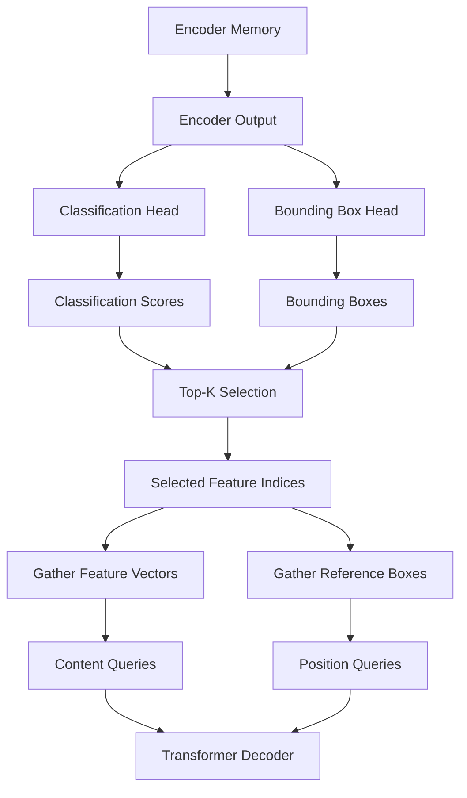

## 5.3 Encoder Classification Head

对于每一个 Encoder 特征：

$$
X_i\in\mathbb{R}^{256}
$$

分类头输出：

$$
C_i\in\mathbb{R}^{N_{cls}}
$$

COCO 数据集：

$$
N_{cls}=80
$$

因此：

$$
C\in\mathbb{R}^{B\times8400\times80}
$$

每个空间位置都有 80 个类别分数。

## 5.4 Encoder Bounding Box Head

同时，Encoder 通过一个 MLP 预测边界框。

$$
B_i=MLP(X_i)+A_i
$$

其中：

- $X_i$：Encoder Feature。
- $A_i$：初始 Anchor 的 Logit 表示。
- $B_i$：预测框的 Logit 表示。

经过 Sigmoid：

$$
\hat{b}_i=\sigma(B_i)
$$

得到归一化边界框。

边界框格式：

$$
(cx,cy,w,h)
$$

所有坐标都归一化到 0～1。

## 5.5 Anchor 是如何生成的？

RT-DETR 在 Encoder 的候选框初始化阶段生成网格 Anchor。

这里的 Anchor 是用于初始化参考框的网格先验，不是传统检测器中为每个位置配置大量宽高比模板的方式。

假设某个特征层尺寸：

$$
H\times W
$$

对于位置 $(i,j)$：

中心坐标：

$$
x=\frac{j+0.5}{W}
$$

$$
y=\frac{i+0.5}{H}
$$

初始宽高：

$$
w=h=0.05\times2^l
$$

其中 $l$ 表示特征层级，从 0 开始。

因此 Anchor：

$$
a_{l,i,j}
=
(x,y,w,h)
$$

将其转换为 Logit：

$$
a_{logit}=
\log\left(
\frac{a}{1-a}
\right)
$$

然后与 Bounding Box Head 的输出相加。

$$
B_i=MLP(X_i)+a_{logit}
$$

最后经过 Sigmoid 得到初始预测框。

对于超出有效范围的 Anchor，代码会通过 Valid Mask 排除。

## 5.6 Top-K Query Selection

对于每个空间位置，取其所有类别分数中的最大值：

$$
s_i=\max_{c}C_{i,c}
$$

然后选择 Top-K：

$$
I_{topk}=TopK(s,K)
$$

默认：

$$
K=300
$$

从 Encoder Memory 中取出对应特征：

$$
Q_{content}=Memory[I_{topk}]
$$

从预测框中取出对应的参考框：

$$
Q_{reference}=B[I_{topk}]
$$

因此：

$$
Q_{content}
\in
\mathbb{R}^{B\times300\times256}
$$

$$
Q_{reference}
\in
\mathbb{R}^{B\times300\times4}
$$

默认 `learnt_init_query=False`，所以使用 Encoder 选出的特征初始化 Query，而不是直接使用可学习的 Query Embedding。

## 5.7 Uncertainty-minimal Query Selection

为什么 RT-DETR 不仅考虑分类分数，还考虑定位质量？

假设有两个候选特征：

| 特征 | 分类置信度 | Box IoU |
|---|---:|---:|
| A | 0.95 | 0.30 |
| B | 0.90 | 0.85 |

如果只根据分类分数选择：

A 会排在 B 前面。

但是 A 的定位质量很差。

B 虽然分类分数稍低，但定位质量更高。

因此，RT-DETR 认为：

一个高质量的检测特征，需要同时具有较好的分类能力和定位能力。

论文将特征不确定性定义为：

$$
\mathcal{U}(\hat{X})
=
\left\|
\mathcal{P}(\hat{X})
-
\mathcal{C}(\hat{X})
\right\|
$$

其中：

- $\mathcal{P}(\hat{X})$：定位相关的预测分布。
- $\mathcal{C}(\hat{X})$：分类相关的预测分布。
- $\mathcal{U}$：二者之间的差异。

论文进一步将不确定性引入训练目标：

$$
\mathcal{L}
=
\mathcal{L}_{box}
+
\mathcal{L}_{cls}
(
\mathcal{U}(\hat{X}),
\hat{c},
c
)
$$

其目标是降低分类质量与定位质量之间的不一致性。

这样，Encoder 能够提供更加可靠的初始 Query。

### 5.7.1 官方代码中的具体实现

这里需要区分论文的数学描述和实际代码实现。

在官方 PyTorch 代码中：

`rtdetr_decoder.py`

Query Selection 的核心操作是：

```python
_, topk_ind = torch.topk(
    enc_outputs_class.max(-1).values,
    self.num_queries,
    dim=1
)
```

也就是说，实际 Top-K 仍然是按照每个特征的最大分类分数进行选择。

那么定位质量体现在哪里？

关键在于 `rtdetr_criterion.py` 中的 Varifocal Loss（VFL）。

对于已经匹配的预测框：

首先计算预测框和 GT 的 IoU：

$$
q=IoU(\hat{b},b)
$$

然后将这个 IoU 作为正确类别的分类目标：

$$
target\_score=q\times OneHot(c)
$$

这样，分类分数不再仅仅表示是否属于某个类别，还会受到定位质量的影响。

因此：

- 定位准确的预测框具有较高的分类目标分数。
- 定位不准确的预测框具有较低的分类目标分数。
- 背景预测的分类目标为 0。

Encoder 的 Top-K 输出也参与辅助损失计算。

因此，Encoder 的分类分数经过质量感知监督后，能够更好地反映预测框质量。

需要注意：

论文中的显式不确定性公式，并没有在这份 PyTorch 实现中表现为一个单独的 `uncertainty` 计算模块。

从代码可以直接确认的是：

1. Encoder 通过分类分数执行 Top-K。
2. Encoder 预测框和分类结果参与辅助训练。
3. VFL 使用匹配预测框的 IoU 作为分类质量目标。

因此，不能简单地将代码中的 VFL 与论文中的 L2 不确定性公式视为完全相同的数学运算。

官方仓库中也存在关于这一实现细节的讨论：

- https://github.com/lyuwenyu/RT-DETR/issues/357
- https://github.com/lyuwenyu/RT-DETR/issues/438

这两个 Issue 主要讨论论文中的不确定性公式与源码中的 VFL 实现之间的关系。

---

# 六、Transformer Decoder

经过 Query Selection 后，RT-DETR 得到 300 个高质量 Object Queries。

接下来进入 Transformer Decoder。

## 6.1 Decoder 整体结构

RT-DETR 默认使用 6 层 Decoder。

每一层包含三个主要模块：

1. Multi-Head Self-Attention。
2. Multi-Scale Deformable Cross-Attention。
3. FFN。

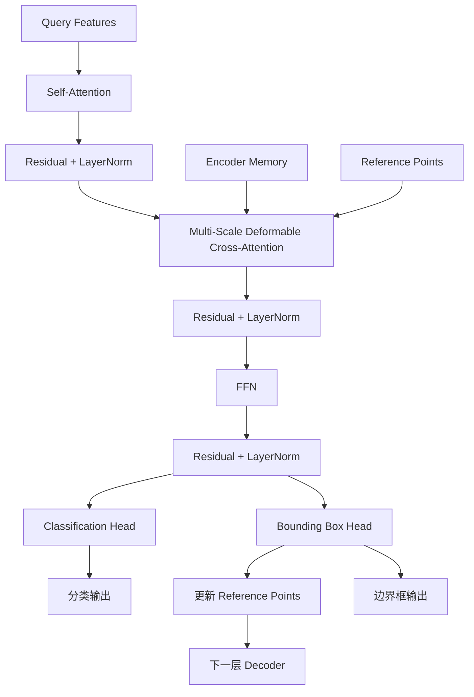

## 6.2 Decoder 参数

官方配置：

| 参数 | 数值 |
|---|---:|
| Hidden Dimension | 256 |
| Number of Queries | 300 |
| Decoder Layers | 6 |
| Attention Heads | 8 |
| FFN Dimension | 1024 |
| Feature Levels | 3 |
| Decoder Points | 4 |
| Activation | ReLU |
| Dropout | 0 |

其中：

$$
HeadDim=\frac{256}{8}=32
$$

注意：

AIFI 和 Decoder 都使用 8 个 Attention Heads，但它们属于不同模块，处理的输入和任务也不同。

## 6.3 Multi-Head Self-Attention

Self-Attention 用于建立不同 Object Queries 之间的关系。

例如：

一张图片中有：

- 汽车。
- 行人。
- 自行车。

不同 Queries 之间可能存在关联。

Self-Attention 可以让不同 Query 交换信息。

计算：

$$
Q=XW_Q
$$

$$
K=XW_K
$$

$$
V=XW_V
$$

$$
Attention(Q,K,V)
=
Softmax\left(
\frac{QK^T}{\sqrt{d_k}}
\right)V
$$

输入维度：

$$
X\in\mathbb{R}^{B\times300\times256}
$$

Attention 矩阵：

$$
A\in\mathbb{R}^{B\times8\times300\times300}
$$

Self-Attention 的输入是 Query，而不是全部 8400 个 Encoder Tokens。

## 6.4 Multi-Scale Deformable Cross-Attention

这是 Decoder 中非常重要的模块。

传统 Cross-Attention：

Query 需要与 Encoder 的大量 Key 和 Value 建立注意力关系。

如果 Encoder Memory 有 8400 个 Token：

每个 Query 都需要处理大量特征。

RT-DETR 使用 Multi-Scale Deformable Attention。

核心思想：

**每个 Query 不需要关注所有空间位置，而是根据参考框，在不同尺度特征图上选择少量关键采样点。**

### 6.4.1 输入

Query：

$$
Q\in\mathbb{R}^{B\times300\times256}
$$

Encoder Memory：

$$
V\in\mathbb{R}^{B\times8400\times256}
$$

特征层尺寸：

$$
[(80,80),(40,40),(20,20)]
$$

参考框：

$$
R\in\mathbb{R}^{B\times300\times4}
$$

其中：

$$
R=(c_x,c_y,w,h)
$$

### 6.4.2 预测采样偏移量

对于每个 Query，网络预测采样偏移量：

$$
\Delta p
\in
\mathbb{R}^{B\times Q\times M\times L\times K\times2}
$$

其中：

- $Q=300$：Query 数量。
- $M=8$：Attention Heads。
- $L=3$：特征层数量。
- $K=4$：每个 Head、每个特征层的采样点数量。

每个 Head 在每个尺度采样 4 个点。

因此每个 Query 总采样点数量：

$$
8\times3\times4=96
$$

即每个 Query 在每层 Decoder 中总共处理 96 个采样位置。

### 6.4.3 采样位置

对于四维参考框：

$$
R=(c_x,c_y,w,h)
$$

采样位置可以表示为：

$$
p_{q,l,k}
=
(c_x,c_y)
+
\frac{\Delta p_{q,l,k}}{K}
\odot
(w,h)\times0.5
$$

其中：

- $\Delta p$ 是网络预测的偏移量。
- $(w,h)$ 控制采样范围。
- $\odot$ 表示逐元素乘法。

因此，参考框越大，采样区域也可以越大。

### 6.4.4 预测 Attention Weights

网络还会预测每个采样位置的权重：

$$
\alpha_{q,m,l,k}
$$

对所有尺度和采样点进行 Softmax：

$$
\sum_{l=1}^{L}
\sum_{k=1}^{K}
\alpha_{q,m,l,k}=1
$$

最终输出：

$$
Y_q=
W_o
\sum_{m=1}^{M}
\sum_{l=1}^{L}
\sum_{k=1}^{K}
\alpha_{q,m,l,k}
W_vV_l(p_{q,m,l,k})
$$

这里：

- $V_l(p)$：在第 $l$ 个特征层对应位置插值得到的特征。
- $W_v$：Value Projection。
- $W_o$：Output Projection。
- $\alpha$：注意力权重。

这样就不需要对所有 8400 个位置执行完整 Cross-Attention。

### 6.4.5 为什么叫 Deformable Attention？

因为采样位置不是固定的。

网络会根据当前 Query 的状态，动态预测偏移量。

例如：

一个 Query 负责寻找汽车。

在初始阶段，它可能采样到汽车周围的一些区域。

经过训练后，采样点会逐渐集中到汽车的关键位置。

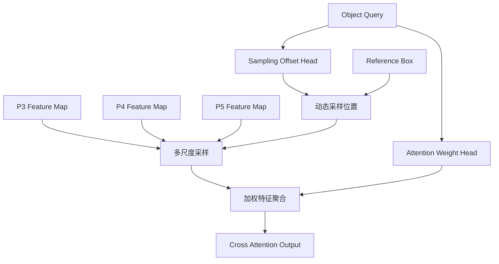

## 6.5 FFN

经过 Self-Attention 和 Cross-Attention 后，Query 还需要通过 FFN 进一步变换。

默认：

$$
256\rightarrow1024\rightarrow256
$$

计算：

$$
FFN(X)=W_2(ReLU(W_1X))
$$

然后通过 Residual Connection 和 LayerNorm。

一个完整 Decoder Layer：

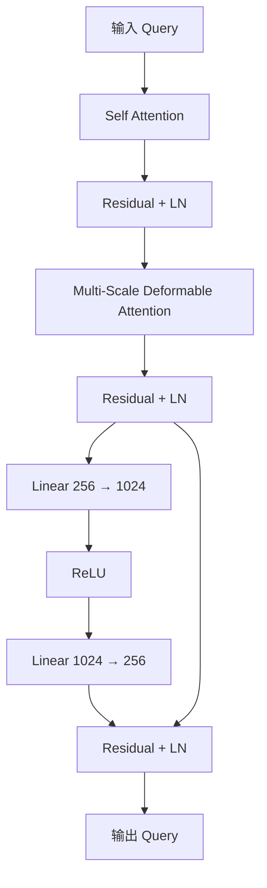

## 6.6 Iterative Bounding Box Refinement

这是 RT-DETR Decoder 的另一个重要机制。

每一层 Decoder 都会输出：

- 分类结果。
- 边界框结果。

并且下一层 Decoder 会使用上一层预测的边界框更新 Reference Points。

假设初始参考框：

$$
b^{(0)}
$$

第 $l$ 层预测一个边界框偏移量：

$$
\Delta b^{(l)}
$$

更新：

$$
b^{(l)}
=
\sigma
\left(
\Delta b^{(l)}
+
\sigma^{-1}(b^{(l-1)})
\right)
$$

其中：

- $\sigma$：Sigmoid。
- $\sigma^{-1}$：Inverse Sigmoid。

为什么使用 Inverse Sigmoid？

因为边界框坐标被限制在 0～1 之间。

直接在坐标空间加减可能导致更新范围受到限制。

转换到 Logit 空间后进行偏移，再通过 Sigmoid 转回归一化坐标。

这样每层 Decoder 都可以逐步修正预测框。

流程：

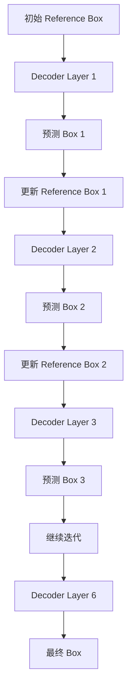

注意：

训练阶段会计算多个 Decoder 层的辅助损失。

推理阶段则可以选择某一个 Decoder 层作为最终输出。

---

# 七、NMS-Free：为什么 RT-DETR 不需要 NMS？

## 7.1 核心原因

RT-DETR 采用 Set Prediction。

每个 Query 最终负责预测一个目标或者背景。

训练阶段通过 Hungarian Matching 建立预测与真实目标之间的一对一匹配。

例如：

真实目标有 3 个：

$$
GT=\{A,B,C\}
$$

模型输出 300 个 Query：

$$
Q=\{Q_1,Q_2,\ldots,Q_{300}\}
$$

Hungarian Matching 会选择：

$$
Q_1\leftrightarrow A
$$

$$
Q_2\leftrightarrow B
$$

$$
Q_3\leftrightarrow C
$$

其他 Query 被训练为背景预测。

这样，网络本身就学习了避免重复预测的能力。

因此推理时不需要使用 NMS。

## 7.2 推理阶段具体输出什么？

Decoder 输出：

$$
Pred_{cls}\in\mathbb{R}^{B\times300\times C}
$$

$$
Pred_{box}\in\mathbb{R}^{B\times300\times4}
$$

其中：

- $C$：类别数量。
- 4：边界框的四个坐标。

使用 Sigmoid：

$$
Score=\sigma(Pred_{cls})
$$

然后对 Query 和类别维度展开：

$$
Score_{flat}
\in
\mathbb{R}^{B\times(300C)}
$$

选择 Top-K 分数：

$$
TopK=300
$$

根据索引恢复：

- Query 索引。
- 类别索引。
- 对应边界框。

最后将归一化坐标转换为原始图片坐标。

## 7.3 后处理流程

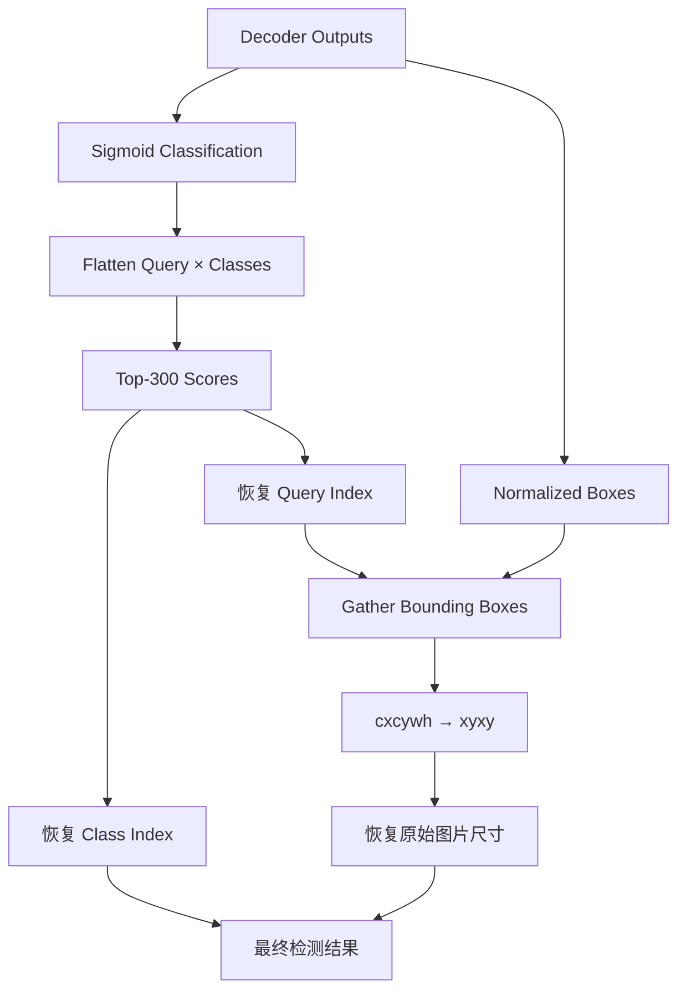

注意：

NMS-Free 不代表完全没有后处理。

RT-DETR 仍然需要：

- Sigmoid。
- Top-K。
- 坐标格式转换。
- 坐标缩放。

只是没有 NMS。

另外，官方 PostProcessor 在 Focal Loss 模式下，会在 Query × Class 的展开分数中选择 Top-K，因此同一个 Query 理论上可能对应多个类别候选分数。

---

# 八、RT-DETR 的训练机制

RT-DETR 的训练与传统 YOLO 检测器有明显区别。

它主要使用：

1. Hungarian Matching。
2. Varifocal Loss。
3. Bounding Box L1 Loss。
4. GIoU Loss。
5. Contrastive Denoising。
6. Auxiliary Loss。

## 8.1 Hungarian Matching

Hungarian Matching 的作用：

将模型预测结果与 GT 建立一对一匹配。

假设：

- 模型输出 300 个 Query。
- GT 有 5 个目标。

需要从 300 个预测中找到最合适的 5 个，与 GT 分别匹配。

### 8.1.1 匹配代价

对于预测框 $i$ 和真实框 $j$：

$$
C_{ij}
=
\lambda_{cls}C_{cls}
+
\lambda_{bbox}C_{bbox}
+
\lambda_{giou}C_{giou}
$$

其中：

分类代价：

$$
C_{cls}
$$

边界框 L1 距离：

$$
C_{bbox}
=
\|\hat{b}_i-b_j\|_1
$$

GIoU 代价：

$$
C_{giou}
=
-GIoU(\hat{b}_i,b_j)
$$

默认权重：

| 参数 | 数值 |
|---|---:|
| Class Cost | 2 |
| BBox Cost | 5 |
| GIoU Cost | 2 |

通过 Hungarian Algorithm 找到总匹配代价最小的一对一分配。

## 8.2 Varifocal Loss

RT-DETR 使用 VFL 进行分类质量监督。

传统分类损失：

正确类别目标为 1，其他类别目标为 0。

VFL 的区别：

正确类别的目标分数不再固定为 1，而是使用预测框与 GT 的 IoU。

例如：

一个预测框：

$$
IoU=0.85
$$

那么对应正确类别的分类目标就是：

$$
q=0.85
$$

另一个预测框：

$$
IoU=0.30
$$

对应分类目标：

$$
q=0.30
$$

这样，分类分数就能够反映预测框的定位质量。

### 8.2.1 VFL 公式

对于正样本：

$$
\mathcal{L}_{pos}
=
-q
[
q\log p+(1-q)\log(1-p)
]
$$

对于负样本：

$$
\mathcal{L}_{neg}
=
-\alpha p^\gamma\log(1-p)
$$

其中：

- $p$：预测分类概率。
- $q$：真实质量分数，通常为 IoU。
- $\alpha$：负样本权重。
- $\gamma$：难样本调节参数。

RT-DETR 默认：

$$
\alpha=0.75
$$

$$
\gamma=2.0
$$

VFL 的作用：

让分类置信度同时反映类别正确性和定位质量。

## 8.3 Bounding Box L1 Loss

边界框回归使用 L1 Loss。

预测框：

$$
\hat{b}=(\hat{c}_x,\hat{c}_y,\hat{w},\hat{h})
$$

真实框：

$$
b=(c_x,c_y,w,h)
$$

计算：

$$
\mathcal{L}_{L1}
=
\|\hat{b}-b\|_1
$$

展开：

$$
\mathcal{L}_{L1}
=
|\hat{c}_x-c_x|
+
|\hat{c}_y-c_y|
+
|\hat{w}-w|
+
|\hat{h}-h|
$$

## 8.4 GIoU Loss

GIoU 用于改善边界框之间的几何关系。

IoU：

$$
IoU(A,B)=\frac{|A\cap B|}{|A\cup B|}
$$

GIoU：

$$
GIoU
=
IoU
-
\frac{|C-(A\cup B)|}{|C|}
$$

其中 $C$ 是能够同时包含 A 和 B 的最小外接矩形。

损失：

$$
\mathcal{L}_{GIoU}=1-GIoU
$$

为什么需要 GIoU？

当两个预测框完全不重叠时：

$$
IoU=0
$$

传统 IoU Loss 无法很好地反映两个框之间的距离关系。

GIoU 通过外接矩形提供额外的几何约束。

## 8.5 总损失函数

默认配置：

$$
\boxed{
\mathcal{L}
=
\mathcal{L}_{VFL}
+
5\mathcal{L}_{L1}
+
2\mathcal{L}_{GIoU}
}
$$

其中：

| Loss | 权重 |
|---|---:|
| VFL | 1 |
| L1 | 5 |
| GIoU | 2 |

训练过程中，还会对中间 Decoder 层、Encoder 输出和 Denoising 分支计算辅助损失。

因此实际总训练目标包含多个预测分支的损失。

---

# 九、Contrastive Denoising：对比去噪训练

## 9.1 为什么需要 Denoising？

DETR 类模型的 Query 需要从大量候选特征中逐渐学习如何定位目标。

这会增加训练难度。

Denoising 的思想：

训练时直接将 GT 信息作为带噪声的 Query 输入 Decoder，让模型学习恢复正确的类别和边界框。

例如：

真实目标：

```text
Class = Car
Box = [0.5, 0.5, 0.2, 0.3]
```

添加噪声：

```text
Class = Truck
Box = [0.53, 0.48, 0.22, 0.28]
```

网络需要恢复：

```text
Class = Car
Box = [0.5, 0.5, 0.2, 0.3]
```

## 9.2 正负样本构造

RT-DETR 使用 Contrastive Denoising。

对于每个 GT，构造：

- Positive Denoising Query。
- Negative Denoising Query。

Positive：

对真实框添加较小的噪声。

Negative：

添加更大的框扰动。

类别标签也可以加入随机噪声。

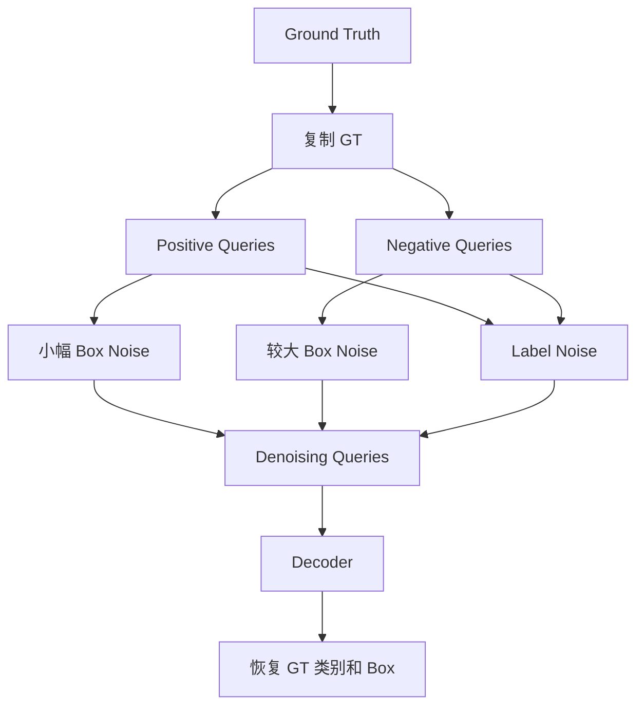

## 9.3 Attention Mask

Denoising Query 与正常 Query 之间需要进行隔离。

RT-DETR 使用 Attention Mask：

- 正常 Matching Query 不能看到 Denoising Query。
- 不同 Denoising Group 之间不能互相看到。

这样可以避免 Denoising 信息泄漏到正常 Query 的预测过程中。

## 9.4 Denoising 参数

官方配置：

| 参数 | 数值 |
|---|---:|
| num_denoising | 100 |
| label_noise_ratio | 0.5 |
| box_noise_scale | 1.0 |

注意：

论文附录的超参数表中 `denoising number` 为 200，而当前官方 PyTorch R50 配置中的 `num_denoising` 为 100。

论文配置和仓库具体配置存在这一数值差异，实际复现实验时应以所使用的配置文件为准。

---

# 十、RT-DETR 的多尺度训练与训练参数

## 10.1 官方训练配置

以 RT-DETR-R50 为例。

官方配置：

`rtdetr_pytorch/configs/rtdetr/include/rtdetr_r50vd.yml`

| 参数 | 数值 |
|---|---:|
| Backbone | PResNet50 |
| Backbone Variant | D |
| Encoder Hidden Dim | 256 |
| Encoder Layers | 1 |
| Encoder Heads | 8 |
| Encoder FFN | 1024 |
| Feature Levels | 3 |
| Decoder Layers | 6 |
| Decoder Heads | 8 |
| Decoder FFN | 1024 |
| Decoder Points | 4 |
| Number of Queries | 300 |
| Number of Denoising | 100 |
| Input Size | 640×640 |

## 10.2 优化器

官方配置：

```yaml
optimizer:
  type: AdamW
  params:
    -
      params: 'backbone'
      lr: 0.00001

  lr: 0.0001
  betas: [0.9, 0.999]
  weight_decay: 0.0001
```

主要参数：

| 参数 | 数值 |
|---|---:|
| Optimizer | AdamW |
| Backbone LR | 1e-5 |
| Other LR | 1e-4 |
| Weight Decay | 1e-4 |
| EMA Decay | 0.9999 |
| Gradient Clip | 0.1 |
| Epochs | 72 |

为什么 Backbone 学习率更低？

因为 Backbone 通常已经具有较好的预训练特征提取能力。

如果对 Backbone 使用过大的学习率，可能破坏原有的视觉特征表示。

而 Encoder 和 Decoder 需要学习目标检测任务，因此使用相对较高的学习率。

## 10.3 EMA

RT-DETR 使用 Exponential Moving Average。

EMA 参数更新：

$$
\theta_{EMA}
=
\alpha\theta_{EMA}
+
(1-\alpha)\theta
$$

默认：

$$
\alpha=0.9999
$$

EMA 可以使模型权重变化更加平滑。

## 10.4 Multi-scale Training

RT-DETR 支持多尺度训练。

官方 R50 配置：

```yaml
multi_scale:
  - 480
  - 512
  - 544
  - 576
  - 608
  - 640
  - 640
  - 640
  - 672
  - 704
  - 736
  - 768
  - 800
```

训练过程中随机选择不同输入尺寸。

这样可以增强模型对不同图片分辨率的适应能力。

## 10.5 论文训练环境

论文附录给出的训练配置：

- GPU：4× NVIDIA Tesla V100。
- Optimizer：AdamW。
- Batch Size：16。
- EMA：0.9999。
- 训练 Epoch：最终使用 6× 配置，即 72 Epoch。
- 数据集：COCO train2017。
- 验证集：COCO val2017。

数据增强包括：

- Color Distortion。
- Expand。
- Random Crop。
- Random Flip。
- Resize。

---

# 十一、RT-DETR 的性能测试

## 11.1 不同模型规模对比

官方 GitHub Model Zoo：

| 模型 | 参数量 | GFLOPs | COCO AP | AP50 | FPS |
|---|---:|---:|---:|---:|---:|
| RT-DETR-R18 | 20M | 60G | 46.5 | 63.8 | 217 |
| RT-DETR-R34 | 31M | 92G | 48.9 | 66.8 | 161 |
| RT-DETR-R50-m | 36M | 100G | 51.3 | 69.6 | 145 |
| RT-DETR-R50 | 42M | 136G | 53.1 | 71.3 | 108 |
| RT-DETR-R101 | 76M | 259G | 54.3 | 72.7 | 74 |

测试条件：

- Dataset：COCO。
- Input Size：640×640。
- GPU：NVIDIA T4。
- Inference：TensorRT FP16。
- Batch Size：1。

注意：

FPS 受到 GPU、推理框架、输入分辨率和算子实现影响，不能直接用来推断其他设备上的实际速度。

## 11.2 与 YOLO 的性能对比

论文 Table 2：

| 模型 | 参数量 | GFLOPs | FPS | COCO AP |
|---|---:|---:|---:|---:|
| YOLOv5-L | 46M | 109 | 54 | 49.0 |
| YOLOv5-X | 86M | 205 | 43 | 50.7 |
| PP-YOLOE-L | 52M | 110 | 94 | 51.4 |
| PP-YOLOE-X | 98M | 206 | 60 | 52.3 |
| YOLOv6-L | 59M | 150 | 99 | 52.8 |
| YOLOv7-L | 36M | 104 | 55 | 51.2 |
| YOLOv7-X | 71M | 189 | 45 | 52.9 |
| YOLOv8-L | 43M | 165 | 71 | 52.9 |
| YOLOv8-X | 68M | 257 | 50 | 53.9 |
| RT-DETR-R50 | 42M | 136 | 108 | 53.1 |
| RT-DETR-R101 | 76M | 259 | 74 | 54.3 |

从数据可以看出：

RT-DETR-R50：

- 参数量 42M。
- AP 53.1。
- FPS 108。

在论文测试条件下，其精度和速度都具有较强竞争力。

RT-DETR-R101：

- 参数量 76M。
- AP 54.3。
- FPS 74。

通过更大的 Backbone 获得更高的检测精度。

注意：

论文对 RT-DETR 和 YOLO 使用 640×640 输入，而部分其他 DETR 使用 800×1333 输入。

因此不同架构之间的速度比较需要结合具体测试条件理解。

## 11.3 Objects365 预训练的效果

论文还使用 Objects365 数据集进行预训练，然后在 COCO 上微调。

| 模型 | COCO AP | Objects365 预训练后 AP |
|---|---:|---:|
| RT-DETR-R18 | 46.5 | 49.2 |
| RT-DETR-R50 | 53.1 | 55.3 |
| RT-DETR-R101 | 54.3 | 56.2 |

说明更大规模的数据预训练可以显著改善下游检测性能。

## 11.4 NMS 对速度的影响

论文专门研究了 NMS 的执行时间。

以 YOLOv8 为例：

固定 Confidence Threshold = 0.001。

| IoU Threshold | AP | NMS Latency |
|---|---:|---:|
| 0.5 | 52.1 | 2.24ms |
| 0.6 | 52.6 | 2.29ms |
| 0.8 | 52.8 | 2.46ms |

固定 IoU Threshold = 0.7。

| Confidence Threshold | AP | NMS Latency |
|---|---:|---:|
| 0.001 | 52.9 | 2.36ms |
| 0.01 | 52.4 | 1.73ms |
| 0.05 | 51.2 | 1.06ms |

可以看到：

提高 Confidence Threshold 可以减少需要处理的候选框，从而降低 NMS 延迟。

但是同时也可能导致 Recall 和 AP 下降。

RT-DETR 不需要通过 NMS 删除重复预测框，因此避免了这一部分后处理成本。

论文使用 TensorRT EfficientNMSPlugin 测试 NMS 时间，报告的是 EfficientNMS Kernel 的时间，不是完整模型推理时间。

---

# 十二、关键消融实验

## 12.1 Hybrid Encoder 消融实验

论文比较了不同 Encoder 设计。

| Variant | AP | 参数量 | Latency |
|---|---:|---:|---:|
| A | 43.0 | 31M | 7.2ms |
| B | 44.9 | 32M | 11.1ms |
| C | 45.6 | 32M | 13.3ms |
| D | 46.4 | 35M | 12.2ms |
| D_S5 | 46.8 | 35M | 7.9ms |
| E | 47.9 | 42M | 9.3ms |

不同 Variant 的区别：

**A：**

移除原有多尺度 Transformer Encoder。

**B：**

加入单尺度 Transformer Encoder，进行同尺度特征交互。

AP 从 43.0 提升到 44.9。

但是延迟从 7.2ms 增加到 11.1ms。

**C：**

在 B 的基础上加入跨尺度特征融合，然后进行多尺度 Transformer 特征交互。

AP 提升到 45.6。

但延迟增加到 13.3ms。

**D：**

将同尺度 Transformer 交互和跨尺度 CNN 融合分离。

AP 提升到 46.4。

延迟下降到 12.2ms。

**D_S5：**

只对最高层 S5 执行 Transformer。

AP 提升到 46.8。

延迟下降到 7.9ms。

**E：**

使用最终设计的高效 Hybrid Encoder。

AP 达到 47.9。

延迟为 9.3ms。

实验说明：

1. 同尺度特征交互有价值。
2. 跨尺度特征融合也很重要。
3. 不需要在所有尺度上执行 Transformer。
4. 将 Transformer 和 CNN 分工处理，可以获得更好的速度与精度平衡。

## 12.2 Query Selection 消融实验

| Query Selection | AP | Prop_cls | Prop_both |
|---|---:|---:|---:|
| Vanilla | 47.9 | 0.35 | 0.30 |
| Uncertainty-minimal | 48.7 | 0.82 | 0.67 |

其中：

- Prop_cls：分类分数大于 0.5 的特征比例。
- Prop_both：分类分数和 IoU 分数均大于 0.5 的特征比例。

RT-DETR 的 Query Selection：

$$
AP:47.9\rightarrow48.7
$$

提升：

$$
\Delta AP=0.8
$$

说明质量感知的 Query 初始化能够提高 Decoder 的输入质量。

## 12.3 Decoder 层数消融实验

论文使用训练好的 6 层 Decoder，分别测试不同层的输出。

| Decoder 输出层 | AP | Latency |
|---|---:|---:|
| Layer 1 | 49.1 | 7.0ms |
| Layer 2 | 51.3 | 7.5ms |
| Layer 3 | 52.4 | 7.9ms |
| Layer 4 | 52.7 | 8.3ms |
| Layer 5 | 53.0 | 8.8ms |
| Layer 6 | 53.1 | 9.3ms |

可以看到：

第 5 层与第 6 层的精度差异只有：

$$
53.1-53.0=0.1
$$

但是延迟降低：

$$
9.3-8.8=0.5ms
$$

这就是 RT-DETR 灵活调整推理速度的依据。

需要注意：

这里是使用完整训练的 6 层 Decoder，只在推理时选择提前结束的层数，并不是分别训练不同深度的模型。

---

# 十三、RT-DETR 的优缺点与适用场景

## 13.1 优势

### 1. NMS-Free

不需要传统 NMS 后处理。

减少后处理延迟，也避免了 NMS 阈值对结果的影响。

### 2. 高效 Hybrid Encoder

通过 AIFI 和 CCFF 分工处理：

- Transformer 负责高层语义交互。
- CNN 负责多尺度特征融合。

减少了不必要的计算。

### 3. 动态 Query Selection

从 Encoder 特征中选择高质量 Query，而不是完全依赖随机初始化的 Query。

### 4. 多尺度特征融合

保留 Stride 8、16、32 的特征。

可以兼顾不同尺寸目标。

### 5. 灵活调整推理速度

可以通过调整 Decoder 输出层数来改变速度和精度。

不需要重新训练。

## 13.2 局限性

### 1. 小目标检测仍然存在不足

论文明确指出：

RT-DETR 在小目标检测上的表现仍然不如部分强实时检测器。

例如：

RT-DETR-R50 的 AP_small 为 34.8。

YOLOv8-L 的 AP_small 为 35.3。

相差 0.5。

RT-DETR-R101 的 AP_small 为 36.0。

YOLOv7-X 的 AP_small 为 36.9。

相差 0.9。

因此，RT-DETR 并不是在所有检测任务上都具有优势。

### 2. Decoder 计算成本

即使使用了稀疏 Deformable Attention，仍然需要进行多层 Transformer 计算。

### 3. Query 数量存在上限

默认：

$$
num\_queries=300
$$

这意味着正常推理输出的候选数量受到 Query 数量限制。

对于每张图片包含大量密集目标的任务，需要特别注意这一点。

### 4. 训练和部署复杂度

与普通 YOLO 相比，RT-DETR 的训练涉及：

- Hungarian Matching。
- Denoising Queries。
- 多层 Decoder。
- Deformable Attention。
- Auxiliary Loss。

部署时还需要考虑相关算子的兼容性和优化情况。

---

# 十四、RT-DETR 在密集小目标检测中的应用

如果将 RT-DETR 用于密集植物、杂草等检测任务，需要重点考虑以下几个方面。

## 14.1 Query 数量

默认：

$$
num\_queries=300
$$

如果一张图片中有 500 个独立目标：

默认 300 个 Query 显然可能无法完整表示所有目标。

可以考虑增加：

$$
num\_queries=500
$$

甚至更高。

但是需要同步检查：

- Decoder 的 Query 数量。
- Encoder Top-K 数量。
- PostProcessor 的 Top-K 数量。
- 训练中的 Hungarian Matching。
- Denoising Query 数量。
- GPU 显存与推理延迟。

不能只修改最后的 PostProcessor，因为模型本身只有对应数量的 Query。

增加 Query 还会增加 Decoder Self-Attention 的计算量。

## 14.2 高分辨率输入

小目标检测通常需要更高的输入分辨率。

例如：

640×640：

$$
N=8400
$$

960×960：

P3：

$$
120\times120=14400
$$

P4：

$$
60\times60=3600
$$

P5：

$$
30\times30=900
$$

总计：

$$
N=18900
$$

可以看到，输入分辨率增加后，Encoder Memory 的 Token 数量显著增加。

虽然 Decoder 使用稀疏 Cross-Attention，但更高分辨率仍然会增加 Backbone、Hybrid Encoder 和 Memory 的计算与存储成本。

## 14.3 是否增加 P2 检测层？

默认 RT-DETR 使用：

- P3：Stride 8。
- P4：Stride 16。
- P5：Stride 32。

如果需要检测非常小的目标，可以考虑增加：

- P2：Stride 4。

但是这不是简单地修改 `feat_strides` 就可以完成的。

还需要修改：

1. Backbone 输出特征。
2. Hybrid Encoder 的输入通道。
3. Hybrid Encoder 的 FPN 和 PAN。
4. Decoder 的 Feature Levels。
5. Decoder 的输入投影。
6. 训练和推理配置。

而且 P2 会显著增加 Memory Token 数量。

因此需要通过实验判断收益是否值得额外计算成本。

## 14.4 密集目标场景下的特殊问题

对于密集植物检测，建议重点观察：

| 指标 | 关注内容 |
|---|---|
| AP50 | 基础检测能力 |
| AP50-95 | 框定位质量 |
| AP_small | 小目标检测 |
| Recall | 漏检情况 |
| 每图预测数量 | Query 是否不足 |
| 相邻目标漏检率 | 密集区域的检测能力 |
| 重叠目标误检率 | 是否存在重复预测 |
| Latency | 实际推理效率 |

尤其需要注意：

NMS-Free 并不代表模型天然擅长所有重叠目标。

它只是消除了 NMS 对预测结果的二次筛选。

是否能够区分紧密相邻的独立目标，仍然取决于：

- Backbone 特征质量。
- 多尺度特征融合。
- Query 数量。
- Hungarian Matching。
- 数据标注质量。
- 模型训练能力。

## 14.5 建议的实验方案

可以设计以下对照实验：

| 实验 | Backbone | 输入尺寸 | Query 数量 | 目的 |
|---|---|---:|---:|---|
| A | ResNet18 | 640 | 300 | 轻量基线 |
| B | ResNet50 | 640 | 300 | 标准基线 |
| C | ResNet50 | 960 | 300 | 高分辨率影响 |
| D | ResNet50 | 960 | 500 | Query 数量影响 |
| E | ResNet50 + P2 | 960 | 500 | 高分辨率特征影响 |

尽量保持相同的：

- 数据集。
- 训练 Epoch。
- 优化器。
- 数据增强。
- 预训练方式。
- 评估方法。

重点比较 AP_small、Recall、每图检测数量和推理延迟。

---

# 十五、官方 GitHub 仓库与源码结构

## 15.1 官方仓库

https://github.com/lyuwenyu/RT-DETR

官方仓库包含：

- Paddle 实现。
- PyTorch 实现。
- 训练代码。
- 验证代码。
- 模型配置。
- 预训练权重。
- ONNX 导出工具。

这里主要使用：

`rtdetr_pytorch/`

## 15.2 核心目录结构

```text
RT-DETR/
│
├── rtdetr_pytorch/
│   │
│   ├── configs/
│   │   ├── dataset/
│   │   ├── rtdetr/
│   │   └── runtime.yml
│   │
│   ├── src/
│   │   ├── nn/
│   │   │   └── backbone/
│   │   │       └── presnet.py
│   │   │
│   │   ├── zoo/
│   │   │   └── rtdetr/
│   │   │       ├── rtdetr.py
│   │   │       ├── hybrid_encoder.py
│   │   │       ├── rtdetr_decoder.py
│   │   │       ├── denoising.py
│   │   │       ├── matcher.py
│   │   │       ├── rtdetr_criterion.py
│   │   │       ├── rtdetr_postprocessor.py
│   │   │       └── box_ops.py
│   │   │
│   │   └── core/
│   │
│   ├── tools/
│   │   ├── train.py
│   │   ├── export_onnx.py
│   │   └── README.md
│   │
│   ├── requirements.txt
│   └── README.md
│
├── rtdetr_paddle/
│
└── README.md
```

## 15.3 核心源码阅读顺序

建议按照以下顺序阅读：

### 第一步：整体模型

[rtdetr.py](https://github.com/lyuwenyu/RT-DETR/blob/main/rtdetr_pytorch/src/zoo/rtdetr/rtdetr.py)

重点查看：

```python
def forward(self, x, targets=None):
    if self.multi_scale and self.training:
        sz = np.random.choice(self.multi_scale)
        x = F.interpolate(x, size=[sz, sz])

    x = self.backbone(x)
    x = self.encoder(x)
    x = self.decoder(x, targets)

    return x
```

可以直接看到整体数据流：

```text
Input
  |
Backbone
  |
Hybrid Encoder
  |
Transformer Decoder
  |
Predictions
```

### 第二步：Backbone

[presnet.py](https://github.com/lyuwenyu/RT-DETR/blob/main/rtdetr_pytorch/src/nn/backbone/presnet.py)

重点查看：

- PResNet。
- BottleNeck。
- BasicBlock。
- return_idx。
- variant。

### 第三步：Hybrid Encoder

[hybrid_encoder.py](https://github.com/lyuwenyu/RT-DETR/blob/main/rtdetr_pytorch/src/zoo/rtdetr/hybrid_encoder.py)

重点查看：

- HybridEncoder。
- TransformerEncoderLayer。
- CSPRepLayer。
- RepVggBlock。
- FPN。
- PAN。

### 第四步：Transformer Decoder

[rtdetr_decoder.py](https://github.com/lyuwenyu/RT-DETR/blob/main/rtdetr_pytorch/src/zoo/rtdetr/rtdetr_decoder.py)

重点查看：

- MSDeformableAttention。
- TransformerDecoderLayer。
- TransformerDecoder。
- RTDETRTransformer。
- _get_encoder_input。
- _generate_anchors。
- _get_decoder_input。

### 第五步：Denoising

[denoising.py](https://github.com/lyuwenyu/RT-DETR/blob/main/rtdetr_pytorch/src/zoo/rtdetr/denoising.py)

重点查看：

- get_contrastive_denoising_training_group。
- Label Noise。
- Box Noise。
- Attention Mask。

### 第六步：Hungarian Matching

[matcher.py](https://github.com/lyuwenyu/RT-DETR/blob/main/rtdetr_pytorch/src/zoo/rtdetr/matcher.py)

重点查看：

- HungarianMatcher。
- cost_class。
- cost_bbox。
- cost_giou。
- linear_sum_assignment。

### 第七步：Loss

[rtdetr_criterion.py](https://github.com/lyuwenyu/RT-DETR/blob/main/rtdetr_pytorch/src/zoo/rtdetr/rtdetr_criterion.py)

重点查看：

- loss_labels_vfl。
- loss_boxes。
- get_loss。
- forward。

### 第八步：PostProcessor

[rtdetr_postprocessor.py](https://github.com/lyuwenyu/RT-DETR/blob/main/rtdetr_pytorch/src/zoo/rtdetr/rtdetr_postprocessor.py)

重点查看：

- Sigmoid。
- Top-K。
- 坐标格式转换。
- 原始图片尺寸恢复。

---

# 十六、RT-DETR 的训练、微调与 ONNX 导出

## 16.1 环境准备

官方 PyTorch README 推荐：

- Python 3.8～3.11。
- PyTorch 2.0.1。
- TorchVision 0.15.2。

建议使用独立 Conda 环境。

```bash
conda create -n rtdetr python=3.10 -y

conda activate rtdetr

git clone https://github.com/lyuwenyu/RT-DETR.git

cd RT-DETR/rtdetr_pytorch

pip install -r requirements.txt
```

实际使用时，需要根据本机 CUDA 和驱动版本选择兼容的 PyTorch 安装包。

## 16.2 COCO 数据集准备

目录结构：

```text
dataset/
└── coco/
    ├── annotations/
    │   ├── instances_train2017.json
    │   └── instances_val2017.json
    │
    ├── train2017/
    │
    └── val2017/
```

修改：

`configs/dataset/coco_detection.yml`

主要配置：

```yaml
num_classes: 80

train_dataloader:
  dataset:
    type: CocoDetection
    img_folder: ./dataset/coco/train2017/
    ann_file: ./dataset/coco/annotations/instances_train2017.json

val_dataloader:
  dataset:
    type: CocoDetection
    img_folder: ./dataset/coco/val2017/
    ann_file: ./dataset/coco/annotations/instances_val2017.json
```

## 16.3 单卡训练

```bash
export CUDA_VISIBLE_DEVICES=0

python tools/train.py \
    -c configs/rtdetr/rtdetr_r50vd_6x_coco.yml
```

## 16.4 多卡训练

例如四卡：

```bash
export CUDA_VISIBLE_DEVICES=0,1,2,3

torchrun --nproc_per_node=4 \
    tools/train.py \
    -c configs/rtdetr/rtdetr_r50vd_6x_coco.yml
```

## 16.5 使用预训练权重微调

官方训练脚本支持：

```bash
torchrun --nproc_per_node=4 \
    tools/train.py \
    -c configs/rtdetr/rtdetr_r50vd_6x_coco.yml \
    -t path/to/pretrained_checkpoint.pth
```

其中：

- `-t`：使用预训练权重进行微调。
- `-r`：恢复已有训练状态。

具体参数以仓库的训练脚本为准。

## 16.6 验证模型

```bash
python tools/train.py \
    -c configs/rtdetr/rtdetr_r50vd_6x_coco.yml \
    -r path/to/checkpoint.pth \
    --test-only
```

## 16.7 导出 ONNX

官方提供：

`tools/export_onnx.py`

命令：

```bash
python tools/export_onnx.py \
    -c configs/rtdetr/rtdetr_r50vd_6x_coco.yml \
    -r path/to/checkpoint.pth \
    --check
```

官方仓库提供 ONNX 导出支持，并有关于 ONNX Runtime、TensorRT、OpenVINO 等部署方式的讨论。

部署时需要重点检查：

1. Deformable Attention 的算子支持。
2. 动态输入尺寸。
3. FP16 精度。
4. 输出坐标格式。
5. 后处理是否与 PyTorch 一致。

---

# 十七、完整 Tensor Shape 推导

这一节将 RT-DETR-R50 从输入到输出的 Tensor Shape 完整串联起来。

假设：

- Batch Size = B。
- Input Size = 640×640。
- Backbone = ResNet50。
- Number of Classes = 80。
- Hidden Dimension = 256。
- Number of Queries = 300。

## 17.1 输入

$$
X\in\mathbb{R}^{B\times3\times640\times640}
$$

## 17.2 Backbone

Stage 2：

$$
S_3\in\mathbb{R}^{B\times512\times80\times80}
$$

Stage 3：

$$
S_4\in\mathbb{R}^{B\times1024\times40\times40}
$$

Stage 4：

$$
S_5\in\mathbb{R}^{B\times2048\times20\times20}
$$

## 17.3 Hybrid Encoder 输入投影

三个特征层都经过 1×1 Conv：

$$
S_3'\in\mathbb{R}^{B\times256\times80\times80}
$$

$$
S_4'\in\mathbb{R}^{B\times256\times40\times40}
$$

$$
S_5'\in\mathbb{R}^{B\times256\times20\times20}
$$

## 17.4 AIFI

S5 展平：

$$
X_5\in\mathbb{R}^{B\times400\times256}
$$

经过 Transformer：

$$
X_5'\in\mathbb{R}^{B\times400\times256}
$$

恢复：

$$
F_5'\in\mathbb{R}^{B\times256\times20\times20}
$$

## 17.5 CCFF

FPN + PAN：

$$
P_3\in\mathbb{R}^{B\times256\times80\times80}
$$

$$
P_4\in\mathbb{R}^{B\times256\times40\times40}
$$

$$
P_5\in\mathbb{R}^{B\times256\times20\times20}
$$

## 17.6 Decoder 输入投影

三个特征层经过 Decoder 的 Input Projection。

由于输入和输出通道均为 256，因此空间尺寸不变。

然后分别展平：

P3：

$$
F_3\in\mathbb{R}^{B\times6400\times256}
$$

P4：

$$
F_4\in\mathbb{R}^{B\times1600\times256}
$$

P5：

$$
F_5\in\mathbb{R}^{B\times400\times256}
$$

拼接：

$$
Memory\in\mathbb{R}^{B\times8400\times256}
$$

## 17.7 Encoder Prediction

分类：

$$
C\in\mathbb{R}^{B\times8400\times80}
$$

边界框：

$$
B_{box}\in\mathbb{R}^{B\times8400\times4}
$$

Top-K：

$$
K=300
$$

选出：

$$
Q_{content}
\in
\mathbb{R}^{B\times300\times256}
$$

$$
Q_{reference}
\in
\mathbb{R}^{B\times300\times4}
$$

## 17.8 Transformer Decoder

输入：

$$
Q\in\mathbb{R}^{B\times300\times256}
$$

每一层 Decoder：

- Self-Attention。
- Multi-Scale Deformable Cross-Attention。
- FFN。

经过 6 层后：

$$
Q_{final}
\in
\mathbb{R}^{B\times300\times256}
$$

## 17.9 最终预测

分类：

$$
Pred_{cls}
\in
\mathbb{R}^{B\times300\times80}
$$

边界框：

$$
Pred_{box}
\in
\mathbb{R}^{B\times300\times4}
$$

最终通过 PostProcessor 输出检测结果。

---

# 十八、总结

RT-DETR 的核心创新不是简单地将 CNN 替换为 Transformer，而是重新设计了 DETR 的特征处理方式，使其能够满足实时目标检测的要求。

需要掌握以下几个关键点。

## 18.1 网络结构

RT-DETR 包含三个主要部分：

1. Backbone：提取多尺度特征。
2. Hybrid Encoder：融合特征。
3. Transformer Decoder：完成目标预测。

## 18.2 AIFI

只对最高层 S5 执行 Transformer Attention。

目的：

降低多尺度全局 Attention 的计算成本，同时保留高层语义交互能力。

## 18.3 CCFF

通过 FPN 和 PAN 进行多尺度特征融合。

内部使用 CSPRepLayer 和 RepVggBlock。

推理时可以通过重参数化将 RepVggBlock 的多分支卷积融合。

## 18.4 Query Selection

从 Encoder 的空间特征中选择 Top-K。

默认：

$$
K=300
$$

选出的特征作为 Decoder 的初始 Object Queries。

分类质量通过 IoU-aware 的 VFL 监督得到改善。

## 18.5 Deformable Attention

Decoder 不需要对全部 Encoder Memory 进行完整的 Cross-Attention。

每个 Query 在多个尺度上进行稀疏采样。

默认每个 Query 每层总共采样：

$$
8\times3\times4=96
$$

个位置。

## 18.6 Iterative Box Refinement

每层 Decoder 都会更新参考框。

通过逐层迭代，使边界框逐渐接近真实目标。

## 18.7 NMS-Free

通过 Hungarian Matching 和 Set Prediction 建立一对一检测机制。

推理阶段不需要传统 NMS。

## 18.8 灵活调整速度

可以在不重新训练的情况下，选择不同 Decoder 层的预测结果。

## 18.9 模型适用场景

RT-DETR 适合：

- 需要端到端检测的任务。
- 希望减少 NMS 后处理的任务。
- 对推理延迟有要求的任务。
- 需要使用 Transformer 建模目标关系的任务。
- 希望使用多尺度特征的目标检测任务。

但对于极小目标和极密集目标，需要特别关注：

- 输入分辨率。
- Query 数量。
- 多尺度特征。
- 小目标 AP。
- 每张图片的最大目标数量。

**最重要的认识：RT-DETR 通过将全局语义交互与多尺度卷积融合分离，降低了 DETR 的计算成本；再通过质量感知的 Query 初始化和稀疏 Deformable Attention，使端到端 Transformer 检测器具备实时应用的可能性。**

---

# 十九、论文与源码索引

## 19.1 官方论文

- [DETRs Beat YOLOs on Real-time Object Detection - arXiv](https://arxiv.org/abs/2304.08069)
- [CVPR 2024 论文页面](https://openaccess.thecvf.com/content/CVPR2024/html/Zhao_DETRs_Beat_YOLOs_on_Real-time_Object_Detection_CVPR_2024_paper.html)
- [官方项目主页](https://zhao-yian.github.io/RTDETR/)

推荐阅读顺序：

1. Section 1：Introduction。
2. Section 3：End-to-end Speed of Detectors。
3. Section 4：The Real-time DETR。
4. Section 5：Experiments。
5. Appendix：Experimental Settings。

重点关注：

- Figure 4：RT-DETR 整体网络架构。
- Figure 5：Hybrid Encoder。
- Figure 6：Query Selection。
- Table 2：与其他检测器的性能对比。
- Table 3：Hybrid Encoder 消融实验。
- Table 4：Query Selection 消融实验。
- Table 5：Decoder 层数消融实验。

## 19.2 官方 GitHub

- [lyuwenyu/RT-DETR](https://github.com/lyuwenyu/RT-DETR)
- [PyTorch README](https://github.com/lyuwenyu/RT-DETR/blob/main/rtdetr_pytorch/README.md)
- [配置文件目录](https://github.com/lyuwenyu/RT-DETR/tree/main/rtdetr_pytorch/configs)
- [模型源码目录](https://github.com/lyuwenyu/RT-DETR/tree/main/rtdetr_pytorch/src/zoo/rtdetr)

## 19.3 核心网络源码

- [presnet.py](https://github.com/lyuwenyu/RT-DETR/blob/main/rtdetr_pytorch/src/nn/backbone/presnet.py)
- [hybrid_encoder.py](https://github.com/lyuwenyu/RT-DETR/blob/main/rtdetr_pytorch/src/zoo/rtdetr/hybrid_encoder.py)
- [rtdetr_decoder.py](https://github.com/lyuwenyu/RT-DETR/blob/main/rtdetr_pytorch/src/zoo/rtdetr/rtdetr_decoder.py)
- [rtdetr.py](https://github.com/lyuwenyu/RT-DETR/blob/main/rtdetr_pytorch/src/zoo/rtdetr/rtdetr.py)

## 19.4 核心训练源码

- [denoising.py](https://github.com/lyuwenyu/RT-DETR/blob/main/rtdetr_pytorch/src/zoo/rtdetr/denoising.py)
- [matcher.py](https://github.com/lyuwenyu/RT-DETR/blob/main/rtdetr_pytorch/src/zoo/rtdetr/matcher.py)
- [rtdetr_criterion.py](https://github.com/lyuwenyu/RT-DETR/blob/main/rtdetr_pytorch/src/zoo/rtdetr/rtdetr_criterion.py)
- [rtdetr_postprocessor.py](https://github.com/lyuwenyu/RT-DETR/blob/main/rtdetr_pytorch/src/zoo/rtdetr/rtdetr_postprocessor.py)

## 19.5 核心配置文件

- [rtdetr_r50vd_6x_coco.yml](https://github.com/lyuwenyu/RT-DETR/blob/main/rtdetr_pytorch/configs/rtdetr/rtdetr_r50vd_6x_coco.yml)
- [rtdetr_r50vd.yml](https://github.com/lyuwenyu/RT-DETR/blob/main/rtdetr_pytorch/configs/rtdetr/include/rtdetr_r50vd.yml)
- [optimizer.yml](https://github.com/lyuwenyu/RT-DETR/blob/main/rtdetr_pytorch/configs/rtdetr/include/optimizer.yml)

## 19.6 推荐源码阅读重点

| 顺序 | 文件 | 重点 |
|---|---|---|
| 1 | rtdetr.py | 整体网络数据流 |
| 2 | presnet.py | Backbone 特征提取 |
| 3 | hybrid_encoder.py | AIFI、CCFF、RepBlock |
| 4 | rtdetr_decoder.py | Query、Attention、Box Refinement |
| 5 | denoising.py | Denoising Query 构造 |
| 6 | matcher.py | Hungarian Matching |
| 7 | rtdetr_criterion.py | VFL、L1、GIoU |
| 8 | rtdetr_postprocessor.py | NMS-Free 后处理 |

建议阅读时始终关注三个问题：

1. 每个模块输入的 Tensor Shape 是什么？
2. 经过模块之后，Tensor Shape 发生了什么变化？
3. 这个模块具体减少了什么计算，或者解决了什么检测问题？

只有将网络结构、Tensor Shape、损失函数和推理流程联系起来，才能真正理解 RT-DETR 的设计。