# YOLO11 与 YOLO26：网络架构、核心模块与部署解析

## 一、YOLO11 与 YOLO26 概述
### 1.1 YOLO 系列的发展
YOLO（You Only Look Once）是一类单阶段目标检测算法。

其核心思想是：

将目标检测转换为一个统一的神经网络前向计算过程，直接从输入图片中预测目标的位置和类别，而不需要先生成候选区域，再逐个进行分类。

传统两阶段检测器：

```latex
输入图片
   |
   v
Region Proposal
   |
   v
候选区域提取
   |
   v
分类 + 边界框回归
   |
   v
检测结果
```

YOLO 单阶段检测器：

```latex
输入图片
   |
   v
Backbone
   |
   v
Neck
   |
   v
Detection Head
   |
   v
检测结果
```

YOLO 的发展过程中，网络结构、特征融合方式、标签分配策略、边界框回归方法和部署方式都发生了变化。

本文重点研究：

+ YOLO11：2024 年发布的 Ultralytics YOLO 系列模型。
+ YOLO26：2026 年发布的 Ultralytics 新一代实时视觉模型。

需要注意：

YOLO11 与 YOLO26 的资料来源并不完全相同。

| 模型 | 发布时间 | 正式论文 | 主要资料 |
| --- | --- | --- | --- |
| YOLO11 | 2024 年 9 月 | 官方未发布正式研究论文 | 官方文档、GitHub 源码、模型 YAML |
| YOLO26 | 2026 年 1 月发布 | 2026 年 6 月发布正式论文 | 论文、官方文档、GitHub 源码 |


YOLO26 论文：

**Ultralytics YOLO26: Unified Real-Time End-to-End Vision Models**

+ 论文地址：[https://arxiv.org/abs/2606.03748](https://arxiv.org/abs/2606.03748)
+ GitHub：[https://github.com/ultralytics/ultralytics](https://github.com/ultralytics/ultralytics)
+ YOLO11 官方文档：[https://docs.ultralytics.com/models/yolo11](https://docs.ultralytics.com/models/yolo11)
+ YOLO26 官方文档：[https://docs.ultralytics.com/models/yolo26](https://docs.ultralytics.com/models/yolo26)

### 1.2 YOLO11 和 YOLO26 的核心特点
YOLO11 主要围绕网络结构和特征提取效率进行优化。

主要特点：

1. 使用 C3k2 替换 C2f。
2. 引入 C2PSA 注意力模块。
3. 改进 Backbone 和 Neck。
4. 检测 Head 使用更加轻量化的分类分支。
5. 在参数量和计算量方面进一步优化。

YOLO26 则在 YOLO11 的基础上，进一步解决检测模型的几个实际问题：

1. 如何实现真正的 NMS-Free 推理。
2. 如何减少检测 Head 的计算量。
3. 如何改善小目标的正样本分配。
4. 如何提高训练效率和优化稳定性。
5. 如何针对 Pose、Segmentation、OBB 等任务进行优化。

核心对比：

| 对比维度 | YOLO11 | YOLO26 |
| --- | --- | --- |
| Backbone | C3k2 | C3k2 |
| 空间注意力 | C2PSA | C2PSA |
| Neck | FPN + PAN | 改进的 FPN + PAN |
| 检测方式 | Anchor-Free | Anchor-Free |
| 检测 Head | One-to-Many | One-to-Many + One-to-One |
| DFL | 使用 | 移除 |
| 边界框回归 | Distribution Regression | Direct Regression |
| NMS | 需要 | 默认不需要 |
| 标签分配 | TAL | TAL + STAL |
| 优化器 | SGD 等 | MuSGD |
| 损失权重 | 常规策略 | Progressive Loss |


可以看到：

YOLO26 并没有完全推翻 YOLO11 的 Backbone 和 Neck，而是重点优化了检测头、训练机制和部署路径。

---

## 二、YOLO 检测网络的整体结构
### 2.1 Backbone、Neck 和 Head
YOLO 网络通常分为三个部分。

**Backbone：特征提取网络**

负责从图片中提取不同层次的视觉特征。

浅层特征：

+ 边缘。
+ 纹理。
+ 颜色。
+ 局部形状。

深层特征：

+ 物体结构。
+ 语义信息。
+ 高层次目标特征。

**Neck：多尺度特征融合**

将 Backbone 输出的不同分辨率特征进行融合。

例如：

+ P3：高分辨率，适合小目标。
+ P4：中等分辨率，适合中等目标。
+ P5：低分辨率，适合大目标。

**Head：任务预测网络**

将融合后的特征转换成具体任务的预测结果。

检测任务：

+ 类别概率。
+ 边界框坐标。

Pose 任务：

+ 目标类别。
+ 边界框。
+ Keypoints。

Segmentation 任务：

+ 目标类别。
+ 边界框。
+ Mask。

### 2.2 YOLO11/26 的整体数据流
假设输入图片：

```latex
Batch Size = B
Image Size = 640 × 640
Channels   = 3
```

输入张量：

$$X\in\mathbb{R}^{B\times3\times640\times640}$$

经过 Backbone：

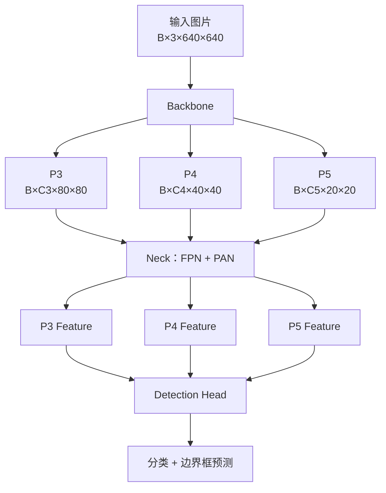

三个特征层的分辨率：

| 特征层 | Stride | 特征图尺寸 | 主要用途 |
| --- | ---: | ---: | --- |
| P3 | 8 | 80×80 | 小目标 |
| P4 | 16 | 40×40 | 中目标 |
| P5 | 32 | 20×20 | 大目标 |


为什么叫 P3、P4、P5？

它们表示不同下采样倍率的特征层。

例如：

$$P3=\frac{640}{8}=80$$

$$P4=\frac{640}{16}=40$$

$$P5=\frac{640}{32}=20$$

三个特征图总共包含：

$$N=80^2+40^2+20^2$$

$$\boxed{N=8400}$$

也就是说，常规 YOLO 检测 Head 在 640×640 输入下，一共需要处理 8400 个候选位置。

---

## 三、YOLO11 的网络架构
### 3.1 YOLO11 整体结构
YOLO11 的检测模型主要由以下模块组成：

```latex
Input
  |
  v
Backbone
  |
  +-- Conv
  |
  +-- C3k2
  |
  +-- Conv
  |
  +-- C3k2
  |
  +-- Conv
  |
  +-- C3k2
  |
  +-- Conv
  |
  +-- C3k2
  |
  +-- SPPF
  |
  +-- C2PSA
  |
  v
Neck
  |
  +-- Upsample
  |
  +-- Concat
  |
  +-- C3k2
  |
  +-- Upsample
  |
  +-- Concat
  |
  +-- C3k2
  |
  +-- Conv
  |
  +-- Concat
  |
  +-- C3k2
  |
  +-- Conv
  |
  +-- Concat
  |
  +-- C3k2
  |
  v
Detection Head
  |
  +-- P3
  +-- P4
  +-- P5
  |
  v
Detection Results
```

对应官方 YAML：

[https://github.com/ultralytics/ultralytics/blob/main/ultralytics/cfg/models/11/yolo11.yaml](https://github.com/ultralytics/ultralytics/blob/main/ultralytics/cfg/models/11/yolo11.yaml)

### 3.2 YOLO11 的模型规模
YOLO11 提供五种模型规模：

+ YOLO11n：Nano。
+ YOLO11s：Small。
+ YOLO11m：Medium。
+ YOLO11l：Large。
+ YOLO11x：Extra Large。

官方 YAML 中通过三个参数控制模型规模：

```yaml
scales:
  # [depth, width, max_channels]
  n: [0.50, 0.25, 1024]
  s: [0.50, 0.50, 1024]
  m: [0.50, 1.00, 512]
  l: [1.00, 1.00, 512]
  x: [1.00, 1.50, 512]
```

三个参数：

**Depth Multiple：深度系数**

控制网络中重复模块的数量。

假设 YAML 中某个模块重复 6 次：

$$N=\max(\operatorname{round}(6\times d),1)$$

如果：

$$d=0.5$$

那么：

$$N=3$$

**Width Multiple：宽度系数**

控制网络通道数量。

假设原始通道为 256：

$$C=256\times w$$

如果：

$$w=0.25$$

则：

$$C=64$$

实际实现还会考虑通道对齐和最大通道限制。

**Max Channels：最大通道数**

限制网络通道数，避免大型模型的通道无限增长。

因此：

YOLO11n 和 YOLO11x 并不是两套完全独立的网络结构，而是通过深度和宽度缩放得到的不同规模模型。

### 3.3 YOLO11 Backbone
官方 YAML：

```yaml
backbone:
  # [from, repeats, module, args]

  - [-1, 1, Conv, [64, 3, 2]]
  - [-1, 1, Conv, [128, 3, 2]]

  - [-1, 2, C3k2, [256, False, 0.25]]

  - [-1, 1, Conv, [256, 3, 2]]
  - [-1, 2, C3k2, [512, False, 0.25]]

  - [-1, 1, Conv, [512, 3, 2]]
  - [-1, 2, C3k2, [512, True]]

  - [-1, 1, Conv, [1024, 3, 2]]
  - [-1, 2, C3k2, [1024, True]]

  - [-1, 1, SPPF, [1024, 5]]
  - [-1, 2, C2PSA, [1024]]
```

整体结构：

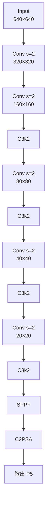

其中：

+ Conv 主要负责特征提取和下采样。
+ C3k2 负责特征提取、通道分流和特征融合。
+ SPPF 扩大感受野。
+ C2PSA 引入空间注意力。

最终 Backbone 输出三个主要尺度的特征：

P3：80×80。

P4：40×40。

P5：20×20。

### 3.4 YOLO11 Neck
YOLO11 使用 FPN + PAN 结构。

FPN：

Feature Pyramid Network。

主要负责自顶向下的语义特征传递。

PAN：

Path Aggregation Network。

主要负责自底向上的特征传递。

为什么需要两个方向？

深层特征：

+ 语义信息丰富。
+ 空间分辨率低。

浅层特征：

+ 空间信息丰富。
+ 语义信息相对较弱。

FPN 将深层语义信息传递到高分辨率特征层。

PAN 再将浅层定位信息向深层传递。

整体：

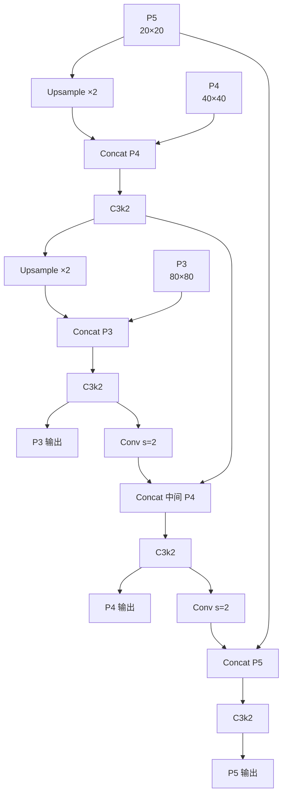

最终得到：

```latex
P3：80×80
P4：40×40
P5：20×20
```

三个特征层输入 Detection Head。

---

## 四、YOLO11 核心网络模块
这一部分重点理解 C3k2、SPPF、C2PSA。

### 4.1 Conv
Conv 是 YOLO 网络中最基础的模块。

Ultralytics 中的标准 Conv 通常由：

```latex
Conv2d
   |
   v
BatchNorm2d
   |
   v
SiLU
```

组成。

公式：

$$Y=SiLU(BN(W*X))$$

其中：

+ X：输入特征图。
+ W：卷积核。
+ BN：批归一化。
+ SiLU：激活函数。

SiLU：

$$SiLU(x)=x\cdot\sigma(x)$$

$$\sigma(x)=\frac{1}{1+e^{-x}}$$

对于一个普通卷积：

参数量：

$$P=K_hK_wC_{in}C_{out}$$

如果使用 Bias，还需要增加：

$$+C_{out}$$

如果使用 BatchNorm，还需要考虑其可学习的缩放和偏移参数。

卷积计算量近似为：

$$FLOPs=
2H_{out}W_{out}K_hK_wC_{in}C_{out}$$

这里按照一次乘法和一次加法分别计为一次 FLOP。

### 4.2 C2f
理解 C3k2 之前，先了解 C2f。

C2f 是一种基于 CSP 思想的特征提取模块。

CSP：

Cross Stage Partial Network。

其核心思想：

将输入特征分成不同路径，一部分直接保留，一部分经过多个特征提取模块，然后将不同路径的特征融合。

C2f 结构：

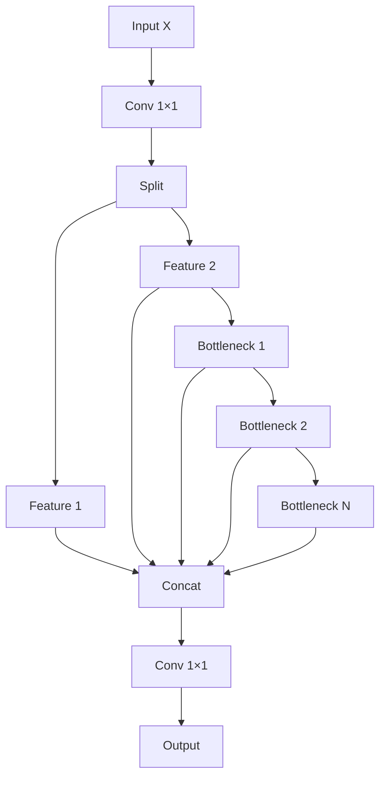

假设输入：

$$X\in\mathbb{R}^{B\times C_{in}\times H\times W}$$

首先经过 Conv：

$$C_{hidden}=C_{out}\times e$$

其中 e 是 Expansion Ratio。

然后分为两部分：

$$X_1,X_2\in
\mathbb{R}^{B\times C_{hidden}\times H\times W}$$

其中：

+ X1：保留的特征。
+ X2：进入 Bottleneck 的特征。

每个 Bottleneck 的输出继续输入下一个 Bottleneck。

最终将所有特征拼接：

$$Y=Concat(X_1,X_2,Y_1,\ldots,Y_n)$$

拼接后的通道数量：

$$C_{concat}=(2+n)C_{hidden}$$

最后通过一个 1×1 Conv 融合通道。

为什么这样设计？

相比仅保留最后一个 Bottleneck 输出，C2f 能够充分利用中间层特征。

同时，分流结构能够改善梯度传播，并控制计算量。

### 4.3 C3k2
C3k2 是 YOLO11 的核心模块之一。

官方源码：

[https://github.com/ultralytics/ultralytics/blob/main/ultralytics/nn/modules/block.py](https://github.com/ultralytics/ultralytics/blob/main/ultralytics/nn/modules/block.py)

它继承自 C2f。

因此可以理解为：

**C3k2 = C2f 框架 + 可配置的内部特征提取模块。**

其内部可以使用：

1. Bottleneck。
2. C3k。
3. Bottleneck + PSABlock。

由不同参数决定。

C3k2 的主要参数：

```python
C3k2(
    c1,
    c2,
    n=1,
    c3k=False,
    e=0.5,
    attn=False,
    g=1,
    shortcut=True
)
```

其中：

| 参数 | 含义 |
| --- | --- |
| c1 | 输入通道数 |
| c2 | 输出通道数 |
| n | 内部模块重复次数 |
| c3k | 是否使用 C3k |
| e | Expansion Ratio |
| attn | 是否使用注意力模块 |
| g | Group 数量 |
| shortcut | 是否使用残差连接 |


其结构：

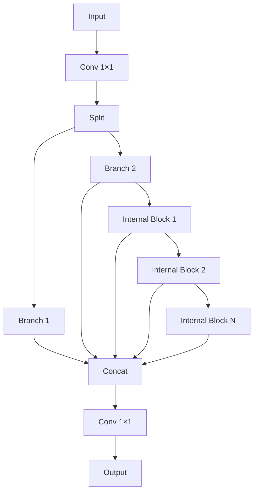

注意：

内部 Bottleneck 是串联的。

Concat 则保留不同阶段的输出。

#### C3k 是什么？
C3k 也是一种 CSP Bottleneck 结构。

它通过多个卷积和内部 Bottleneck 进行特征提取。

相比普通 Bottleneck，C3k 可以配置内部卷积核大小。

在 C3k2 中：

```python
C3k(self.c, self.c, 2, shortcut, g)
```

表示内部使用 C3k 模块。

而当：

```python
c3k=False
```

内部则使用普通 Bottleneck。

因此：

YOLO11 并不是所有 C3k2 都使用 C3k。

需要结合 YAML 中每一层的参数判断。

#### YOLO11 中 C3k2 的使用
例如：

```yaml
- [-1, 2, C3k2, [256, False, 0.25]]
```

含义：

+ 输出通道为 256（经过模型宽度缩放后）。
+ 重复次数为 2（还需要经过深度缩放）。
+ c3k=False。
+ Expansion Ratio 为 0.25。

而：

```yaml
- [-1, 2, C3k2, [512, True]]
```

表示：

+ 使用 C3k。
+ Expansion Ratio 默认 0.5。

这说明不同网络阶段可以使用不同复杂度的内部模块。

### 4.4 SPPF
SPPF：

Spatial Pyramid Pooling - Fast。

作用：

扩大感受野，让网络在不明显增加特征图尺寸的情况下获取更大范围的上下文信息。

为什么需要扩大感受野？

假设检测一个大目标：

如果网络只关注局部区域，可能无法充分理解目标整体结构。

通过多尺度池化，可以让网络同时获取不同范围的上下文信息。

SPPF 使用连续的 MaxPool：

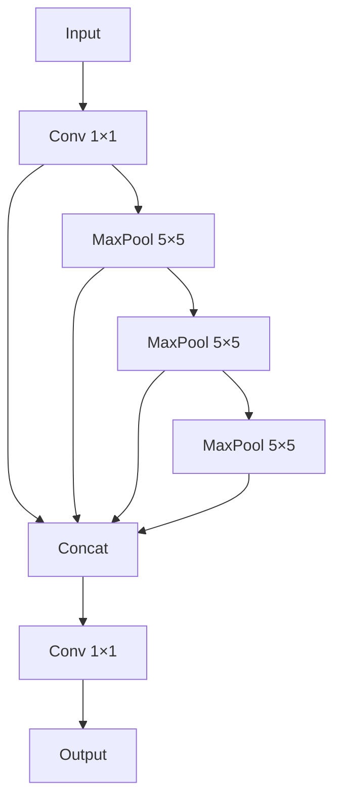

连续使用三次 5×5 池化，相当于逐渐扩大感受野。

其有效感受野大小：

第一次：

$$K_1=5$$

第二次：

$$K_2=5+5-1=9$$

第三次：

$$K_3=9+5-1=13$$

因此可以得到：

```latex
原始特征

5×5 池化特征

9×9 等效池化特征

13×13 等效池化特征
```

最后将这些特征拼接，再经过卷积融合。

相比直接并行使用 5×5、9×9、13×13 池化，SPPF 使用连续的 5×5 池化，计算更加高效。

### 4.5 C2PSA
C2PSA 是 YOLO11 引入的重要注意力模块。

PSA：

Position-Sensitive Attention。

它的主要作用：

在特征图上引入空间注意力，让网络能够建立不同空间位置之间的关系。

C2PSA 的整体结构：

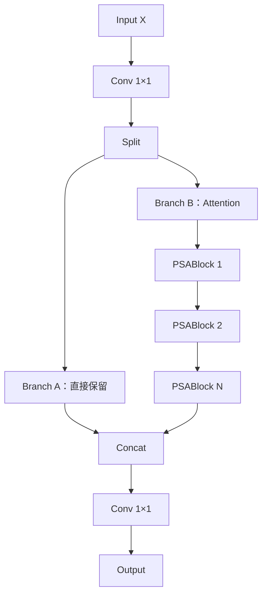

首先：

$$C_{hidden}=C_{in}\times0.5$$

通过 1×1 Conv 将通道变为：

$$2C_{hidden}$$

然后分为两个分支：

$$A,B\in\mathbb{R}^{B\times C_{hidden}\times H\times W}$$

其中：

+ A：直接保留。
+ B：经过多个 PSABlock。

最后：

$$Y=Conv(Concat(A,PSA(B)))$$

#### PSABlock 内部结构
PSABlock 主要包含：

1. Multi-Head Attention。
2. FFN。
3. Residual Connection。

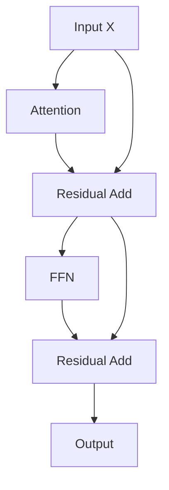

Attention 内部：

首先使用 1×1 Conv 产生 Q、K、V。

假设：

$$X\in\mathbb{R}^{B\times C\times H\times W}$$

空间位置数量：

$$N=H\times W$$

Attention Head 数量：

$$n_h=\max(C/64,1)$$

Head Dimension：

$$d_h=C/n_h$$

PSA 的注意力比例：

$$r=0.5$$

因此：

$$d_k=\lfloor d_h\times0.5\rfloor$$

每个 Head 的 Q、K 维度为 $d_k$，V 维度为 $d_h$。

将特征图展平为 N 个空间位置，计算：

$$A=
Softmax\left(
\frac{Q^TK}{\sqrt{d_k}}
\right)$$

其中：

$$A\in\mathbb{R}^{B\times n_h\times N\times N}$$

然后：

$$O=VA^T$$

再将结果恢复成二维特征图。

另外，源码还对 V 使用了 Depthwise 3×3 卷积作为位置编码分支：

$$O=Attention(Q,K,V)+DWConv_{3\times3}(V)$$

最终经过 1×1 Conv 投影。

这里需要注意：

C2PSA 的 Attention 是针对二维特征图空间位置进行计算的，并不是直接对原始图片像素进行 Attention。

#### 为什么使用 C2PSA？
随着网络不断下采样：

特征图分辨率降低，但语义信息增加。

C2PSA 通常放置在 Backbone 的深层位置。

这样可以在较低分辨率下进行空间注意力计算，减少 Attention 的计算成本。

例如：

输入：

$$[B,1024,20,20]$$

空间位置数量：

$$N=20\times20=400$$

Attention 需要处理的空间关系矩阵规模为：

$$400\times400$$

如果直接在 80×80 特征图上进行同样的 Attention：

$$6400\times6400$$

计算成本会大幅增加。

因此将注意力模块放置在深层特征上是一种较为合理的设计。

---

## 五、YOLO11 Detection Head
### 5.1 Anchor-Free 检测
YOLO11 使用 Anchor-Free 检测方式。

传统 Anchor-Based：

需要提前定义一系列 Anchor Boxes。

例如：

```latex
Anchor 1：小宽高比
Anchor 2：中等宽高比
Anchor 3：大宽高比
```

模型预测每个 Anchor 与目标之间的偏移量。

Anchor-Free：

不再预先设置大量具有固定宽高的 Anchor Boxes。

而是以特征图中的网格中心作为候选位置，直接预测目标边界框。

注意：

Anchor-Free 并不意味着没有 Anchor Points。

YOLO11 仍然需要通过特征图位置生成参考点，用于边界框解码。

### 5.2 Detection Head 的分支结构
YOLO11 使用 Decoupled Head。

将分类和边界框回归分开。

```mermaid
flowchart TD    A["P3 / P4 / P5 Features"] --> B["Detection Head"]
    B --> C["Box Regression Branch"]
    B --> D["Classification Branch"]
    C --> E["DFL + Box Decode"]
    D --> F["Class Scores"]
    E --> G["Detection Predictions"]
    F --> G
```

为什么分开？

分类和边界框回归的优化目标不同：

分类：

判断当前区域属于什么类别。

回归：

判断目标的具体位置和尺寸。

分离之后，两个任务可以使用不同的卷积结构和损失函数。

YOLO11 的分类分支还使用了 Depthwise Separable Convolution 进行轻量化。

### 5.3 YOLO11 的输出维度
YOLO11 检测 Head 使用：

```latex
nc = 80
reg_max = 16
```

每个候选位置的边界框回归输出：

$$4\times16=64$$

其中 4 代表：

+ Left。
+ Top。
+ Right。
+ Bottom。

分类输出：

$$80$$

因此每个位置的输出通道数：

$$C=4\times16+80$$

$$\boxed{C=144}$$

假设输入为 640×640：

候选位置数量：

$$N=8400$$

最终原始预测张量：

$$\boxed{
Y\in\mathbb{R}^{B\times144\times8400}
}$$

这里的 144 不是最终检测框的数量，而是每个候选位置的预测通道数量。

### 5.4 DFL：Distribution Focal Loss
DFL 是 YOLO11 边界框回归的重要组成部分。

DFL 全称：

Distribution Focal Loss。

传统直接回归：

模型直接预测一个距离值：

$$d=12.5$$

DFL：

模型预测一个离散概率分布，再通过期望得到最终距离。

假设：

$$reg\_max=16$$

那么每个边界距离有 16 个 Bin：

```latex
Bin：

0, 1, 2, 3, ..., 15
```

模型输出：

$$z\in\mathbb{R}^{16}$$

经过 Softmax：

$$p_i=
\frac{e^{z_i}}
{\sum_{j=0}^{15}e^{z_j}}$$

最终距离：

$$\boxed{
d=\sum_{i=0}^{15}i\cdot p_i
}$$

例如：

```latex
Bin 10：0.1

Bin 11：0.2

Bin 12：0.5

Bin 13：0.2
```

最终：

$$d=10\times0.1+
11\times0.2+
12\times0.5+
13\times0.2$$

$$d=11.8$$

因此模型最终可以输出连续的距离值。

#### 为什么使用 DFL？
直接回归：

模型需要学习一个连续数值。

DFL：

模型学习一个概率分布，再通过期望获得连续数值。

这种方式能够提供更细致的边界框监督信号。

但它也增加了输出通道数量和计算量。

### 5.5 边界框解码
DFL 输出四个距离：

$$(l,t,r,b)$$

假设参考点：

$$(a_x,a_y)$$

特征图对应的 Stride：

$$s$$

那么：

$$x_1=a_x-ls$$

$$y_1=a_y-ts$$

$$x_2=a_x+rs$$

$$y_2=a_y+bs$$

最终得到：

$$B=(x_1,y_1,x_2,y_2)$$

再结合分类分数得到最终检测结果。

### 5.6 YOLO11 的主要检测损失
主要包含三个部分：

**分类损失：**

使用 BCE Loss。

$$L_{cls}=BCE(p,y)$$

**边界框损失：**

使用 IoU 系列损失，Ultralytics 检测实现中使用 CIoU。

$$L_{box}=1-CIoU(B_{pred},B_{gt})$$

**DFL 损失：**

约束边界距离分布。

$$L_{dfl}=DFL(z,d_{gt})$$

总损失：

$$\boxed{
L=L_{box}+L_{cls}+L_{dfl}
}$$

实际训练中还会受到不同损失权重的影响。

---

## 六、YOLO26 的整体架构
### 6.1 YOLO26 的主要变化
YOLO26 是建立在 YOLO11 基础上的改进模型。

它没有完全重新设计 Backbone，而是重点优化了检测流程。

主要创新：

| 改进 | 解决的问题 |
| --- | --- |
| Dual-Head | 同时支持 One-to-Many 和 One-to-One |
| NMS-Free | 减少推理后处理 |
| DFL Removal | 减少检测 Head 计算量 |
| Direct Regression | 直接预测边界框距离 |
| STAL | 改善极小目标正样本分配 |
| Progressive Loss | 动态调整双分支训练权重 |
| MuSGD | 改善参数优化 |
| Task-Specific Heads | 改善 Pose、Segmentation、OBB 等任务 |


### 6.2 YOLO26 Backbone 和 Neck
YOLO26 仍然使用：

+ Conv。
+ C3k2。
+ SPPF。
+ C2PSA。
+ FPN。
+ PAN。

官方 YAML：

[https://github.com/ultralytics/ultralytics/blob/main/ultralytics/cfg/models/26/yolo26.yaml](https://github.com/ultralytics/ultralytics/blob/main/ultralytics/cfg/models/26/yolo26.yaml)

主要结构：

```yaml
backbone:
  - [-1, 1, Conv, [64, 3, 2]]
  - [-1, 1, Conv, [128, 3, 2]]
  - [-1, 2, C3k2, [256, False, 0.25]]
  - [-1, 1, Conv, [256, 3, 2]]
  - [-1, 2, C3k2, [512, False, 0.25]]
  - [-1, 1, Conv, [512, 3, 2]]
  - [-1, 2, C3k2, [512, True]]
  - [-1, 1, Conv, [1024, 3, 2]]
  - [-1, 2, C3k2, [1024, True]]
  - [-1, 1, SPPF, [1024, 5, 3, True]]
  - [-1, 2, C2PSA, [1024]]
```

与 YOLO11 相比：

1. SPPF 增加了 Shortcut 配置。
2. Neck 中的 C3k2 内部结构有所调整。
3. 最深层检测 Neck 中加入额外的注意力模块。

例如：

```yaml
- [-1, 1, C3k2, [1024, True, 0.5, True]]
```

这里：

```latex
c3k  = True
e    = 0.5
attn = True
```

根据 C3k2 源码，当 `attn=True` 时，内部模块采用：

```latex
Bottleneck
    |
    v
PSABlock
```

因此 YOLO26 在检测 Neck 的深层特征融合位置进一步引入注意力。

需要注意：

这并不代表 YOLO26 所有 C3k2 都加入了 Attention。

具体取决于 YAML 参数。

### 6.3 YOLO26 整体网络结构
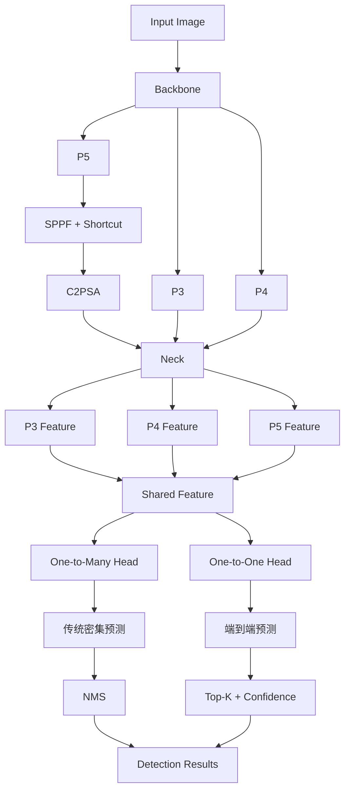

核心：

YOLO26 训练时使用两个检测分支，但两个分支共享 Backbone 和 Neck。

---

## 七、YOLO26 的 Dual-Head 与 NMS-Free
### 7.1 为什么传统 YOLO 需要 NMS？
传统 YOLO 在每个特征图位置上都会产生预测。

例如：

640×640 输入：

$$N=8400$$

意味着模型可能输出 8400 个候选位置的预测结果。

其中很多候选框可能对应同一个物体。

例如：

```latex
同一个物体：

预测框 A：0.95

预测框 B：0.91

预测框 C：0.87

预测框 D：0.75
```

如果不进行筛选，最终会出现多个重叠框。

因此需要 NMS：

Non-Maximum Suppression。

基本过程：

1. 按置信度排序。
2. 选择最高置信度的框。
3. 计算其余框与当前框的 IoU。
4. 删除重叠程度超过阈值的框。
5. 重复直到完成筛选。

流程：

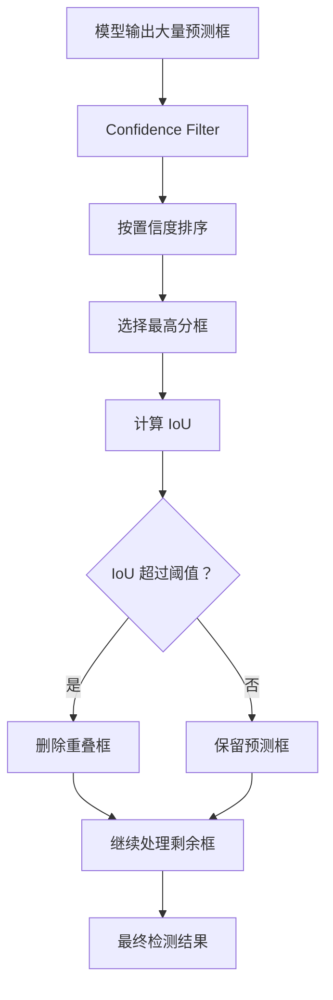

NMS 的问题：

+ 增加后处理时间。
+ 需要额外实现。
+ 不同硬件平台的实现可能不同。
+ 对密集目标、重叠目标的处理比较复杂。

### 7.2 YOLO26 的 One-to-Many Head
One-to-Many：

一个 Ground Truth 可以匹配多个正样本位置。

例如：

```latex
GT Object A

     |
     +---- Positive 1
     |
     +---- Positive 2
     |
     +---- Positive 3
     |
     +---- Positive 4
```

这种方式的优点：

+ 正样本数量较多。
+ 训练监督信号丰富。
+ 优化相对容易。

YOLO26 的 One-to-Many 使用 TAL。

主要配置：

$$TopK=10$$

输出仍然是传统 YOLO 密集预测格式。

640×640、80 类：

$$Y\in\mathbb{R}^{B\times84\times8400}$$

因为 YOLO26 不使用 DFL：

$$84=80+4$$

推理时仍然需要 NMS。

### 7.3 YOLO26 的 One-to-One Head
One-to-One：

每个 Ground Truth 最终只匹配一个正样本预测位置。

例如：

```latex
GT Object A
     |
     v
Prediction A

GT Object B
     |
     v
Prediction B

GT Object C
     |
     v
Prediction C
```

这样可以让网络直接学习：

每个目标应该产生一个主要预测结果。

YOLO26 的 One-to-One 使用两阶段筛选：

```latex
Task-Aligned Assignment
       |
       v
TopK = 7
       |
       v
Secondary TopK = 1
       |
       v
唯一正样本匹配
```

最终实现一对一匹配。

推理时：

不需要传统 NMS。

模型通过内部 Top-K 选择得到最多 300 个预测结果。

输出：

$$\boxed{
Y\in\mathbb{R}^{B\times300\times6}
}$$

每个预测包含：

```latex
[x1, y1, x2, y2, confidence, class_id]
```

### 7.4 双分支训练结构
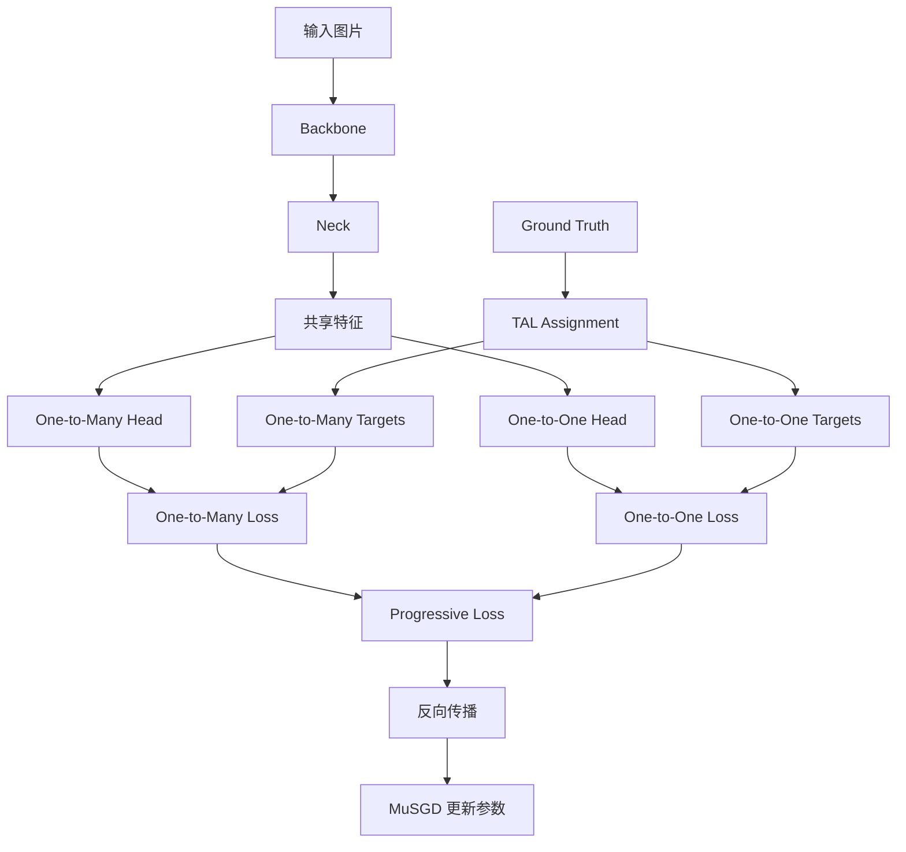

需要注意：

两个 Head 不是两个独立模型。

它们共享 Backbone 和 Neck，只是检测分支不同。

### 7.5 为什么同时保留两个 Head？
One-to-Many：

正样本丰富，容易训练。

One-to-One：

输出更加符合最终推理要求，但监督更加严格。

如果只训练 One-to-One：

模型早期可能缺乏足够的正样本监督。

如果只训练 One-to-Many：

模型推理仍然需要 NMS。

因此 YOLO26 采用双分支：

训练阶段利用 One-to-Many 提供丰富监督。

训练过程中逐渐加强 One-to-One 的优化。

最终推理时主要使用 One-to-One。

### 7.6 YOLO26 的 NMS-Free 是否完全没有后处理？
不是。

它不需要传统 IoU-NMS，但仍然需要：

+ Box Decoding。
+ Top-K 选择。
+ Confidence Threshold。
+ 坐标变换。

所以更准确的理解是：

**NMS-Free 不等于完全没有后处理，而是移除了传统基于 IoU 的重复框抑制流程。**

### 7.7 YOLO26 的输出与 YOLO11 有什么区别？
| 项目 | YOLO11 | YOLO26 One-to-Many | YOLO26 One-to-One |
| --- | --- | --- | --- |
| 输出形状 | B×(nc+64)×8400 | B×(nc+4)×8400 | B×300×6 |
| 边界框回归 | DFL | Direct | Direct |
| 候选位置 | 8400 | 8400 | Top-K 结果 |
| NMS | 需要 | 需要 | 不需要 |
| Box 格式 | xywh 解码路径 | xywh 解码路径 | xyxy |
| 最大检测数 | 由后处理限制 | 由后处理限制 | 默认 300 |


如果使用自定义 ONNX / TensorRT C++ 推理代码，需要特别注意输出格式变化。

---

## 八、YOLO26 移除 DFL：Direct Regression
### 8.1 为什么移除 DFL？
YOLO11 使用 DFL。

假设：

$$reg\_max=16$$

每个边界距离需要预测 16 个数值。

四个方向：

$$4\times16=64$$

YOLO26：

直接预测四个边界距离。

$$4\times1=4$$

这样检测 Head 的回归输出通道从 64 降低为 4。

以 80 类为例：

YOLO11：

$$C=80+64=144$$

YOLO26：

$$C=80+4=84$$

减少：

$$\frac{144-84}{144}
\approx41.67\%$$

注意：

这是每个候选位置的回归与分类输出通道总数的变化比例，不代表整个模型参数量减少 41.67%。

### 8.2 DFL 的最大回归范围
DFL 使用：

$$d=\sum_{i=0}^{15}i\cdot p_i$$

因此：

$$d\in[0,15]$$

实际距离还需要乘以特征层的 Stride。

例如：

P5：

$$s=32$$

最大单边距离：

$$d_{max}=15\times32$$

$$d_{max}=480$$

这意味着在对应特征层上，DFL 的单边距离存在有限的离散支持范围。

随着输入分辨率增加，较大目标可能需要更大的回归距离。

### 8.3 YOLO26 如何直接回归？
YOLO26：

```yaml
reg_max: 1
```

源码中：

```python
self.dfl = DFL(self.reg_max) if self.reg_max > 1 else nn.Identity()
```

因此：

$$reg\_max=1$$

时：

$$DFL=Identity$$

检测 Head 直接输出：

$$(l,t,r,b)$$

不再经过 16 个 Bin 的 Softmax 和期望计算。

### 8.4 移除 DFL 后如何保证定位精度？
YOLO26 不是简单地删除 DFL。

而是结合：

1. Direct Regression。
2. L1 Loss。
3. STAL。
4. Progressive Loss。
5. 双分支训练。

L1 Loss：

$$L_{L1}
=
\frac{1}{N}
\sum_{i=1}^{N}
|x_i-\hat{x}_i|$$

其中：

+ $x_i$：真实坐标。
+ $\hat{x}_i$：预测坐标。

它直接约束预测坐标与真实坐标之间的绝对误差。

注意：

YOLO26 的配置文件仍然保留 `dfl` 这一损失权重字段，以兼容已有训练配置。

但在 YOLO26 中，这个字段用于控制直接回归的 L1 损失权重，并不意味着模型仍然使用 DFL。

---

## 九、STAL：小目标标签分配策略
### 9.1 为什么小目标容易没有正样本？
这是 YOLO26 很值得关注的改进。

先看传统 TAL：

Task-Aligned Learning。

它会根据：

+ 分类分数。
+ IoU。
+ 特征点与 Ground Truth 的几何关系。

为每个 Ground Truth 选择正样本。

其中一个重要条件：

候选点的中心需要落在 Ground Truth Box 内部。

问题：

假设检测特征层最小 Stride：

$$s_{min}=8$$

特征图中相邻两个位置对应原图 8 个像素。

现在有一个非常小的目标：

```latex
目标宽度 = 4 px

目标高度 = 5 px
```

由于特征图离散化：

可能没有任何一个特征点中心落在这个目标内部。

结果：

```latex
Ground Truth

      +------+
      |      |
      +------+

特征点：

   ●       ●
       ●
   ●       ●
```

没有候选点落入 GT。

那么这个目标就没有正样本。

模型也就无法从这个目标获得正常的分类和定位监督。

### 9.2 STAL 的核心思想
STAL：

Small-Target-Aware Label Assignment。

它的思路：

**在候选位置筛选阶段，适当扩大极小目标的几何范围，但不改变真正用于回归的 Ground Truth。**

假设：

原始目标：

$$g_i=(x_i,y_i,w_i,h_i)$$

其中：

+ $x_i,y_i$：中心坐标。
+ $w_i,h_i$：宽高。

首先确定：

$$s_{min}=8$$

参考尺寸：

$$s_{ref}=16$$

如果目标某一个维度小于 8，则仅在候选位置筛选时，将该维度调整为 16。

公式：

$$\tilde{d}_i=
\begin{cases}
s_{ref},&d_i<s_{min}\\
d_i,&\text{otherwise}
\end{cases}$$

其中：

$$d_i\in\{w_i,h_i\}$$

得到新的候选筛选框：

$$\tilde{g}_i=
(x_i,y_i,\tilde{w}_i,\tilde{h}_i)$$

然后根据新的几何范围判断候选点：

$$M_{ij}=
\begin{cases}
1,&a_j\in\tilde{g}_i\\
0,&a_j\notin\tilde{g}_i
\end{cases}$$

其中 $a_j$ 是特征图中的候选点中心。

### 9.3 STAL 举例
假设：

```latex
原始 GT：

宽度 = 5 px
高度 = 12 px

最小 Stride = 8

参考尺寸 = 16
```

候选筛选时：

$$\tilde{w}=16$$

$$\tilde{h}=12$$

因此：

```latex
候选筛选框：

16 × 12
```

但真正用于边界框回归的仍然是：

```latex
5 × 12
```

这点非常重要：

STAL 不会真的把 GT 标注框扩大。

它只改变正样本候选位置的筛选范围。

完整流程：

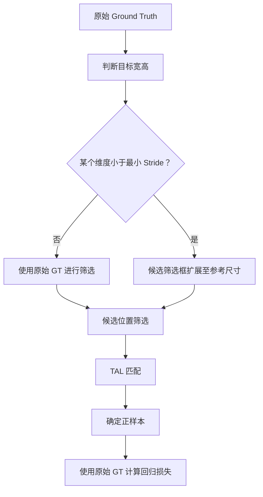

### 9.4 STAL 的意义与局限
它主要解决：

+ 极小目标没有正样本。
+ 特征图离散化导致的候选点缺失。
+ 小目标监督信号不足。

但它并不意味着：

+ 网络分辨率提高了。
+ 新增了 P2 检测头。
+ 特征图的空间细节增加了。
+ 所有小目标都能被检测出来。

如果目标本身只有几个像素，模型可能仍然无法提取足够的视觉信息。

STAL 解决的是标签分配问题，不是所有小目标检测问题。

---

## 十、Progressive Loss：渐进式损失权重
### 10.1 为什么需要 Progressive Loss？
YOLO26 有两个检测分支：

One-to-Many。

One-to-One。

两者的优化难度不同。

One-to-Many：

+ 正样本更多。
+ 监督信号丰富。
+ 训练早期更容易收敛。

One-to-One：

+ 正样本更少。
+ 匹配更加严格。
+ 直接决定最终 NMS-Free 推理效果。

如果两个分支始终使用相同的 Loss 权重：

One-to-Many 可能在训练中占据较大优势。

导致最终真正用于推理的 One-to-One 分支优化不充分。

### 10.2 Progressive Loss 的核心思想
训练初期：

更多依赖 One-to-Many。

训练后期：

逐渐增加 One-to-One 的训练权重。

总损失：

$$\boxed{
L=
\alpha(t)L_{one2many}
+
(1-\alpha(t))L_{one2one}
}$$

其中：

+ $t$：当前 Epoch。
+ $\alpha(t)$：One-to-Many 的权重。

YOLO26 的权重：

初始：

$$(\alpha_{init},1-\alpha_{init})
=
(0.8,0.2)$$

最终：

$$(\alpha_{final},1-\alpha_{final})
=
(0.1,0.9)$$

也就是说：

```latex
训练初期：

One-to-Many = 80%

One-to-One  = 20%


训练后期：

One-to-Many = 10%

One-to-One  = 90%
```

### 10.3 权重如何变化？
使用线性变化：

$$\alpha(t)=
\max\left(
1-\frac{t}{\max(E-1,1)},0
\right)
(\alpha_{init}-\alpha_{final})
+\alpha_{final}$$

其中：

+ E：总 Epoch 数。
+ t：当前 Epoch。
例如：

总训练 Epoch：

$$E=100$$

初始权重：

$$\alpha_{init}=0.8$$

最终权重：

$$\alpha_{final}=0.1$$

那么：

| 训练进度 | One-to-Many | One-to-One |
| --- | ---: | ---: |
| 0% | 80% | 20% |
| 25% | 62.5% | 37.5% |
| 50% | 45% | 55% |
| 75% | 27.5% | 72.5% |
| 100% | 10% | 90% |


整体：

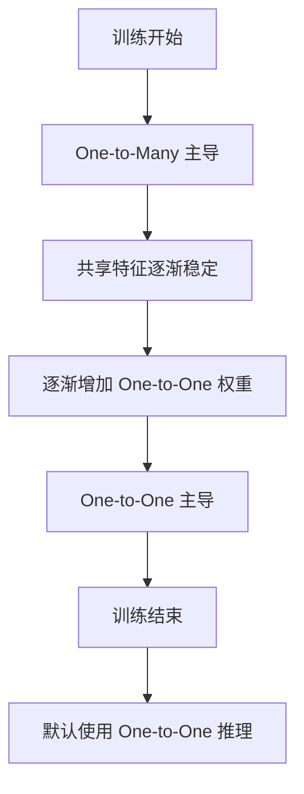

这样能够让训练过程逐渐从丰富的密集监督转向最终部署所需要的预测方式。

---

## 十一、MuSGD：YOLO26 的优化器
### 11.1 为什么引入 MuSGD？
YOLO11 常见的训练优化器是 SGD、AdamW 等。

YOLO26 引入：

MuSGD。

它将：

+ Muon。
+ SGD with Momentum。

结合起来。

Muon 是一种主要面向多维参数矩阵的优化器。

其特点：

在动量更新的基础上，使用 Newton-Schulz 迭代对更新矩阵进行正交化处理。

论文认为，这种方式能够改善参数更新的条件性，并提高训练效率。

### 11.2 MuSGD 的核心思想
SGD：

$$\theta_{t+1}
=
\theta_t-\eta g_t$$

加入 Momentum：

$$m_t=\beta m_{t-1}+g_t$$

$$\theta_{t+1}
=
\theta_t-\eta m_t$$

Muon：

在动量更新之后，对多维参数的更新方向进行正交化处理。

简化表示：

$$U_t=Orthogonalize(m_t)$$

Muon 更新：

$$\theta_{t+1}
=
\theta_t-\eta U_t$$

MuSGD 则将 Muon 和 SGD 的更新进行加权组合。

对于多维参数：

$$\boxed{
\Delta\theta=
\lambda_m\Delta\theta_{Muon}
+
\lambda_s\Delta\theta_{SGD}
}$$

对于一维参数，例如：

+ Bias。
+ Normalization Scale。

使用普通 SGD 更新。

注意：

这里是便于理解的简化表达，实际更新还包括动量、权重衰减和 Muon 的矩阵正交化细节。

### 11.3 Newton-Schulz 迭代
Muon 的一个重要步骤是正交化。

Newton-Schulz 是一种矩阵迭代方法。

其目标是得到近似正交的矩阵。

对于矩阵 X：

$$X^TX\approx I$$

迭代过程中，通过矩阵乘法不断修正矩阵的奇异值结构。

可以将其理解为：

```latex
原始梯度动量矩阵
        |
        v
矩阵归一化
        |
        v
Newton-Schulz 迭代
        |
        v
近似正交更新矩阵
        |
        v
参数更新
```

### 11.4 MuSGD 的参数分配
YOLO26 的 MuSGD：

| 参数类型 | 更新方式 |
| --- | --- |
| Conv Weights | Muon + SGD |
| Linear Weights | Muon + SGD |
| Bias | SGD |
| Normalization Parameters | SGD |


为什么这样设计？

卷积核和 Linear 权重通常是多维矩阵。

它们适合使用 Muon 的矩阵正交化更新。

而 Bias、Normalization Scale 等参数通常是一维向量，直接使用 SGD 更合适。

---

## 十二、YOLO26 针对不同任务的改进
YOLO26 不仅针对 Detection 进行了优化，还针对 Segmentation、Pose 和 OBB 设计了专门的改进。

### 12.1 Instance Segmentation
传统 YOLO 实例分割使用 Prototype + Mask Coefficients。

核心：

先生成一组共享的 Mask Prototypes。

每个目标预测一组系数。

通过线性组合得到最终 Mask。

假设：

$$P\in\mathbb{R}^{K\times H\times W}$$

其中：

K 是 Prototype 数量。

某个实例的系数：

$$c_i\in\mathbb{R}^{K}$$

最终 Mask：

$$\boxed{
M_i=\sum_{k=1}^{K}c_{ik}P_k
}$$

YOLO26 保留了这一基本思想。

但增加了两个改进：

1. Multi-Scale Proto Module。
2. Auxiliary Semantic Segmentation Loss。

#### Multi-Scale Proto
传统方法主要使用高分辨率特征生成 Prototype。

YOLO26 则融合多个尺度的特征：

$$F_{proto}
=
X_1+
\sum_{\ell=2}^{L}
U(\phi_\ell(X_\ell))$$

其中：

+ $X_1$：最高分辨率特征。
+ $\phi_\ell$：1×1 Conv 投影。
+ U：上采样。

然后生成：

$$P=\tilde G(F_{proto})$$

这样可以同时利用：

+ 浅层空间细节。
+ 深层语义信息。

#### Auxiliary Semantic Segmentation Loss
YOLO26 还加入一个辅助语义分割分支。

训练时：

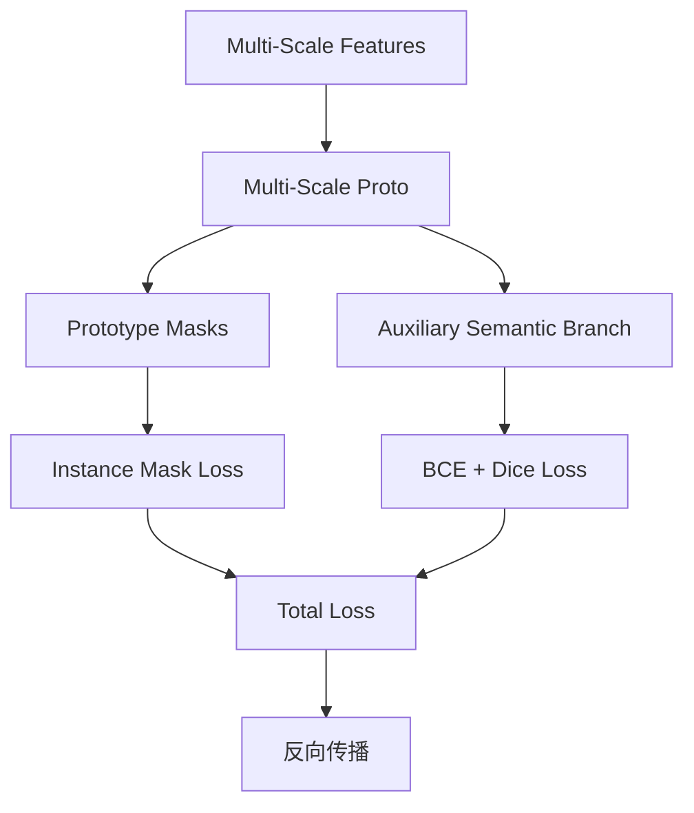

辅助分支只在训练阶段使用。

推理和模型融合时会移除，因此不会额外增加最终推理成本。

### 12.2 Pose Estimation
YOLO26 的 Pose 改进非常值得关注。

传统 YOLO Pose：

直接预测：

+ Keypoint X。
+ Keypoint Y。
+ Visibility。

并使用 OKS Loss 等进行监督。

YOLO26 在此基础上加入：

RLE：

Residual Log-Likelihood Estimation。

核心思想：

不同关键点的定位不确定性不同。

例如：

+ 清晰可见的关键点：定位容易。
+ 被遮挡的关键点：定位困难。
+ 模糊的关键点：可能存在多种合理位置。

如果所有关键点都使用相同的误差建模方式，就无法充分表达这种不确定性。

#### Sigma Branch
YOLO26 为每个关键点增加一个不确定性预测分支。

预测：

$$\sigma=(\sigma_x,\sigma_y)$$

然后计算归一化残差：

$$\boxed{
\varepsilon=
\frac{\hat{x}-x^*}{\sigma}
}$$

其中：

+ $\hat{x}$：预测坐标。
+ $x^*$：真实坐标。
+ $\sigma$：预测的不确定性。

接下来使用 RealNVP Normalizing Flow 学习残差分布。

RLE Loss：

$$L_{RLE}
=
\log\sigma
-
\log\varphi(\varepsilon)
+
L_q(\sigma,\varepsilon)$$

其中：

+ $\varphi$：学习到的残差概率密度。
+ $L_q$：基础概率分布的负对数似然项。

可以理解为：

模型不只是预测关键点在哪里，还要学习自己对这个位置有多大把握。

#### Pose 完整结构
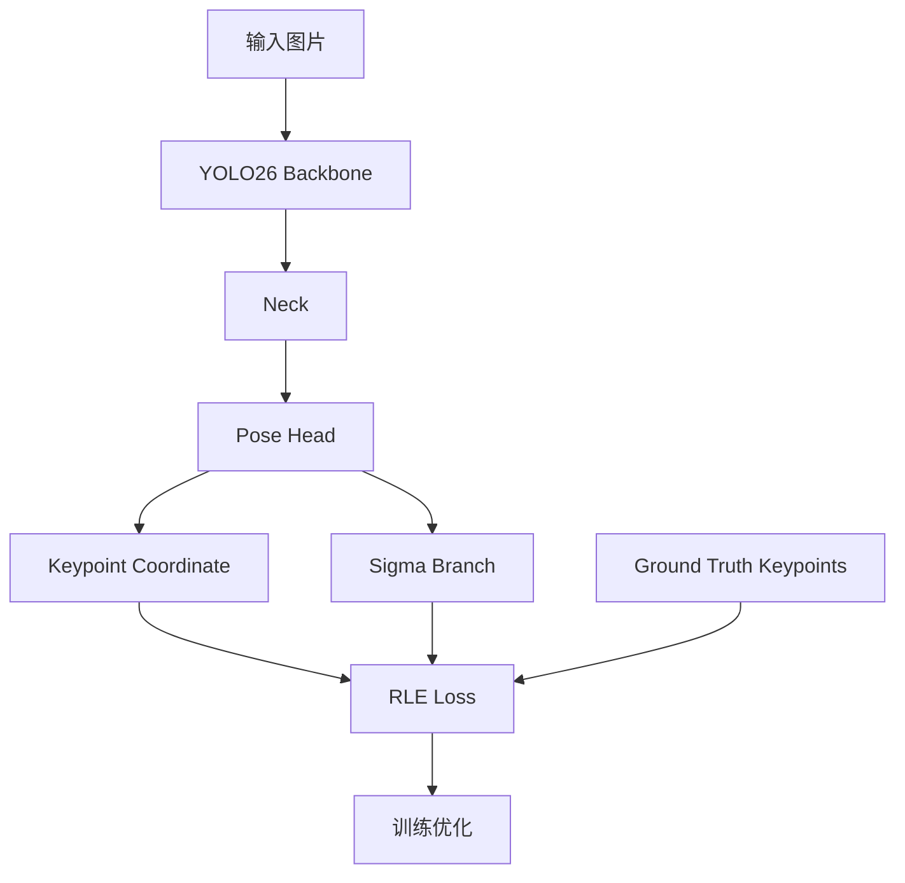

注意：

Sigma Branch 主要用于训练时的不确定性建模，最终标准 Pose 推理输出仍然是关键点坐标和可见性等信息。

### 12.3 Oriented Bounding Box
OBB：

Oriented Bounding Box。

用于检测具有方向的目标。

例如：

+ 遥感飞机。
+ 船舶。
+ 旋转车辆。
+ 细长物体。

传统水平框：

$$(x,y,w,h)$$

OBB：

$$(x,y,w,h,\theta)$$

其中：

$\theta$ 表示旋转角度。

YOLO26 对 OBB 主要进行两个改进。

**第一：Long-Edge Definition**

传统角度定义存在宽高交换问题。

YOLO26 使用 Long-Edge Definition：

$$w\ge h$$

角度范围：

$$\boxed{
\theta\in[-45^\circ,135^\circ)
}$$

这样可以降低接近边界角度时的宽高交换问题。

**第二：Square-Object Angle Loss**

对于正方形或接近正方形的目标：

即使旋转一定角度，几何形状也可能几乎不变。

因此单纯依赖旋转 IoU 可能无法提供足够稳定的角度监督。

YOLO26 加入专门的角度损失：

$$L_{angle}
=
\frac{1}{S}
\sum_{i\in\mathcal{F}}
q_i\omega_i
\sin^2(2\Delta\theta_i)$$

其中：

+ $q_i$：标签分配权重。
+ $\omega_i$：宽高比相关权重。
+ $\Delta\theta_i$：角度误差。

主要作用：

加强正方形和近正方形目标的角度预测稳定性。

---

## 十三、YOLO11 与 YOLO26 的参数量和计算量
### 13.1 YOLO11 参数量
官方 YOLO11n：

| 模型 | Params | FLOPs |
| --- | ---: | ---: |
| YOLO11n | 2.6M | 6.5G |
| YOLO11s | 9.4M | 21.5G |
| YOLO11m | 20.1M | 68.0G |
| YOLO11l | 25.3M | 86.9G |
| YOLO11x | 56.9M | 194.9G |


### 13.2 YOLO26 参数量
官方 YOLO26：

| 模型 | Params | FLOPs |
| --- | ---: | ---: |
| YOLO26n | 2.4M | 5.4G |
| YOLO26s | 9.5M | 20.7G |
| YOLO26m | 20.4M | 68.2G |
| YOLO26l | 24.8M | 86.4G |
| YOLO26x | 55.7M | 193.9G |


注意：

YOLO26 官方性能表中的参数量和 FLOPs 是经过 `model.fuse()` 后的统计结果。

Fusion 会：

+ 合并 Conv 和 BatchNorm。
+ 移除不再使用的 One-to-Many 辅助检测分支。

因此不能直接把它与未经融合的训练模型参数量混为一谈。

### 13.3 为什么 YOLO26 的参数量没有明显减少？
因为 YOLO26 的主要创新并不是大幅改变 Backbone。

它主要优化：

+ Detection Head。
+ DFL。
+ 双分支训练。
+ Label Assignment。
+ Loss。
+ Optimizer。

因此整体参数量不会出现特别大的变化。

但检测 Head 的回归通道已经明显减少。

这对于：

+ Nano 模型。
+ CPU 推理。
+ 端侧部署。
+ 模型导出。

具有实际意义。

---

## 十四、YOLO11 与 YOLO26 的 COCO 性能比较
### 14.1 Detection 性能
官方数据：

输入尺寸：

640×640。

| 模型 | YOLO11 mAP50-95 | YOLO26 mAP50-95 | YOLO26 E2E mAP |
| --- | ---: | ---: | ---: |
| n | 39.5 | 40.9 | 40.1 |
| s | 47.0 | 48.6 | 47.8 |
| m | 51.5 | 53.1 | 52.5 |
| l | 53.4 | 55.0 | 54.4 |
| x | 54.7 | 57.5 | 56.9 |


这里需要注意：

YOLO26 有两种评估方式：

+ mAP：One-to-Many + NMS。
+ E2E mAP：One-to-One + NMS-Free。

与 YOLO11 进行常规检测精度比较时，应优先对比 YOLO26 的 One-to-Many mAP。

如果比较实际 NMS-Free 部署性能，则需要看 E2E mAP。

### 14.2 推理速度
官方测试环境：

+ CPU：Intel Xeon CPU @ 2.00 GHz。
+ GPU：NVIDIA T4。
+ TensorRT：TensorRT 10。
+ 输入：640×640。

| 模型 | YOLO11 CPU ONNX | YOLO26 CPU ONNX | YOLO11 T4 TRT | YOLO26 T4 TRT |
| --- | ---: | ---: | ---: | ---: |
| n | 56.1 ms | 38.9 ms | 1.5 ms | 1.7 ms |
| s | 90.0 ms | 87.2 ms | 2.5 ms | 2.5 ms |
| m | 183.2 ms | 220.0 ms | 4.7 ms | 4.7 ms |
| l | 238.6 ms | 286.2 ms | 6.2 ms | 6.2 ms |
| x | 462.8 ms | 525.8 ms | 11.3 ms | 11.8 ms |


这里有一个值得注意的现象：

YOLO26 并不是在所有硬件上都更快。

在官方 CPU ONNX 测试中，YOLO26n 明显更快。

但在 T4 TensorRT 测试中，两者的延迟接近，部分规模的 YOLO26 略慢。

原因：

+ NMS 的执行成本与硬件、实现方式有关。
+ TensorRT 本身已经能够高效处理很多后处理操作。
+ NMS-Free 的优势在不同部署平台上并不相同。

因此不能仅凭 NMS-Free 就认为所有设备上的推理速度一定提高。

### 14.3 Pose 性能
YOLO26 对 Pose 的改进比较明显。

COCO Keypoints：

| 模型 | YOLO11 mAP | YOLO26 E2E mAP |
| --- | ---: | ---: |
| n | 50.0 | 57.2 |
| s | 58.9 | 63.0 |
| m | 64.9 | 68.8 |
| l | 66.1 | 70.4 |
| x | 69.5 | 71.6 |


YOLO26 的 RLE 让模型能够学习关键点的不确定性。

论文报告：

不同模型规模下，Pose AP 相比 YOLO11 提升约 2.1～7.2。

### 14.4 Segmentation 和 OBB
YOLO26 的其他任务也进行了针对性优化。

**Instance Segmentation：**

论文报告：

+ Box AP 最高提升约 2.5。
+ Mask AP 最高提升约 3.7。

主要来自：

+ Multi-Scale Proto。
+ Auxiliary Semantic Segmentation Loss。

**OBB：**

论文报告：

相比 YOLO11，DOTA-v1.0 上的 mAP 提升约 2.5～3.4。

主要来自：

+ Long-Edge Angle Definition。
+ Square-Object Angle Loss。
+ 更稳定的角度解码。

---

## 十五、YOLO26 的官方训练方案
### 15.1 官方预训练流程
YOLO26 发布的模型权重并不是直接在 COCO 上从随机初始化开始训练。

官方采用两阶段训练：

第一阶段：

Objects365-v1 Pretraining。

第二阶段：

COCO Fine-tuning。

训练配置：

| 参数 | Objects365 预训练 | COCO 微调 |
| --- | ---: | ---: |
| Image Size | 640 | 640 |
| Batch Size | 128 | 128 |
| Optimizer | MuSGD | MuSGD |
| Epoch | 150 | 按模型规模调整 |
| End2End | 非 E2E 预训练阶段 | True |


COCO 微调 Epoch：

| 模型 | Epoch |
| --- | ---: |
| n | 245 |
| s | 70 |
| m | 80 |
| l | 60 |
| x | 40 |


也就是说：

官方发布的 COCO 权重已经经过 Objects365 预训练。

这也是 COCO 微调 Epoch 相对较少的原因。

### 15.2 数据增强
官方 Objects365 预训练配置中使用：

+ Mosaic。
+ Copy-Paste。
+ Scale。
+ HSV。
+ Horizontal Flip。

其中 Mosaic 概率为 1.0。

训练后期关闭 Mosaic：

```latex
close_mosaic = 8
```

即最后若干 Epoch 不再使用 Mosaic。

这样可以让模型在训练后期逐渐适应真实图片分布。

### 15.3 自定义数据集训练
使用 Ultralytics API：

```python
from ultralytics import YOLO

# 加载预训练权重
model = YOLO("yolo26n.pt")

# 训练
results = model.train(
    data="data.yaml",
    epochs=300,
    imgsz=960,
    batch=32,
    workers=8,
    device=0
)
```

YOLO11：

```python
from ultralytics import YOLO

model = YOLO("yolo11n.pt")

results = model.train(
    data="data.yaml",
    epochs=300,
    imgsz=960,
    batch=32,
    workers=8,
    device=0
)
```

这里使用的是预训练权重迁移学习。

如果需要从随机初始化训练，可以使用对应的 YAML 架构文件，而不是加载 `.pt` 预训练权重。

---

## 十六、YOLO11/26 的不同任务模型
Ultralytics 将不同视觉任务整合在统一框架中。

### 16.1 Detection
模型：

```latex
yolo11n.pt
yolo11s.pt
yolo11m.pt
yolo11l.pt
yolo11x.pt

yolo26n.pt
yolo26s.pt
yolo26m.pt
yolo26l.pt
yolo26x.pt
```

### 16.2 Segmentation
模型：

```latex
yolo11n-seg.pt
yolo11s-seg.pt
yolo11m-seg.pt
yolo11l-seg.pt
yolo11x-seg.pt

yolo26n-seg.pt
yolo26s-seg.pt
yolo26m-seg.pt
yolo26l-seg.pt
yolo26x-seg.pt
```

### 16.3 Pose
模型：

```latex
yolo11n-pose.pt
yolo11s-pose.pt
yolo11m-pose.pt
yolo11l-pose.pt
yolo11x-pose.pt

yolo26n-pose.pt
yolo26s-pose.pt
yolo26m-pose.pt
yolo26l-pose.pt
yolo26x-pose.pt
```

### 16.4 OBB
模型：

```latex
yolo11n-obb.pt
yolo11s-obb.pt
yolo11m-obb.pt
yolo11l-obb.pt
yolo11x-obb.pt

yolo26n-obb.pt
yolo26s-obb.pt
yolo26m-obb.pt
yolo26l-obb.pt
yolo26x-obb.pt
```

### 16.5 Classification
模型：

```latex
yolo11n-cls.pt
yolo11s-cls.pt
yolo11m-cls.pt
yolo11l-cls.pt
yolo11x-cls.pt

yolo26n-cls.pt
yolo26s-cls.pt
yolo26m-cls.pt
yolo26l-cls.pt
yolo26x-cls.pt
```

另外，当前 YOLO26 官方文档还提供：

+ Semantic Segmentation。
+ Monocular Depth Estimation。

具体模型支持情况应以当前官方模型列表为准。

---

## 十七、YOLO26 的部署与推理
### 17.1 Python 推理
```python
from ultralytics import YOLO

model = YOLO("yolo26n.pt")

results = model.predict(
    source="test.jpg",
    imgsz=640,
    conf=0.25
)

for result in results:
    print(result.boxes.xyxy)
    print(result.boxes.conf)
    print(result.boxes.cls)
```

默认使用 YOLO26 的 One-to-One End-to-End 路径。

### 17.2 切换回传统 One-to-Many
如果希望使用传统输出格式：

```python
results = model.predict(
    source="test.jpg",
    end2end=False
)
```

此时：

+ 使用 One-to-Many Head。
+ 输出密集候选框。
+ 需要 NMS。

验证：

```python
metrics = model.val(
    data="data.yaml",
    end2end=False
)
```

导出：

```python
model.export(
    format="onnx",
    imgsz=640,
    end2end=False
)
```

### 17.3 YOLO11 与 YOLO26 的 ONNX 输出区别
YOLO11：

```latex
输入：

[1,3,640,640]

输出：

[1,84,8400]
```

假设 80 类：

$$84=80+4$$

这里是解码前的密集预测结果。

通常还需要：

1. 解析边界框。
2. 解析分类分数。
3. Confidence Filter。
4. NMS。
5. 坐标还原。

YOLO26 默认 End-to-End：

```latex
输入：

[1,3,640,640]

输出：

[1,300,6]
```

每个检测结果：

```latex
[x1,y1,x2,y2,confidence,class_id]
```

不需要传统 NMS。

后处理：

```python
detections = output[0]

detections = detections[
    detections[:, 4] > conf_threshold
]
```

即可进行置信度筛选。

### 17.4 YOLO26 的其他任务输出
以默认 COCO Pose 为例：

```latex
Detection：

[N,300,6]

Segmentation：

[N,300,38]

Prototype：

[N,32,160,160]

Pose：

[N,300,57]

OBB：

[N,300,7]
```

Pose 的 57：

$$6+17\times3=57$$

其中：

+ 6：边界框、置信度和类别。
+ 17×3：17 个关键点，每个关键点包含 x、y、visibility。

Segmentation 的 38：

$$6+32=38$$

其中 32 是 Mask Coefficients。

### 17.5 导出格式兼容性
当前官方文档列出的主要格式：

| 格式 | End-to-End 支持 |
| --- | --- |
| ONNX | 支持 |
| TensorRT | 支持 |
| CoreML | 支持 |
| OpenVINO | 支持 |
| LiteRT | 支持 |
| MNN | 支持 |
| NCNN | 自动回退 |
| RKNN | 自动回退 |
| PaddlePaddle | 自动回退 |
| ExecuTorch | 自动回退 |
| IMX | 自动回退 |
| Edge TPU | 自动回退 |
| Qualcomm QNN | 自动回退 |


这里的自动回退意味着：

如果目标导出格式无法支持 End-to-End 所需的算子，Ultralytics 会切换到 One-to-Many 路径。

因此：

部署时仍然需要 NMS。

注意：

具体支持情况会随着 Ultralytics 版本和推理后端更新而变化，实际部署前需要检查导出日志和 ONNX 输出结构。

---

## 十八、YOLO11 与 YOLO26 的实际选型
### 18.1 如果主要关注检测精度
建议同时比较：

+ YOLO11。
+ YOLO26 One-to-Many。
+ YOLO26 One-to-One。

不能只看 YOLO26 的 NMS-Free 结果。

因为：

One-to-Many 通常具有略高的 mAP。

One-to-One 则能够减少后处理。

### 18.2 如果主要关注小目标
YOLO26 引入 STAL 是一个积极改进。

但是需要明确：

STAL 解决的是正样本候选位置缺失问题。
如果小目标本身的图像信息不足，仍然需要考虑：

1. 提高输入分辨率。
2. 增加 P2 检测头。
3. 调整数据增强。
4. 改善标注质量。
5. 提高小目标样本比例。
6. 调整正负样本分配策略。

另外，YOLO26 官方提供 P2 和 P6 的架构 YAML，但这些变体没有对应的官方预训练权重，需要自行训练或微调。

### 18.3 如果主要关注密集目标
需要特别注意：

YOLO26 One-to-One 默认最大输出数量为：

$$max\_det=300$$

如果单张图片中可能存在大量目标，尤其是接近或超过 300 个目标时，需要关注：

+ 最大检测数量限制。
+ One-to-One 分支的训练设置。
+ Top-K 截断。
+ 密集目标之间的匹配冲突。

如果目标非常密集，可以同时测试 One-to-Many 路径。

它能够保留更加丰富的候选预测，但需要 NMS。

### 18.4 如果主要关注 Pose
YOLO26 引入 RLE 和不确定性建模，值得重点测试。

但需要注意：

如果数据集中关键点的标注质量不稳定，或者遮挡规则不统一，单纯更换模型并不能解决标注问题。

需要保证：

+ Keypoint 定义一致。
+ Visibility 规则一致。
+ 不同类别的关键点定义明确。
+ 难例标注具有一致性。

### 18.5 如果主要关注端侧部署
YOLO26 的优势主要体现在：

+ 减少 DFL 运算。
+ NMS-Free 推理。
+ 简化输出格式。
+ 减少 CPU 后处理。
+ 改善部分端侧推理性能。

但是具体是否更快，需要结合实际硬件测试。

例如：

TensorRT GPU 环境和纯 CPU ONNX 环境的收益可能完全不同。

---

## 十九、官方 GitHub 仓库与源码阅读路线
官方仓库：

[https://github.com/ultralytics/ultralytics](https://github.com/ultralytics/ultralytics)

### 19.1 主要目录
```latex
ultralytics/
│
├── cfg/
│   └── models/
│       ├── 11/
│       │   ├── yolo11.yaml
│       │   ├── yolo11-seg.yaml
│       │   ├── yolo11-pose.yaml
│       │   └── yolo11-obb.yaml
│       │
│       └── 26/
│           ├── yolo26.yaml
│           ├── yolo26-seg.yaml
│           ├── yolo26-pose.yaml
│           ├── yolo26-obb.yaml
│           ├── yolo26-p2.yaml
│           └── yolo26-p6.yaml
│
├── nn/
│   ├── modules/
│   │   ├── block.py
│   │   ├── conv.py
│   │   ├── head.py
│   │   └── transformer.py
│   │
│   ├── tasks.py
│   └── autobackend.py
│
├── engine/
│   ├── model.py
│   ├── trainer.py
│   ├── predictor.py
│   └── validator.py
│
├── utils/
│   ├── loss.py
│   ├── tal.py
│   └── ...
│
└── models/
    ├── yolo/
    └── ...
```

### 19.2 核心网络结构源码
| 文件 | 作用 |
| --- | --- |
| block.py | C3k2、C2PSA、SPPF、DFL 等模块 |
| conv.py | Conv、DWConv 等基础卷积模块 |
| head.py | Detect、Pose、Segment、OBB 等 Head |
| tasks.py | YAML 解析、模型构建、任务定义 |
| transformer.py | Transformer 相关模块 |


### 19.3 核心训练源码
| 文件 | 作用 |
| --- | --- |
| utils/loss.py | 各任务 Loss |
| utils/tal.py | Task-Aligned Assignment |
| engine/trainer.py | 训练主流程 |
| models/yolo/detect/train.py | 检测训练 |
| cfg/models/26 | YOLO26 模型配置 |


YOLO26 的核心实现可以重点搜索：

```latex
end2end

one2one_cv2

one2many_cv2

reg_max

E2ELoss

MuSGD

TaskAlignedAssigner

STAL
```

### 19.4 推荐源码阅读顺序
建议按照下面的顺序：

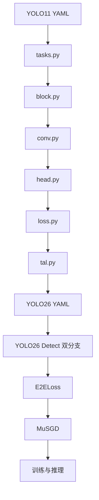

这样可以从模型结构逐步理解到训练和推理的具体实现。

---

## 二十、总结
### 20.1 YOLO11 的核心
YOLO11 的重点在于：

1. C3k2 特征提取模块。
2. C2PSA 空间注意力。
3. 改进的 Backbone 和 Neck。
4. 轻量化 Detection Head。
5. Anchor-Free + DFL 检测框回归。

它主要通过网络模块和特征融合方式的调整，提高准确率与计算效率。

### 20.2 YOLO26 的核心
YOLO26 的重点在于：

1. Dual-Head。
2. NMS-Free。
3. DFL Removal。
4. Direct Regression。
5. STAL。
6. Progressive Loss。
7. MuSGD。
8. Pose、Segmentation、OBB 的任务级改进。

它并不是通过大幅改变 Backbone 来提高性能，而是从检测训练、标签分配、预测方式和部署流程等方面进行优化。

### 20.3 两者最重要的区别
可以用一句话概括：

**YOLO11 主要优化如何提取和融合视觉特征；YOLO26 在保留主要特征提取框架的基础上，进一步优化如何训练检测器、如何预测目标以及如何部署模型。**

从实际工程角度：

+ YOLO11：结构成熟，适合常规目标检测与端侧部署。
+ YOLO26：更关注端到端检测、小目标标签分配和部署简化。
+ YOLO26 One-to-Many：适合需要传统密集预测和 NMS 的场景。
+ YOLO26 One-to-One：适合希望减少后处理、简化推理流程的场景。

选择模型时，最终仍然应该通过自己的数据集和目标硬件进行验证，而不是只依据 COCO 上的 mAP 或官方速度表。

---

## 二十一、参考资料与源码索引
### 21.1 YOLO11 官方资料
+ [YOLO11 官方文档](https://docs.ultralytics.com/models/yolo11)
+ [YOLO11 Detection YAML](https://github.com/ultralytics/ultralytics/blob/main/ultralytics/cfg/models/11/yolo11.yaml)
+ [YOLO11 Segmentation YAML](https://github.com/ultralytics/ultralytics/blob/main/ultralytics/cfg/models/11/yolo11-seg.yaml)
+ [YOLO11 Pose YAML](https://github.com/ultralytics/ultralytics/blob/main/ultralytics/cfg/models/11/yolo11-pose.yaml)
+ [YOLO11 OBB YAML](https://github.com/ultralytics/ultralytics/blob/main/ultralytics/cfg/models/11/yolo11-obb.yaml)

### 21.2 YOLO26 论文与官方资料
+ [YOLO26 论文](https://arxiv.org/abs/2606.03748)
+ [YOLO26 官方文档](https://docs.ultralytics.com/models/yolo26)
+ [YOLO26 GitHub YAML](https://github.com/ultralytics/ultralytics/blob/main/ultralytics/cfg/models/26/yolo26.yaml)
+ [YOLO26 Training Recipe](https://docs.ultralytics.com/guides/yolo26-training-recipe)
+ [YOLO26 End-to-End Detection](https://docs.ultralytics.com/guides/end2end-detection)

### 21.3 核心网络模块源码
+ [block.py](https://github.com/ultralytics/ultralytics/blob/main/ultralytics/nn/modules/block.py)
+ [conv.py](https://github.com/ultralytics/ultralytics/blob/main/ultralytics/nn/modules/conv.py)
+ [head.py](https://github.com/ultralytics/ultralytics/blob/main/ultralytics/nn/modules/head.py)
+ [tasks.py](https://github.com/ultralytics/ultralytics/blob/main/ultralytics/nn/tasks.py)

### 21.4 核心训练源码
+ [loss.py](https://github.com/ultralytics/ultralytics/blob/main/ultralytics/utils/loss.py)
+ [tal.py](https://github.com/ultralytics/ultralytics/blob/main/ultralytics/utils/tal.py)
+ [Trainer](https://github.com/ultralytics/ultralytics/blob/main/ultralytics/engine/trainer.py)

### 21.5 其他重要论文
+ [Generalized Focal Loss](https://arxiv.org/abs/2006.04388)
+ [TOOD: Task-Aligned One-Stage Object Detection](https://arxiv.org/abs/2108.07755)
+ [YOLOv10: Real-Time End-to-End Object Detection](https://arxiv.org/abs/2405.14458)
+ [Muon Is Scalable for LLM Training](https://arxiv.org/abs/2502.16982)
+ [Human Pose Regression with Residual Log-Likelihood Estimation](https://arxiv.org/abs/2107.11291)
+ [Density Estimation Using Real NVP](https://arxiv.org/abs/1605.08803)
