# YOLO11：网络架构、训练机制与源码解析

## 阅读说明

本文以 Ultralytics YOLO11 的**目标检测版本**为主要分析对象，按照四个阶段展开：

- **阶段 A：理解模型**——研究动机、任务定义、网络结构和单张图片的前向传播。
- **阶段 B：理解训练与推理**——研究初始化、标签分配、Loss、数据增强、预测解码和 NMS。
- **阶段 C：评价模型**——分析数据集、性能、架构改进、实验依据和模型局限。
- **阶段 D：复现与应用**——对应官方源码、训练命令、模型导出和部署。

YOLO11 还提供 Segmentation、Pose、OBB 和 Classification 等任务版本。它们会复用部分 Backbone，但任务 Head、输出形式和 Loss 不完全相同。本文重点解释 Detection 版本，不把检测分支的细节直接套用到其他任务。

**资料边界：**Ultralytics 官方明确说明，YOLO11 没有单独发表正式研究论文。因此，本文以官方模型文档、YAML 配置、源码和官方性能表为主要依据，不虚构论文 Figure、消融表或训练耗时。文中会区分官方事实、技术解释和基于结构的分析推断。

参考：[Ultralytics YOLO11 官方说明](https://docs.ultralytics.com/models/yolo11/)

---

# 阶段 A：理解模型（Understand the Model）

## 1. 研究背景与问题定义

### 1.1 YOLO11 的定位

YOLO11 是 Ultralytics 于 2024 年发布的实时视觉模型系列，延续单阶段检测器的基本思路：通过一次网络前向传播，同时预测图像中目标的位置和类别。

典型流程：

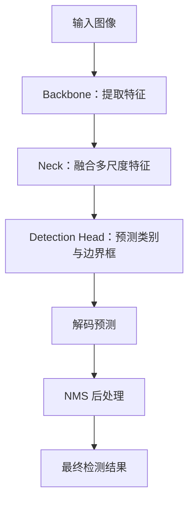

YOLO11 并没有彻底更换检测范式，而是在 YOLOv8 的单阶段、Anchor-Free、解耦检测头基础上，调整特征提取模块、深层注意力和分类分支。

### 1.2 YOLOv8 到 YOLO11 的主要变化

| 位置 | YOLOv8 | YOLO11 | 变化目的 |
|---|---|---|---|
| Backbone / Neck 特征块 | C2f | C3k2 | 调整 CSP 特征提取结构 |
| Backbone 深层 | SPPF 后无 C2PSA | SPPF 后增加 C2PSA | 建模深层空间关系 |
| Detect 分类分支 | 常规卷积 | Depthwise Separable Conv | 降低分类分支计算开销 |
| 检测范式 | Anchor-Free、Decoupled Head | 基本保持 | 沿用检测接口 |
| Box Regression | DFL，reg_max=16 | DFL，reg_max=16 | 沿用分布式回归 |
| 后处理 | NMS | NMS | 仍采用传统 NMS |

YOLO11 加入 C2PSA，并不意味着它变成了纯 Transformer 检测器。其主体仍是 CNN 特征提取网络，只在深层特征块中引入自注意力。

### 1.3 创新证据边界

从官方 YAML 和源码可以确认：

1. Backbone / Neck 使用 C3k2。
2. Backbone 末端在 SPPF 后接入 C2PSA。
3. Detect 分类分支使用深度可分离卷积。
4. 检测头仍为 Anchor-Free、Decoupled Head，并使用 DFL。
5. 标准检测推理仍然经过 NMS。

但官方没有提供完整的论文级消融表，不能仅凭最终 AP 提升就断言某一个模块贡献了多少 AP。要判断模块独立贡献，需要自行设计控制变量实验。

---

## 2. 任务定义与输入输出

### 2.1 输入

以 Batch Size=1、输入尺寸 640×640 为例，原始图像可以表示为：

$$
X\in\mathbb{R}^{B\times H\times W\times3}
$$

进入 PyTorch 网络前通常转换为 NCHW：

$$
X\in\mathbb{R}^{1\times3\times640\times640}
$$

推理预处理通常包括 Resize、必要的 Padding、BGR/RGB 转换、HWC 到 CHW 转换和像素归一化。具体以所使用的 Ultralytics Predictor 版本为准。

### 2.2 训练标签

每个 Ground Truth 通常由类别和边界框构成：

$$
y_i=(c_i,x_i,y_i,w_i,h_i)
$$

YOLO 标签文件通常使用归一化中心点格式：

$$
x_c=x_{pixel}/W,\quad y_c=y_{pixel}/H
$$

$$
w_n=w_{pixel}/W,\quad h_n=h_{pixel}/H
$$

进入 Loss 计算前，标签会结合当前图像尺寸还原，并转换成匹配和回归所需的坐标表示。

### 2.3 输出

对 COCO 80 类检测任务，最终需要输出 Bounding Box、Class Score 和 Class Index。

YOLO11 Detect Head 不单独输出传统 Anchor-Based 模型中的 Objectness 分支，而是为每个候选位置预测边界框分布和各类别分数。

---

## 3. 完整网络架构（Architecture Deep Dive）

### 3.1 整体结构

YOLO11 Detection 由 Backbone、Neck 和 Detection Head 组成：

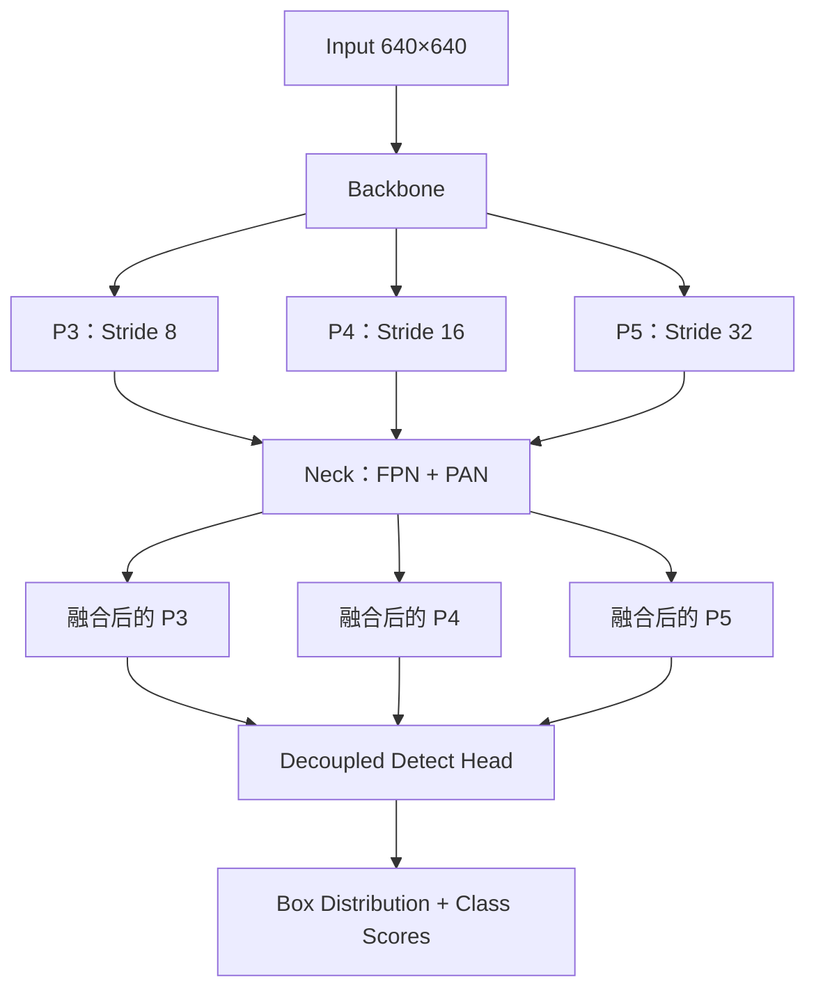

官方结构配置：[yolo11.yaml](https://github.com/ultralytics/ultralytics/blob/main/ultralytics/cfg/models/11/yolo11.yaml)。

### 3.2 模型规模

YOLO11 通过 Depth、Width 和 Max Channels 定义 n、s、m、l、x 五种规格：

| 规模 | Depth | Width | Max Channels |
|---|---:|---:|---:|
| n | 0.50 | 0.25 | 1024 |
| s | 0.50 | 0.50 | 1024 |
| m | 0.50 | 1.00 | 512 |
| l | 1.00 | 1.00 | 512 |
| x | 1.00 | 1.50 | 512 |

Depth 控制重复模块数量，Width 控制通道数。实际通道还会经过最大通道限制和 8 的倍数对齐。

需要注意：当前官方 parse_model() 对 m、l、x 规格会将 C3k2 的 c3k 参数设为 True。因此，不同规格的 C3k2 内部结构可能不同，不能只看 YAML 中的单个参数就认为所有规格完全相同。复现时必须结合模型规格和 parse_model() 检查实际实例化结果。

### 3.3 Backbone

Backbone 主要顺序：

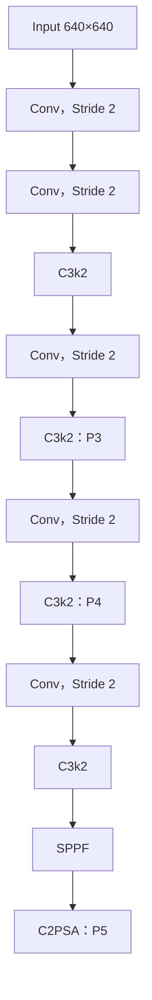

三个主要输出尺度为 P3、P4、P5，分别对应 Stride 8、16、32。

### 3.4 Neck：FPN + PAN

YOLO11 Neck 通过自顶向下的 FPN 和自底向上的 PAN 融合多尺度特征。

- FPN：将深层 P5 上采样，与 Backbone P4 Concat，再融合；继续上采样，与 Backbone P3 Concat，形成高分辨率特征。
- PAN：将融合后的 P3 下采样，与 P4 融合；再下采样，与 P5 融合，增强不同尺度之间的信息传递。

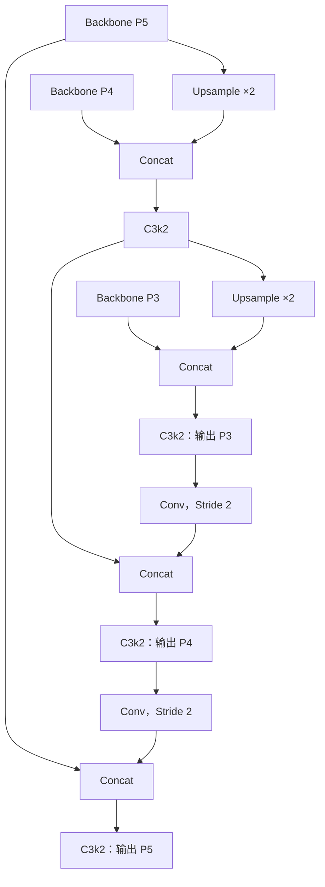

| 输出 | Stride | 640 输入时尺寸 | 主要作用 |
|---|---:|---:|---|
| P3 | 8 | 80×80 | 相对较小的目标 |
| P4 | 16 | 40×40 | 中等尺度目标 |
| P5 | 32 | 20×20 | 相对较大的目标 |

### 3.5 Conv 模块

Ultralytics 常用的标准 Conv 通常由 Conv2d、BatchNorm2d 和 SiLU 组成：

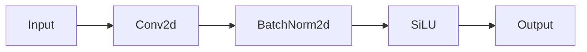

计算过程：

$$
Y=SiLU(BN(Conv(X)))
$$

$$
SiLU(x)=x\cdot\sigma(x),\quad
\sigma(x)=\frac{1}{1+e^{-x}}
$$

### 3.6 C3k2：从 C2f 到 C3k2

C3k2 是 YOLO11 Backbone 和 Neck 中大量使用的特征提取模块。源码位于 [nn/modules/block.py](https://github.com/ultralytics/ultralytics/blob/main/ultralytics/nn/modules/block.py)。

先看 C2f。输入经过 1×1 Conv 后沿通道拆分成两部分，其中一部分保留，另一部分依次通过多个 Bottleneck。初始分支和各个 Bottleneck 的输出最终全部 Concat，再通过 1×1 Conv 融合。

设隐藏通道为：

$$
c=\lfloor C_2\cdot e\rfloor
$$

拆分后每个分支的形状为：

$$
X_1,X_2\in\mathbb{R}^{B\times c\times H\times W}
$$

Concat 后的通道数为：

$$
C_{concat}=(n+2)c
$$

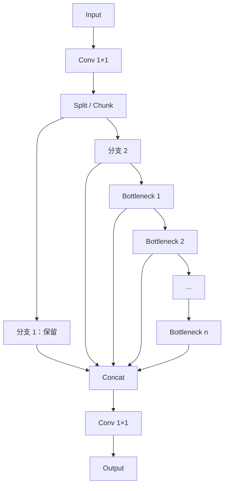

C3k2 继承 C2f 的分流、串联和 Concat 框架，但允许替换内部重复单元：

- c3k=False：内部使用 Bottleneck。
- c3k=True：内部使用 C3k。
- attn=True：内部使用 Bottleneck 与 PSABlock 组合。

YOLO11 标准 YAML 没有为 C3k2 设置 attn=True；主要注意力由 Backbone 末端的 C2PSA 提供。

C3k 是 C3 风格的 CSP 结构，可以理解为两条分支：一条经过串联 Bottleneck，另一条保留，最后 Concat 并融合。

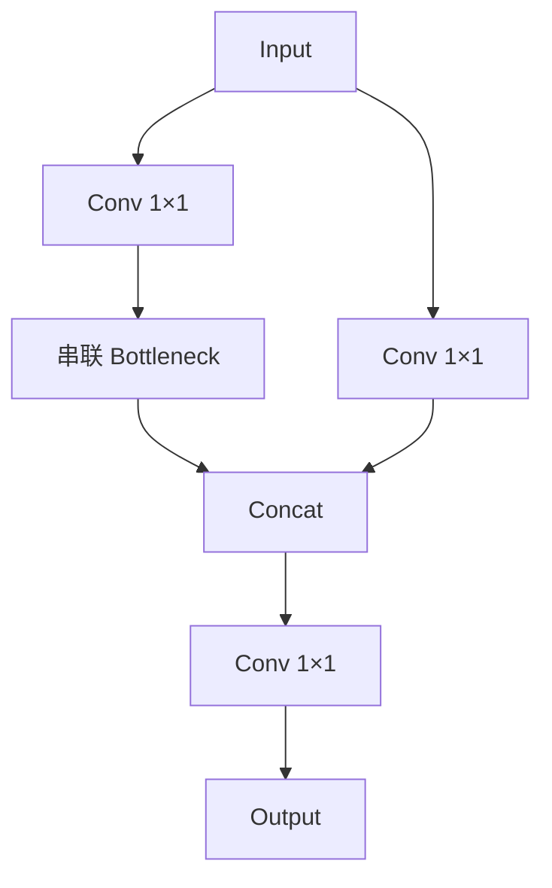

**设计价值：**C3k2 保留了 C2f 的多分支特征复用方式，同时允许不同阶段采用不同复杂度的内部单元，以在特征表达和计算成本之间取舍。是否优于 C2f，仍需通过同数据、同训练预算的对照实验验证。

### 3.7 SPPF

SPPF（Spatial Pyramid Pooling - Fast）位于 Backbone 深层，用于在不改变特征图尺寸的情况下扩大感受野。

主要步骤：

1. 1×1 Conv 调整通道。
2. 连续执行三次 5×5、Stride=1 的 MaxPool。
3. 将初始特征和三次池化结果 Concat。
4. 通过 1×1 Conv 融合。

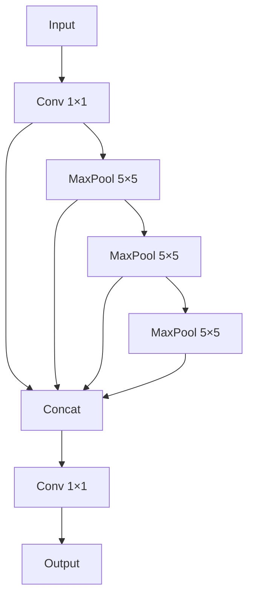

连续三次 5×5 池化对应的等效感受野为 5、9、13。这与并行使用 5×5、9×9、13×13 池化核的空间金字塔效果相近，但通过串联池化减少重复计算。YOLO11 YAML 使用默认 shortcut=False，不应把其他后续版本可能增加的 SPPF 残差连接误写到 YOLO11 上。

### 3.8 C2PSA 与 PSABlock

C2PSA 是 YOLO11 的重要结构变化之一，位于 Backbone 的 SPPF 后。

它采用 CSP 风格通道分流：一条分支直接保留，另一条分支经过 PSABlock 堆叠，最后 Concat 并用 1×1 Conv 融合。

设输入：

$$
X\in\mathbb{R}^{B\times C\times H\times W}
$$

默认扩展比例 e=0.5，隐藏通道：

$$
c=\lfloor C\cdot e\rfloor
$$

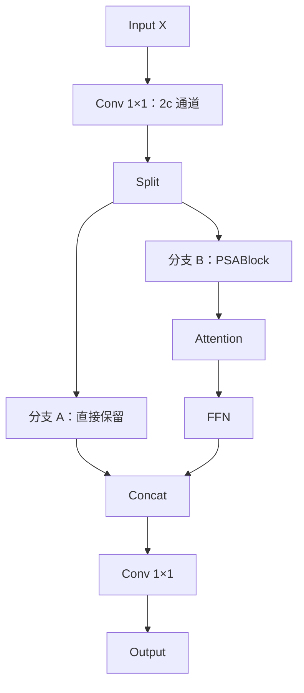

PSABlock 包含 Multi-Head Self-Attention、两层 1×1 Conv 构成的 FFN，以及两次残差连接：

$$
X_1=X+Attention(X)
$$

$$
Y=X_1+FFN(X_1)
$$

#### Attention 的计算

输入特征的空间位置数量：

$$
N=H\times W
$$

设 Head 数量为 h，每个 Head 的 Value 维度为 d_h，Key 维度为 d_k。将空间维展平后：

$$
Q,K\in\mathbb{R}^{B\times h\times d_k\times N}
$$

$$
V\in\mathbb{R}^{B\times h\times d_h\times N}
$$

注意力矩阵：

$$
A=Softmax\left(\frac{Q^TK}{\sqrt{d_k}}\right)
$$

$$
A\in\mathbb{R}^{B\times h\times N\times N}
$$

再用注意力权重聚合 V。Ultralytics 实现还对 V 增加 Depthwise 3×3 卷积分支作为位置编码，并通过 1×1 Conv 投影输出。

#### YOLO11n 的数值示例

640×640 输入时，C2PSA 位于 P5 深层特征：

$$
X\in\mathbb{R}^{B\times256\times20\times20}
$$

隐藏通道 c=128，Head 数量 h=2，每个 Head 维度 d_h=64，Key 维度 d_k=32，空间 Token 数量 N=400。因此每个 Head 的空间注意力矩阵为 400×400。

如果在 80×80 特征图上执行同样的全局 Attention，矩阵会变成 6400×6400。将 C2PSA 放在低分辨率深层特征上，可以显著降低全局空间注意力的计算规模。

### 3.9 Detect Head

YOLO11 使用解耦检测头，分类和边界框回归分支分别计算。

- **Box 分支**：两层标准 3×3 Conv，最后通过 1×1 Conv 输出 4×reg_max 个边界框分布通道。
- **Class 分支**：使用两组 Depthwise Separable Conv，每组由 3×3 Depthwise Conv 和 1×1 Conv 组成，最后通过 1×1 Conv 输出 nc 个类别 Logits。

因此，YOLO11 并不是把整个检测头都换成深度可分离卷积，而是重点轻量化分类分支；边界框回归分支仍保留标准卷积结构。

YOLO11 默认 reg_max=16，因此 Box 分支输出 64 个通道；COCO 80 类时，分类分支输出 80 个通道。

这里没有独立 Objectness 分支。Anchor-Free 也不意味着没有参考点，模型仍然使用特征网格中心作为 Anchor Points，只是不再预设具有固定宽高比和尺度的 Anchor Boxes。

---

## 4. 单张图片的完整前向传播（Forward Pass）

以 YOLO11n、输入 640×640、Batch Size=1、COCO 80 类为例。

### 4.1 Backbone Tensor Shape

| 层 | 模块 | 输出 Tensor Shape |
|---|---|---|
| Input | Image | [1, 3, 640, 640] |
| 0 | Conv s=2 | [1, 16, 320, 320] |
| 1 | Conv s=2 | [1, 32, 160, 160] |
| 2 | C3k2 | [1, 64, 160, 160] |
| 3 | Conv s=2 | [1, 64, 80, 80] |
| 4 | C3k2：P3 | [1, 128, 80, 80] |
| 5 | Conv s=2 | [1, 128, 40, 40] |
| 6 | C3k2：P4 | [1, 128, 40, 40] |
| 7 | Conv s=2 | [1, 256, 20, 20] |
| 8 | C3k2 | [1, 256, 20, 20] |
| 9 | SPPF | [1, 256, 20, 20] |
| 10 | C2PSA：P5 | [1, 256, 20, 20] |

这是 YOLO11n 的典型解析结果。不同 Ultralytics 版本、模型规格或自定义 YAML 可能改变具体配置，应通过实际模型打印结果核对。

### 4.2 Neck Tensor Shape

| 层 | 操作 | 输出 Tensor Shape |
|---|---|---|
| 11 | P5 Upsample | [1, 256, 40, 40] |
| 12 | Concat Backbone P4 | [1, 384, 40, 40] |
| 13 | C3k2 | [1, 128, 40, 40] |
| 14 | Upsample | [1, 128, 80, 80] |
| 15 | Concat Backbone P3 | [1, 256, 80, 80] |
| 16 | C3k2：输出 P3 | [1, 64, 80, 80] |
| 17 | Conv s=2 | [1, 64, 40, 40] |
| 18 | Concat 中间 P4 | [1, 192, 40, 40] |
| 19 | C3k2：输出 P4 | [1, 128, 40, 40] |
| 20 | Conv s=2 | [1, 128, 20, 20] |
| 21 | Concat Backbone P5 | [1, 384, 20, 20] |
| 22 | C3k2：输出 P5 | [1, 256, 20, 20] |

最终送入 Detect Head：

$$
P3\in\mathbb{R}^{1\times64\times80\times80}
$$

$$
P4\in\mathbb{R}^{1\times128\times40\times40}
$$

$$
P5\in\mathbb{R}^{1\times256\times20\times20}
$$

### 4.3 候选位置数量与输出维度

三个尺度的候选位置总数：

$$
N=80\times80+40\times40+20\times20=8400
$$

COCO 80 类、reg_max=16 时，每个候选位置的逻辑输出通道：

$$
4\times16+80=144
$$

训练时源码将 Box Distribution 和 Class Scores 分开保存：

$$
Boxes\in\mathbb{R}^{B\times64\times8400}
$$

$$
Scores\in\mathbb{R}^{B\times80\times8400}
$$

概念上拼接后相当于 [B,144,8400]，但当前源码训练输出是字典中的分开字段。

推理时，64 个边界框分布通道经过 DFL 积分变为 4 个连续距离，再解码成边界框；分类分数经过 Sigmoid。解码后的逻辑输出为：

$$
[B,4+80,8400]=[B,84,8400]
$$

随后进入 NMS。

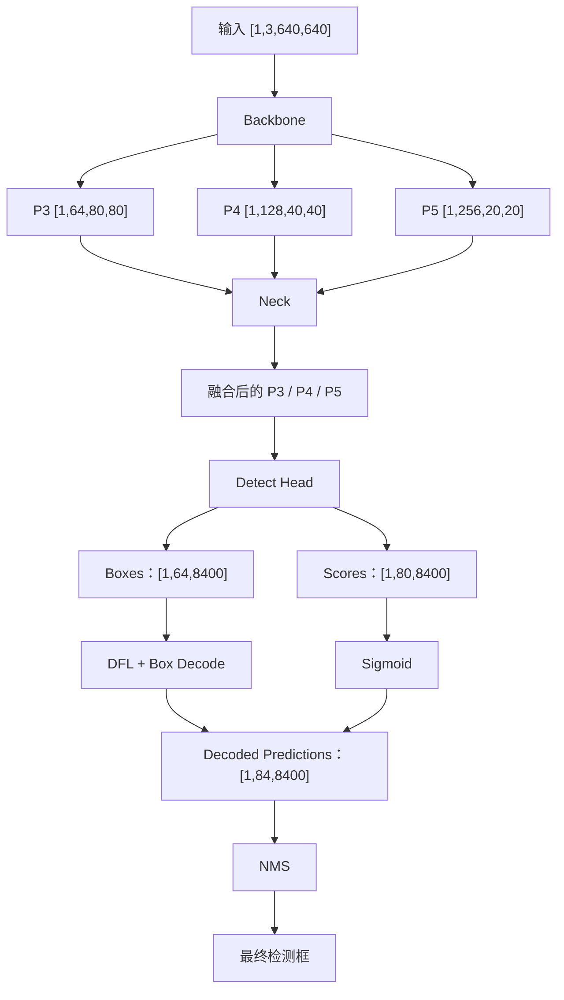

---

# 阶段 B：理解训练与推理（Understand Training & Inference）

## 5. 训练机制与优化过程

### 5.1 参数初始化与预训练权重

常见方式是加载官方 COCO 预训练权重，再迁移到自己的数据集：

```python
from ultralytics import YOLO

model = YOLO("yolo11n.pt")
results = model.train(data="custom.yaml", epochs=100, imgsz=640)
```

需要区分：

| 初始化方式 | 行为 |
|---|---|
| yolo11n.pt | 从预训练 checkpoint 加载可匹配参数 |
| yolo11n.yaml | 根据 YAML 构建网络；未加载预训练权重时从初始化参数开始训练 |

当自定义类别数与 COCO 不同时，类别相关 Head 参数可能形状不匹配。权重迁移会按可匹配参数加载，不能假设所有参数都被完整加载。

#### Detect Head Bias 初始化

官方 DetectionModel 初始化时先推断检测层 Stride，再调用 Detect 的 bias_init()。

当前源码中 Box 分支最后一层 Bias 初始化为 2.0；分类分支 Bias 使用：

$$
b_{cls}=\log\left(\frac{5}{nc\cdot(640/stride)^2}\right)
$$

其目的是让训练初始阶段类别预测保持较低的先验分数，避免大量候选位置在随机初始化时产生过高置信度。

Ultralytics 的 initialize_weights() 对 Conv2d 权重保留 PyTorch 模块自身的初始化结果，主要调整 BatchNorm 的 eps 和 momentum。因此，YOLO11 的特殊初始化重点之一是 Detect Head Bias，而不是对所有卷积权重再统一执行一遍 Kaiming 初始化。

### 5.2 正负样本分配：Task-Aligned Assigner

YOLO11 使用 Task-Aligned Assigner（TAL）匹配训练候选位置。它综合考虑分类分数和预测框与 GT 的重叠程度，而不是只使用固定 IoU 阈值。

当前官方源码的 v8DetectionLoss 默认参数为：

- topk=10
- alpha=0.5
- beta=6.0

任务对齐度量：

$$
T=s^\alpha\cdot IoU^\beta
$$

其中 s 是候选位置对 GT 类别的预测分数，IoU 是预测框与 GT 的重叠程度。当前默认值对应：

$$
T=s^{0.5}\cdot IoU^6
$$

匹配过程：

1. 生成 P3、P4、P5 的网格中心点。
2. 筛选中心点落在 GT 框内部的候选位置。
3. 计算候选位置的分类分数和预测框 IoU。
4. 根据任务对齐度量，为每个 GT 选择 Top-K 候选位置。
5. 处理同一候选位置被多个 GT 选中的冲突。
6. 生成正样本掩码、目标框和软分类目标分数。

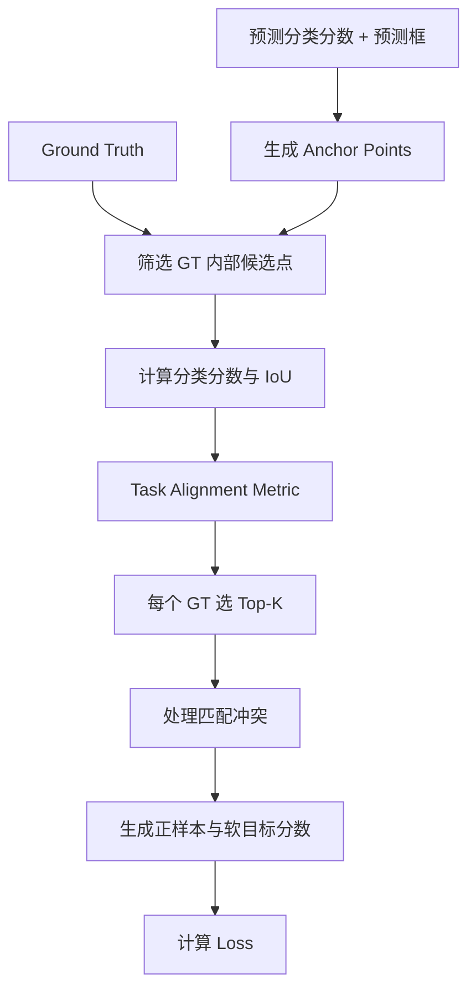

这里的 Anchor Point 是特征网格参考点，不是 Anchor-Based 检测器中预先定义宽高比和尺寸的一组 Anchor Boxes。

### 5.3 Loss Function

YOLO11 检测训练主要包含 Box、Classification 和 DFL 三项损失：

$$
L=L_{box}+L_{cls}+L_{dfl}
$$

当前 Ultralytics 默认配置的权重为：

$$
L_{total}=7.5L_{box}+0.5L_{cls}+1.5L_{dfl}
$$

实际训练应以运行时配置为准。

#### 5.3.1 Classification Loss：BCEWithLogitsLoss

$$
L_{cls}=-[y\log\sigma(x)+(1-y)\log(1-\sigma(x))]
$$

x 是分类 Logit，y 是 TAL 生成的目标分数。y 不一定只是 0 或 1；TAL 会生成与任务对齐质量相关的软目标，使分类分支也受到定位质量的影响。

#### 5.3.2 Box Loss：CIoU

$$
L_{box}=1-CIoU(B_{pred},B_{gt})
$$

CIoU 综合考虑 IoU、预测框与 GT 中心点距离，以及长宽比差异。源码中正样本 Box Loss 会使用目标分数加权，再按目标分数总和归一化。

#### 5.3.3 DFL：Distribution Focal Loss

YOLO11 不直接为每个边界框坐标预测单一标量，而是为左、上、右、下四个方向分别预测离散分布。

默认 reg_max=16，每个方向有 16 个离散区间：

$$
0,1,2,\ldots,15
$$

模型对每个方向的 16 个 Logits 做 Softmax，再计算期望：

$$
d=\sum_{i=0}^{15}i\cdot p_i
$$

例如 p4=0.7、p5=0.3，则预测距离为：

$$
d=4\times0.7+5\times0.3=4.3
$$

训练时，目标距离通常不是整数。DFL 会取目标距离两侧相邻的离散区间，并按距离比例计算两个交叉熵项的加权和。设：

$$
l=\lfloor d^*\rfloor,\quad r=l+1
$$

$$
w_l=r-d^*,\quad w_r=d^*-l
$$

则：

$$
L_{DFL}=-w_l\log p_l-w_r\log p_r
$$

分布回归使模型能够表达相邻距离区间上的不确定性，再通过期望转换成连续距离。

### 5.4 数据增强

常见增强包括 Mosaic、HSV、Translate、Scale、Horizontal Flip 和 MixUp。

当前 Ultralytics 通用默认配置中常见值：

| 参数 | 默认值 | 作用 |
|---|---:|---|
| hsv_h | 0.015 | 色调变化 |
| hsv_s | 0.7 | 饱和度变化 |
| hsv_v | 0.4 | 亮度变化 |
| translate | 0.1 | 平移比例 |
| scale | 0.5 | 缩放幅度 |
| fliplr | 0.5 | 水平翻转概率 |
| mosaic | 1.0 | Mosaic 概率 |
| mixup | 0.0 | MixUp 概率 |
| close_mosaic | 10 | 最后 10 个 Epoch 关闭 Mosaic |

这些是当前配置默认值，不代表 YOLO11 最初发布时所有实验都使用完全相同的设置。复现时必须保存实际运行参数。

### 5.5 优化器与训练配置

当前通用默认配置包括：

| 参数 | 默认值 |
|---|---:|
| epochs | 100 |
| batch | 16 |
| imgsz | 640 |
| pretrained | True |
| optimizer | auto |
| close_mosaic | 10 |
| amp | True |

optimizer=auto 不代表永远固定使用某一种优化器。当前 Trainer 会根据训练迭代规模选择优化器，并在日志中输出最终选择结果。应以实际训练日志和保存的训练参数为准。

### 5.6 完整训练流程

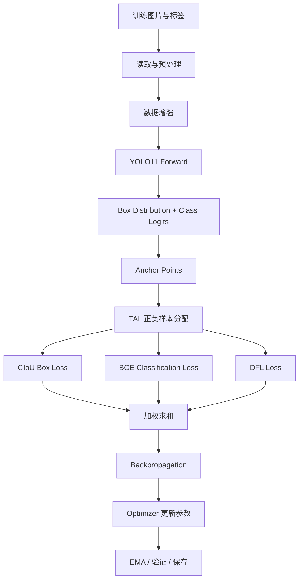

---

## 6. 推理过程与后处理（Inference Pipeline）

### 6.1 输入预处理

常见 Predictor 流程包括读取图像、Resize、必要时 Padding、BGR 转 RGB、HWC 转 CHW、转 Tensor 和归一化。推理阶段不会使用 Mosaic、MixUp 等随机增强。

### 6.2 Anchor-Free 解码

YOLO11 虽然是 Anchor-Free，但仍然使用 Anchor Points。官方 make_anchors() 根据特征图网格生成中心点，默认偏移量为 0.5。

模型预测四个方向的距离：

$$
(l,t,r,b)
$$

设参考点为 (x_a,y_a)，则：

$$
x_1=x_a-l,\quad y_1=y_a-t
$$

$$
x_2=x_a+r,\quad y_2=y_a+b
$$

再结合各层 Stride 还原到输入图像坐标系。

### 6.3 NMS

YOLO11 标准检测推理仍然使用 NMS。

基本流程：

1. 根据置信度阈值过滤低分候选框。
2. 将边界框从 xywh 转换为 xyxy。
3. 默认选择每个候选框最高类别分数。
4. 按类别执行 NMS，避免不同类别互相抑制。
5. 根据 IoU 阈值抑制与高分框重叠过大的低分框。
6. 最多保留 max_det 个结果。

两个框的 IoU：

$$
IoU=\frac{Area(B_1\cap B_2)}{Area(B_1\cup B_2)}
$$

假设两个同类别框 IoU=0.75：阈值为 0.5 时低分框会被抑制；阈值为 0.8 时则可能保留。阈值越低，抑制通常越强。

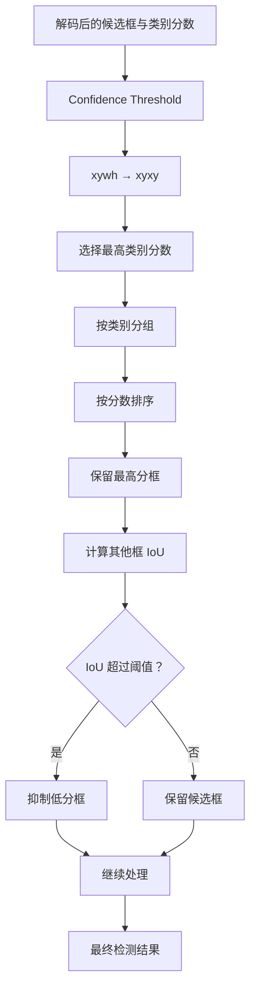

当前 Ultralytics 通用配置中常见预测默认值为 conf=0.25、iou=0.5、max_det=300。验证时通常使用更低的置信度阈值，以便计算 Recall 和 AP。不同模式默认值可能不同。

### 6.4 YOLO11 是不是 NMS-Free？

不是。YOLO11 标准 Detect Head 采用 One-to-Many 密集预测训练，推理后使用 NMS 去除冗余框。不要将 YOLO11 与支持端到端 NMS-Free 路径的其他模型混为一谈。

### 6.5 训练和推理差异

| 项目 | Training | Inference |
|---|---|---|
| 数据增强 | Mosaic、HSV、Scale 等 | 常规预处理 |
| Detect 输出 | Box Distribution、Class Logits | 解码后的 Box 和 Class Scores |
| TAL | 需要 | 不需要 |
| Loss | 需要计算 | 不计算 |
| DFL | 分布监督与解码 | 分布积分解码 |
| NMS | 不属于梯度训练主流程 | 标准检测流程需要 |
| 参数更新 | Backprop + Optimizer | 无参数更新 |

---

## 7. 可解释性与特征可视化

### 7.1 原始资料是否提供热力图？

由于 Ultralytics 没有为 YOLO11 发表正式研究论文，因此不存在一套可按论文 Figure 编号解释的原始论文热力图实验。官方文档重点提供模型结构、性能指标和使用方式，不等同于包含完整可解释性实验的学术论文。

### 7.2 建议自行进行的可视化

1. **Backbone / Neck Feature Map**：分别提取 P3、P4、P5，观察不同尺度的响应区域、目标与背景响应差异，以及特征融合前后的变化。
2. **C2PSA Attention Map**：记录 PSABlock 的空间注意力矩阵。一个 Head 的矩阵形状为：

$$
A\in\mathbb{R}^{B\times N\times N}
$$

可选取某个 Query 位置，观察它对其他空间位置的权重，再映射回二维特征图。
3. **Grad-CAM**：针对一个具体检测结果定义目标分数，例如预测框的类别分数，再反向传播得到梯度。检测任务不能直接照搬图像分类 Grad-CAM。
4. **错误案例可视化**：按漏检、误检、重复框和定位偏差分类，并结合特征图分析。

Feature Map、Attention Map 和 Grad-CAM 可以帮助观察网络内部响应，但不是模型因果解释的充分证据。

---

# 阶段 C：评价模型（Evaluate the Model）

## 8. 数据集与实验设置

Ultralytics 官方 YOLO11 Detection 性能表使用 COCO 检测任务，包含 80 个类别，输入尺寸为 640。COCO 2017 的常用划分为 train2017（118,287 张图像）和 val2017（5,000 张图像）；官方性能表给出的是 COCO 验证性能。可参考 [COCO 数据集官网](https://cocodataset.org/)。

需要区分：

1. **官方预训练权重**：官方提供的 COCO 预训练 checkpoint。
2. **官方性能表**：官方公布的 COCO 验证集 AP、参数量、FLOPs 和指定环境延迟。
3. **自己的训练配置**：自定义数据集微调时实际使用的 Epoch、Batch、学习率、增强和硬件。

官方文档的示例命令不等于完整公开了最初训练官方权重时的全部训练配方。没有明确披露的数据规模、训练时长或硬件配置，不应自行猜测。

## 9. 性能评估与实验结果

### 9.1 COCO Detection 官方指标

以下为 Ultralytics 官方 YOLO11 文档公布的数据：

| 模型 | 输入尺寸 | COCO mAP50-95 | CPU ONNX 延迟 | T4 TensorRT 10 延迟 | 参数量 | FLOPs |
|---|---:|---:|---:|---:|---:|---:|
| YOLO11n | 640 | 39.5 | 56.1 ± 0.8 ms | 1.5 ± 0.0 ms | 2.6 M | 6.5 B |
| YOLO11s | 640 | 47.0 | 90.0 ± 1.2 ms | 2.5 ± 0.0 ms | 9.4 M | 21.6 B |
| YOLO11m | 640 | 51.5 | 183.2 ± 2.0 ms | 4.7 ± 0.1 ms | 20.1 M | 68.1 B |
| YOLO11l | 640 | 53.4 | 238.6 ± 1.4 ms | 6.2 ± 0.1 ms | 25.3 M | 87.2 B |
| YOLO11x | 640 | 54.7 | 462.8 ± 6.7 ms | 11.3 ± 0.2 ms | 56.9 M | 195.3 B |

### 9.2 指标如何理解？

- **Precision**：预测为正的结果中，有多少是真正例，计算为 TP / (TP + FP)。
- **Recall**：所有真实目标中，有多少被检测出来，计算为 TP / (TP + FN)。
- **AP**：在指定 IoU 匹配阈值下，Precision-Recall 曲线下的面积。
- **mAP50-95**：对 IoU 阈值 0.50、0.55、……、0.95 分别计算 AP，再对阈值和类别求平均，是 COCO 常用的主指标。

因此，mAP50-95 同时考虑分类和定位质量；它比单独的 AP50 更严格，不能将两者混为一谈。

说明：

- mAP 为 COCO val 的 mAP50-95。
- 延迟分别来自 CPU ONNX 和 NVIDIA T4 TensorRT 10。
- FLOPs、参数量和延迟依赖模型版本、融合状态、推理框架及测量口径。
- 不要将 T4 TensorRT 延迟直接当成其他 GPU、ONNX Runtime 或 PyTorch 的延迟。
- 官方表格没有给出训练耗时，因此不能从中推导 YOLO11 的训练时间。

官方 YAML 注释中的参数量和 GFLOPs 与文档表格可能存在轻微差异，通常与统计版本、融合状态或测量口径有关。引用时应保持同一来源的数据口径。

### 9.2 训练耗时

官方 YOLO11 模型页没有提供完整训练硬件、训练总时长和每 Epoch 时间。因此本文不填写未经验证的训练耗时。

如果需要估算自己的训练时间，应记录数据集图片数、输入尺寸、Batch Size、Epoch、GPU 型号和数量、数据加载速度、每 Epoch 耗时、验证耗时，以及 AMP、缓存和多卡设置。

## 10. 与前代模型对比及创新分析

### 10.1 YOLOv8 → YOLO11

| 模块 | YOLOv8 | YOLO11 | 变化意义 |
|---|---|---|---|
| Backbone 特征块 | C2f | C3k2 | 改变 CSP 特征提取单元 |
| Neck 特征块 | C2f | C3k2 | 使用同代特征块 |
| 深层注意力 | 无 C2PSA | SPPF 后接 C2PSA | 建模深层空间关系 |
| 分类分支 | 常规卷积 | Depthwise Separable Conv | 降低分类分支计算开销 |
| 检测范式 | Anchor-Free | Anchor-Free | 保持不变 |
| Box Regression | DFL | DFL | 保持不变 |
| NMS | 使用 | 使用 | 没有改为 NMS-Free |

### 10.2 改进点的证据强度

| 改进 | 官方配置 / 源码可确认 | 是否有 YOLO11 独立论文级消融证据 |
|---|---|---|
| C3k2 替换 C2f | 是 | 官方未提供完整论文级消融表 |
| C2PSA | 是 | 官方未提供完整论文级消融表 |
| 分类分支轻量化 | 是 | 官方未提供完整论文级消融表 |
| Anchor-Free | 是 | 继承的检测范式 |
| DFL | 是 | 继承的回归机制 |
| NMS | 是 | 标准检测推理仍使用 |

稳妥结论是：YOLO11 在特征提取块、深层注意力和分类分支上做了结构优化，官方 COCO 指标展示了不同规模模型的精度与效率；但公开证据不足以将总性能提升精确分摊给某一个新增模块。

### 10.3 如何独立验证模块贡献？

可以设计控制变量实验：

| 实验 | Backbone / Neck | C2PSA | 分类分支 | 目的 |
|---|---|---|---|---|
| A | YOLOv8 原始结构 | × | 原始 | Baseline |
| B | 替换为 C3k2 | × | 原始 | 测试 C3k2 |
| C | 原始结构 | ✓ | 原始 | 测试注意力 |
| D | 原始结构 | × | Depthwise Separable | 测试分类分支 |
| E | YOLO11 完整结构 | ✓ | Depthwise Separable | 测试组合效果 |

实验时统一数据集、输入分辨率、预训练条件、Epoch、Batch、增强、优化器、评价代码、硬件和推理框架，否则 AP 变化可能来自训练条件。

## 11. 模型不足、失败案例与泛化能力

以下是根据架构得到的分析推断，不应误认为作者正式论文中的局限性声明。

### 11.1 小目标

YOLO11 Detection 默认输出 P3、P4、P5，最浅检测层 Stride=8。极小目标经过多次下采样后可保留的空间信息有限。

这不意味着小于 8 像素的目标一定检测不到，但默认三尺度结构可能难以充分保留极小目标细节。可以研究增加 P2、高分辨率输入、小目标增强和更合适的特征融合方式。是否增加 P2 必须实验验证，因为它也会增加候选位置和计算成本。

### 11.2 密集目标与 NMS

在目标高度密集、框严重重叠时，NMS 可能抑制属于不同实例的预测框。建议统计漏检、重复框、相邻 GT 匹配冲突、不同 NMS 阈值下的 Recall，以及不同目标密度下的 AP。

### 11.3 TAL 匹配竞争

对于高度重叠的相邻目标，候选位置可能同时落入多个 GT 框，训练阶段也可能发生匹配竞争。因此密集目标问题不一定只是 NMS 的问题，还可能发生在正样本分配阶段。

### 11.4 C2PSA 的位置限制

C2PSA 位于 Backbone 深层 P5，能够以较低分辨率建模全局位置关系，但它没有在所有高分辨率特征层执行同样的 Attention。因此不能认为 YOLO11 已解决高分辨率细节之间的全局关系建模问题。

### 11.5 域偏移与泛化

COCO 预训练模型不保证在农业、工业或医疗领域直接取得同样表现。需要检查目标外观、尺寸分布、背景和光照、类别长尾、标注规则，以及训练和部署设备差异。

对于田间植物检测，尤其应检查不同季节、地块、相机高度、天气和光照下的跨场景泛化能力。

---

# 阶段 D：复现与应用（Reproduce & Apply）

## 12. 官方代码分析、模型复现与部署

### 12.1 关键源码文件

| 内容 | 官方源码 |
|---|---|
| YOLO11 网络配置 | [cfg/models/11/yolo11.yaml](https://github.com/ultralytics/ultralytics/blob/main/ultralytics/cfg/models/11/yolo11.yaml) |
| C2f、C3k2、C3k、C2PSA、SPPF、PSABlock | [nn/modules/block.py](https://github.com/ultralytics/ultralytics/blob/main/ultralytics/nn/modules/block.py) |
| Conv、DWConv、Concat | [nn/modules/conv.py](https://github.com/ultralytics/ultralytics/blob/main/ultralytics/nn/modules/conv.py) |
| Detect Head、DFL、Bias 初始化 | [nn/modules/head.py](https://github.com/ultralytics/ultralytics/blob/main/ultralytics/nn/modules/head.py) |
| 模型解析与 DetectionModel | [nn/tasks.py](https://github.com/ultralytics/ultralytics/blob/main/ultralytics/nn/tasks.py) |
| v8DetectionLoss、BboxLoss、DFLoss | [utils/loss.py](https://github.com/ultralytics/ultralytics/blob/main/ultralytics/utils/loss.py) |
| TaskAlignedAssigner、make_anchors、dist2bbox | [utils/tal.py](https://github.com/ultralytics/ultralytics/blob/main/ultralytics/utils/tal.py) |
| NMS | [utils/nms.py](https://github.com/ultralytics/ultralytics/blob/main/ultralytics/utils/nms.py) |
| 默认训练参数 | [cfg/default.yaml](https://github.com/ultralytics/ultralytics/blob/main/ultralytics/cfg/default.yaml) |

### 12.2 论文概念与源码调用关系

1. 读取 yolo11.yaml。
2. parse_model() 根据模型规模解析深度、宽度和模块参数。
3. 创建 Backbone、Neck 和 Detect Head。
4. 推断 Detect Head 的 Stride。
5. 执行检测头 Bias 初始化。
6. 加载可匹配的预训练权重。
7. 训练时创建 v8DetectionLoss。
8. Loss 内部使用 TaskAlignedAssigner 和 BboxLoss。
9. 推理时 Detect Head 解码 Box，再由 Predictor 调用 NMS。

### 12.3 查看模型结构

```python
from ultralytics import YOLO
import ultralytics

print("Ultralytics version:", ultralytics.__version__)

model = YOLO("yolo11n.pt")
model.info(verbose=True)

for i, layer in enumerate(model.model.model):
    print(i, layer)
```

实际研究时，建议把 ultralytics.__version__ 和 Git Commit 一起记录。官方 GitHub 的 main 分支会持续更新，不能假设不同时间看到的源码完全一致。

### 12.4 训练示例

```python
from ultralytics import YOLO

model = YOLO("yolo11n.pt")

results = model.train(
    data="custom.yaml",
    epochs=100,
    imgsz=640,
    batch=16,
    workers=8,
    device=0,
)
```

data 指向数据集 YAML，epochs 是训练轮数，imgsz 是输入尺寸，batch 是训练 Batch Size，device 指定训练设备。多卡训练还应记录全局 Batch、每卡 Batch、DDP 设置和实际训练日志。

### 12.5 推理示例

```python
from ultralytics import YOLO

model = YOLO("runs/detect/train/weights/best.pt")

results = model.predict(
    source="test.jpg",
    imgsz=640,
    conf=0.25,
    iou=0.5,
    max_det=300,
    save=True,
)
```

conf、iou 和 max_det 是推理后处理参数，会影响最终保留的检测框，不是网络训练出来的权重参数。

### 12.6 ONNX 导出

```python
from ultralytics import YOLO

model = YOLO("runs/detect/train/weights/best.pt")
model.export(format="onnx", imgsz=640, dynamic=False, simplify=True)
```

导出后需要检查 ONNX 输入输出名称、Tensor Shape、输出是否已经包含后处理、NMS 是否在图外执行、FP32 / FP16 精度差异，以及 ONNX Runtime 与 PyTorch 的数值一致性。

### 12.7 TensorRT 导出

```python
from ultralytics import YOLO

model = YOLO("runs/detect/train/weights/best.pt")
model.export(format="engine", imgsz=640, half=True, device=0)
```

TensorRT 部署时还需要测试 Engine 构建环境、TensorRT 与 CUDA 版本、FP16 精度、动态输入支持、预处理和后处理是否计入延迟、Batch Size=1 端到端耗时，以及不同输入尺寸下的性能。

导出成功不代表部署结果已经与 PyTorch 完全一致。必须实际运行测试集，比较检测框、类别分数和定位误差。

### 12.8 复现边界

本文提供的是官方源码分析和可执行复现入口，并没有在当前任务中实际启动 YOLO11 训练，也没有实测 ONNX 或 TensorRT 性能，因此不能把上述命令描述为已经复现成功。

严格复现实验应固定 Ultralytics 版本与 Git Commit、PyTorch / CUDA / cuDNN / TensorRT 版本、数据集版本和划分、预训练权重、完整训练参数、随机种子，以及验证脚本和指标口径。

---

# 总结

YOLO11 并没有改变 YOLO 单阶段检测的基本范式。它在 YOLOv8 的基础上主要优化了 Backbone / Neck 的特征提取模块、深层空间注意力和检测头分类分支。

理解 YOLO11 时，最值得掌握的技术链路是：

1. **C3k2**：理解 C2f 的分流与特征拼接，以及内部 Bottleneck / C3k 的切换。
2. **C2PSA**：理解通道分流、PSABlock、QKV 和空间注意力矩阵。
3. **FPN + PAN**：理解 P3、P4、P5 的双向特征融合。
4. **Anchor-Free + DFL**：理解网格中心参考点、LTRB 距离预测和分布积分解码。
5. **TAL**：理解如何结合分类分数和 IoU 选择正样本。
6. **CIoU + BCE + DFL**：理解定位、分类和分布回归三项 Loss。
7. **NMS**：理解 YOLO11 仍然需要后处理，以及密集目标下可能发生的误抑制。

对实际应用而言，YOLO11 的 COCO 指标只能作为通用基准。对于极小目标、密集植物和复杂田间场景，仍然需要通过专门的数据集、失败案例分析和对照实验验证其适用性。

---

## 参考资料

### 官方资料

1. [Ultralytics YOLO11 官方模型文档](https://docs.ultralytics.com/models/yolo11/)
2. [Ultralytics YOLO 架构解析](https://docs.ultralytics.com/guides/yolo-architecture)
3. [Ultralytics YOLO11 官方发布介绍](https://www.ultralytics.com/blog/ultralytics-yolo11-has-arrived-redefine-whats-possible-in-ai)
4. [Ultralytics GitHub 仓库](https://github.com/ultralytics/ultralytics)

### 核心配置与源码

5. [YOLO11 YAML](https://github.com/ultralytics/ultralytics/blob/main/ultralytics/cfg/models/11/yolo11.yaml)
6. [Block Modules：C2f、C3k2、C2PSA、SPPF、PSABlock](https://github.com/ultralytics/ultralytics/blob/main/ultralytics/nn/modules/block.py)
7. [Convolution Modules](https://github.com/ultralytics/ultralytics/blob/main/ultralytics/nn/modules/conv.py)
8. [Detection Head 与 DFL](https://github.com/ultralytics/ultralytics/blob/main/ultralytics/nn/modules/head.py)
9. [Model Parsing 与 DetectionModel](https://github.com/ultralytics/ultralytics/blob/main/ultralytics/nn/tasks.py)
10. [Detection Loss](https://github.com/ultralytics/ultralytics/blob/main/ultralytics/utils/loss.py)
11. [Task-Aligned Assigner 与 Anchor Points](https://github.com/ultralytics/ultralytics/blob/main/ultralytics/utils/tal.py)
12. [NMS 实现](https://github.com/ultralytics/ultralytics/blob/main/ultralytics/utils/nms.py)
13. [默认训练配置](https://github.com/ultralytics/ultralytics/blob/main/ultralytics/cfg/default.yaml)

### 相关基础论文

14. [Generalized Focal Loss: Learning Qualified and Distributed Bounding Boxes for Dense Object Detection](https://arxiv.org/abs/2006.04388)
15. [TOOD: Task-aligned One-stage Object Detection](https://arxiv.org/abs/2108.07755)
16. [Distance-IoU Loss: Faster and Better Learning for Bounding Box Regression](https://arxiv.org/abs/1911.08287)
