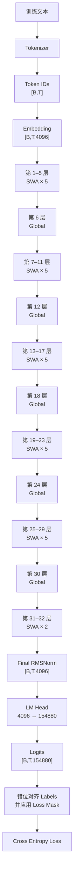
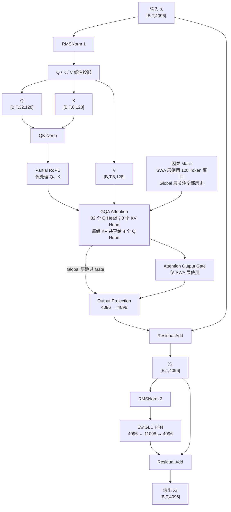
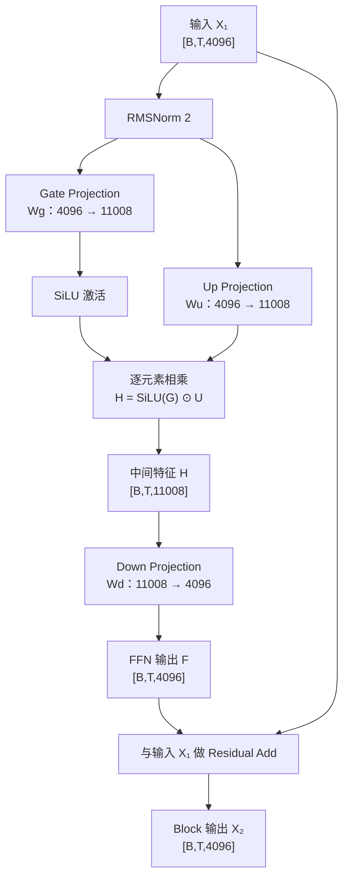
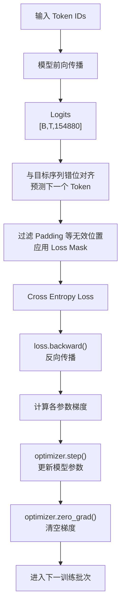

# ZGCM-1：Transformer 数据流、参数量计算、MLA 与 MoE

## 一、模型整体数据流
首先明确 ZGCM-1 的主要架构配置。

| 配置 | 数值 |
| --- | ---: |
| Vocabulary Size | 154880 |
| Hidden Size | 4096 |
| Transformer Layers | 32 |
| Query Heads | 32 |
| KV Heads | 8 |
| Head Dim | 128 |
| FFN Hidden Size | 11008 |
| Attention 类型 | GQA |
| FFN 类型 | SwiGLU |
| Norm | RMSNorm |


为了方便理解，下面假设：

```python
B = 2
T = 4
Hidden_Size = 4096
```

其中：

+ B：Batch Size，一次并行处理多少组文本。
+ T：Sequence Length，每组文本包含多少个 Token。
+ Hidden Size：每个 Token 对应的特征维度。

整个模型的数据流：

整个模型的数据流：



---

## 二、训练数据如何变成 `[B,T]`？
### 2.1 原始训练文本
假设训练语料中有这样一段文本：

```latex
我喜欢机器学习
```

模型不能直接处理汉字、英文单词或句子，需要先经过 Tokenizer。

假设 Tokenizer 将它转换成：

```latex
Token IDs：

[1024, 2345, 5678, 9012]
```

这里的数字仅用于演示，不代表 ZGCM-1 词表中这些 ID 的真实含义。

每个数字代表词表中的一个 Token。

### 2.2 Batch 和 Sequence Length
假设同时处理两条文本：

```python
batch = [
    [1024, 2345, 5678, 9012],
    [1024, 3456, 7890, 1234]
]
```

输入 Tensor：

$$Input\in\mathbb{R}^{B\times T}$$

其中：

$$B=2,\qquad T=4$$

因此：

$$Input\in\mathbb{R}^{2\times4}$$

实际 Tensor：

```python
tensor([
    [1024, 2345, 5678, 9012],
    [1024, 3456, 7890, 1234]
])
```

此时它是一个二维整数 Tensor。它里面没有 4096 维特征，也没有经过 Attention 计算。

### 2.3 Padding 和 Attention Mask
实际训练中，不同文本长度可能不同。

例如：

```latex
样本1：[1024, 2345, 5678, 9012]
样本2：[1024, 3456]
```

为了组成规则的二维 Tensor，需要进行 Padding：

```latex
[
    [1024, 2345, 5678, 9012],
    [1024, 3456, PAD,  PAD]
]
```

此时：

$$Input\in\mathbb{R}^{2\times4}$$

同时需要记录哪些位置是有效 Token，哪些位置是 Padding。

Padding Mask 会防止模型将无效位置当作真实文本参与注意力计算和 Loss 统计。

实际大规模预训练还会使用 Packing，将多段文本拼接到固定长度序列中，并根据文档边界、EOS 等标记处理注意力和 Loss Mask。

---

## 三、Embedding 将 `[B,T]` 转换为 `[B,T,4096]`
### 3.1 为什么需要 Embedding？
刚才输入的是：

$$Input\in\mathbb{R}^{2\times4}$$

里面的 1024、2345 等数字只是 Token 的编号。

模型不能直接把这些整数当作具有语义的特征进行 Attention 运算。

因此需要 Embedding。

ZGCM-1：

```latex
Vocabulary Size = 154880
Hidden Size     = 4096
```

Embedding 矩阵：

$$W_{emb}\in\mathbb{R}^{154880\times4096}$$

它是一个可训练的参数矩阵。

每一行对应一个 Token，每一行包含 4096 个浮点数。

### 3.2 Embedding 到底怎么算？
假设输入：

```latex
[1024, 2345, 5678, 9012]
```

Embedding 的操作不是复杂的矩阵计算，而是查表。

例如：

$$e_1=W_{emb}[1024]$$

$$e_2=W_{emb}[2345]$$

$$e_3=W_{emb}[5678]$$

$$e_4=W_{emb}[9012]$$

每次查询都会得到一个 4096 维向量。

例如：

```latex
Token 1024 → [0.12, 0.35, -0.21, ..., 0.17]
Token 2345 → [0.42, 0.13,  0.56, ..., 0.29]
Token 5678 → [0.31, 0.62, -0.18, ..., 0.45]
Token 9012 → [0.27, 0.19,  0.38, ..., 0.11]
```

### 3.3 Tensor Shape 如何变化？
输入：

$$Input\in\mathbb{R}^{B\times T}$$

Embedding 后：

$$H=W_{emb}[Input]$$

得到：

$$\boxed{H\in\mathbb{R}^{B\times T\times4096}}$$

---

## 四、进入 Transformer Block
现在正式进入 Transformer。输入：

$$X_0\in\mathbb{R}^{B\times T\times4096}$$

ZGCM-1 有 32 个 Transformer Layers。

每一层都包含两个核心子模块：

1. Self-Attention：让不同 Token 交换信息。
2. FFN：对每个 Token 的特征进行非线性变换。

一个完整 Transformer Block：

一个完整 Transformer Block：



整个过程中，输入和输出都是：

$$[B,T,4096]$$

但中间会出现不同的临时维度。

### 5.1 第一步：RMSNorm
输入：

$$X\in\mathbb{R}^{B\times T\times4096}$$

首先进行 RMSNorm。

它的作用是对每个 Token 的 4096 维特征进行归一化。

RMSNorm 公式：

$$RMSNorm(x)=
\frac{x}{
\sqrt{
\frac{1}{D}\sum_{i=1}^{D}x_i^2+\epsilon
}
}
\odot\gamma$$

其中：

+ D = 4096。
+ epsilon：防止分母为零。
+ gamma：可学习的缩放参数。
+ 乘号 `⊙`：逐元素相乘。

注意，RMSNorm 是针对每个 Token 独立计算的。

例如：

```latex
Token 1 的 4096 维向量 → 独立归一化
Token 2 的 4096 维向量 → 独立归一化
Token 3 的 4096 维向量 → 独立归一化
Token 4 的 4096 维向量 → 独立归一化
```

它不会将不同 Token 的特征混合起来。

所以：

$$[B,T,4096]\rightarrow[B,T,4096]$$

归一化改变的是数值，不是 Tensor Shape。

### 5.2 第二步：Q、K、V 投影
经过 RMSNorm 后，开始计算 QKV。

输入：

$$X_n\in\mathbb{R}^{B\times T\times4096}$$

ZGCM-1：

```latex
Query Heads = 32
KV Heads    = 8
Head Dim    = 128
```

#### Q Projection
$$Q=X_nW_Q$$

$$W_Q\in\mathbb{R}^{4096\times4096}$$

所以：

$$Q\in\mathbb{R}^{B\times T\times4096}$$

然后 Reshape：

$$Q\rightarrow[B,T,32,128]$$

#### K Projection
$$K=X_nW_K$$

$$W_K\in\mathbb{R}^{4096\times1024}$$

所以：

$$K\in\mathbb{R}^{B\times T\times1024}$$

然后 Reshape：

$$K\rightarrow[B,T,8,128]$$

#### V Projection
$$V=X_nW_V$$

$$W_V\in\mathbb{R}^{4096\times1024}$$

所以：

$$V\in\mathbb{R}^{B\times T\times1024}$$

然后 Reshape：

$$V\rightarrow[B,T,8,128]$$

此时的形状：

| Tensor | Shape |
| --- | --- |
| Q | `[B,T,32,128]` |
| K | `[B,T,8,128]` |
| V | `[B,T,8,128]` |


### 5.3 第三步：QK Norm 和 Partial RoPE
这里补充两个架构设计。

#### QK Norm
Q 和 K 投影之后，还会经过 QK Norm 归一化。

QK Norm 是对每个 Head 的特征进行处理，不改变 Head 数量和 Head Dimension。

$$Q:[B,T,32,128]$$

$$K:[B,T,8,128]$$

经过 QK Norm 后，形状不变。

#### Partial RoPE
ZGCM-1 使用 Partial RoPE，旋转维度比例为 0.33。

也就是说，并不是将每个 Head 的全部 128 个维度都进行 RoPE 旋转，而是只对其中约三分之一的维度应用旋转位置编码。

它的作用是让模型获得位置信息，同时减少位置编码对全部特征维度的作用。

RoPE 不改变 Tensor Shape：

$$Q,K\rightarrow Q',K'$$

V 不需要进行 RoPE。

### 5.4 第四步：GQA Attention
现在：

```latex
Q：[B,T,32,128]
K：[B,T,8,128]
V：[B,T,8,128]
```

需要进行 GQA。

因为：

$$32/8=4$$

每 4 个 Query Head 共享一组 K、V。

为了方便理解，我们先将维度调整为：

```latex
Q：[B,32,T,128]
K：[B, 8,T,128]
V：[B, 8,T,128]
```

以第一个 Query Head 为例：

$$Q_1\in\mathbb{R}^{B\times T\times128}$$

对应的 K：

$$K_1\in\mathbb{R}^{B\times T\times128}$$

计算：

$$S_1=Q_1K_1^T$$

其中：

$$[T,128]\times[128,T]=[T,T]$$

所以：

$$S_1\in\mathbb{R}^{B\times T\times T}$$

这一步非常重要。

原来每个 Token 只有一个 128 维 Query。

现在通过 Q 和 K 的矩阵乘法，得到一个 T×T 的注意力分数矩阵。

例如 T=4：

$$S=
\begin{bmatrix}
s_{11}&s_{12}&s_{13}&s_{14}\\
s_{21}&s_{22}&s_{23}&s_{24}\\
s_{31}&s_{32}&s_{33}&s_{34}\\
s_{41}&s_{42}&s_{43}&s_{44}
\end{bmatrix}$$

每一行代表一个 Query Token 对所有 Key Token 的注意力分数。

#### Causal Mask
因为是 Decoder-only 模型，训练时需要使用因果注意力。

当前 Token 不能看到未来 Token。

例如：

$$S=
\begin{bmatrix}
s_{11}&-\infty&-\infty&-\infty\\
s_{21}&s_{22}&-\infty&-\infty\\
s_{31}&s_{32}&s_{33}&-\infty\\
s_{41}&s_{42}&s_{43}&s_{44}
\end{bmatrix}$$

Softmax 后，未来位置的概率为 0。

然后：

$$A=Softmax\left(\frac{S}{\sqrt{128}}\right)$$

再乘以 V：

$$O=AV$$

得到：

$$[T,T]\times[T,128]=[T,128]$$

因此每个 Query Head 最终输出：

$$O_i\in\mathbb{R}^{B\times T\times128}$$

32 个 Head 分别计算，最后拼接：

$$Concat(O_1,\ldots,O_{32})$$

得到：

$$\boxed{O\in\mathbb{R}^{B\times T\times4096}}$$

实际 GQA 实现不一定真的复制 K、V 四次，而是通过分组索引或优化的 Attention Kernel 直接完成共享计算。

#### ZGCM-1 的局部与全局注意力
不同层使用的 Attention Mask 不同：

+ SWA 层：只允许关注当前位置以及之前 128 个 Token 范围内的内容。
+ Global 层：允许关注整个历史序列。

ZGCM-1 的 32 层中：

| 层 | Attention 类型 |
| --- | --- |
| 1～5 | SWA |
| 6 | Global |
| 7～11 | SWA |
| 12 | Global |
| 13～17 | SWA |
| 18 | Global |
| 19～23 | SWA |
| 24 | Global |
| 25～29 | SWA |
| 30 | Global |
| 31～32 | SWA |


这里的 SWA 窗口大小为 128 Token。

##### SWA 的核心计算机制
SWA（Sliding Window Attention，滑动窗口注意力）并不是把整个输入序列的长度 T 截断为 128，而是让**每一个 Query Token 都拥有自己的局部注意力窗口**。

假设输入序列长度为 T，每个位置都仍然会生成对应的 Query、Key 和 Value。逻辑上的 Attention Score 仍然可以表示为：

$$S=\frac{QK^T}{\sqrt{d_k}},\qquad S\in\mathbb{R}^{T\times T}$$

区别在于：普通 Causal Attention 只屏蔽当前位置之后的未来 Token；SWA 则进一步屏蔽距离当前 Query 太远的历史 Token。

以窗口大小为 3 举例，假设序列为：

```latex
Token:    A  B  C  D  E  F
位置:     0  1  2  3  4  5
```

每个 Query 允许关注自己以及之前最近的两个 Token：

| Query Token | 允许关注的 Key Token |
| --- | --- |
| A | A |
| B | A、B |
| C | A、B、C |
| D | B、C、D |
| E | C、D、E |
| F | D、E、F |


因此，SWA 的 Attention Mask 同时满足两个条件：

1. **因果约束**：不能关注当前位置之后的未来 Token。
2. **窗口约束**：不能关注窗口范围之外的历史 Token。

对应的 Mask（0 表示允许关注，$-\infty$ 表示屏蔽）为：

$$M=
\begin{bmatrix}
0&-\infty&-\infty&-\infty&-\infty&-\infty\\
0&0&-\infty&-\infty&-\infty&-\infty\\
0&0&0&-\infty&-\infty&-\infty\\
-\infty&0&0&0&-\infty&-\infty\\
-\infty&-\infty&0&0&0&-\infty\\
-\infty&-\infty&-\infty&0&0&0
\end{bmatrix}$$

将 Mask 加到 Attention Score 上：

$$S'=S+M$$

再进行 Softmax：

$$A=Softmax(S')$$

由于被屏蔽位置的分数为 $-\infty$，Softmax 后这些位置的注意力权重为 0，因此不会参与当前 Query 的信息聚合。

**回到 ZGCM-1：窗口大小为 128**

假设序列长度 $T=1024$：

+ Q 仍然包含 1024 个 Query Token。
+ K、V 仍然包含 1024 个位置。
+ Attention Score 的逻辑形状仍然是 $[1024,1024]$。
+ 每个 Query 最多只能关注窗口内的 128 个 Key 位置。
+ 窗口之外的位置通过 Mask 屏蔽。

因此，不能将 SWA 理解为先把整个序列切成长度为 128 的片段，再分别计算 Attention。它是一个沿序列滑动的局部窗口：位置不断向后移动，每个 Query 对应的窗口也随之移动。

**窗口大小是否包含当前位置？**

在 ZGCM-1 的窗口定义中，窗口总长度为 128，包含当前位置，而不是“当前位置之外再加 128 个历史 Token”。

因此，位置 $i$ 的允许范围为：

$$\max(0,i-127)\leq j\leq i$$

其中 $i$ 是 Query 位置，$j$ 是 Key 位置。也就是当前位置加上最多 127 个历史位置。

阅读其他模型或实现的代码时，仍应以 Attention Mask 或 Kernel 中的实际边界条件为准，因为不同实现对窗口参数的定义可能不同。

**SWA 与 Global Attention 的区别**

| 对比 | SWA | Global Attention |
| --- | --- | --- |
| 可关注范围 | 当前 Token 附近的局部窗口 | 整个历史序列 |
| 是否使用因果约束 | 是 | 是 |
| 远距离 Token 能否直接交互 | 不能（超出窗口时） | 可以 |
| 计算开销 | 随窗口大小增长，通常低于全局注意力 | 标准实现随序列长度平方增长 |


在高效实现中，Sliding Window Attention Kernel 可以直接跳过窗口之外的 QK 计算，而不必先完整计算 $T\times T$ 矩阵再将其 Mask。因此，SWA 不仅限制了信息访问范围，也有机会降低实际计算量和注意力矩阵的内存开销。

对于 ZGCM-1，SWA 负责局部信息交互，间隔插入的 Global Attention 层负责跨越整个历史序列的信息交互。两者结合，使模型兼顾局部计算效率和长距离上下文建模能力。

对于因果注意力，局部窗口具体是否包含当前位置以及前面多少个 Token，以实现中的窗口定义为准。

注意：虽然 Attention 会在 T 个 Token 之间交换信息，但每个 Query 位置最终仍然只产生一个 4096 维输出。

因此：

$$[B,T,4096]\rightarrow Attention\rightarrow[B,T,4096]$$

它不会将 T 个 Token 合并成一个 Token。

### 5.5 第五步：Attention Output Gate
ZGCM-1 的 SWA 层还有额外的门控操作。

从归一化后的输入计算：

$$G=X_nW_g$$

其中：

$$W_g\in\mathbb{R}^{4096\times4096}$$

得到：

$$G\in\mathbb{R}^{B\times T\times4096}$$

然后：

$$Gate=sigmoid(G)$$

最后：

$$O'=O\odot Gate$$

这一步不会改变形状：

$$[B,T,4096]\rightarrow[B,T,4096]$$

直观理解：

Attention 算出来的特征并不一定全部需要保留，Gate 学习对每个位置、每个特征维度进行调节。

注意：

+ SWA 层：使用 Attention Output Gate。
+ Global Attention 层：不使用这个 Gate。

### 5.6 第六步：Output Projection
将 Attention 输出映射回 Hidden Size：

$$Y=O'W_O$$

其中：

$$W_O\in\mathbb{R}^{4096\times4096}$$

所以：

$$Y\in\mathbb{R}^{B\times T\times4096}$$

对于 Global 层，使用普通 Attention 输出进入 Output Projection。

---

## 五、Residual Add
刚才我们得到：

$$Y\in\mathbb{R}^{B\times T\times4096}$$

但是在整个 Attention 子模块开始之前，还有一个原始输入：

$$X\in\mathbb{R}^{B\times T\times4096}$$

现在进行：

$$\boxed{X_1=X+Y}$$

这就是残差连接。

例如：

```latex
原始输入 X：

[0.12, 0.35, -0.21, ...]

Attention 输出 Y：

[0.05, 0.16,  0.11, ...]

Residual Add：

[0.17, 0.51, -0.10, ...]
```

这里只是演示前三个维度。

实际上是对全部 4096 个维度逐元素相加。

由于两个 Tensor 形状完全相同：

$$[B,T,4096]+[B,T,4096]$$

得到：

$$\boxed{X_1\in\mathbb{R}^{B\times T\times4096}}$$

为什么需要这样做？

假设没有残差连接：

```latex
X → Attention(X) → FFN(...)
```

网络只能不断依赖变换后的结果。

加入残差后：

$$X_1=X+Attention(RMSNorm(X))$$

模型可以在保留原始信息的基础上，学习需要增加或修改的特征。

这对训练几十层甚至上百层 Transformer 非常重要。

---

## 六、进入 FFN（SwiGLU）
现在 Attention 部分完成。

得到：

$$X_1\in\mathbb{R}^{B\times T\times4096}$$

接下来进入 FFN。

这里要理解一个重要区别：

**Attention 负责不同 Token 之间的信息交互；FFN 主要负责每个 Token 自身的特征变换。**

也就是说，FFN 不需要再次计算 Token 之间的关系。

### 7.1 FFN 前的 RMSNorm
$$X_{1n}=RMSNorm_2(X_1)$$

得到：

$$X_{1n}\in\mathbb{R}^{B\times T\times4096}$$

注意，这是另一套独立的 RMSNorm 参数，与 Attention 前面的 RMSNorm 不共享。

### 7.2 Gate Projection
ZGCM-1：

$$D_{ff}=11008$$

Gate Projection：

$$G=X_{1n}W_g^{ffn}$$

其中：

$$W_g^{ffn}\in\mathbb{R}^{4096\times11008}$$

因此：

$$G\in\mathbb{R}^{B\times T\times11008}$$

### 7.3 Up Projection
$$U=X_{1n}W_u^{ffn}$$

其中：

$$W_u^{ffn}\in\mathbb{R}^{4096\times11008}$$

得到：

$$U\in\mathbb{R}^{B\times T\times11008}$$

现在两个分支都是 11008 维。

### 7.4 SiLU 激活与逐元素相乘
首先：

$$G'=SiLU(G)$$

其中：

$$SiLU(x)=x\cdot sigmoid(x)$$

然后：

$$H=G'\odot U$$

也就是：

$$H=SiLU(G)\odot U$$

最终：

$$H\in\mathbb{R}^{B\times T\times11008}$$

这里发生的是逐元素相乘，而不是矩阵乘法。

例如：

```latex
Gate：

[0.2, 0.5, 0.8, ...]

Up：

[0.3, 0.4, 0.6, ...]

SiLU(Gate)：

[0.11, 0.31, 0.55, ...]

逐元素相乘：

[0.033, 0.124, 0.33, ...]
```

### 7.5 Down Projection
现在 FFN 内部特征是 11008 维。

但是下一层 Transformer 仍然要求输入 4096 维。

因此需要 Down Projection：

$$F=HW_d^{ffn}$$

其中：

$$W_d^{ffn}\in\mathbb{R}^{11008\times4096}$$

得到：

$$\boxed{F\in\mathbb{R}^{B\times T\times4096}}$$

SwiGLU FFN 的完整维度变化：

SwiGLU FFN 的完整维度变化：



---

## 七、第二次 Residual Add
现在：

FFN 输入前的特征：

$$X_1\in\mathbb{R}^{B\times T\times4096}$$

FFN 输出：

$$F\in\mathbb{R}^{B\times T\times4096}$$

进行第二次残差相加：

$$\boxed{X_2=X_1+F}$$

得到：

$$\boxed{X_2\in\mathbb{R}^{B\times T\times4096}}$$

这就是一个完整 Transformer Block 的最终输出。

完整计算公式：

$$X_1=X+Attention(RMSNorm_1(X))$$

$$X_2=X_1+FFN(RMSNorm_2(X_1))$$

其中 Attention 和 FFN 内部还有各自的投影、激活、注意力和门控操作。

经过一个完整 Transformer Block，Token 数量没有变化，但是每个 Token 的 4096 维特征已经被重新计算。

---

## 八、重复 32 个 Transformer Block
现在我们已经得到第一个 Block 的输出：

$$X_1\in\mathbb{R}^{B\times T\times4096}$$

它会作为第二个 Block 的输入。

第二层：

$$X_2=TransformerBlock_2(X_1)$$

第三层：

$$X_3=TransformerBlock_3(X_2)$$

依此类推：

$$X_{32}=TransformerBlock_{32}(X_{31})$$

最终：

$$\boxed{X_{32}\in\mathbb{R}^{B\times T\times4096}}$$

每一层的 Hidden Size 都是 4096。

每一层的 Token 数量仍然是 T。

但是每一层的参数矩阵不同，因此每一层都会对特征进行不同的变换。

### 9.1 32 层到底改变了什么？
假设某个 Token 的初始 Embedding 是：

$$h_0\in\mathbb{R}^{4096}$$

经过不同层：

$$h_1=Block_1(h_0)$$

$$h_2=Block_2(h_1)$$

$$h_3=Block_3(h_2)$$

依此类推：

$$h_{32}=Block_{32}(h_{31})$$

维度始终是 4096。

但数值不断发生变化。

可以理解为：

+ Embedding：提供 Token 的初始表示。
+ 浅层 Transformer：逐渐建立上下文关系。
+ 中间层 Transformer：持续融合和加工信息。
+ 深层 Transformer：形成适合当前预测任务的高级特征。

这只是对深层特征演化的直观解释，不意味着每一层具有固定的语义功能。

### 9.2 为什么不把 4096 增加到 8192、16384？
因为模型设计时已经确定了 Hidden Size。

每个 Block 都有自己的权重矩阵，其输入和输出维度需要匹配。

例如：

$$W_Q\in\mathbb{R}^{4096\times4096}$$

$$W_O\in\mathbb{R}^{4096\times4096}$$

$$W_{down}\in\mathbb{R}^{11008\times4096}$$

所以 Attention 和 FFN 最终都回到 4096 维。

如果希望 Hidden Size 从 4096 改成 8192，那么整个模型的大量权重矩阵都需要重新设计。

这属于模型架构层面的变化，而不是简单地在某一层增加维度。

---

## 九、Final RMSNorm 和 LM Head
现在 32 层 Transformer 全部完成。

得到：

$$H_{final}\in\mathbb{R}^{B\times T\times4096}$$

接下来进行最终预测。

### 10.1 Final RMSNorm
首先：

$$H_{norm}=RMSNorm_{final}(H_{final})$$

得到：

$$H_{norm}\in\mathbb{R}^{B\times T\times4096}$$

依然不改变 Tensor Shape。

### 10.2 LM Head
前面我们一直在 4096 维的 Hidden Space 中进行计算。

但是模型最终要预测的是：

词表中的 154880 个 Token，哪个最可能是下一个 Token？

因此需要一个 Linear 层：

$$Logits=H_{norm}W_{LM}$$

其中：

$$W_{LM}\in\mathbb{R}^{4096\times154880}$$

所以：

$$[B,T,4096]\times[4096,154880]$$

得到：

$$\boxed{Logits\in\mathbb{R}^{B\times T\times154880}}$$

为什么是 154880？

因为词表有 154880 个 Token。

每个位置都要预测词表中所有 Token 的分数。

例如：

```latex
位置1：

Token 0      → 0.23
Token 1      → 0.81
Token 2      → -0.12
...
Token 154879 → 0.45
```

这里的数值是 Logits，不是概率。
### 10.3 Softmax
接下来：

$$P=Softmax(Logits)$$

Softmax 沿着词表维度进行计算。

得到：

$$P\in\mathbb{R}^{B\times T\times154880}$$

每个位置的概率之和为 1。

例如：

```latex
P(Token 0) = 0.02
P(Token 1) = 0.15
P(Token 2) = 0.01
...
```

模型根据这些概率预测下一个 Token。

注意：训练时通常直接将 Logits 输入 Cross Entropy，不需要先显式计算 Softmax，因为 Cross Entropy 内部已经包含数值稳定的 LogSoftmax 计算。

---

## 十、训练时如何计算 Loss？
这里是理解训练和推理区别的关键。

前面我们只讲了模型如何从输入得到输出，现在还没有讲模型如何知道自己预测得对不对。

### 11.1 训练数据实际上是错位的
假设原始 Token 序列：

```latex
[A, B, C, D, E]
```

训练时，模型需要学习预测下一个 Token。

因此可以构造：

输入 Input IDs：

```latex
[A, B, C, D]
```

目标 Labels：

```latex
[B, C, D, E]
```

对应关系：

| 输入位置 | 模型预测目标 |
| --- | --- |
| A | B |
| B | C |
| C | D |
| D | E |


模型输入 A，预测 B。

模型输入 A、B，预测 C。

模型输入 A、B、C，预测 D。

模型输入 A、B、C、D，预测 E。

数学表示：

$$Input=[A,B,C,D]$$

$$Labels=[B,C,D,E]$$

实际训练代码中通常会通过 Shift 操作完成这个过程。

有些实现会将原始 Token 序列整体输入，然后在 Loss 计算时错位对齐，数学效果相同。

### 11.2 模型输出什么？
经过前面的网络：

$$Input:[B,T]$$

$$Transformer:[B,T,4096]$$

$$LMHead:[B,T,154880]$$

因此：

$$Logits\in\mathbb{R}^{B\times T\times154880}$$

假设：

$$B=2,\qquad T=4$$

那么：

$$Logits\in\mathbb{R}^{2\times4\times154880}$$

这表示：

+ 第一组文本有 4 个位置，每个位置预测 154880 个 Token。
+ 第二组文本也有 4 个位置，每个位置预测 154880 个 Token。

总共预测 8 次。

### 11.3 Cross Entropy Loss
对于某一个位置：

假设模型预测：

```latex
Token A：0.1
Token B：0.6
Token C：0.2
Token D：0.1
```

但正确答案是 Token C。

那么模型就应该提高 Token C 的概率，降低其他 Token 的相对概率。

交叉熵：

$$Loss=-\log P(y_{true})$$

对于整个 Batch：

$$Loss=
-\frac{1}{N}
\sum_{b,t}
\log P(y_{b,t}\mid x_{b,\leq t})$$

这里 N 是有效预测位置的数量，Padding 等无效位置不参与计算。

实际训练还会根据 Packing 边界等设置调整 Attention Mask 和 Loss Mask。

### 11.4 Loss 计算完之后发生什么？
模型执行：

模型执行：



例如：

```python
logits = model(input_ids)

loss = cross_entropy(
    logits.view(-1, vocab_size),
    labels.view(-1)
)

loss.backward()

optimizer.step()
optimizer.zero_grad()
```

这里的 `model` 包含：

+ Embedding 参数。
+ 32 层 Attention 参数。
+ 32 层 FFN 参数。
+ RMSNorm 参数。
+ LM Head 参数。

反向传播会计算这些参数对 Loss 的梯度。

然后优化器根据梯度更新参数。

注意：

训练过程中变化的是网络参数，而不是 Token ID。

例如：

$$W_Q^{new}=W_Q^{old}-\eta\nabla W_Q$$

这里的 eta 是学习率。

经过大量训练，模型逐渐学会根据上下文预测下一个 Token。

---

## 十一、为什么整个 Transformer 始终保持 `[B,T,4096]`？
这是本次学习最值得总结的一个问题。

我们已经经过了大量模块，为什么输入输出维度始终没有变化？

核心原因是：

**Attention 和 FFN 虽然计算方式不同，但最终都被设计成保持 Token 数量和 Hidden Size 不变。**

看一下每个模块的作用：

| 模块 | 主要计算 | 输入 | 输出 |
| --- | --- | --- | --- |
| Embedding | Token ID 查表 | `[B,T]` | `[B,T,4096]` |
| RMSNorm | 归一化最后一维 | `[B,T,4096]` | `[B,T,4096]` |
| Q Projection | Linear | `[B,T,4096]` | `[B,T,4096]` |
| K Projection | Linear | `[B,T,4096]` | `[B,T,1024]` |
| V Projection | Linear | `[B,T,4096]` | `[B,T,1024]` |
| GQA | Token 间信息交互 | Q/K/V | `[B,T,4096]` |
| Attention Gate | 逐元素门控 | `[B,T,4096]` | `[B,T,4096]` |
| Output Projection | Linear | `[B,T,4096]` | `[B,T,4096]` |
| Residual Add | 逐元素相加 | `[B,T,4096]` | `[B,T,4096]` |
| FFN Gate/Up | Linear | `[B,T,4096]` | `[B,T,11008]` |
| SiLU × Up | 非线性门控 | `[B,T,11008]` | `[B,T,11008]` |
| FFN Down | Linear | `[B,T,11008]` | `[B,T,4096]` |
| Residual Add | 逐元素相加 | `[B,T,4096]` | `[B,T,4096]` |


这里有三个特别重要的原因。

#### 原因一：Linear 只改变最后一个维度
例如：

$$[B,T,4096]\times[4096,11008]$$

得到：

$$[B,T,11008]$$

Batch 和 Sequence 不变。

#### 原因二：Attention 交换信息，但不减少 Token 数量
Attention 虽然计算了：

$$QK^T\rightarrow[B,H,T,T]$$

但是经过 Softmax 和 V 加权之后，每一个 Query Token 仍然产生自己的输出。

所以：

$$[B,H,T,128]\rightarrow[B,T,4096]$$

不会把 T 个 Token 合并成一个。

#### 原因三：Residual 要求输入和输出形状一致
残差：

$$Y=X+F(X)$$

两边必须具有相同的 Tensor Shape。

所以 Attention 和 FFN 都需要最终映射回 4096 维。

---

## 十二、完整 Tensor Shape 追踪
我们再把整个过程用具体数字走一遍。

假设：

```latex
B = 2
T = 4

Hidden Size = 4096
Query Heads = 32
KV Heads = 8
Head Dim = 128
FFN Hidden Size = 11008
Vocabulary Size = 154880
```

| 阶段 | Tensor Shape | 说明 |
| --- | --- | --- |
| Token IDs | `[2,4]` | 2 组文本，每组 4 个 Token |
| Embedding | `[2,4,4096]` | 每个 Token 变成 4096 维向量 |
| RMSNorm | `[2,4,4096]` | 归一化，不改变形状 |
| Q Projection | `[2,4,4096]` | Query 投影 |
| K Projection | `[2,4,1024]` | Key 投影 |
| V Projection | `[2,4,1024]` | Value 投影 |
| Q Reshape | `[2,32,4,128]` | 32 个 Query Head |
| K/V Reshape | `[2,8,4,128]` | 8 个 KV Head |
| Attention Scores | `[2,32,4,4]` | 每个 Query Head 的注意力分数 |
| GQA Output | `[2,4,4096]` | 32 个 Head 拼接 |
| Output Gate / Projection | `[2,4,4096]` | 门控和输出映射 |
| Residual Add | `[2,4,4096]` | Attention 残差 |
| FFN Gate | `[2,4,11008]` | Gate Projection |
| FFN Up | `[2,4,11008]` | Up Projection |
| SiLU × Up | `[2,4,11008]` | 逐元素相乘 |
| FFN Down | `[2,4,4096]` | 映射回 Hidden Size |
| Residual Add | `[2,4,4096]` | FFN 残差 |
| Transformer × 32 | `[2,4,4096]` | 32 层计算 |
| Final RMSNorm | `[2,4,4096]` | 最终归一化 |
| LM Head | `[2,4,154880]` | 预测整个词表 |
| Cross Entropy | Scalar | 计算训练损失 |


注意：上表中 Attention Scores 的形状 `[2,32,4,4]` 是逻辑上的注意力分数形状。实际使用 GQA Kernel 时，可以不显式展开共享的 K/V。

---

## 十三、建立真正的整体认知
最后强调三个概念，它们是理解大模型网络结构的基础。

### 14.1 Attention 和 FFN 究竟有什么区别？
| 对比 | Attention | FFN |
| --- | --- | --- |
| 主要作用 | Token 之间交换信息 | Token 自身特征变换 |
| 是否混合不同 Token | 是 | 否 |
| 输入 | `[B,T,4096]` | `[B,T,4096]` |
| 中间维度 | Q/K/V 多头维度 | 11008 |
| 输出 | `[B,T,4096]` | `[B,T,4096]` |
| 主要操作 | QKᵀ、Softmax、AV | Linear、SiLU、逐元素乘法 |


这是 Transformer 最核心的两个计算模块。

### 14.2 为什么网络越深，模型能力可能越强？
一个 Transformer Block 并不是简单地重复相同的数字运算。

每层都有不同的可训练参数：

$$X_1=Block_1(X_0)$$

$$X_2=Block_2(X_1)$$

$$\cdots$$

$$X_{32}=Block_{32}(X_{31})$$

每一层都能学习不同的特征变换。

所以即使每一层的输入输出都是 4096 维，模型仍然可以通过多层变换不断提取和组合信息。

但要注意，增加层数不一定总能提高能力，还需要考虑训练数据、计算预算、优化难度和参数规模。

### 14.3 训练与推理的区别
| 项目 | 训练 | 推理 |
| --- | --- | --- |
| 输入 | `[B,T]` | `[B,T]` |
| Embedding | 有 | 有 |
| Transformer | 32 层 | 32 层 |
| 输出 Logits | `[B,T,V]` | 通常取最后位置 |
| Loss | 计算 | 不计算 |
| Backward | 有 | 无 |
| 参数更新 | 有 | 无 |
| KV Cache | 通常不依赖生成式 Cache | 自回归生成时通常使用 |


训练时，模型通常一次性并行处理整个序列，并利用 Causal Mask 保证每个位置只能看到之前的信息。

推理时，模型通常已经知道之前的 Token，通过 KV Cache 缓存历史 K、V，避免重复计算。

---

## 十四、下一步：用 PyTorch 实际观察 Tensor
建议下一步用 PyTorch 实际打印每个模块的 Tensor Shape。

尤其是观察下面这些变化：

```python
input_ids.shape

embedding_output.shape

rmsnorm_output.shape

q.shape
k.shape
v.shape

attention_scores.shape

attention_output.shape

residual_output.shape

ffn_gate.shape
ffn_up.shape
ffn_hidden.shape
ffn_output.shape

transformer_block_output.shape

logits.shape
```

还可以使用 PyTorch 的 `register_forward_hook`，直接观察每个模块的输入和输出。

这样就能把理论上的：

$$[B,T]\rightarrow[B,T,4096]$$

和实际运行时 GPU 中的 Tensor 对应起来。

**建议后续直接实现一个可运行的 ZGCM-1 简化版 Transformer：先实现单层完整 Block，再扩展成 32 层，最后加入训练数据、Loss 和反向传播。**

这样就能从理解网络结构，真正走到理解大模型训练。

## 十五、ZGCM-1 的参数量详细计算
前面已经理解了 ZGCM-1 的整体网络结构、Tensor Shape 变化以及每个模块的计算过程。

现在进一步计算一个核心问题：

**ZGCM-1 的 7.39B 参数究竟是怎么来的？**

我们不直接使用官方公布的 7.39B，而是从 Embedding 开始，将每一个矩阵的参数量计算出来，最后汇总验证。

### 15.1 模型架构配置
首先整理计算所需要的配置。

| 配置 | 数值 | 说明 |
| --- | ---: | --- |
| Vocabulary Size | 154,880 | 词表大小 |
| Hidden Size | 4,096 | 隐藏层维度 |
| Intermediate Size | 11,008 | FFN 中间层维度 |
| Transformer Layers | 32 | Transformer 层数 |
| Query Heads | 32 | Q Head 数量 |
| KV Heads | 8 | K/V Head 数量 |
| Head Dim | 128 | 每个 Head 的维度 |
| SWA Layers | 27 | 局部注意力层 |
| Global Layers | 5 | 全局注意力层 |
| Attention Gate | 27 层 | 仅 SWA 层使用 |
| Attention Bias | False | Attention Linear 不使用 Bias |
| Tie Word Embeddings | False | Embedding 和 LM Head 不共享权重 |


其中：

$$Hidden\ Size=32\times128=4096$$

$$KV\ Dimension=8\times128=1024$$

后面所有参数量都以这些配置为基础计算。

### 15.2 Embedding 参数量
Embedding 的作用是将 Token ID 映射为 Hidden Size 维度的向量。

ZGCM-1：

$$W_{emb}\in\mathbb{R}^{154880\times4096}$$

因此：

$$\begin{aligned}
P_{emb}
&=154880\times4096\\
&=\boxed{634,388,480}
\end{aligned}$$

约为：

$$P_{emb}\approx0.6344B$$

这里有 154880 行，每行 4096 个可学习参数。

### 15.3 LM Head 参数量
Transformer 最终输出：

$$H_{final}\in\mathbb{R}^{B\times T\times4096}$$

LM Head 负责将 4096 维 Hidden State 映射到词表维度。

权重矩阵：

$$W_{LM}\in\mathbb{R}^{4096\times154880}$$

因此：

$$\begin{aligned}
P_{LM}
&=4096\times154880\\
&=\boxed{634,388,480}
\end{aligned}$$

约为：

$$P_{LM}\approx0.6344B$$

这里有一个值得注意的地方：

**Embedding 和 LM Head 虽然矩阵形状刚好互为转置，但 ZGCM-1 并没有共享这两个矩阵的参数。**

因为配置中：

```python
tie_word_embeddings = False
```

所以两部分需要分别计算。

两者合计：

$$\begin{aligned}
P_{emb+LM}
&=634,388,480\\
&\quad+634,388,480\\
&=\boxed{1,268,776,960}
\end{aligned}$$

约为 1.269B。

### 15.4 Attention 参数量
Attention 是 Transformer 中的重要组成部分。

ZGCM-1 使用 GQA：

```latex
Query Heads = 32
KV Heads    = 8
Head Dim    = 128
Hidden Size = 4096
```

单层 Attention 包含四个主要投影矩阵：

+ Q Projection
+ K Projection
+ V Projection
+ Output Projection

#### 15.4.1 Q Projection
输入维度：

$$D_{in}=4096$$

输出维度：

$$D_{out}=32\times128=4096$$

权重矩阵：

$$W_Q\in\mathbb{R}^{4096\times4096}$$

参数量：

$$\begin{aligned}
P_Q
&=4096\times4096\\
&=\boxed{16,777,216}
\end{aligned}$$

#### 15.4.2 K Projection
K 只有 8 个 KV Head：

$$D_{out}=8\times128=1024$$

权重矩阵：

$$W_K\in\mathbb{R}^{4096\times1024}$$

参数量：

$$\begin{aligned}
P_K
&=4096\times1024\\
&=\boxed{4,194,304}
\end{aligned}$$

#### 15.4.3 V Projection
V 和 K 的维度相同：

$$W_V\in\mathbb{R}^{4096\times1024}$$

参数量：

$$\begin{aligned}
P_V
&=4096\times1024\\
&=\boxed{4,194,304}
\end{aligned}$$

#### 15.4.4 Output Projection
Attention 输出经过 32 个 Query Head 拼接：

$$32\times128=4096$$

因此需要映射回 Hidden Size：

$$W_O\in\mathbb{R}^{4096\times4096}$$

参数量：

$$\begin{aligned}
P_O
&=4096\times4096\\
&=\boxed{16,777,216}
\end{aligned}$$

#### 15.4.5 单层 Attention 总参数量
将四个矩阵相加：

$$P_{attn}=P_Q+P_K+P_V+P_O$$

代入：

$$\begin{aligned}
P_{attn}
&=16,777,216\\
&\quad+4,194,304\\
&\quad+4,194,304\\
&\quad+16,777,216\\
&=\boxed{41,943,040}
\end{aligned}$$

也就是：

$$P_{attn}\approx41.94M$$

32 层全部使用相同的基础 GQA 投影结构：

$$\begin{aligned}
P_{attn,total}
&=32\times41,943,040\\
&=\boxed{1,342,177,280}
\end{aligned}$$

约为 1.342B。

注意：这里还没有计算 SWA 特有的 Attention Output Gate。

### 15.5 SWA Attention Gate 参数量
这是 ZGCM-1 相比普通 GQA Attention 额外增加的一部分参数。

ZGCM-1 的 32 层中：

+ 27 层 SWA：有 Attention Gate。
+ 5 层 Global Attention：没有 Attention Gate。

Gate 的作用是对 Attention 输出进行逐元素调节。

计算公式：

$$Gate=\sigma(XW_g)$$

其中：

$$W_g\in\mathbb{R}^{4096\times4096}$$

因此，单个 SWA 层的 Gate Projection 参数量：

$$\begin{aligned}
P_{gate}
&=4096\times4096\\
&=\boxed{16,777,216}
\end{aligned}$$

27 层合计：

$$\begin{aligned}
P_{gate,total}
&=27\times16,777,216\\
&=\boxed{452,984,832}
\end{aligned}$$

约为 0.453B。

这里可以看出，ZGCM-1 的 Attention 参数不仅包含 Q、K、V、O 四个矩阵，还包含 27 个 SWA 层额外的 Gate Projection。

#### 15.5.1 GQA Attention 与 SWA Gate 汇总
| 模块 | 单层参数量 | 层数 | 总参数量 |
| --- | ---: | ---: | ---: |
| Q | 16,777,216 | 32 | 536,870,912 |
| K | 4,194,304 | 32 | 134,217,728 |
| V | 4,194,304 | 32 | 134,217,728 |
| O | 16,777,216 | 32 | 536,870,912 |
| SWA Gate | 16,777,216 | 27 | 452,984,832 |


因此：

$$\boxed{
P_{Attention+Gate}=1,795,162,112
}$$

约为 1.795B。

### 15.6 FFN（SwiGLU）参数量
FFN 是整个 ZGCM-1 参数量最大的部分。

ZGCM-1 使用 SwiGLU：

```latex
Hidden Size      = 4096
Intermediate Size = 11008
```

SwiGLU 包含三个 Linear 矩阵：

1. Gate Projection
2. Up Projection
3. Down Projection

#### 15.6.1 Gate Projection
输入：

$$D_{in}=4096$$

输出：

$$D_{out}=11008$$

权重矩阵：

$$W_{gate}\in\mathbb{R}^{4096\times11008}$$

参数量：

$$\begin{aligned}
P_{gate}^{ffn}
&=4096\times11008\\
&=\boxed{45,088,768}
\end{aligned}$$

#### 15.6.2 Up Projection
Up Projection 的输入输出维度相同：

$$W_{up}\in\mathbb{R}^{4096\times11008}$$

参数量：

$$\begin{aligned}
P_{up}
&=4096\times11008\\
&=\boxed{45,088,768}
\end{aligned}$$

#### 15.6.3 Down Projection
将 11008 维映射回 4096 维：

$$W_{down}\in\mathbb{R}^{11008\times4096}$$

参数量：

$$\begin{aligned}
P_{down}
&=11008\times4096\\
&=\boxed{45,088,768}
\end{aligned}$$

#### 15.6.4 单层 FFN 总参数量
$$P_{FFN}=P_{gate}^{ffn}+P_{up}+P_{down}$$

代入：

$$\begin{aligned}
P_{FFN}
&=45,088,768\\
&\quad+45,088,768\\
&\quad+45,088,768\\
&=\boxed{135,266,304}
\end{aligned}$$

约为：

$$P_{FFN}\approx135.27M$$

32 层合计：

$$\begin{aligned}
P_{FFN,total}
&=32\times135,266,304\\
&=\boxed{4,328,521,728}
\end{aligned}$$

约为 4.329B。

可以看到：

**FFN 占整个模型参数量的比例非常高，是模型参数的主要组成部分。**

### 15.7 RMSNorm 和 QK Norm 参数量
前面计算时，我们还没有计算归一化层的可学习参数。

ZGCM-1 使用 RMSNorm。

RMSNorm 的计算本身不需要大量参数，但包含一个可学习的缩放向量：

$$\gamma\in\mathbb{R}^{D}$$

因此：

$$P_{RMSNorm}=D$$

#### 15.7.1 每个 Transformer Block 的 RMSNorm
每个 Block 包含两个 RMSNorm：

+ Attention 前的 RMSNorm。
+ FFN 前的 RMSNorm。

每个 RMSNorm 的维度都是 4096。

因此单层：

$$P_{block,norm}=2\times4096=8192$$

32 层：

$$\begin{aligned}
P_{block,norm,total}
&=32\times8192\\
&=\boxed{262,144}
\end{aligned}$$

#### 15.7.2 QK Norm
ZGCM-1 还对 Q 和 K 使用 RMSNorm。

每个 Head 的维度为：

$$D_{head}=128$$

Q Norm 和 K Norm 各有一个 128 维可学习缩放向量。

因此单层：

$$P_{QKNorm}=2\times128=256$$

32 层：

$$\begin{aligned}
P_{QKNorm,total}
&=32\times256\\
&=\boxed{8,192}
\end{aligned}$$

注意：这里的 QK Norm 参数在所有 32 层中都存在，而不是只在 SWA 层中存在。

#### 15.7.3 Final RMSNorm
32 层 Transformer 完成后，还有一个最终 RMSNorm：

$$P_{final,norm}=4096$$

#### 15.7.4 Norm 总参数量
$$\begin{aligned}
P_{norm,total}
&=262,144+8,192+4,096\\
&=\boxed{274,432}
\end{aligned}$$

归一化层的参数量相对于其他模块非常小。

### 15.8 每个 Transformer Block 的参数量
现在可以进一步区分 SWA Block 和 Global Block。

因为两者的 Attention 结构略有不同：

+ SWA Block：多一个 4096 × 4096 的 Attention Gate。
+ Global Block：没有 Attention Gate。

两种 Block 都有：

+ Q、K、V、O 四个投影矩阵。
+ 两个 FFN RMSNorm。
+ QK Norm。
+ SwiGLU FFN。

#### SWA Block
$$\begin{aligned}
P_{SWA}
&=P_{QKVO}+P_{Gate}\\
&\quad+P_{FFN}+P_{block,norm}\\
&\quad+P_{QKNorm}
\end{aligned}$$

代入：

$$\begin{aligned}
P_{SWA}
&=41,943,040\\
&\quad+16,777,216\\
&\quad+135,266,304\\
&\quad+8,192\\
&\quad+256\\
&=\boxed{193,995,008}
\end{aligned}$$

#### Global Block
Global Block 没有额外 Gate：

$$\begin{aligned}
P_{Global}
&=41,943,040\\
&\quad+135,266,304\\
&\quad+8,192\\
&\quad+256\\
&=\boxed{177,217,792}
\end{aligned}$$

#### 32 层 Transformer 总参数量
ZGCM-1：

```latex
SWA Block    = 27 层
Global Block = 5 层
```

因此：

$$\begin{aligned}
P_{Transformer}
&=27\times193,995,008\\
&\quad+5\times177,217,792\\
&=\boxed{6,123,954,176}
\end{aligned}$$

约为 6.124B。

### 15.9 ZGCM-1 全模型参数量汇总
现在将前面计算的所有部分相加。

| 模块 | 参数量 | 占比 |
| --- | ---: | ---: |
| Embedding | 634,388,480 | 8.58% |
| LM Head | 634,388,480 | 8.58% |
| Attention（Q/K/V/O） | 1,342,177,280 | 18.16% |
| SWA Attention Gate | 452,984,832 | 6.13% |
| SwiGLU FFN | 4,328,521,728 | 58.55% |
| 全部 Norm | 274,432 | 约 0.004% |
| **总计** | **7,392,735,232** | **100%** |


最终：

$$\begin{aligned}
P_{total}
&=P_{Embedding}+P_{LM}\\
&\quad+P_{Attention}+P_{Gate}\\
&\quad+P_{FFN}+P_{Norm}
\end{aligned}$$

代入：

$$\begin{aligned}
P_{total}
&=634,388,480\\
&+634,388,480\\
&+1,342,177,280\\
&+452,984,832\\
&+4,328,521,728\\
&+274,432
\end{aligned}$$

得到：

$$\boxed{P_{total}=7,392,735,232}$$

换算：

$$\boxed{P_{total}\approx7.393B\approx7.39B}$$

这与 ZGCM-1 官方公布的 7.39B 参数量一致。

### 15.10 哪些操作不需要计算参数量？
并不是 Transformer 中所有操作都有可学习参数。

下面这些操作本身不引入可训练权重：

| 操作 | 是否增加参数 | 原因 |
| --- | --- | --- |
| Softmax | 否 | 数值归一化运算 |
| SiLU | 否 | 固定激活函数 |
| Residual Add | 否 | 逐元素相加 |
| Attention Mask | 否 | 限制注意力访问范围 |
| SWA Window | 否 | 窗口大小是架构配置 |
| RoPE | 否 | 根据位置计算旋转矩阵，不使用可训练位置嵌入 |
| Partial RoPE | 否 | 只是控制旋转维度比例 |
| QK 矩阵乘法 | 否 | 计算操作，使用的是已经统计过的 Q、K 权重 |
| Attention 与 V 相乘 | 否 | 使用已有的注意力结果和 V |


另外，ZGCM-1 的 Linear 层使用 `bias=False`，因此没有额外的 Bias 参数。

如果使用带 Bias 的 Linear，每个矩阵还需要额外计算输出维度对应的 Bias 参数。

### 15.11 参数量分布说明
从前面的计算可以看出，ZGCM-1 的参数分布有几个值得关注的特点。

**第一：FFN 占据了最大的参数比例。**

$$\frac{P_{FFN}}{P_{total}}\approx58.55\%$$

也就是说，超过一半的参数都集中在 FFN 中。

这也是为什么研究大模型参数量时，FFN 的中间维度是一个非常重要的设计指标。

**第二：Embedding 和 LM Head 占据了约 17.16%。**

$$\frac{P_{Embedding}+P_{LM}}{P_{total}}
\approx17.16\%$$

词表越大，Embedding 和 LM Head 的参数量通常也越大。

**第三：Attention 的参数量并不只有 Q、K、V、O。**

ZGCM-1 还增加了 27 个 SWA 层的 Output Gate。

因此：
$$P_{Attention+Gate}\approx1.795B$$

约占模型总参数量的 24.28%。

**第四：SWA 并不是通过减少模型参数量来降低主要开销。**

SWA 的核心作用是限制每个 Query 可以访问的历史 Token 数量，从而减少长序列 Attention 的计算和 KV Cache 开销。

它并没有改变 Q、K、V、O 投影矩阵的维度。

所以，即使把 27 个 SWA 层改成 Global Attention，基础 QKVO 参数量也不会发生变化；改变的是注意力计算范围以及对应的运行开销。

### 15.12 参数量与模型文件大小的关系
最后补充一个实际问题：7.39B 参数的模型，需要多少显存才能加载？

如果使用 BF16：

每个参数占用 2 Bytes。

因此：

$$\begin{aligned}
Memory
&=7,392,735,232\times2\\
&=14,785,470,464\ Bytes
\end{aligned}$$

换算：

$$Memory\approx14.79GB$$

或者：

$$Memory\approx13.77GiB$$

这是仅计算模型权重的理论存储量，不包括 KV Cache、运行时工作区、激活值以及其他显存开销。

如果训练模型，还需要考虑梯度、优化器状态和激活值等额外内存。

---

**本节最终结论：**

ZGCM-1 的 7.39B 参数主要由以下部分组成：

+ Embedding + LM Head：1.269B
+ Attention（QKVO）：1.342B
+ SWA Gate：0.453B
+ SwiGLU FFN：4.329B
+ Norm：约 0.00027B

其中 FFN 是参数量最大的组成部分，占比约 58.55%。

通过这种逐矩阵计算的方式，就可以从模型配置出发，独立推算一个 Decoder-only Transformer 的总参数量，而不必依赖模型官方公布的参数统计。

## 十六、MLA（Multi-head Latent Attention）
### 16.1 为什么需要 MLA？
先回顾之前学习的 GQA。

ZGCM-1 的 Attention 配置：

```latex
Hidden Size    = 4096
Query Heads    = 32
KV Heads       = 8
Head Dimension = 128
```

经过 QKV 投影：

$$Q:[B,T,32,128]$$

$$K:[B,T,8,128]$$

$$V:[B,T,8,128]$$

GQA 已经通过减少 KV Heads 的数量，大幅降低了 KV Cache 的显存占用。

但是，GQA 仍然需要为每个 Token 保存多组完整的 K、V。

#### 16.1.1 什么是 KV Cache？
大语言模型采用自回归方式生成文本，每次生成一个新的 Token，都需要利用之前所有 Token 的 Key 和 Value。

例如：

```latex
生成第 1 个 Token：
计算 K1、V1
保存 K1、V1

生成第 2 个 Token：
计算 K2、V2
使用 K1、V1、K2、V2

生成第 3 个 Token：
计算 K3、V3
使用 K1、V1、K2、V2、K3、V3
```

如果每次生成 Token 都重新计算历史 Token 的 K、V，会产生大量重复计算。

因此，模型会缓存历史 Token 的 K、V，这就是 KV Cache。

随着上下文长度增加，KV Cache 会不断增长。

其显存计算公式：

$$M_{KV}=B\times T\times L\times H_{KV}
\times D_h\times2\times Bytes$$

其中：

| 符号 | 含义 |
| --- | --- |
| B | Batch Size |
| T | Sequence Length |
| L | Transformer Layers |
| H_KV | KV Heads 数量 |
| D_h | Head Dimension |
| 2 | K 和 V |
| Bytes | 每个数值占用的字节数 |


假设：

```latex
Batch Size      = 1
Sequence Length = 128000
Layers          = 60
KV Heads        = 8
Head Dimension  = 128
数据精度         = BF16（2 Bytes）
```

那么：

$$M_{KV}=1\times128000\times60
\times8\times128\times2\times2$$

约为：

$$\boxed{M_{KV}=29.30GiB}$$

这还只是 KV Cache，没有计算模型权重和其他运行时显存。

#### 16.1.2 GQA 已经压缩了 KV，为什么还需要 MLA？
GQA 的本质是减少 KV Head 数量。

例如：

```latex
Query Heads = 128
KV Heads    = 8
Head Dim    = 128
```

每个 Token 仍然需要保存：

$$K+V=2\times8\times128$$

即 2048 个数值。

MLA 的思路更加激进：

**能不能不保存完整的 K、V，而是将它们压缩到一个低维向量中，只保存这个向量，需要计算 Attention 时再利用它恢复所需的信息？**

这就是 MLA 的核心思想。

### 16.2 MLA 的核心思想：低秩 KV 压缩
MLA 全称：

Multi-head Latent Attention，多头潜在注意力。

它的核心是：

不直接缓存每个 Attention Head 的 K、V，而是将输入特征压缩成一个低维 Latent Vector（潜在向量），缓存这个向量。

先看两种架构的区别。

**传统 GQA：**

```latex
                  输入 X
                    |
          +---------+---------+
          |                   |
          v                   v
      K Projection        V Projection
          |                   |
          v                   v
        K Heads             V Heads
          |                   |
          +---------+---------+
                    |
                    v
                 KV Cache
```

**MLA：**

```latex
                  输入 X
                    |
                    v
              KV Down Projection
                    |
                    v
               KV Latent
                    |
          +---------+---------+
          |                   |
          v                   v
     K Up Projection     V Up Projection
          |                   |
          v                   v
        K Heads             V Heads
```

例如：

```latex
输入维度：5120

KV 压缩维度：512

压缩比例：10:1
```

原本需要保存多个 Head 的 K、V，现在只需要保存一个 512 维的压缩向量，以及额外的位置编码 Key。

但这里有一个问题：

压缩之后，如何继续计算 Attention？

下面从矩阵运算开始理解。

### 16.3 MLA 的完整计算过程
#### 16.3.1 DeepSeek-V2 的 MLA 配置
这里使用 DeepSeek-V2 作为具体案例。

注意：DeepSeek-V2 的 Hidden Size 是 5120，而之前学习的 ZGCM-1 是 4096，两者参数不能混用。

| 配置 | 数值 |
| --- | ---: |
| Transformer Layers | 60 |
| Hidden Size | 5120 |
| Attention Heads | 128 |
| Query Compression Rank | 1536 |
| KV Compression Rank | 512 |
| QK NoPE Dimension | 128 |
| QK RoPE Dimension | 64 |
| Value Dimension | 128 |


其中：

+ `Query Compression Rank = 1536`：Query 压缩后的维度。
+ `KV Compression Rank = 512`：KV 压缩后的维度。
+ `QK NoPE Dimension = 128`：不使用 RoPE 的内容特征维度。
+ `QK RoPE Dimension = 64`：专门用于位置编码的特征维度。

因此，每个 Attention Head 的 Q、K 维度：

$$D_Q=D_K=128+64=192$$

而 V 仍然是 128 维。

#### 16.3.2 第一步：输入是什么？
假设：

```latex
Batch Size      = 2
Sequence Length = 4
Hidden Size     = 5120
```

输入：

$$X\in\mathbb{R}^{B\times T\times5120}$$

即：

$$X\in\mathbb{R}^{2\times4\times5120}$$

和之前学习 GQA 一样，输入是经过 RMSNorm 的 Hidden States，而不是 Token ID。

MLA 与 GQA 最大的区别是：它不会直接将输入投影成完整的 K、V，而是先经过低秩压缩。

#### 16.3.3 第二步：Query 的低秩压缩
先看 Query 分支。

传统 Attention：

$$Q=XW_Q$$

直接将 5120 维映射到全部 Query Head 的维度。

MLA 则分为两步。

**第一步：Down Projection**

$$C^Q=XW^{DQ}$$

其中：

$$W^{DQ}\in\mathbb{R}^{5120\times1536}$$

得到：

$$\boxed{C^Q\in\mathbb{R}^{B\times T\times1536}}$$

每个 Token 原本是 5120 维，先压缩到 1536 维。

**第二步：Up Projection**

再将压缩后的 Query 恢复成多头表示。

其中内容分支：

$$Q^C=C^QW^{UQ_C}$$

$$W^{UQ_C}\in\mathbb{R}^{1536\times16384}$$

得到：

$$Q^C\in\mathbb{R}^{B\times T\times16384}$$

Reshape：

$$Q^C\rightarrow[B,T,128,128]$$

这部分就是每个 Head 的 128 维内容 Query。

另外还需要生成 64 维的 RoPE Query，后面再介绍。

整体流程：

```latex
输入 X
[B,T,5120]
     |
     v
Down Projection
5120 → 1536
     |
     v
Query Latent
[B,T,1536]
     |
     +----------------------+
     |                      |
     v                      v
Content Up Projection   RoPE Up Projection
1536 → 128×128          1536 → 128×64
     |                      |
     v                      v
Q Content               Q RoPE
[B,T,128,128]           [B,T,128,64]
```

为什么 Query 也要压缩？

主要是降低 Query 投影相关的参数和训练时的激活开销。

注意：Query 不需要像 K、V 一样长期保存在 KV Cache 中，因此 Query 压缩并不是 MLA 降低 KV Cache 的直接原因。

#### 16.3.4 第三步：Key 和 Value 联合压缩
这是 MLA 最核心的部分。

传统 GQA：

```latex
X
|
+---- K Projection
|        |
|        v
|      K Heads
|
+---- V Projection
         |
         v
       V Heads
```

MLA：

```latex
X
|
v
KV Down Projection
|
v
KV Latent
|
+---- K Up Projection
|        |
|        v
|      K Heads
|
+---- V Up Projection
         |
         v
       V Heads
```

**第一步：KV Down Projection**

$$C^{KV}=XW^{DKV}$$

其中：

$$W^{DKV}\in\mathbb{R}^{5120\times512}$$

得到：

$$\boxed{C^{KV}\in\mathbb{R}^{B\times T\times512}}$$

每个 Token 的 Key 和 Value 信息，被共同压缩到了一个 512 维的潜在向量中。

**第二步：恢复 Key**

$$K^C=C^{KV}W^{UK}$$

其中：

$$W^{UK}\in\mathbb{R}^{512\times16384}$$

得到：

$$K^C\in\mathbb{R}^{B\times T\times16384}$$

Reshape：

$$K^C\rightarrow[B,T,128,128]$$

**第三步：恢复 Value**

$$V^C=C^{KV}W^{UV}$$

其中：

$$W^{UV}\in\mathbb{R}^{512\times16384}$$

得到：

$$V^C\in\mathbb{R}^{B\times T\times16384}$$

Reshape：

$$V^C\rightarrow[B,T,128,128]$$

这里需要建立一个重要认识：

+ K 和 V 共享同一个 Down Projection。
+ K 和 V 分别拥有独立的 Up Projection。
+ KV Latent 负责保存压缩后的共同信息。
+ K、V Up Projection 分别学习如何恢复对应的特征。

这些矩阵都是通过训练学习得到的，不是简单截断或者删除原始特征。

#### 16.3.5 为什么叫低秩压缩（Low-Rank Compression）？
我们把刚才的公式展开：

$$C^{KV}=XW^{DKV}$$

$$K^C=C^{KV}W^{UK}$$

代入：

$$K^C=XW^{DKV}W^{UK}$$

可以把两个矩阵合并：

$$K^C=X(W^{DKV}W^{UK})$$

其中：

$$W^{DKV}\in\mathbb{R}^{5120\times512}$$

$$W^{UK}\in\mathbb{R}^{512\times16384}$$

所以：

$$W^{DKV}W^{UK}\in\mathbb{R}^{5120\times16384}$$

但这个组合矩阵的秩最多为 512：

$$\boxed{Rank(W^{DKV}W^{UK})\leq512}$$

也就是说，原本 5120 维输入映射到 16384 维 K 表示，现在通过一个秩最多为 512 的低秩分解完成。

V 也是一样：

$$V^C=X(W^{DKV}W^{UV})$$

这就是 Low-Rank Key-Value Joint Compression 的含义。

它不是简单地丢弃一部分维度，而是通过端到端训练，让模型自己学习如何压缩和恢复信息。

### 16.4 MLA 为什么还需要额外的 RoPE 分支？
到这里，我们已经知道：

```latex
Q：先压缩，再恢复

K：先压缩，再恢复

V：先压缩，再恢复
```

但还没有解决位置编码的问题。

#### 16.4.1 RoPE 为什么会与 KV 压缩产生冲突？
之前已经学习过 RoPE。

它会根据 Token 的位置，对 Q 和 K 的特征进行旋转。

假设：

$$K^C=XW^{DKV}W^{UK}$$

如果直接对 K 使用 RoPE：

$$K'=RoPE(K^C)$$

RoPE 是与 Token 位置有关的变换，因此无法简单地与 Up Projection 合并成一个固定的线性投影。

这会影响 MLA 的矩阵吸收优化，可能需要重新恢复历史 Token 的 K。

因此，DeepSeek 需要一种新的位置编码处理方式。

#### 16.4.2 DeepSeek 的解决方案：Decoupled RoPE
DeepSeek 采用 Decoupled RoPE，也就是解耦位置编码。

核心思想：

**把内容特征和位置特征分开处理。**

原本：

```latex
Q：内容信息 + 位置信息

K：内容信息 + 位置信息
```

现在拆成两条路径：

```latex
Query：
    Q_content
        +
    Q_rope

Key：
    K_content
        +
    K_rope
```

这里的加号表示拼接（Concat），不是数学加法。

具体计算：

**Query 的位置分支：**

$$Q^R=RoPE(C^QW^{UQ_R})$$

其中：

$$W^{UQ_R}\in\mathbb{R}^{1536\times8192}$$

因为：

$$128\times64=8192$$

所以：

$$Q^R\in\mathbb{R}^{B\times T\times128\times64}$$

**Key 的位置分支：**

$$K^R=RoPE(XW^{KR})$$

其中：

$$W^{KR}\in\mathbb{R}^{5120\times64}$$

得到：

$$K^R\in\mathbb{R}^{B\times T\times64}$$

注意一个非常关键的设计：

K 的 RoPE 部分只有一组 64 维向量，由所有 128 个 Attention Head 共享。

它不需要为每个 Head 单独生成一套 RoPE Key。

#### 16.4.3 将内容和位置特征拼接
现在：

| 特征 | 维度 |
| --- | ---: |
| Query Content | 128 |
| Query RoPE | 64 |
| Key Content | 128 |
| Key RoPE | 64 |
| Value | 128 |


对于第 i 个 Head：

$$Q_i=Concat(Q_i^C,Q_i^R)$$

$$K_i=Concat(K_i^C,K^R)$$

因此：

$$Q_i,K_i\in\mathbb{R}^{192}$$

而：

$$V_i\in\mathbb{R}^{128}$$

结构图：

```latex
Query Head
    |
    +------ Content：128
    |
    +------ RoPE：64
    |
    v
    192 维


Key Head
    |
    +------ Content：128
    |
    +------ RoPE：64（所有 Head 共享）
    |
    v
    192 维


Value Head
    |
    +------ Value Content：128
    |
    v
    128 维
```

这就是 MLA 与普通 GQA 在特征组织方式上的重要区别。

### 16.5 最终 Attention 怎么计算？
现在已经得到：

$$Q:[B,T,128,192]$$

$$K:[B,T,128,192]$$

$$V:[B,T,128,128]$$

其中 K 的 RoPE 部分会广播到 128 个 Head。

对于每个 Head：

$$S_i=\frac{Q_iK_i^T}{\sqrt{192}}$$

然后：

$$A_i=Softmax(S_i+Mask)$$

最后：

$$O_i=A_iV_i$$

其中：

$$[T,T]\times[T,128]=[T,128]$$

128 个 Head 拼接：

$$O=Concat(O_1,\ldots,O_{128})$$

得到：

$$O\in\mathbb{R}^{B\times T\times16384}$$

最后经过 Output Projection：

$$Y=OW_O$$

其中：

$$W_O\in\mathbb{R}^{16384\times5120}$$

最终：

$$\boxed{Y\in\mathbb{R}^{B\times T\times5120}}$$

因此，MLA 并没有改变 Transformer Block 的输入和输出维度。

它改变的是 Attention 内部 Q、K、V 的表示方式。

### 16.6 MLA 最重要的优化：KV Cache 到底减少了多少？
现在回到最初的问题。

MLA 不再缓存每个 Head 的完整 K、V，而是保存：

1. KV Latent：512 维。
2. Decoupled RoPE Key：64 维。

因此：

$$\boxed{D_{cache}=512+64=576}$$

注意：不是只缓存 512 维，还需要额外缓存 64 维的 RoPE Key。

#### 16.6.1 三种架构对比
假设：

```latex
Attention Heads = 128
Head Dimension  = 128
GQA KV Heads    = 8
```

| 架构 | 每 Token 每层缓存维度 |
| --- | ---: |
| MHA | 2×128×128 = 32768 |
| GQA（8 KV Heads） | 2×8×128 = 2048 |
| MLA | 512+64 = 576 |


因此：

$$\frac{32768}{576}\approx56.89$$

$$\frac{2048}{576}\approx3.56$$

也就是说：

+ MLA 相比 MHA，理论 KV Cache 压缩约 56.9 倍。
+ MLA 相比 8 KV Head GQA，理论 KV Cache 压缩约 3.56 倍。

这是相同 Head 配置下的理论存储量比较，不是实际推理速度的比较。

#### 16.6.2 实际显存计算
假设：

```latex
Batch Size      = 1
Sequence Length = 128000
Layers          = 60
数据类型         = BF16
```

BF16 每个数值占 2 Bytes。

MLA：

$$M=128000\times60\times576\times2$$

换算：

$$\boxed{M\approx8.24GiB}$$

对比：

| 架构 | 128K、60 层、BF16 |
| --- | ---: |
| MHA（128 KV） | 468.75 GiB |
| GQA（8 KV） | 29.30 GiB |
| MLA | 8.24 GiB |


这还没有计算模型权重、激活值和其他运行时显存。

#### 16.6.3 为什么 MLA 可以不恢复完整 K、V？
这是 MLA 在工程实现上特别巧妙的地方。

我们刚才的公式：

$$K^C=C^{KV}W^{UK}$$

$$V^C=C^{KV}W^{UV}$$

看起来推理时还是要把 K、V 恢复出来。

但可以通过矩阵吸收（Absorption）重新组织计算。

先看 Key：

$$q_i^Tk_i^C$$

代入：

$$q_i^T(W_i^{UK})^Tc^{KV}$$

可以重新组织为：

$$\left(W_i^{UK}q_i\right)^Tc^{KV}$$

这样就可以把 Key Up Projection 的计算吸收到 Query 一侧。

也就是说：

不需要先恢复历史 Token 的完整 K，再与 Q 计算点积，而是直接利用缓存的 KV Latent 计算注意力分数。

Value 也类似：

$$\sum_j a_jv_{j,i}^C$$

代入：

$$\sum_j a_jc_j^{KV}W_i^{UV}$$

重新组织：

$$\left(\sum_j a_jc_j^{KV}\right)W_i^{UV}$$

这样可以先对低维 Latent 进行加权求和，再通过 Up Projection 得到 Value 结果。

因此，推理时可以直接利用缓存的 Latent Vector 完成计算，不必显式恢复所有历史 K、V。

这正是 MLA 能够降低 KV Cache，同时保持多头 Attention 表达能力的重要原因。

#### 16.6.4 MLA 并没有减少所有 Attention 计算
这里需要注意一个容易产生的误解。

MLA 主要解决的是 KV Cache 和相关访存开销。

它仍然有：

+ 128 个 Query Head。
+ 每个 Query Head 对历史 Token 计算注意力分数。
+ Softmax。
+ Attention Value 加权求和。

对于标准全局因果 Attention，Prefill 阶段的序列交互计算仍然具有：

$$O(T^2)$$

的复杂度。

Decode 阶段，每生成一个 Token，仍然需要与历史 Token 进行注意力计算，只不过读取的 KV 数据少得多。

所以：

**MLA 是 KV 表示与缓存机制的优化，不是将 Attention 的时间复杂度从二次变成线性。**

### 16.7 MLA 的参数量计算
以 DeepSeek-V2 的配置为例，只计算主要矩阵权重，不包含 Norm 参数等其他开销。

| 投影矩阵 | 维度 | 参数量 |
| --- | --- | ---: |
| Query Down | 5120×1536 | 7.86M |
| Query Up Content | 1536×16384 | 25.17M |
| Query Up RoPE | 1536×8192 | 12.58M |
| KV Down | 5120×512 | 2.62M |
| Key Up | 512×16384 | 8.39M |
| Value Up | 512×16384 | 8.39M |
| Key RoPE | 5120×64 | 0.33M |
| Output Projection | 16384×5120 | 83.89M |


因此：

$$P_{MLA}=\sum_i P_i$$

$$\boxed{P_{MLA}\approx149.23M}$$

这是每层 MLA 的主要投影参数量。

60 层：

$$149.23M\times60\approx8.95B$$

这里可以看出，MLA 并不是单纯减少参数量的设计。

它通过增加低秩投影结构，换取更小的 KV Cache 和更低的历史 KV 读取开销。

---

## 十七、MoE（Mixture of Experts）
### 17.1 为什么需要 MoE？
前面 MLA 解决了 Attention 的 KV Cache 问题。

现在来看 Transformer 的另一个重要组成部分：FFN。

先回顾之前学习的 SwiGLU FFN。

#### 17.1.1 传统 Dense FFN
假设：

```latex
Hidden Size      = 5120
FFN Hidden Size  = 12288
```

输入：

$$X\in\mathbb{R}^{B\times T\times5120}$$

经过三个 Linear。

Gate Projection：

$$G=XW_g$$

$$W_g\in\mathbb{R}^{5120\times12288}$$

Up Projection：

$$U=XW_u$$

$$W_u\in\mathbb{R}^{5120\times12288}$$

SiLU 激活和逐元素相乘：

$$H=SiLU(G)\odot U$$

得到：

$$H\in\mathbb{R}^{B\times T\times12288}$$

Down Projection：

$$Y=HW_d$$

$$W_d\in\mathbb{R}^{12288\times5120}$$

最终：

$$Y\in\mathbb{R}^{B\times T\times5120}$$

完整流程：

```latex
             输入 X
          [B,T,5120]
                |
         +------+------+
         |             |
         v             v
    Gate Projection  Up Projection
         |             |
         v             |
        SiLU           |
         |             |
         +------×------+
                |
                v
          [B,T,12288]
                |
                v
         Down Projection
                |
                v
          [B,T,5120]
```

Dense FFN 有一个特点：

**不管输入是什么 Token，每个 Token 都会经过同一套 FFN 权重。**

例如：

```latex
Token 1：Python
Token 2：苹果
Token 3：数学
Token 4：汽车
```

它们全部使用同一个 Gate、Up、Down 权重矩阵。

当我们不断增加 FFN 的 Hidden Size，模型参数量和计算量都会同步增加。

那么有没有办法：

让模型拥有大量不同的 FFN，但每次只使用其中一部分？

这就是 MoE 的核心思想。

### 17.2 MoE 的基本原理
MoE 全称：

Mixture of Experts，混合专家模型。

核心思想：

把一个大型 FFN 拆分为多个独立的 FFN，每个 FFN 称为一个 Expert（专家）。
然后通过 Router（路由器），根据输入 Token 的特征，选择一部分 Expert 进行计算。

#### 17.2.1 Dense FFN 与 MoE 的区别
传统 Dense FFN：

```latex
输入 Token
     |
     v
 Dense FFN
     |
     v
   输出
```

所有 Token 使用相同的 FFN。

MoE：

```latex
                 输入 Token
                     |
                     v
                   Router
                     |
                     v
                Top-K Routing
                     |
          +----------+----------+
          |          |          |
          v          v          v
       Expert 1   Expert 2   Expert 3
         激活       未激活      激活
          |                     |
          +----------+----------+
                     |
                     v
                  加权融合
                     |
                     v
                    输出
```

假设模型有 8 个专家，每个 Token 只选择其中 3 个。

实际 DeepSeek-V2 使用：

```latex
160 个 Routed Experts

2 个 Shared Experts
```

注意：

MoE 不是把模型分成多个独立的大语言模型。

它只是将 Transformer Block 中的 FFN 替换成多个 Expert FFN，并增加一个 Router。

Attention 仍然负责 Token 之间的信息交互。

#### 17.2.2 Router 是什么？
Router 是一个可学习的线性层。

假设：

```latex
Hidden Size     = 5120
Routed Experts  = 160
```

输入一个 Token：

$$x_t\in\mathbb{R}^{5120}$$

Router 权重矩阵：

$$W_r\in\mathbb{R}^{5120\times160}$$

计算：

$$R_t=x_tW_r$$

得到：

$$R_t\in\mathbb{R}^{160}$$

也就是说，每个 Token 都会得到 160 个专家分数。

例如：

```latex
Token：Python

Expert 1：0.02
Expert 2：0.15
Expert 3：0.01
Expert 4：0.30
Expert 5：0.03
Expert 6：0.08
...
Expert 160：0.05
```

这些分数由模型训练学习得到。

对于 DeepSeek-V2，Router 使用 Sigmoid 计算专家关联分数：

$$s_t=Sigmoid(R_t)$$

然后选择分数最高的 Top-K 个专家。

例如：

$$TopK=6$$

那么这个 Token 就会选择 6 个专家。

注意：不同 MoE 架构可能使用不同的 Router 评分方式，DeepSeek-V2 这里使用的是 Sigmoid，而不是简单地对所有专家进行 Softmax。

#### 17.2.3 选择专家之后如何计算？
假设：

```latex
Token：Python

选择的专家：

Expert 4：0.30
Expert 7：0.20
Expert 9：0.18
Expert 12：0.12
Expert 21：0.08
Expert 33：0.05
```

每个专家都是一个独立的 SwiGLU FFN。

分别计算：

$$Y_4=Expert_4(x_t)$$

$$Y_7=Expert_7(x_t)$$

一直到：

$$Y_{33}=Expert_{33}(x_t)$$

然后按照 Router 权重进行加权求和。

如果对选中的 Top-K 权重进行归一化：

$$\tilde{s}_{i,t}
=
\frac{s_{i,t}}
{\sum_{j\in TopK}s_{j,t}}$$

最终：

$$\boxed{
Y_t=\sum_{i\in TopK}
\tilde{s}_{i,t}Expert_i(x_t)
}$$

得到：

$$Y_t\in\mathbb{R}^{5120}$$

这里需要注意：

**一个 Token 会同时经过多个专家，而不是只选择一个专家。**

这就是 Top-K Routing。

### 17.3 DeepSeekMoE：普通 MoE 的两个重要改进
普通 MoE 已经能够实现稀疏激活。

但传统 MoE 仍然存在两个问题：

1. 专家之间容易出现知识冗余。
2. 专家数量有限，单个专家的能力可能过于宽泛。

因此 DeepSeekMoE 提出了两个重要设计：

+ Fine-Grained Expert Segmentation：细粒度专家切分。
+ Shared Expert Isolation：共享专家隔离。

#### 17.3.1 改进一：Fine-Grained Expert Segmentation
先理解传统 MoE 的专家结构。

假设一个 MoE 有 8 个专家：

```latex
Expert 1：FFN Hidden Size = 6144
Expert 2：FFN Hidden Size = 6144
...
Expert 8：FFN Hidden Size = 6144
```

每个 Token 激活 2 个专家。

那么每个 Token 实际使用的 FFN 总宽度：

$$2\times6144=12288$$

DeepSeek 的思路是：

将原本较大的专家拆成更多更小的专家，同时增加每个 Token 激活的专家数量。

例如：

```latex
传统 MoE：

8 个专家
每个专家 Hidden Size = 6144
每个 Token 激活 2 个

激活宽度：
2 × 6144 = 12288
```

细粒度 MoE：

```latex
32 个专家
每个专家 Hidden Size = 1536
每个 Token 激活 8 个

激活宽度：
8 × 1536 = 12288
```

两者的总激活宽度相同。

但是细粒度方案有更多专家可供选择。

例如：

```latex
Token A：
选择 Expert 1、3、5、7……

Token B：
选择 Expert 2、4、6、8……

Token C：
选择其他专家组合……
```

不同 Token 可以组合出不同的专家集合。

这样可以提高专家组合的灵活性。

为什么细粒度切分可能更好？

因为模型可以根据 Token 的不同特征，组合多个更细致的专家，而不是只能在少数几个大专家之间选择。

不过，并不是专家越多越好。专家太多也会增加 Router 负担、通信开销和负载均衡难度。

#### 17.3.2 改进二：Shared Expert Isolation
这是 DeepSeekMoE 的另一个核心设计。

先思考：

不同 Token 之间是否存在大量共同知识？

例如：

```latex
Python 代码问题
C++ 代码问题
Java 代码问题
```

它们虽然属于不同任务，但都可能需要：

+ 基础语法知识。
+ 逻辑推理能力。
+ 编程语言概念。
+ 基础数学能力。

如果所有专家都是完全独立的 Routed Experts，那么不同专家可能重复学习这些共同知识。

这样就产生了知识冗余。

DeepSeek 的解决办法：

将一部分专家设置为 Shared Experts，让所有 Token 都能够使用它们；剩余专家作为 Routed Experts，负责按需提供不同的特征变换。

结构：

```latex
                   输入 Token
                       |
             +---------+---------+
             |                   |
             v                   v
       Shared Experts          Router
             |                   |
             v                   v
        Expert S1             Top-K
        Expert S2                |
             |             +-----+-----+
             |             |           |
             |             v           v
             |          Expert 1    Expert 2
             |          Expert 3    Expert 4
             |             ...         ...
             |             |
             +-------------+
                   |
                   v
                输出融合
                   |
                   v
                 MoE 输出
```

这里可以建立一个直觉：

+ Shared Experts：处理不同 Token 之间具有共性的特征。
+ Routed Experts：通过路由选择，提供不同的专业化特征变换。

但这并不意味着 Shared Expert 被人为指定成语言知识专家，而 Routed Expert 被指定成数学专家。

它们的功能仍然是通过训练学习形成的。

### 17.4 DeepSeek-V2 的 MoE 真实配置
现在不再使用假设数据，而是看 DeepSeek-V2 的实际参数。

| 配置 | 数值 |
| --- | ---: |
| Hidden Size | 5120 |
| Transformer Layers | 60 |
| Routed Experts | 160 |
| Shared Experts | 2 |
| 每 Token 激活 Routed Experts | 6 |
| 每个 Expert 的 FFN Hidden Size | 1536 |
| FFN 类型 | SwiGLU |
| Dense FFN 层 | 第 1 层 |
| MoE FFN 层 | 其余 59 层 |


这里特别注意：

DeepSeek-V2 不是 160 个专家全部激活。

每个 Token 选择：

```latex
2 个 Shared Experts
+
6 个 Routed Experts
```

因此：

$$N_{active}=2+6=8$$

每个 Token 在一个 MoE 层中会经过 8 个专家 FFN。

#### 17.4.1 每个 Expert 内部是什么结构？
每个 Expert 本身就是一个独立的 SwiGLU FFN。

输入：

$$x\in\mathbb{R}^{5120}$$

Gate Projection：

$$G=xW_g$$

$$W_g\in\mathbb{R}^{5120\times1536}$$

Up Projection：

$$U=xW_u$$

$$W_u\in\mathbb{R}^{5120\times1536}$$

激活：

$$H=SiLU(G)\odot U$$

Down Projection：

$$Y=HW_d$$

$$W_d\in\mathbb{R}^{1536\times5120}$$

最终：

$$Y\in\mathbb{R}^{5120}$$

所以每个专家的参数量：

$$P_{expert}=3\times5120\times1536$$

$$\boxed{P_{expert}=23,592,960}$$

约为 23.59M。

这里的 3 来自 Gate、Up、Down 三个矩阵，不包含 Bias 等额外参数。

#### 17.4.2 一个 MoE 层有多少参数？
DeepSeek-V2 每个 MoE 层：

```latex
160 个 Routed Experts

2 个 Shared Experts

总计：

162 个 Experts
```

因此：

$$P_{total}=162\times23,592,960$$

$$\boxed{P_{total}\approx3.822B}$$

注意，这只是一个 MoE 层的专家 FFN 参数量，不包含 Router 等其他参数。

一个 MoE 层的专家参数量已经达到约 38 亿。

#### 17.4.3 每个 Token 实际激活多少参数？
每个 Token 只激活：

```latex
2 个 Shared Experts
6 个 Routed Experts
```

因此：

$$P_{active}=8\times23,592,960$$

$$\boxed{P_{active}\approx188.74M}$$

你可以发现一个很有意思的关系：

$$8\times1536=12288$$

也就是说，8 个激活专家的中间维度总和为 12288。

这恰好对应一个中间维度为 12288 的 Dense SwiGLU FFN 的参数量。

所以可以这样理解：

DeepSeek-V2 通过 162 个小专家构建了一个非常大的参数池，但每个 Token 只需要激活其中 8 个专家，其 FFN 激活参数量与一个 12288 维的 Dense FFN 相当。

当然，两者的函数表达能力和参数组织方式并不相同。

#### 17.4.4 整个模型有多少参数？
DeepSeek-V2 有：

+ 60 层 Transformer。
+ 第 1 层使用 Dense FFN。
+ 其余 59 层使用 MoE FFN。

因此，全部专家参数量：

$$P_{experts}=59\times3.822B$$

$$\boxed{P_{experts}\approx225.5B}$$

而每个 Token 激活的专家参数量：

$$P_{active,experts}=59\times188.74M$$

$$\boxed{P_{active,experts}\approx11.14B}$$

再加上：

+ 60 层 MLA Attention。
+ 第一层 Dense FFN。
+ Embedding 和 LM Head。
+ Router 和其他参数。

最终：

```latex
总参数量：

约 236B

每 Token 激活参数：

约 21B
```

这里一定要记住：

**21B 激活参数不等于模型只需要存储 21B 参数。**

236B 的专家权重仍然需要部署在 GPU 集群中，只不过每个 Token 不需要对全部专家进行计算。

MoE 降低的是每 Token 的计算量，不是模型的总权重存储需求。

### 17.5 MoE 还有一个非常重要的问题：负载均衡
到这里，MoE 看起来已经很完美了：

+ 160 个专家。
+ Router 自动选择。
+ 每个 Token 只激活 6 个 Routed Experts。

但实际上还有一个很严重的问题。

如果大量 Token 都选择同一个专家，会发生什么？

例如：

```latex
Expert 1：10000 个 Token
Expert 2：10 个 Token
Expert 3：5 个 Token
Expert 4：0 个 Token
...
```

会出现两个问题：

1. Expert 1 负载过重，成为计算瓶颈。
2. 很多专家几乎没有被使用，无法充分训练。

这叫做 Expert Load Imbalance（专家负载不均衡）。

严重时还可能发生 Routing Collapse（路由坍塌）。

#### 17.5.1 为什么会产生负载不均衡？
Router 是通过训练学习的。

如果某些专家初期获得了较好的路由分数，更多 Token 就可能被分配到这些专家。

这些专家获得更多训练数据，可能进一步强化它们的路由优势。

于是形成正反馈：

```latex
某专家初始分数较高
       |
       v
获得更多 Token
       |
       v
得到更多训练
       |
       v
进一步强化路由优势
       |
       v
其他专家逐渐缺少训练
```

因此，MoE 不仅需要 Router，还需要专门的负载均衡机制。

#### 17.5.2 DeepSeek-V2 的负载均衡损失
DeepSeek-V2 设计了三种辅助损失：

| Loss | 解决的问题 |
| --- | --- |
| Expert-Level Balance Loss | 专家之间的 Token 分配是否均衡 |
| Device-Level Balance Loss | 不同 GPU 之间的计算负载是否均衡 |
| Communication Balance Loss | 不同 GPU 之间的通信负载是否均衡 |


先理解第一种。

假设有 4 个专家：

```latex
Expert 1：50% Token
Expert 2：30% Token
Expert 3：15% Token
Expert 4：5% Token
```

DeepSeek-V2 会统计：

+ 每个专家实际接收了多少 Token。
+ Router 给每个专家分配了多少平均概率。

定义专家实际分配比例：

$$f_i=
\frac{N_r}{K_rT}
\sum_{t=1}^{T}
\mathbb{1}(i\in TopK_t)$$

其中：

+ $N_r$：Routed Expert 总数。
+ $K_r$：每个 Token 选择的专家数。
+ $T$：统计范围内的 Token 数量。
+ $\mathbb{1}$：指示函数。

平均路由分数：

$$P_i=\frac{1}{T}\sum_{t=1}^{T}s_{i,t}$$

专家级均衡损失：

$$\boxed{
L_{ExpBal}=\alpha_1
\sum_{i=1}^{N_r}f_iP_i
}$$

训练时，将这些辅助损失加入总 Loss：

$$L_{total}
=
L_{LM}+L_{ExpBal}
+L_{DevBal}+L_{CommBal}$$

这里的目标不是让每个专家永远接收完全相同数量的 Token，而是在保留 Router 自主选择能力的前提下，避免负载过度集中。

#### 17.5.3 Device-Limited Routing
还有一个问题：

DeepSeek-V2 有 160 个 Routed Experts。

训练和推理时，这些专家会被分布到多张 GPU 上。

假设：

```latex
GPU 0：Expert 1～20
GPU 1：Expert 21～40
GPU 2：Expert 41～60
...
GPU 7：Expert 141～160
```

现在一个 Token 需要选择 6 个专家。

如果这 6 个专家分布在 6 张 GPU 上，就需要把 Token 的 Hidden States 发送到不同 GPU。

这会产生大量 All-to-All 通信。

DeepSeek-V2 使用 Device-Limited Routing 限制单个 Token 访问的设备数量。

论文中的配置：

```latex
Expert Parallel Devices = 8

每个 Token 最多访问的设备数 = 3
```

其过程：

1. 先根据专家分数选择得分较高的设备。
2. 再在这些设备上的专家中选择 Top-6。
3. 将 Token 分发给最终选中的专家。

这样可以降低跨 GPU 通信范围。

这说明 MoE 不仅要考虑专家本身的计算量，还要考虑专家分布在哪些 GPU 上。

### 17.6 MoE 的实际计算流程与 PyTorch 简化实现
现在将前面所有内容串起来。

假设输入：

$$X\in\mathbb{R}^{B\times T\times5120}$$

首先将 Token 展平：

$$X_{flat}\in\mathbb{R}^{(B\times T)\times5120}$$

例如：

```latex
Batch Size = 2
Sequence Length = 4

输入：
[2,4,5120]

展平：
[8,5120]
```

每个 Token 独立进行 Router 计算：

$$R=X_{flat}W_r$$

得到：

$$R\in\mathbb{R}^{8\times160}$$

然后进行 Sigmoid 和 Top-6 选择。

得到：

```latex
Token 1 → Expert 4、7、9、12、21、33

Token 2 → Expert 2、5、8、11、20、31

Token 3 → Expert 1、3、6、15、18、25

...
```

接下来将 Token 分发到对应专家，分别执行 FFN。

每个专家处理自己接收到的 Token：

$$Y_i=Expert_i(X_i)$$

然后按照 Router 权重融合输出。

最后与 Shared Experts 的输出相加：

$$Y=
\sum_{j=1}^{N_s}Expert_j^s(X)
+
\sum_{i\in TopK}\tilde{s}_iExpert_i^r(X)$$

最终输出：

$$Y\in\mathbb{R}^{B\times T\times5120}$$

下面是一个简化的 PyTorch 教学实现：

```python
import torch
import torch.nn as nn
import torch.nn.functional as F


class SwiGLUExpert(nn.Module):
    def __init__(self, hidden_size=5120,
                 intermediate_size=1536):
        super().__init__()

        self.gate_proj = nn.Linear(
            hidden_size, intermediate_size, bias=False
        )
        self.up_proj = nn.Linear(
            hidden_size, intermediate_size, bias=False
        )
        self.down_proj = nn.Linear(
            intermediate_size, hidden_size, bias=False
        )

    def forward(self, x):
        gate = self.gate_proj(x)
        up = self.up_proj(x)

        hidden = F.silu(gate) * up

        return self.down_proj(hidden)


class DeepSeekMoE(nn.Module):
    def __init__(
        self,
        hidden_size=5120,
        intermediate_size=1536,
        num_routed_experts=160,
        num_shared_experts=2,
        top_k=6
    ):
        super().__init__()

        self.top_k = top_k

        self.router = nn.Linear(
            hidden_size,
            num_routed_experts,
            bias=False
        )

        self.routed_experts = nn.ModuleList([
            SwiGLUExpert(hidden_size, intermediate_size)
            for _ in range(num_routed_experts)
        ])

        self.shared_experts = nn.ModuleList([
            SwiGLUExpert(hidden_size, intermediate_size)
            for _ in range(num_shared_experts)
        ])

    def forward(self, x):
        B, T, D = x.shape

        # [B,T,D] → [B*T,D]
        x_flat = x.reshape(-1, D)

        # Router
        router_logits = self.router(x_flat)

        # DeepSeek-V2 使用 Sigmoid
        scores = torch.sigmoid(router_logits)

        # Top-K
        topk_weights, topk_indices = torch.topk(
            scores, self.top_k, dim=-1
        )

        # 归一化 Top-K 权重
        topk_weights = topk_weights / (
            topk_weights.sum(dim=-1, keepdim=True) + 1e-20
        )

        # Routed Experts
        output = torch.zeros_like(x_flat)

        for expert_id, expert in enumerate(
            self.routed_experts
        ):
            token_indices, slot_indices = torch.where(
                topk_indices == expert_id
            )

            if token_indices.numel() == 0:
                continue

            expert_input = x_flat[token_indices]

            expert_output = expert(expert_input)

            weights = topk_weights[
                token_indices, slot_indices
            ].unsqueeze(-1)

            output.index_add_(
                0,
                token_indices,
                expert_output * weights
            )

        # Shared Experts
        for expert in self.shared_experts:
            output = output + expert(x_flat)

        return output.reshape(B, T, D)


# 测试
x = torch.randn(2, 4, 5120)

model = DeepSeekMoE()

y = model(x)

print(y.shape)
```

输出：

```latex
torch.Size([2, 4, 5120])
```

注意：

这段代码是教学实现，不是高性能实现。

真实 MoE 会采用：

+ Token Dispatch。
+ Expert Parallelism。
+ All-to-All 通信。
+ Grouped GEMM。
+ Fused Expert Kernel。

否则，逐个遍历 160 个专家的 Python 循环会非常慢。

另外，这段代码没有实现 DeepSeek-V2 的全部负载均衡损失和 Device-Limited Routing，主要用于理解 Router、Top-K 和专家计算流程。

### 17.7 MLA 和 MoE 如何组合成 DeepSeek-V2？
现在已经分别理解了：

+ MLA：优化 Attention。
+ MoE：优化 FFN。

把它们放到一起，就能理解 DeepSeek-V2 的完整 Transformer Block。

传统 Dense Transformer：

```latex
输入 X
   |
   v
RMSNorm
   |
   v
MHA / GQA
   |
   v
Residual Add
   |
   v
RMSNorm
   |
   v
Dense SwiGLU FFN
   |
   v
Residual Add
   |
   v
输出
```

DeepSeek-V2：

```latex
输入 X
   |
   v
RMSNorm
   |
   v
MLA
   |
   v
Residual Add
   |
   v
RMSNorm
   |
   v
DeepSeekMoE
   |
   +---- Shared Expert 1
   |
   +---- Shared Expert 2
   |
   +---- Router
           |
           v
       Top-6 Routing
           |
           v
       160 个 Routed Experts
           |
           v
       选择 6 个专家
   |
   v
专家输出融合
   |
   v
Residual Add
   |
   v
输出 X
```

两种架构的对比：

| 组件 | ZGCM-1 | DeepSeek-V2 |
| --- | --- | --- |
| 基础架构 | Decoder-only | Decoder-only |
| Attention | GQA | MLA |
| KV Cache | 保存多组 K/V | 保存 KV Latent + RoPE Key |
| FFN | Dense SwiGLU | DeepSeekMoE |
| FFN 激活方式 | 所有 Token 使用相同 FFN | 每 Token 选择专家 |
| Norm | RMSNorm | RMSNorm |
| 总参数量 | 约 7.39B | 约 236B |
| 每 Token 激活参数 | Dense 模型的大部分参数 | 约 21B |


从架构设计角度看：

+ ZGCM-1 主要是在成熟 Dense Transformer 的基础上组合优化。
+ DeepSeek-V2 则在 Attention 和 FFN 两个重要模块上都采用了更有特色的设计。

最重要的是理解两者的分工：

$$\boxed{\text{MLA}\rightarrow\text{降低 KV Cache 开销}}$$

$$\boxed{\text{MoE}\rightarrow\text{降低每 Token 激活计算量}}$$

它们是两个相互独立、但可以组合使用的架构设计。
